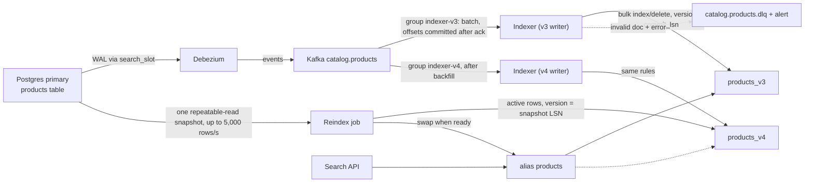

# Plan: move search to CDC

Today a cron job (`existing/indexer_cron.py`) polls `products` every 15 minutes and writes the index `products_v3` directly, not through the alias. It misses hard deletes, overlapping runs can write older data last, and changes take up to 15 minutes to show. The new design streams every committed change from Postgres through Debezium and Kafka into a new indexer service that writes `products_v3`, and the cron job is retired. To rebuild the index (new mappings, or after data loss) without downtime, a reindex job fills a new index `products_v4` from a snapshot plus Kafka, then moves the alias `products` to it.

Target: 95% of committed changes searchable within 5 s. Scale: about 40 million rows, about 300 writes/s at peak.

## Terms
- **Replication slot (`search_slot`)**: a bookmark in Postgres. It makes Postgres keep the write-ahead log (WAL) until Debezium has read it. If Debezium stops, the WAL piles up on the primary (`catalog-primary`).
- **Debezium**: the CDC (change data capture) connector. It reads the slot and writes one event per row change to topic `catalog.products` (12 partitions, keyed by product id, so one product's changes stay in commit order). Today it only feeds a test topic. Kafka keeps events 7 days.
- **Event**: `{"op": "c"|"u"|"d", "id": 123, "after": {full row} or null for d, "commit_lsn": "0/16B3748"}`. `commit_lsn` is the WAL position of the committing transaction; larger means committed later.
- **Document version**: the index applies a write only if its version is at least the stored version. Otherwise it returns a version-conflict error for that document. We use `commit_lsn` as the version.
- **Alias `products`**: the only name the search API queries. It points at one index. Moving it is atomic, so a query goes to the old index or the new one, never to neither.
- **DLQ**: topic `catalog.products.dlq`, for documents the index refuses as invalid.
- **Consumer group / offsets**: a group is a named reader of the topic. Its offsets record how far it has read, and each group keeps its own.

## Diagram

Solid lines are the normal flow. The dotted alias line is where the alias points after the swap. Progress is stored in two places: the slot (how far Debezium has read the WAL) and each consumer group's Kafka offsets (how far each indexer has written).

Rules that hold throughout:
- Versions come from `commit_lsn`.
- Only rows with status `active` may appear in search results.
- Kafka offsets are committed only after the index has acknowledged the writes they cover.

## How it runs: live sync
1. **Postgres to Debezium.** Trigger: each committed insert, update or hard delete on `products` (published by `catalog_search`). Debezium reads it from the slot. If Debezium is down, Postgres keeps the WAL. Alert at 20 GB retained. At 50 GB ops drop the slot to protect the primary; after that, a full rebuild is the only way back.
2. **Debezium to Kafka.** One event per change goes to `catalog.products`. If Kafka is down, Debezium cannot publish, stops reading the slot, and the WAL piles up as in step 1. If the indexer is down for more than 7 days, the events it missed are gone and a full rebuild is the way back. Alert on indexer lag well before that (no threshold set yet).
3. **Indexer.** Trigger: a new batch in `catalog.products`, read by group `indexer-v3`. It turns each event into one bulk action with the version set to `commit_lsn`:
   - op `d`, or `after.status` is not `active` (draft, archived): delete the document. This is how a hard delete, or an active-to-inactive change, leaves the index.
   - op `c` or `u` with status `active`: index the document (sku, title, description, price = price_cents / 100).
4. **Acknowledge.** After the index acknowledges the batch, the indexer commits the Kafka offsets for it. The 5 s target is a target, not yet measured.
5. **Failures in the indexer.**
   - Version conflict: the change is stale. Count it. It is not an error.
   - Transient index failure (timeout, 5xx, throttling): retry the same batch with backoff of 1 s, doubling each time, capped at 60 s. There is no retry limit and it never skips ahead, so that partition waits until the index recovers.
   - Index refuses a document as invalid: send it to the DLQ with the error, raise an alert and keep processing. That product stays stale until a later change for it succeeds or someone replays the DLQ message.

## How it runs: rebuild
The operator starts a rebuild by hand, for new mappings or after data loss. Steps 1 to 5 below prepare `products_v4`. The search API keeps querying the alias and never sees v4 half-built.

1. **Create v4.** Create `products_v4` with the new mappings. The alias still points at v3. If the slot was dropped, first recreate `search_slot` and restart Debezium (nothing produces events until then), and only then take the snapshot. That way every change after the snapshot reaches Kafka. Changes made while there was no slot are covered only by the snapshot.
2. **Snapshot backfill.** The reindex job opens the one repeatable-read snapshot the DBA allows, notes the snapshot's LSN and start time, and reads active rows at up to 5,000 rows/s (about 2.5 h). It writes them to v4 with the snapshot LSN as version. If this fails, drop v4 and start again.
3. **Catch-up.** After the backfill finishes, a second indexer (group `indexer-v4`, its own offsets) reads `catalog.products` and writes to v4 with the same rules as live sync. It starts at the offsets Kafka reports for 5 minutes before the snapshot start time, per partition, by timestamp. The 5 minutes is a margin for clock skew and is a choice, not a measured value. Events older than the snapshot LSN lose the version check (counted as stale); newer ones apply. Starting after the backfill avoids a delete event arriving before the document it deletes. If indexer-v4 fails or stalls, keep v4. Restart it and it resumes from its own offsets, with the same retry rules as live sync. Drop v4 and start over only if the events it still needs have aged out of Kafka's 7 days. A rebuild takes about 2.5 h of backfill, so retention does not normally limit it.
4. **Ready check.** Swap only when v4 is less than 5 s behind Kafka and its document count is within 0.5% of the active row count in Postgres.
5. **Swap.** The reindex job moves the alias to v4 in one atomic step. The search API sees v3 or v4, never neither.
6. **Keep v3 for 48 h.** The two writers are indexer-v3 (writes v3) and indexer-v4 (writes v4). They are separate processes with separate offsets on the same topic, so a stall on v4 does not hold up v3. v3 stays current, so to go back, move the alias to v3. No changes are lost. After 48 h, stop the v3 writer and delete v3.

## Open questions
- Who reads the DLQ, and how messages are replayed, is not decided.
- The 5 s latency target has not been measured.
- Whether the store keeps version information for deleted documents (so an older write cannot bring a deleted product back) is not confirmed.
- Cutover from the cron job is not decided. Cron wrote v3 documents without versions, and how the store compares a versioned write with an unversioned stored document is not confirmed. So when the cron job stops is not decided.
- What data makes the index refuse a document as invalid is not known.
- How Debezium recreates a dropped slot is not in the setup notes.
- The indexer lag alert threshold is not set.
