# Search sync: CDC indexer and zero-downtime rebuild

## Notes before the diagram

**What changes.** Debezium reads `search_slot` (publication `catalog_search`) and writes one event per row change to `catalog.products`. A new indexer service consumes that topic and writes to the search store. The cron job is retired at the first cutover (see "First cutover" below). The search API keeps reading the alias `products`. The indexer always writes to a concrete index name, such as `products_v3`, and never through the alias.

**One consumer group per index.** The indexer runs one consumer group per target index (`search-indexer-products_v3`, `search-indexer-products_v4`, ...). Each group stores its own Kafka offsets, so two indexes can be fed at the same time. A rebuild needs this, and so does the 48-hour fallback.

**Versioning.** `version = commit_lsn` as a 64-bit integer (`"0/16B3748"` becomes `(0x0 << 32) + 0x16B3748`). Every write uses the store's "new must be at least stored" rule. The rule allows equal versions, which matters because changes in the same transaction share one `commit_lsn`. Partitions keep per-id commit order, and each batch keeps only the last event per id, so the later change in a transaction still wins. A version conflict means the change is stale. It increments `stale_skipped` and counts as done.

**Search rule mapping.** `c`/`u` with `after.status = 'active'` becomes an index write. `u` to `draft`/`archived` becomes a delete, and so does `d`. Hard deletes now leave the index. A delete that returns not-found counts as success. Null-value Kafka tombstone records that Debezium emits after deletes are skipped. Any unknown op goes to the DLQ with an alert.

**Latency budget for the 5 s target, measured at p95.** Connector under 1 s, indexer batch of at most 200 ms or 500 events, one bulk round trip of a few hundred ms, and index refresh every 1 s. Peak load is about 300 writes/s, or about 25/s per partition. The metric is commit time (Debezium source timestamp) to bulk ack, plus the refresh interval.

## Diagram

```mermaid
flowchart TD

  %% ---------------- Source ----------------
  subgraph PG["Postgres catalog-primary"]
    W["App and seller writes to products<br/>about 300 writes/s at peak"]
    SLOT[("Replication slot search_slot<br/>PROGRESS: confirmed_flush_lsn<br/>WAL is retained behind it")]
    W -->|"commit, WAL record with commit_lsn"| SLOT
  end

  DBZ["Debezium connector<br/>publication catalog_search<br/>snapshot.mode = never, so no second long snapshot"]
  CONNOFF[("Kafka Connect offsets topic<br/>PROGRESS: last LSN written to Kafka")]
  TOPIC[("Topic catalog.products<br/>12 partitions keyed by id, commit order per id<br/>7-day retention")]

  SLOT -->|"logical decoding stream"| DBZ
  DBZ -->|"event: op, id, after or null, commit_lsn"| TOPIC
  DBZ -->|"after Kafka acks: save LSN, then confirm flush to slot"| CONNOFF

  WALMON{"Retained WAL for search_slot"}
  SLOT -.->|"monitored every minute"| WALMON
  WALMON -->|"at 20 GB"| WALALERT["Page: connector or Kafka brokers stalled<br/>fix the connector before 50 GB"]
  WALMON -->|"at 50 GB"| DROP["Ops drop search_slot to protect the primary<br/>changes since the drop never reach the topic"]
  DROP --> RECREATE["Recreate search_slot, restart connector streaming from now<br/>search keeps serving the current index, now with gaps"]
  RECREATE -->|"only way back"| R0

  %% ---------------- Live indexer loop ----------------
  subgraph LIVE["Indexer service: one loop per partition, per consumer group search-indexer-INDEX"]
    POLL["Poll partition<br/>TRIGGER: new events, up to 500 events or 200 ms"]
    MAP["Skip null tombstone records<br/>keep only the last event per id in the batch<br/>version = commit_lsn as int64"]
    DEC{"op and after.status"}
    IDX["Index to_doc of after<br/>with version, rule: new at least stored"]
    DEL["Delete by id<br/>with version, same rule"]
    BULK["Bulk write to the concrete index name<br/>never through the alias"]
    RES{"Per-item result"}
    STALE["Version conflict: stale<br/>increment stale_skipped, treat as done"]
    DLQ["Invalid document: produce event + error + index + partition/offset<br/>to catalog.products.dlq, raise alert, treat as done"]
    RETRY["Timeout, 5xx or throttling<br/>keep partition paused, retry only the failed items<br/>backoff 1 s, 2 s, 4 s ... capped at 60 s, no retry limit<br/>never skip ahead"]
    DONE["Every item in the batch acknowledged or resolved"]
    COMMIT["Commit Kafka offset = last batch offset + 1"]

    POLL --> MAP --> DEC
    DEC -->|"c or u, status active"| IDX
    DEC -->|"u to draft or archived, or d"| DEL
    DEC -->|"unknown op"| DLQ
    IDX --> BULK
    DEL --> BULK
    BULK --> RES
    RES -->|"ok, or not_found on delete"| DONE
    RES -->|"version conflict"| STALE --> DONE
    RES -->|"invalid document, 4xx mapping or parse error"| DLQ
    DLQ -->|"DLQ produce acked"| DONE
    DLQ -->|"DLQ produce fails"| RETRY
    RES -->|"timeout, 5xx, 429"| RETRY
    RETRY -->|"after backoff"| BULK
    DONE --> COMMIT -->|"next batch"| POLL
  end

  TOPIC -->|"events for this partition"| POLL
  GROUPOFF[("Kafka consumer group offsets<br/>PROGRESS: one group per index")]
  COMMIT -->|"written only after the index acknowledged the writes"| GROUPOFF
  SEARCH[("Search store<br/>alias products points at the live index<br/>PROGRESS per doc: version = commit_lsn<br/>refresh every 1 s makes writes searchable")]
  BULK -->|"documents and deletes"| SEARCH

  CRASH["Indexer crash or rebalance before commit"]
  CRASH -->|"resume from committed offset and replay in order<br/>versions make replayed writes stale or idempotent"| POLL

  LAGMON{"Indexer lag per group"}
  GROUPOFF -.->|"monitored"| LAGMON
  LAGMON -->|"p95 commit-to-searchable over 5 s"| SLOALERT["SLO alert"]
  LAGMON -->|"backlog older than 24 h"| AGEPAGE["Page: events expire from Kafka after 7 days"]
  LAGMON -->|"needed events already expired"| R0

  %% ---------------- Rebuild ----------------
  subgraph REBUILD["Rebuild into a new index, for example products_v4, while the alias stays on products_v3"]
    R0["TRIGGER: new mapping, index data loss,<br/>slot dropped, Kafka events expired, or first cutover"]
    R1["Create products_v4 with the new mapping<br/>refresh off, 0 replicas during backfill"]
    R2["Step 1: record the end offset of all 12 partitions"]
    R3["Step 2: record S_low = pg_current_wal_lsn"]
    R4["Step 3: BEGIN REPEATABLE READ on primary<br/>SELECT active rows, keyset pages ORDER BY id<br/>throttled to 5,000 rows/s, about 2.5 h"]
    R5["Bulk index each page into products_v4<br/>version = S_low for every row<br/>same retry and DLQ rules as the live loop"]
    RSTATE[("Rebuild state record<br/>PROGRESS: start offsets, S_low, last acked id")]
    RLOST["Snapshot connection or transaction lost"]
    R7["Backfill complete. Only now start group search-indexer-products_v4<br/>at the recorded start offsets, using the live loop above"]
    R8["Restore refresh 1 s and replicas, wait for green health"]
    GATE{"products_v4 lag under 5 s<br/>AND v4 doc count within 0.5% of active row count?"}
    WAITG["Keep catching up, recheck every minute<br/>alert if the gate has not passed after 1 h"]
    SWITCH["One atomic alias call: remove products to v3, add products to v4"]
    KEEP["48 h fallback window<br/>both consumer groups keep running, v3 still gets every change"]
    BACK["Switch back: one atomic alias call, products to v3"]
    RETIRE["Stop and delete group search-indexer-products_v3<br/>delete products_v3"]

    R0 --> R1
    R1 -->|"before any snapshot read"| R2
    R2 -->|"then"| R3
    R3 -->|"then"| R4
    R2 -->|"saved"| RSTATE
    R3 -->|"saved"| RSTATE
    R4 -->|"page of active rows"| R5
    R5 -->|"after ack: checkpoint last id"| RSTATE
    R5 -->|"next page"| R4
    R4 -.->|"failure"| RLOST
    RLOST -->|"open a new snapshot, resume after last acked id<br/>keep the same S_low and start offsets"| R4
    R5 -->|"last page acked"| R7
    R7 --> R8 --> GATE
    GATE -->|"no"| WAITG --> GATE
    GATE -->|"yes"| SWITCH --> KEEP
    KEEP -->|"problem with v4 within 48 h"| BACK
    KEEP -->|"48 h passed, no rollback"| RETIRE
  end

  R2 -.->|"reads partition end offsets"| TOPIC
  R4 -.->|"long snapshot read"| PG
  R5 -->|"documents"| SEARCH
  SWITCH -->|"alias move"| SEARCH
  BACK -->|"alias move"| SEARCH
```

## Notes after the diagram

**Why the rebuild is correct without pausing writes.**
- The start offsets are recorded before `S_low`, and `S_low` before the snapshot opens. Any change with `commit_lsn >= S_low` is therefore at or after the start offset in its partition.
- Every snapshot document carries `S_low`. When the v4 consumer replays from the start offsets, changes older than `S_low` conflict as stale against snapshot rows. Changes from `S_low` onward overwrite snapshot rows, in commit order per id. The last write for each id is the latest committed state.
- Rows deleted before the snapshot are not in it. Their replayed create or update is followed in the same partition by the delete, so they end up removed.
- The v4 stream starts only after the whole backfill is acknowledged. A stream delete therefore can never be followed by an older snapshot write that brings the product back. Running the two at the same time would depend on the store keeping delete tombstones long enough, so we don't.
- The same reasoning lets a lost snapshot resume from the last acknowledged id under a new snapshot. It keeps `S_low` and the start offsets, and it never holds more than one long snapshot open at a time.
- During catch-up, products_v4 replays about 2.5 h of changes, roughly 2.7 M events at most. It does not affect the live path.

**Search never sees a half-built index.** The alias moves only after the gate passes, in one atomic call. Until then every query goes to products_v3. After a data-loss trigger, v3 keeps serving with gaps but stays up.

**48-hour fallback.** Both consumer groups write every change to their own index. Moving the alias back to v3 therefore loses nothing. If a rebuild has to be abandoned, delete products_v4 and its consumer group. The alias was never touched.

**Failure summary.**

| Failure | Effect | Handling |
|---|---|---|
| Index timeout, 5xx or throttling | That partition stops; lag grows | Backoff from 1 s, doubling, capped at 60 s, no limit; offsets not committed; SLO alert |
| Invalid document | One product not updated (the older doc stays) | DLQ with error, alert, carry on. After the fix, redrive the DLQ through the indexer; versions stop it overwriting newer changes |
| Version conflict | None | `stale_skipped` counter |
| Indexer crash or rebalance | Replay since the last commit | Versions make replays harmless. A product can briefly reappear before its delete is replayed, if the store has already purged the delete tombstone |
| Connector or Kafka down | WAL grows on the primary | Alert at 20 GB; at 50 GB the slot is dropped, then recreate the slot and do a full rebuild |
| Indexer behind beyond 7-day retention | Events lost for that index | Page at 24 h; full rebuild |
| Snapshot lost mid-backfill | Backfill paused | Resume from the last acknowledged id in a new snapshot |

**First cutover (retiring cron).** The cron job keeps feeding products_v3 while products_v4 is backfilled. At step R7, stop cron. Then start `search-indexer-products_v3` at the same recorded start offsets, so v3 also gets hard deletes and ordered updates from then on. LSN versions are far larger than the store's internal versions on cron-written documents. Check in staging that versioned writes apply over them. Then follow the normal gate, switch and 48-hour window.

**Open questions.**
- The gate needs a current count of active rows. A plain `count(*)` scans about 40 M rows on the primary. Agree with the DBA whether to run it on a replica, add a partial index on `status = 'active'`, or run it as a short, approved query.
- Confirm that the connector puts the commit timestamp in each event (Debezium `source.ts_ms`). Without it we cannot measure the 5 s target from commit to searchable.
- Confirm the connector setting for `TRUNCATE` on `products`. A truncate cannot be expressed as c/u/d events, so it should trigger a full rebuild.
