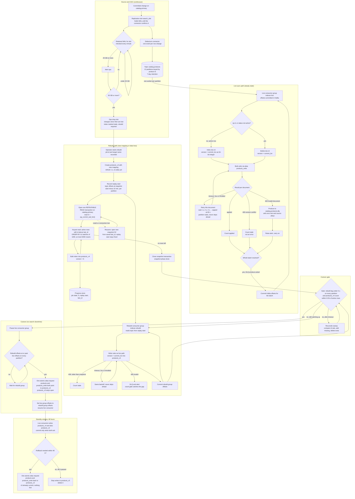

# Search sync: CDC indexer and zero-downtime rebuild

## Summary

Today a cron job copies changes from the `products` table into the search index every 15 minutes. This plan replaces it with a live indexer that reads every committed change to `products` from a Kafka topic and writes it to the index within 5 seconds. It also adds a rebuild path that builds a complete new index from a snapshot of the database while live sync keeps running, then switches the search alias to it with no search downtime. Both paths use each change's commit position as the document version, so an older write can never overwrite a newer one.

Today's cron job (`existing/indexer_cron.py`) reads rows whose `updated_at` is newer than its last run and writes them straight to index `products_v3`, bypassing the alias and sending no version. It misses hard deletes, a slow run can overlap a newer one and write older data last, and changes take up to 15 minutes to appear.

## Terms

- **Search store:** the one search cluster that holds the indexes.
- **Index:** a set of searchable documents. The live index is `products_v3`.
- **Alias:** a name that points at one index. The search API queries alias `products`. The indexer writes through alias `products_write`. Moving an alias is atomic: a query goes to the old index or the new one, never to neither.
- **Document version:** a number sent with a write. The store applies a write only if its version is at least the stored version. Otherwise it returns a 409 version conflict for that document.
- **Products table:** in the `catalog` database on Postgres 16, host `catalog-primary`. It has about 40 million rows and about 300 writes per second at peak. Rows are hard-deleted when a seller removes a product. Each row has a `status` of `draft`, `active` or `archived`. Only `active` rows may appear in search results.
- **WAL (write-ahead log):** Postgres's ordered log of committed changes. Each committed transaction has a position called its LSN, written like `0/16B3748`. A larger LSN means committed later.
- **commit_lsn:** the WAL position of the transaction that made a change.
- **Replication slot (`search_slot`):** a marker that makes Postgres keep WAL until the reader confirms it has read it. While the reader is stopped, the retained WAL grows.
- **Publication (`catalog_search`):** the list of tables whose changes are reported. Here, only `products`.
- **Debezium CDC connector:** reads the slot and writes one Kafka event per row change. CDC means change data capture.
- **Topic `catalog.products`:** a Kafka topic with 12 partitions, keyed by product id. All changes to one product land in one partition, in commit order. Kept for 7 days. The three Kafka brokers are shared with other teams.
- **Partition and offset:** a partition is one ordered lane of a topic. An offset is a reader's position in that lane.
- **Consumer group:** readers that share a topic and track offsets together. This plan uses two: `indexer-live` and `indexer-rebuild`. Each has its own offsets.
- **Repeatable-read snapshot:** one long read transaction that sees the table as it was when the transaction started.
- **DLQ (dead-letter queue):** topic `catalog.products.dlq`, where documents the index refuses as invalid are parked, with the error text.
- **Event shape:** `{"op": "c" | "u" | "d", "id": 123, "after": {...full row...} or null for d, "commit_lsn": "0/16B3748"}`. A source commit time, `ts_ms`, is added later (see Rollout).

## Diagram

## The live path, step by step

1. **A change is committed.** Trigger: a transaction on `catalog-primary` changes a row in `products`. Postgres writes it to the WAL. The slot `search_slot` keeps that WAL until the connector confirms it has read it, so Postgres holds the data.
2. **The connector writes one event.** Trigger: new WAL on the slot. Debezium writes one event per row change to `catalog.products`, keyed by product id. Snapshot events (`op r`) are treated as `c`.
3. **The live indexer reads the event.** Trigger: new events in a partition. Each partition has one worker in group `indexer-live`. Offsets are kept in Kafka.
4. **The indexer decides the action.** An `op d` event, or a row whose status is not `active`, becomes a delete of that document, with version = `commit_lsn`. Any other event becomes an index write with version = `commit_lsn`. The document is `{sku, title, description, price}`, where `price` is `price_cents / 100`. The LSN is converted to one 64-bit integer, `X * 2^32 + Y`.
5. **The indexer writes in bulk.** Trigger: 200 ms passed, or 500 documents are queued, whichever comes first. Writes go through alias `products_write`. Each document gets one result:
   - Applied: counted.
   - 409 version conflict: counted as stale. Not an error.
   - Timeout, 5xx or throttled: this document is retried after 1 s, then 2 s, 4 s and so on, capped at 60 s. The partition waits. It never skips ahead.
   - 400 invalid: the document is produced to `catalog.products.dlq` with the error text and the source offset. An alert is raised, and processing continues.
6. **The indexer commits offsets.** Trigger: every document in the batch is resolved (applied, stale, or DLQ produce acknowledged). Only then are the Kafka offsets for the batch committed. If the indexer crashes before this point, the batch is read again. Versions make that replay safe.

The latency target is 95% of committed changes searchable within 5 seconds, measured from the source commit time `ts_ms`. The index refreshes every 1 s.

**Retained WAL watch.** Every minute, the retained WAL for `search_slot` is read from `pg_replication_slots` on the primary. At 20 GB, ops are alerted. At 50 GB, ops drop the slot to protect the primary. Changes since the drop are lost, the index is marked stale, and a rebuild is the only way back.

## The rebuild path, step by step

Trigger: an operator starts a rebuild, for a new mapping or after data loss. The job id and target name are recorded in the indexer's own Postgres, not on the catalog primary.

1. **Create the target.** Create `products_v4` with the new mapping and a 1 s refresh. It has no alias yet, so the search API never sees it.
2. **Record the replay start.** Store the topic offset of each partition at (snapshot start minus 10 minutes). It is stored once and never moves forward on resume.
3. **Take the snapshot.** Open one repeatable-read transaction on `catalog-primary`. Its first statement reads `S = pg_current_wal_lsn()`, and `S` is stored.
4. **Copy active rows.** Read active rows in id order, from the saved `last_id`, in batches of 1000. Read at most 5000 rows per second. Index each batch into `products_v4` with version = `S`. Save `last_id` after each batch. Trigger for a crash or lost connection: open a new snapshot `S2` from the saved `last_id`. The replay start does not change. Timeouts and 5xx use the same backoff. An invalid document goes to the DLQ and raises an alert, and the count gate catches the gap.
5. **Finish the snapshot.** When no rows are left, close the transaction. The snapshot phase is done.
6. **Replay the topic.** Trigger: the job starts, and runs alongside step 4. Group `indexer-rebuild` reads each partition from the replay start and applies the live rules: version = `commit_lsn`, into `products_v4`. A 409 is counted as stale. Timeouts and 5xx use the same backoff. A 400 goes to the DLQ with an alert. Offsets are committed after each batch. This group has its own throttle, so it cannot starve the live path.

## The cutover, step by step

1. **Gate check.** Trigger: step 5 of the rebuild is done. The gate passes only when the rebuild lag is under 5 s on every partition, and the `products_v4` count is within 0.5% of the active row count. If the gate fails, replay continues and the gate is checked again. If it still fails after a timeout (value not yet set), a reconcile sweep compares the id sets of both indexes, adds missing documents and deletes extra ones. Then the gate is checked again.
2. **Pause live.** Pause the `indexer-live` consumer group.
3. **Wait for replay.** Wait until the rebuild group's offsets are at or past the live group's offsets on every partition.
4. **Move the aliases.** One atomic alias request points both `products` and `products_write` to `products_v4`. `products_v3` stays open.
5. **Resume live.** Set the live group's offsets to the rebuild group's offsets and resume the live consumer.

## The standby window, 48 hours

1. **Dual write.** The live consumer writes to `products_v4` and also to `products_v3`, and commits offsets only when both acknowledge.
2. **Rollback.** If a rollback is needed within 48 hours, one atomic alias request points `products` and `products_write` back to `products_v3`. `v3` is already current, so nothing is lost. After a rollback, `v4` is the standby, and a new 48-hour reverse standby window starts.
3. **Retire.** After 48 hours with no rollback, writes to `products_v3` stop and the index is deleted.

If a write to `v3` fails, the batch commit waits and an alert is raised. This keeps a rollback lossless. An invalid document on `v3` goes to the DLQ, and the gap is repaired before any rollback.

## Why it is safe

- **Versions.** Each document's version is its `commit_lsn`. Changes in one transaction share a value. Equal versions are accepted under the at-least-stored rule, so within one transaction the partition order decides the final state.
- **Deletes.** A hard delete (`op d`) and a non-active row both become a delete with version = `commit_lsn`. This needs the store to keep a version marker after a delete, so that an older write arriving later is refused. If the store drops that marker, a stale create can bring a deleted product back. This must be verified before building.
- **Snapshot consistency.** Changes committed at or before `S` are already in the snapshot. Later changes have `commit_lsn > S` and are applied. Older events are refused as stale, which is the correct result.
- **Replay is safe, a late start is not.** Replaying old events is harmless because of the version rule. The replay start is set early, at snapshot start minus 10 minutes. Starting late can lose changes.
- **Isolation.** The rebuild has its own consumer group and its own throttle, so it cannot slow the live path's 5 s target.
- **Search rule.** Only `active` rows may appear in search results. Other rows are deleted from the index.

## Rollout (how to build it, not how it runs)

1. Verify that the store keeps a version marker after a delete. Do this before building.
2. Stop the cron job (`existing/indexer_cron.py`) before the live consumer writes anything.
3. Create alias `products_write` pointing at `products_v3`. Then start the live consumer.
4. Point the Debezium connector at the catalog, so it writes to `catalog.products`. It currently feeds only a test topic.
5. Add `ts_ms` (source commit time) to the event shape.
6. Confirm how the connector emits snapshot events (`op r`).
7. Run the rebuild path as the first migration. The contents of `products_v3` are unknown because hard deletes were missed.
8. Set the index refresh to 1 s. Start batching at 200 ms or 500 documents, and tune from there.

## Open questions

- Does the store keep a version marker after a delete? (Verify before building.)
- `ts_ms` must be added to the event shape for the 5 s latency measure.
- How does the connector emit snapshot events (`op r`)?
- Can the shared Kafka brokers absorb the rebuild's replay load, or does it need a throttle?
- The 2.5 hour snapshot length must be checked against the actual active row count. At 5000 rows/s, the 40 million total rows alone would take about 2.2 hours.
- The timeout before the reconcile sweep is not set.
