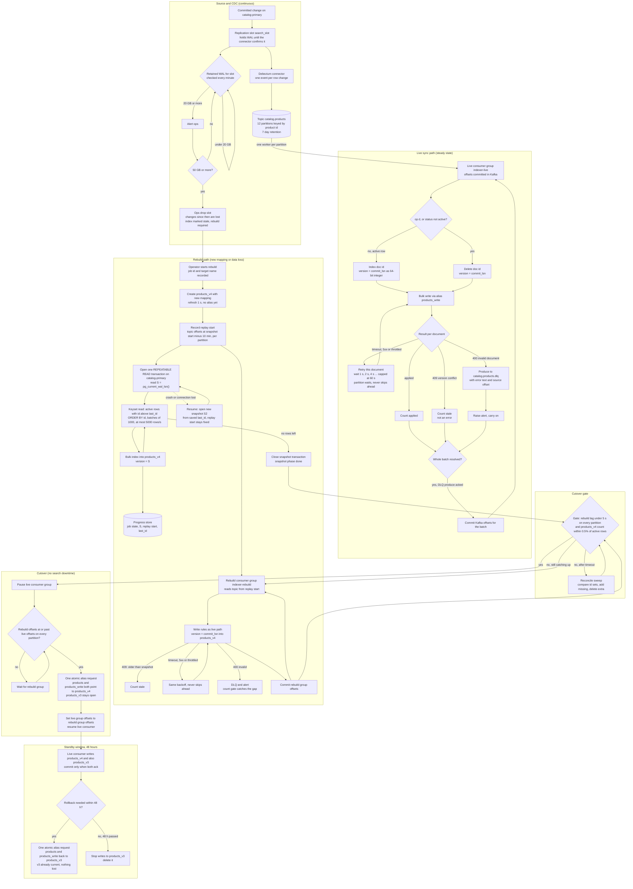

# Search sync: CDC indexer and zero-downtime rebuild

## Notes

1. **Version.** Convert `commit_lsn` from `X/Y` (hex) to one 64-bit integer: `X * 2^32 + Y`. Changes in one transaction share a value. Equal versions are accepted under the "at least stored" rule, so within a transaction, partition order decides the final state.
2. **Deletes.** A hard delete (`op d`) and a row whose status is not `active` both become a delete with `version = commit_lsn`. This assumes the store keeps a version marker after a delete, so an older write arriving later is refused. If the store drops it, a stale create can bring a deleted product back. Verify this before building.
3. **Snapshot events.** Debezium's initial snapshot emits `op r`, which is not in the event contract. Treat `r` as `c`.
4. **Latency.** The 5 s measure needs the source commit timestamp (`ts_ms` in the Debezium envelope), which the current event shape does not carry. Add it. Set the index refresh interval to 1 s. Starting point for bulk batching: flush every 200 ms or 500 docs, whichever comes first.
5. **Cron first.** `indexer_cron.py` writes without a version and can overwrite newer CDC data. Stop it before the live consumer writes anything. Create alias `products_write` pointing at `products_v3` before starting. The first migration is the rebuild path, because the contents of `products_v3` are unknown (hard deletes were missed).
6. **Snapshot consistency.** Read `S = pg_current_wal_lsn()` as the first statement in the repeatable-read transaction and write snapshot docs with `version = S`. Changes committed at or before `S` are already in the snapshot. Later changes have `commit_lsn > S` and are applied. Older events are refused as stale, which is the correct result.
7. **Replay is safe, late start is not.** Replaying old events is harmless because of the version rule. The replay start is therefore set early (snapshot start minus 10 minutes). Starting late can lose changes. The replay start is fixed once recorded and never moves forward on resume.
8. **Progress stores.** Live and rebuild consumer offsets live in Kafka, one group each. Rebuild state (S, replay start, `last_id`) lives in the indexer's own Postgres, not on the catalog primary. Failed invalid documents go to `catalog.products.dlq`. The alias state lives in the search store. WAL retention is read only from `pg_replication_slots` on the primary.
9. **Isolation.** The rebuild uses its own consumer group and its own throttle, so it cannot starve the live path's 5 s target.

## Diagram

## Failure behaviour

- **Index timeout, 5xx or throttling:** retry with backoff (1 s, doubling, capped at 60 s). The partition waits and its offsets are not committed. Nothing is skipped.
- **Invalid document (400):** sent to `catalog.products.dlq` with the error, alert raised, processing continues. The DLQ produce must be acked before the offset commit.
- **Version conflict (409):** counted as stale. Not an error, and the offset is committed.
- **Indexer crash:** restart from committed offsets. Replays are safe because of versions.
- **Connector stopped:** WAL accumulates on the slot. The live index lags but loses nothing while retained WAL is under 50 GB. Alert at 20 GB.
- **Slot dropped at 50 GB:** changes since the drop are lost. The live path cannot recover alone. Mark the index stale and run the rebuild path.
- **Rebuild job crash:** resume from `last_id` with a new snapshot S2. Rows at or below `last_id` stay correct through replay, because the replay start is fixed earlier than S1.
- **Gate not met:** no switch. Run the reconcile sweep, then re-check the gate.
- **Standby write to v3 fails:** the commit of the batch waits, which keeps rollback lossless. Alert. An invalid document on v3 goes to the DLQ and the gap is repaired before any rollback.
- **Rollback:** an alias flip. After a rollback, v4 is the standby, so a new 48 h reverse standby window starts.

## Open questions

- Confirm the store keeps a tombstone version after a delete (note 2).
- Add `ts_ms` to the event contract for the latency measure (note 4).
- Confirm how the connector's snapshot events are emitted (`op r`).
- Confirm the shared Kafka brokers can absorb the replay load of the rebuild group, or set a throttle.
- Confirm the 2.5 h snapshot length against the actual active row count.
