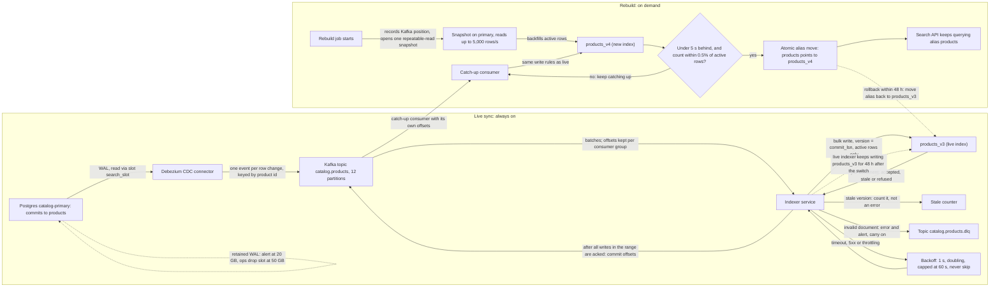

## Plan: move search to CDC

Product search is fed today by a cron job that polls `products` every 15 minutes. That job misses hard deletes, can let an overlapping run write older data last, and makes changes take up to 15 minutes to appear. The plan replaces it with a stream: Postgres writes every committed change to a Kafka topic through Debezium, and a new indexer service writes each change into the search index. A rebuild path loads a fresh index from a database snapshot plus the same stream, and the search API moves to it only when it is caught up, so search never goes down.

The catalog has about 40 million rows and about 300 writes per second at peak.

### Terms

- **CDC (change data capture)**: reads the database's commit log and turns each committed row change into an event.
- **Debezium**: the CDC connector. It is already installed, but today it feeds only a test topic.
- **Replication slot** (`search_slot`): Postgres's bookmark for one reader. Postgres keeps the write-ahead log (WAL) until that reader has read it, so a stopped reader makes WAL pile up on the primary.
- **Topic `catalog.products`**: a Kafka stream with 12 partitions, keyed by product id. All changes to one product land in one partition, in commit order. Kafka is shared with other teams and keeps messages for 7 days.
- **Consumer offset**: how far a consumer group has read in each partition. Kafka stores it for the group.
- **commit_lsn**: the WAL position of the transaction that committed a change. A larger number means it committed later. It is the document version.
- **Version rule**: the store applies a write only if its version is at least the stored version. An older write gets a version-conflict error for that document.
- **Alias `products`**: the only name the search API queries. It points at one index. Moving it is atomic: a query goes to the old index or the new one, never to neither.
- **DLQ**: the dead-letter topic `catalog.products.dlq`. Documents the index refuses as invalid go there, with the error.
- **Repeatable-read snapshot**: one long read transaction on the primary that sees the data as it was at one moment.

### Diagram

### Live sync, step by step

1. **Trigger: a commit to `products`.** Debezium reads the WAL through `search_slot` and writes one event to `catalog.products`. Each event has `op` (`c` create, `u` update, `d` delete), `id`, `after` (the full row, or null for a delete) and `commit_lsn`.
2. **The indexer reads batches from the topic.** An active row becomes a document with `sku`, `title`, `description` and `price` (`price_cents` divided by 100), at version `commit_lsn`. A draft or archived row, or a delete, removes the document. Only active rows may appear in search.
3. **The indexer bulk-writes to the live index**, `products_v3` today. The index answers for each document: accepted, a version conflict (stale, counted, not an error), or refused as invalid (sent to the DLQ).
4. **Progress is stored as Kafka offsets for the indexer's consumer group.** The indexer commits an offset only after the index has acknowledged every write up to it. A crash therefore re-reads the uncommitted events. Re-applying an event is safe, because the version rule keeps the newest version.

### Rebuild, step by step

The rebuild creates a new index, `products_v4` in this plan, and never touches the alias until the new index is ready.

5. **Trigger: a new mapping, or data loss.** The job records the Kafka position and opens one repeatable-read snapshot on the primary. It reads active rows at up to 5,000 rows per second into `products_v4`. For about 2.5 hours of active rows, the snapshot stays open that long.
6. **While the backfill runs, a catch-up consumer reads `catalog.products`** and writes into `products_v4` with the same rules as the live path. It keeps its own offsets, so a failure in either consumer does not move the other. The live indexer keeps writing `products_v3`.
7. **The gate.** The alias moves only when `products_v4` is less than 5 s behind and its document count is within 0.5% of the active row count. Until then, the catch-up keeps running.
8. **The switch.** One atomic alias move points `products` at `products_v4`. The search API never sees a half-built index.
9. **After the switch.** `products_v3` is kept for 48 hours. The live indexer keeps writing to it during those hours, so moving the alias back loses no change made after the switch.

### What happens when things fail

| What fails | What happens | Recovery |
|---|---|---|
| Connector stopped, or slot not read | Postgres keeps WAL for `search_slot`. Alert at 20 GB retained. At 50 GB, ops drop the slot to protect the primary. | After the slot is dropped, only a full rebuild restores search. |
| Transient index error (timeout, 5xx, throttling) | Retry the same batch: wait 1 s, double each time, cap at 60 s. The offset is not committed. | Retries until accepted. The indexer never skips ahead. |
| Index refuses a document as invalid | Write it to `catalog.products.dlq` with the error. Raise an alert. Carry on. | The DLQ holds the document for a person to fix. |
| Version conflict | Count it as stale. It is not an error. Carry on. | None needed. The newer version is already in the index. |
| Indexer crashes | It restarts from the last committed offset. | Events read again are safe under the version rule. |
| Catch-up falls behind | The gate stays closed while the lag is 5 s or more. | If the catch-up falls more than 7 days behind, its events are gone from Kafka, and the rebuild must start again. |
| Document count outside 0.5% | The gate stays closed. | Keep catching up until the count matches, or rebuild again. |
| Problem after the switch | Move the alias back to `products_v3`. | Possible for 48 hours. `products_v3` has every change made since the switch. |

### Build and rollout

These steps build the system. They are not part of how it runs.

- Point the Debezium connector at the catalog, so it reads `search_slot` and writes `catalog.products`. Today it feeds only a test topic.
- Start the new indexer service on `catalog.products`.
- Retire the cron job, `existing/indexer_cron.py`. It writes `products_v3` directly and is replaced by the indexer.

### Open questions

- The snapshot rows have no `commit_lsn`. The plan does not say which version they carry. The snapshot's LSN is one option; it is not decided.
- The plan does not say where the catch-up starts. It must start at or before the snapshot's point so no change is missed. The 7-day topic retention limits how far back it can go.
- If the backfill fails after 2.5 hours, the plan does not say whether it resumes or restarts. A repeatable-read snapshot ends with its connection.
- The brief does not say whether the offset moves past an invalid document before or after the DLQ write is acknowledged. This draft assumes after.
- How the live indexer writes to both indexes after the switch is not decided, and no step removes `products_v3` after 48 hours.
- The brief does not say how the 5 s lag is measured.