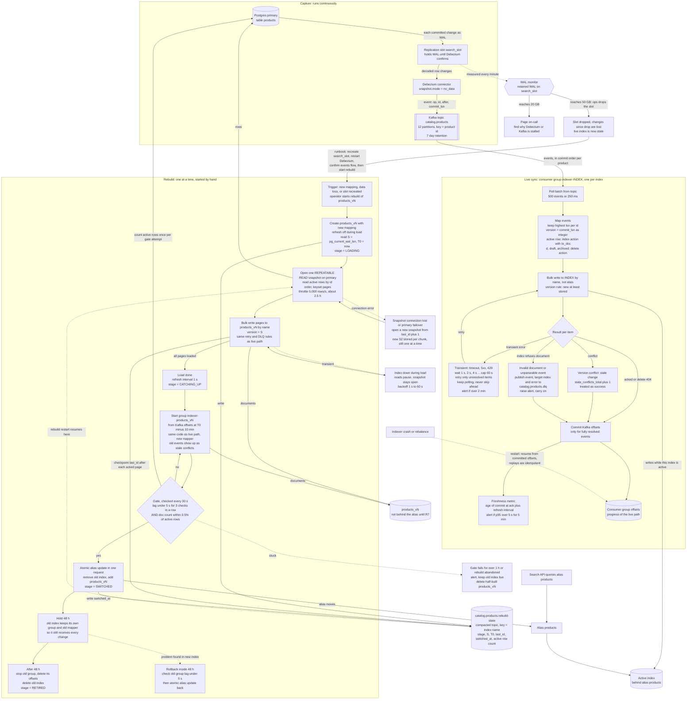

# Search sync: change data capture plan

## Summary

Today a cron job (`existing/indexer_cron.py`) polls the `products` table every 15 minutes for rows with a newer `updated_at` and writes them straight into the search index `products_v3`. It misses hard deletes, overlapping runs can write older data last, and changes take up to 15 minutes to appear.

This plan retires the cron job. A new indexer service reads every committed change to `products` from the Kafka topic `catalog.products` (fed by Debezium from the Postgres write-ahead log) and writes it to the index, using the change's `commit_lsn` as the document version so an older change can never overwrite a newer one. The same code also rebuilds the index from scratch: load a snapshot into a new index, replay Kafka on top, pass a gate, then move the alias `products` atomically, so search is never down and never sees a half-built index.

Target: 95% of committed changes are searchable within 5 seconds.

## Terms

- **WAL (write-ahead log):** Postgres's ordered log of every committed change.
- **Replication slot (`search_slot`):** a bookmark in the WAL. Postgres keeps all WAL after the bookmark until the reader confirms it, so a stopped reader makes WAL pile up on the primary.
- **Debezium:** the CDC (change data capture) connector. It reads `search_slot` and writes one event per row change to `catalog.products`. It is installed today but only feeds a test topic.
- **Event:** `{"op": "c"|"u"|"d", "id": 123, "after": {full row} or null for d, "commit_lsn": "0/16B3748"}`. `op` is create, update or delete.
- **`commit_lsn`:** the WAL position of the committing transaction. Larger means committed later. It is the document version (see step 2).
- **Topic `catalog.products`:** 12 partitions, keyed by product id, so all changes to one product are in one partition, in commit order. Retention is 7 days. The Kafka cluster has 3 brokers shared with other teams.
- **Consumer group and offsets:** a group is a set of consumers that share a topic. Its offsets record how far it has read. Committing an offset means "everything before this is done".
- **Alias `products`:** a name that points at one index. The search API only ever queries the alias. Moving an alias is atomic: a query goes to the old index or the new one, never to neither.
- **Versioned write:** the store applies a write only if its version is at least the stored version. Otherwise it returns a version-conflict error for that document. We call that change stale.
- **DLQ (`catalog.products.dlq`):** a Kafka topic that holds events we cannot index, so processing can carry on.
- **Refresh interval:** how often the index makes new writes visible to queries. We set it to 1 s.
- **Repeatable-read snapshot:** one long Postgres transaction that sees the table as it was when it opened. The DBA allows one, read at up to 5,000 rows/s. About 40 million rows exist in total and about 300 writes/s at peak. The active rows take about 2.5 hours to read.
- **Resurrection:** an old row written over a newer delete, so a removed product reappears.
- **Search rule (from the schema):** only rows with `status = 'active'` may appear in search results. Rows are hard-deleted when a seller removes a product.

## Diagram

## How it runs

### Live path (one consumer group per index)

Each index has its own group, named `indexer-<index name>`. It writes to its index by explicit name, never through the alias, and is bound to the document mapper (`to_doc` version) of that index. Groups have separate offsets, so the live index and a shadow index never interfere, and an old index keeps its old mapping during the 48-hour hold.

1. **Trigger: events arrive.** The indexer polls a batch of up to 500 events, or whatever has arrived after 250 ms. Kafka records with a null value (Debezium tombstones) are ignored. An event that cannot be parsed goes to the DLQ (step 5).
2. **Map to actions.** Keep only the highest-`commit_lsn` event per product id in the batch.
   - `op = d`, or `c`/`u` with `after.status` of `draft` or `archived`, becomes a delete action. This enforces the search rule.
   - An active row becomes an index action with `to_doc(after)`.
   - The version is `commit_lsn` converted to a 64-bit integer: `(high << 32) | low`, so `0/16B3748` is `0x16B3748`. It is sent on index and delete actions alike.
3. **Bulk write.** Send the actions to the index. Each item resolves as one of:
   - Acknowledged, or a delete of a missing document (404): success.
   - Version conflict: the change is stale. Add 1 to `stale_conflicts_total` and treat it as success. An equal version is accepted, which also covers two changes to one row in one transaction, since both share a `commit_lsn`.
   - Transient failure (timeout, 5xx, 429): go to step 4.
   - The index refuses the document as invalid: go to step 5.
4. **Retry transient failures.** Wait 1 s, then 2 s, 4 s and so on, capped at 60 s, with no retry limit. Retry only the unresolved items. Never move to the next batch until the current one is resolved. While retrying, the consumer pauses its partitions but keeps calling `poll()`, so Kafka does not rebalance the group. Alert if the retry state lasts more than 2 minutes.
5. **Invalid documents.** Publish the event, the target index and the error to `catalog.products.dlq`, raise an alert and carry on. A failed DLQ publish is treated as transient and retried. The DLQ is the only allowed way to skip an event.
6. **Commit offsets** only after every item in the batch is resolved (acknowledged, stale, or sent to the DLQ). After a crash or rebalance the group resumes from its committed offsets and replays. That is harmless because writes are idempotent.
7. **Freshness.** The metric is the age of the source commit at acknowledgement, plus the refresh interval. Budget for 95% within 5 s:

   | Stage | Budget |
   |---|---|
   | Debezium poll | 1 s |
   | Kafka | 0.5 s |
   | Batch linger | 0.25 s |
   | Bulk write | 1 s |
   | Index refresh interval | 1 s |
   | **Total** | **about 3.75 s** |

   Alert if p95 is over 5 s for 5 minutes.

### Slot health

Measure the WAL retained by `search_slot` every minute. At 20 GB, page on-call to find why Debezium or Kafka is stalled. At 50 GB, ops will drop the slot to protect the primary, and changes since the drop are lost. The only way back is a full rebuild: recreate `search_slot`, restart Debezium, confirm events flow, and only then start the rebuild, because the snapshot must begin after the new slot is streaming.

### Rebuild (one at a time, started by hand)

Triggers: a new mapping, data loss, or a recreated slot. The new index is `products_vN`.

1. **Create and record.** Create `products_vN` with the new mapping and refresh turned off for speed. Read `S = pg_current_wal_lsn()` and `T0 = now` just before the snapshot opens. Write stage `LOADING` to the progress topic.
2. **Load the snapshot first.** Open one repeatable-read snapshot, read active rows in id order in keyset pages (each page starts after the last id of the previous one), throttled to 5,000 rows/s. Write each page to `products_vN` by name with `version = S`, using the same retry and DLQ rules as the live path. After each acknowledged page, checkpoint `last_id`.
3. **Replay the stream second.** When the load ends, set the refresh interval to 1 s and stage `CATCHING_UP`. Start group `indexer-products_vN` from the Kafka offsets at `T0 - 10 min` (the 10 minutes cover timestamp skew), using the same code as the live path with the new mapper. At 300 writes/s peak, a 2.5-hour load leaves about 2.7 million events, which should catch up in minutes.
   - Why this order: if the stream were applied during the load, a delete arriving before the loader reaches that row would be undone when the loader writes the old row (a resurrection). Applying events only after the load means each product's events arrive in commit order, so the end state is correct.
   - Replaying events the snapshot already reflects is harmless: their version is at most `S`, so they count as stale, or they are applied in order and overwritten by later events.
4. **Gate.** Check every 30 s. Switch only when lag is under 5 s for 3 checks in a row and the document count is within 0.5% of the active row count (about 200k documents). The count is taken from the primary once per attempt. It guards against gross errors such as a loader bug or many DLQ items.
5. **Switch.** One alias request removes the old index and adds `products_vN`. Write stage `SWITCHED` and `switched_at`.
6. **Hold for 48 hours.** The old index keeps its own group and old mapper, so it still receives every change and a switch back loses nothing. To roll back, check that the old group's lag is under 5 s, then move the alias back in one request.
7. **Retire.** After 48 hours, stop the old group, delete its offsets, delete the old index and write stage `RETIRED`.

### Where progress is kept

- Live path: Kafka consumer-group offsets.
- Rebuild: the compacted topic `catalog.products.rebuild-state`, keyed by index name. It holds `stage`, `S`, `T0`, `last_id`, `switched_at` and the active row count. A restarted rebuild resumes from it.
- Which index is live: the alias itself.

## What happens when things fail

| Failure | What happens | Data lost |
|---|---|---|
| Index timeout, 5xx or 429 | Backoff 1 s to 60 s, unresolved items retried, offsets not committed, no skipping. Alert if it lasts over 2 min. | None |
| Index refuses a document | Event and error go to `catalog.products.dlq`, alert, processing continues. That product stays stale until the DLQ item is fixed and replayed by hand. | One change per DLQ item |
| Version conflict | Counted in `stale_conflicts_total`, treated as success. | None |
| Indexer crash or rebalance | Resumes from committed offsets and replays. Idempotent. | None |
| Debezium or Kafka down | The slot retains WAL. Alert at 20 GB. | None, until 50 GB |
| Slot dropped at 50 GB | The live index is stale from the drop onward. Recreate the slot, confirm events flow, start a rebuild. | Changes during the gap, recovered by the rebuild snapshot |
| Snapshot connection lost or primary failover | Open a new snapshot from `last_id + 1`. A new `S2` is stored for the chunk, still one snapshot at a time. | None |
| Index down during load | Reads pause with the snapshot open, backoff 1 s to 60 s. | None |
| Gate not met | The old index stays live and nothing switches. If the gate fails for over 1 hour or the rebuild is abandoned, alert, keep the old index live and delete the half-built `products_vN`. | None |
| Problem after switch | Atomic alias swap back within 48 hours. | None |
| Kafka retention | Replay needs events from `T0 - 10 min`, well inside 7 days. A shadow group stopped for over 7 days loses its place, so monitor the 48-hour hold. | n/a |

## Rolling it out

The first rebuild goes into `products_v4`. After that switch, retire the cron job and keep `products_v3` for 48 hours.

`products_v3` is unversioned and holds ghost documents, because hard deletes never reached it. That makes it a rollback target that is not clean. The store must be confirmed to accept versioned writes onto unversioned stored documents. If that is not confirmed, the first switch has no rollback.

## Open questions

1. **TOAST.** Debezium may emit a placeholder for unchanged large `description` values unless the table has `REPLICA IDENTITY FULL`. Set it on `products`, or the indexer would write a wrong description. The brief says `after` is the full row, so verify this in staging.
2. **New Kafka objects.** `catalog.products.dlq` and `catalog.products.rebuild-state` must be created on the shared brokers, with ACLs.
3. **Active row count for the gate.** An exact `count(*) WHERE status = 'active'` scans the primary and falls outside the 5,000 rows/s read allowance. It needs DBA sign-off.
4. **Snapshot side effect.** A 2.5-hour transaction holds back vacuum cleanup on the primary. The DBA should accept this along with the read budget.
5. **Refresh interval.** The 5-second target assumes the index refreshes every 1 s. Set it on the index.
6. **Versioned deletes.** The plan assumes the store applies the version rule to deletes too. If it does not, ordered per-partition processing and ordered replay still converge, because no stale write can arrive after a delete within one group.
