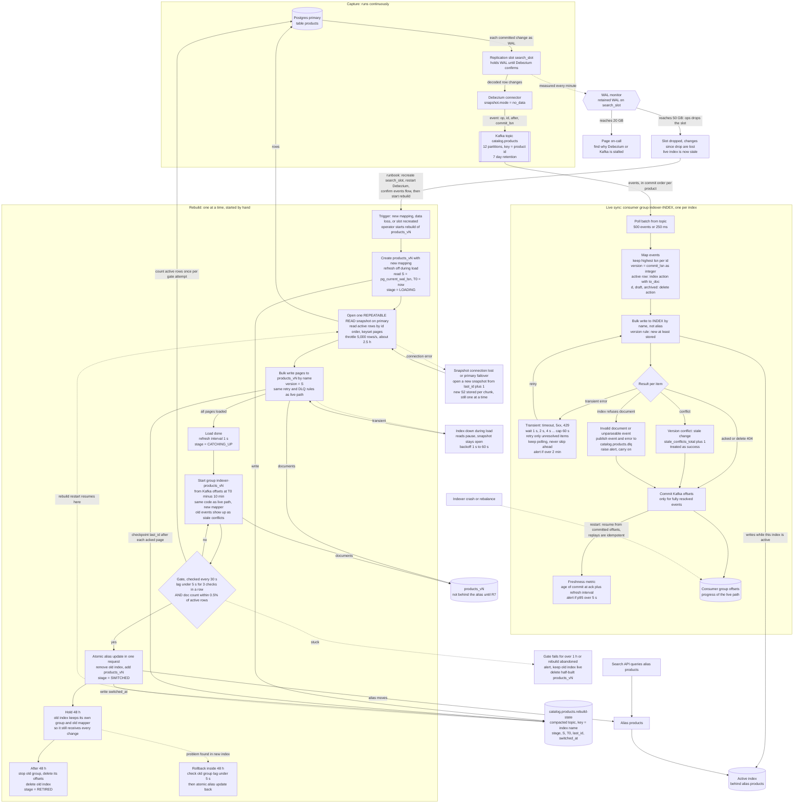

# Search sync: change data capture plan

## Summary

- **Live path.** Postgres WAL goes through slot `search_slot` and Debezium into `catalog.products`. A new indexer service consumes that topic and writes to the search index. Each write carries `version = commit_lsn`. The cron job is retired.
- **Rebuild path.** Build a new index `products_vN` next to the live one:
  1. Bulk-load a snapshot.
  2. Replay Kafka from just before the snapshot.
  3. Pass a gate.
  4. Move the alias `products` atomically.
  5. Keep feeding the old index for 48 hours so a switch back loses nothing.
- **One consumer group per index.** The group is named `indexer-<index name>` and writes to its index by explicit name, never through the alias. Each group is bound to the document mapper version of its index, so an old index keeps its old mapping during the 48-hour hold. Each group has its own offsets, so the live index and the shadow index never interfere.

## Decisions that matter

1. **Offsets are committed only after every item in the batch is resolved.** Resolved means acknowledged, a stale version conflict, or published to the DLQ. Replays after a crash are harmless because writes are idempotent. An equal version is accepted, which also covers two changes to one row in one transaction, since both share a `commit_lsn`.
2. **Version.** `commit_lsn` such as `0/16B3748` is converted to a 64-bit integer: `(high << 32) | low`. It is sent as the document version on both index and delete actions. A version conflict increments `stale_conflicts_total` and counts as success.
3. **Search rule.** Only `status = active` rows may be searchable.
   - `op = d` becomes a delete.
   - `op = c` or `u` with `after.status` of `draft` or `archived` becomes a delete.
   - Only active rows are indexed.
   - A delete of a missing document (404) counts as success.
4. **Batching.** Within one batch, keep only the highest-`commit_lsn` event per product id. The batch is flushed at 500 events or after 250 ms. Kafka records with a null value (Debezium tombstones) are ignored.
5. **Retry.** Timeouts, 5xx and 429 are retried with waits of 1, 2, 4, ... capped at 60 s, with no retry limit. Only the unresolved items are retried, and the consumer never moves to the next batch until the current one is resolved. While retrying, the consumer pauses its partitions but keeps calling `poll()`, so it does not trigger a Kafka rebalance. An alert fires if the retry state lasts more than 2 minutes.
6. **Invalid documents.** The index refuses the document, or the event cannot be parsed. Publish the event, the target index and the error to `catalog.products.dlq`, raise an alert and carry on. A failure to publish to the DLQ is itself treated as transient and retried. The DLQ is the only allowed way to skip an event.
7. **The rebuild snapshot is loaded first, and the stream is replayed second.**
   - If the stream were applied during the load, a delete that arrives before the loader reaches that row would be undone when the loader writes the old row. That is a resurrection.
   - By applying events only after the load, replayed events for each product arrive in commit order, so the end state is correct.
   - Replaying events that the snapshot already reflects is harmless. Their version is lower than or equal to the snapshot version, so they are counted as stale. Or they are applied in order and overwritten by later events.
8. **Snapshot version and replay start.**
   - Snapshot documents carry `version = S`, where `S = pg_current_wal_lsn()` is read just before the snapshot opens.
   - Kafka replay starts at timestamp `T0 - 10 min`. `T0` is the time when `S` was read, and the 10 minutes cover timestamp skew.
   - At 300 writes/s peak, a 2.5-hour load leaves about 2.7 million events to replay. That should catch up in minutes.
9. **Freshness budget for 5 s at p95.**

   | Stage | Budget |
   |---|---|
   | Debezium poll | 1 s |
   | Kafka | 0.5 s |
   | Batch linger | 0.25 s |
   | Bulk write | 1 s |
   | Index refresh interval | 1 s |
   | **Total** | **about 3.75 s** |

   The metric is the age of the source commit at acknowledgement, plus the refresh interval. The alert fires if p95 is over 5 s for 5 minutes.
10. **Where progress is kept.**
    - **Live path:** Kafka consumer-group offsets.
    - **Rebuild:** a new compacted topic `catalog.products.rebuild-state`, keyed by index name. It holds `stage`, `S`, `T0`, `last_id`, `switched_at` and the active row count. A restarted rebuild resumes from it.
    - **Alias:** the alias itself is the record of which index is live.

## Diagram

## Failure handling

| Failure | What happens | Data lost |
|---|---|---|
| Index timeout, 5xx or 429 | Backoff from 1 s to 60 s, unresolved items retried, offsets not committed, no skipping. Lag alert if it lasts. | None |
| Index refuses a document | Event and error go to `catalog.products.dlq`, alert, processing continues. That product is stale until the DLQ item is fixed and replayed by hand. | One change per DLQ item |
| Version conflict | Counted in `stale_conflicts_total`. Treated as success. | None |
| Indexer crash or rebalance | Resumes from committed offsets and replays. Idempotent. | None |
| Debezium or Kafka down | The slot retains WAL. Alert at 20 GB. | None, until 50 GB |
| Slot dropped at 50 GB | The live index is stale from the drop onward. Recreate the slot, confirm events flow, start a rebuild. The snapshot must begin after the new slot is streaming. | Changes during the gap, recovered by the rebuild snapshot |
| Snapshot read breaks | New snapshot from `last_id + 1`, checkpoint resumes. | None |
| Gate not met | Old index stays live and nothing switches. | None |
| Problem after switch | Atomic alias swap back within 48 hours. | None |
| Kafka retention | Rebuild replay needs events from `T0 - 10 min`, well inside 7 days. A shadow group stopped over 7 days loses its place, so keep the 48-hour hold monitored. | n/a |

## Assumptions and open items

1. **TOAST.** Debezium may emit a placeholder for unchanged large `description` values unless the table has `REPLICA IDENTITY FULL`. Set it on `products`, or the indexer would write a wrong description. The brief says `after` is the full row, so this must be verified in staging.
2. **New Kafka objects.** `catalog.products.dlq` and `catalog.products.rebuild-state` must be created on the shared brokers, with ACLs.
3. **Active row count for the gate.** An exact `count(*) WHERE status = 'active'` is a scan of the primary and falls outside the 5,000 rows/s read allowance. It needs DBA sign-off. The check is a guard against gross errors such as a loader bug or many DLQ items. The 0.5% tolerance is about 200k documents.
4. **Snapshot side effect.** A 2.5-hour transaction holds back vacuum cleanup on the primary. The DBA should accept this along with the read budget.
5. **Refresh interval.** The 5-second target assumes the index refreshes every 1 s. That must be set on the index.
6. **First migration.** `products_v3` is unversioned and contains ghost documents, because hard deletes never reached it.
   - The first rebuild goes into `products_v4`. After that switch, retire cron and keep `products_v3` for 48 hours.
   - That makes `products_v3` a rollback target that is not clean.
   - It has to be confirmed that the store accepts versioned writes onto unversioned stored documents.
   - If that is not confirmed, the first switch has no rollback.
7. **Versioned deletes.** The plan assumes the store applies the version rule to deletes too. If it does not, ordered per-partition processing and ordered replay still converge, because no stale write can arrive after a delete within one group.
