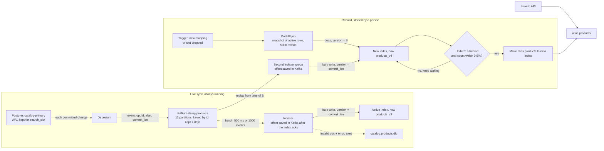

## Plan: move search to CDC

Today a cron job polls `products` every 15 minutes and writes straight into the index `products_v3`. It misses hard deletes, overlapping runs can write older data last, and changes take up to 15 minutes to show up. In the new design, Debezium reads every committed change from the Postgres WAL and puts it on the Kafka topic `catalog.products`. A new indexer service consumes the topic and writes each change into the index with `commit_lsn` as the version, so older data can never overwrite newer data. A rebuild fills a new index from a database snapshot, replays the topic on top of it, and then moves the alias `products` to it in one atomic step, so search never goes down.

**Terms**
- **WAL**: Postgres's log of committed changes. The replication slot `search_slot` makes Postgres keep the WAL until Debezium has read it.
- **CDC (change data capture)**: reading changes from the WAL instead of polling the table. Debezium is the connector that does it here.
- **commit_lsn**: the WAL position of the committing transaction. A larger value means a later commit. It is the document version.
- **Version rule**: the index applies a write only if its version is at least the stored version. Otherwise it returns a version conflict for that document.
- **Alias**: the name `products` that the search API queries. It points at one index, and moving it is atomic.
- **Consumer group and offset**: a group of consumers that share one position in a topic. The position (offset) is stored in Kafka. The indexer runs one group per index, named after the index, so each index has its own position.
- **Snapshot**: one long repeatable-read transaction on the primary. It gives a consistent view of the table.
- **DLQ**: the Kafka topic `catalog.products.dlq`, for documents the index refuses.

**How the live path works**

1. **Capture.** Trigger: a transaction commits on `products`. Debezium reads it from the WAL through `search_slot` and writes one event to `catalog.products`. The topic is keyed by product id, so all changes to one product are in one partition, in commit order. Postgres holds the WAL until Debezium confirms it. If Debezium or Kafka is down, the WAL grows on the primary.
2. **Turn events into writes.** Trigger: the indexer reads a batch from the topic. It flushes every 500 ms or 1,000 events, whichever comes first, so the 5-second target is reachable. Only `active` products may appear in search, so:
   - `c` or `u` with `after.status = active`: write the document `to_doc(after)` under id `id`.
   - `d`, or `u` where the new status is `draft` or `archived`: delete id `id`.
   - Every write and delete carries `commit_lsn` as its version. A delete of a document that is not there counts as success.
3. **Write and acknowledge.** The indexer bulk-writes to its own concrete index, never through the alias. Only after the index acknowledges the writes does it save the Kafka offsets that cover them. If the indexer crashes before that, it re-reads the batch. The version rule makes the repeat harmless.
4. **Handle failures per document.**
   - Version conflict: the change is stale. Count it in a metric. It is not an error.
   - Transient failure (timeout, 5xx, throttling): retry just those documents, waiting 1 s, then 2 s, then doubling up to a cap of 60 s. Never save offsets past an unacknowledged document. If it is still failing, the consumer waits and the lag alert fires.
   - Invalid document: the index refuses it. Publish it with the error to `catalog.products.dlq`, raise an alert, and carry on. The DLQ write must succeed before offsets move past it.

**How the rebuild works** (for a new mapping, or after data loss)

1. **Start.** A person starts it. The job creates `products_v4` with the new mapping and records `S`, the current WAL position (`pg_current_wal_lsn()`) and its time. It then opens the snapshot, so the snapshot is at least as new as `S`.
2. **Backfill.** The job reads active rows from the snapshot at up to 5,000 rows/s, about 2.5 hours, and bulk-writes them to `products_v4` with version `S`. The DBA allows only this one snapshot. If the snapshot or the job dies, delete `products_v4` and start again, because a snapshot cannot be resumed. Progress is not saved.
3. **Replay.** When the backfill finishes, a second indexer group, `products_v4`, starts reading `catalog.products` from the offsets at the time of `S`, minus one minute for clock skew. It writes to `products_v4` exactly as in the live path. Events with a version below `S` are conflicts and are skipped. Later events are applied in order. Replay waits until the backfill is done, so a delete can never be undone by a late snapshot write. Replay starts from the time of `S` because every change committed after `S` appears in Kafka after that time.
4. **Check the gate.** Every minute, the job checks both conditions. If they hold, it moves on to step 5. If they do not, it keeps waiting. If they have not held one hour after replay caught up, it alerts a person and does not switch.
   - The index is less than 5 s behind: the oldest event it has not yet applied is under 5 s old, or there is none.
   - The document count of `products_v4` is within 0.5% of `SELECT count(*) ... WHERE status = 'active'`.
5. **Switch.** Move the alias `products` from `products_v3` to `products_v4` in one atomic step. The search API then sees only the new index. A query never sees a half-built index, because the alias does not point at it until the gate holds.
6. **Keep the old index for 48 hours.** The old index's indexer group keeps running, so `products_v3` stays current. To switch back, move the alias to `products_v3` and no change is lost. After 48 hours, stop that group and delete `products_v3`. Do not start another rebuild while an old index is still being kept.

**Failures, and what happens**

| What fails | What happens |
|---|---|
| Debezium or Kafka is down | Postgres keeps the WAL. Alert at 20 GB retained. At 50 GB ops drops the slot to protect the primary. |
| Slot dropped | Changes made after the drop are missing from the index. Recover with a full rebuild: first recreate the slot and restart Debezium without an initial snapshot, then start the rebuild. Taking `S` after the slot exists means no change falls in the gap. |
| Indexer is down | Events wait in Kafka for 7 days. Alert on lag. If it is down longer, the events expire and only a rebuild fixes it. |
| Index is slow or throttling | Retry with backoff as in live step 4. No skipping ahead. |
| Index refuses a document | DLQ, alert, carry on. |
| Version conflict | Count it and continue. |
| Backfill dies | Delete the new index and restart. The live index is untouched. |
| Gate never holds | No switch, alert. Search keeps using the old index. |

**Rollout (first cutover only)**

1. Point Debezium at the catalog so it starts reading `search_slot`.
2. Deploy the indexer.
3. Run one rebuild as above. The cron keeps writing `products_v3` meanwhile, so search is no worse than today.
4. Switch the alias to the new index.
5. Keep the cron running for 48 hours as the fallback for `products_v3`. The indexer never writes `products_v3` in this first cutover, and the cron writes without versions. Rolling back to `products_v3` then loses at most 15 minutes of changes, plus the hard deletes the cron already misses. Remove the cron after 48 hours.

**Open questions**
- Does the store keep a deleted document's version for a while? If it does not, a stale write for a deleted product could bring it back. Per-product ordering in Kafka should prevent this. It needs confirming.
- The store's refresh interval is not known. It must be about 1 s or less for the 5-second target to hold.
- Debezium may leave out large unchanged columns, such as `description`, from `after` on updates, even though the setup says the full row. This needs checking.
- 2.5 hours at 5,000 rows/s is about 45 million rows, but the table has about 40 million rows in total. The brief's numbers are taken as approximate.
- `count(*)` on 40 million rows on the primary may be costly. Could it run on a replica?
- `to_doc` must produce documents that fit both the old and the new mapping while two indexes are fed. This is undecided.