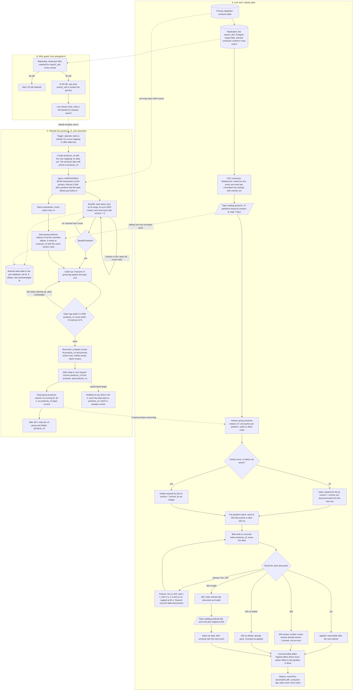

# Search sync plan: CDC indexer and zero-downtime rebuild

## Background

Product search reads from a **search index**: one document per product. The search API does not query the index by its real name. It queries an **alias**, a stable name (`products`) that points to one concrete index at a time.

Today a cron job copies changes from the `products` table into the index every 15 minutes. It has four known gaps:

- Hard-deleted rows never leave the index.
- Two runs can overlap, and the slower one can write older data last.
- Changes take up to 15 minutes to appear.
- A failed run is retried only at the next scheduled run.

This plan does two things:

1. **Live sync:** replace the cron job with a stream of every committed change to `products`, consumed by a new indexer service.
2. **Rebuild:** build a brand-new index beside the live one, and switch the alias only when the new index is ready. Search keeps running the whole time.

## Terms

**Data and streams**

- **Primary:** the main Postgres server (`catalog-primary`).
- **WAL (write-ahead log):** Postgres's own log of every change. Postgres keeps it until its readers have consumed it.
- **Replication slot:** a named reader position on the primary (here `search_slot`). While the slot does not advance, Postgres keeps all WAL after it, so disk fills up if the reader stops.
- **CDC (change data capture):** reading committed changes as a stream of events, instead of polling tables.
- **Debezium:** the CDC connector we already run. It reads the slot and publishes one event per row change to Kafka.
- **commit_lsn:** the WAL position of the transaction that committed a change. Larger means committed later. It is written as hex `X/Y`.
- **Kafka topic:** an ordered log split into partitions. `catalog.products` has 12 partitions. All changes to one product land in one partition, in commit order.
- **Consumer group:** workers that share a topic's partitions. Each partition is read by one worker at a time.
- **Offset:** a message's position within its partition. A consumer commits offsets to record how far it has safely processed.
- **Rebalance:** when workers join or leave a group, Kafka moves partitions between them. Work resumes from the last committed offset.
- **Dead-letter queue (DLQ):** a topic that holds events the index refuses, so they are kept for inspection instead of blocking the stream.

**Search index**

- **Index:** a collection of documents. `products_v3` is the live index.
- **Alias:** the stable name `products`. Moving it is atomic: each query goes to the old index or the new one, never to neither.
- **Mapping:** the field definitions of an index (field types, how text is analysed). A new mapping usually needs a new index, which is why rebuilds exist.
- **Bulk write:** one request that carries many index or delete operations.
- **Refresh:** how often the index makes new writes searchable. A write is stored at once but cannot be searched until the next refresh.
- **External versioning:** each write carries a version number. The store compares it with the stored version to decide whether to apply the write.
- **Tombstone:** the record a store keeps after a delete, so an older write that arrives later cannot bring the document back.

**Failures and checks**

- **Backoff:** waiting longer before each retry. Here it starts at 1 s, doubles, and is capped at 60 s.
- **HTTP codes used here:** 2xx = applied. 400 = document is invalid. 404 on a delete = already gone. 409 = version conflict. 429 = throttled. 5xx = server-side failure.
- **Repeatable-read snapshot:** a database transaction that sees the data as of one point in time, even while other transactions keep writing.
- **Reconcile:** a final comparison of the new index with the database. It deletes extra documents and reports missing ones.
- **Canary rows:** rows in a reserved id range, updated about once a second. They measure end-to-end latency.

## How to read the diagram

The diagram has three parts:

- **A. Live sync** keeps the index current with the database.
- **B. WAL guard** is a watchdog that protects the primary from a stopped reader.
- **C. Rebuild** builds a new index beside the live one and moves the alias only when it is ready.

Shapes: a cylinder is stored state, a slanted box is a Kafka topic, a diamond is a decision, and a plain box is a step.

## Notes before the diagram

### Decisions

**Versions.** Convert `commit_lsn` from `X/Y` to one 64-bit integer: `X × 2^32 + Y`. For example, `0/16B3748` becomes 23,803,720.

The store uses the "at least" rule:

- A write is applied if its version is greater than or equal to the stored version.
- An equal version is applied again. This is harmless, and it makes redelivery after a crash safe.
- A lower version is refused with a 409 conflict. That change is counted as stale.

**Index names.** The sync path writes to a concrete index by name: `products_v3`, or `products_v4` during a rebuild. Only the alias swap changes the alias `products`.

**Inactive rows.** When a row is a draft or archived, the indexer deletes its document. It does not just skip it. So a row that leaves `active` disappears from search.

**Delete of a missing id.** A 404 means the document is already gone, so it counts as applied.

**Kafka offsets.** For each partition, the indexer commits the highest offset N such that every offset up to N is acknowledged. One unacknowledged offset holds the commit back. A write to the DLQ counts as acknowledged. The offset moves on only after that write succeeds.

**Old cron job.** Disable `existing/indexer_cron.py` before the live group starts writing to `products_v3`. Its unversioned writes could overwrite versioned documents. Delete it at cutover.

**Latency.** The 5-second target covers the whole path: database commit, connector, Kafka, batching, and refresh. Set the refresh interval to 1 second or less. Measure with canary rows. Alert when the p95 latency stays above 5 seconds for 10 minutes.

### Assumptions to verify before build

These are hypotheses, not demonstrated results.

1. **Tombstones last longer than the backfill.** The rebuild backfill takes about 2.5 hours. Many stores drop delete records after about 60 seconds. If this store does, a backfill write at version S could bring back a row that was deleted after S. Then only reconcile catches it.
2. **The snapshot and the recorded offsets line up.** The snapshot and the topic offsets are recorded at slightly different moments. A transaction that committed near S can be missing from the snapshot, while its event sits before the recorded offset, so the replay skips it. Its version is below S, so the version rule cannot bring it in. Fixes: a second replication slot with an exported snapshot (needs DBA approval), or rely on reconcile.
3. **Old documents accept a first versioned write.** Documents written by the old cron have no version. Confirm that the store accepts a first versioned write over them.
4. **Versions stay in range.** Many stores hold versions as signed 64-bit integers, with a maximum of 2^63 − 1. The high half X of a real `commit_lsn` is small, so values should stay in range. Confirm with real data.

## Diagram

## Notes after the diagram

### What happens on each failure

| Failure | What happens |
|---|---|
| Index timeout, 5xx or 429 (live) | The partition keeps its offset and retries with backoff: 1 s, doubling, capped at 60 s. Nothing is skipped. Search serves slightly stale data until the retries succeed. |
| Index refuses a document as invalid (400) | The event goes to `catalog.products.dlq` with the error text. An alert is raised and processing continues. The offset moves only after the DLQ write is acknowledged. |
| Version conflict (409) | The change is stale: a newer version is already stored. It is counted and acknowledged. It is not an error. |
| Indexer crash or rebalance | Processing resumes from the last committed offset. Replayed writes are harmless because they are versioned. |
| Connector stopped | WAL builds up on the primary. Alert at 20 GB. At 50 GB ops drop the slot, the live stream ends, and only a rebuild restores sync. |
| Rebuild backfill crash | Resume from the cursor in the state table, using the same S. Writes are idempotent, so repeating them is safe. |
| Index down during rebuild | The alias still points to `products_v3`, so search is unaffected. The backfill backs off and retries. |
| Rebuild gate fails | The alias is unchanged. Keep catching up and investigate. |
| Rollback within 48 h | Point the alias back to `products_v3` in one request. It is already current, because its group kept running. |

### After the switch

Once the alias points to `products_v4`, the v4 group keeps `products_v4` current. The v3 group keeps running for 48 hours, so `products_v3` stays current too. That is what makes a rollback possible.

**Open question:** the plan does not say whether the v4 group keeps running after a rollback, or whether a second switch to v4 would need a catch-up. This needs a decision before build.

**Known limit:** the 48-hour rollback restores changes made after the switch. Drift that the old cron left in `products_v3`, such as missed hard deletes, is not repaired by switching back.