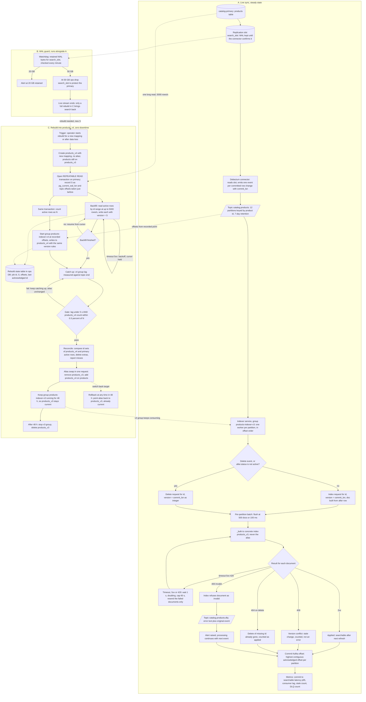

# Search sync plan: CDC indexer and zero-downtime rebuild

## Notes before the diagram

**Decisions**
- **Version:** convert `commit_lsn` from `"X/Y"` (hex) to an unsigned 64-bit integer: `(X << 32) | Y`. Use external versioning, so a write applies only if its version is at least the stored one. An equal version re-applies harmlessly, which makes redelivery safe.
- **Concrete index names:** the sync path writes to `products_v3` (or `products_v4` during a rebuild) by name. Only the alias swap touches the alias `products`.
- **Rows that leave `active`:** drafts and archived rows are deleted from the index, not just skipped, so the search rule holds for rows that stop being active.
- **Delete of a missing id:** a not-found result counts as applied.
- **Kafka offsets:** commit the highest contiguous acknowledged offset per partition. A DLQ write counts as an acknowledgement.
- **Cron:** disable `existing/indexer_cron.py` before the live group starts writing `products_v3`. Its unversioned writes could overwrite versioned documents. Remove it at cutover.
- **Latency:** the 5 s target covers connector lag, Kafka, batching, and index refresh. Set the refresh interval to 1 s or less. Measure with canary rows updated about once a second in a reserved id range, and alert when p95 stays above 5 s for 10 minutes.

**Assumptions to verify before build (hypotheses, not demonstrated)**
1. The store keeps delete versions (tombstones) longer than the 2.5 h backfill. Many stores drop tombstones after about 60 s. If they drop earlier, a backfill write at version S could bring back a row deleted after S. The reconcile step is the only guard in that case.
2. The snapshot point S may not match the topic offsets exactly. A commit in flight at S can have a `commit_lsn` below S while missing from the snapshot, and the version rule cannot catch that. Fixes: create a slot with an exported snapshot (needs DBA approval for a second slot), or rely on reconcile.
3. Documents written by the old cron have no version. Confirm that the store accepts a first versioned write over them.

## Diagram

## Notes after the diagram

| Failure | What happens |
|---|---|
| Index timeout, 5xx or 429 (live) | The partition holds its offset and retries with backoff from 1 s to a 60 s cap. Nothing is skipped. Search serves slightly stale data. |
| Index refuses a document as invalid | The event goes to `catalog.products.dlq` with the error text, an alert is raised, and processing continues. The offset moves only after the DLQ write is acknowledged. |
| Version conflict | Counted as stale and acknowledged. Not an error. |
| Indexer crash or rebalance | Replay from the last committed offset. Versioned writes make replay harmless. |
| Connector stopped | WAL accumulates on the primary. Alert at 20 GB. At 50 GB ops drop the slot, the live stream ends, and only a rebuild restores sync. |
| Rebuild backfill crash | Resume from the cursor in the state table, using the same S. Writes are idempotent. |
| Index down during rebuild | Alias still points at `products_v3`, so search is unaffected. Backfill backs off. |
| Rebuild gate fails | Alias unchanged. Keep catching up and investigate. |
| Rollback within 48 h | Point the alias back to `products_v3` in one request. It has already consumed every change because its group kept running. |

**Known limit:** the 48 h rollback restores changes made after the switch. Drift that the old cron left in `products_v3` (for example, missed hard deletes) is not repaired by the switch-back.