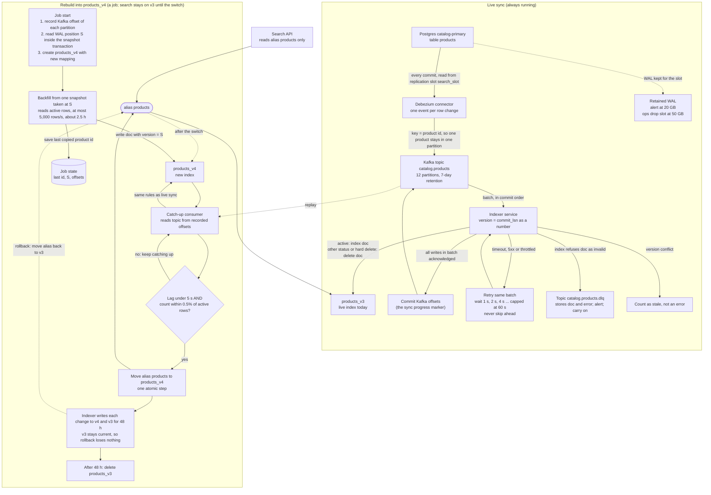

## Plan: move search to CDC

Product search reads from one search index, `products_v3`, through an alias named `products`. The search API only ever asks for `products`, and the alias decides which index answers. Today a cron job (a scheduled script) copies changes from the database into that index every 15 minutes. This causes three problems:

- It misses hard deletes (rows removed from the table), so deleted products stay searchable.
- Two runs can overlap, and the slower one can write older data last.
- A change can take up to 15 minutes to appear in search.

This plan replaces the cron job with a stream. Every committed change to the `products` table reaches the index within seconds. It also adds a way to rebuild the index from scratch, for example for a new mapping (the schema that says how each field is indexed) or after data loss, without taking search down.

### Components

- **Postgres** (`catalog-primary`): the database that holds the `products` table.
- **Debezium**: a connector that reads committed changes from Postgres and writes one event per row change to Kafka.
- **Kafka topic `catalog.products`**: a durable, ordered log of those events.
- **Indexer service**: a new service that reads the topic and writes to the search index. It never reads the database.
- **Search index `products_v3`** and the **alias `products`**: the search API queries only the alias.
- **Dead-letter topic `catalog.products.dlq`**: holds events the index refuses, so people can review them.
- **Reindex job**: builds a new index, `products_v4`, in the background while search keeps using `products_v3`.

### Words used in this plan

- **WAL (write-ahead log):** Postgres's ordered record of every committed change.
- **Replication slot:** a bookmark in the WAL. While the slot exists, Postgres keeps all WAL after the bookmark, so no change is lost while the connector is down. The cost is that the WAL keeps growing on disk.
- **LSN (log sequence number):** a position in the WAL, written like `0/16B3748`. A larger LSN means the change committed later. When attached to a change, it is called `commit_lsn`.
- **Topic, partition, offset:** a Kafka topic is split into partitions. Each partition is an ordered list of events. An offset is an event's position in one partition. A consumer offset records how far a consumer has read and finished.
- **Document:** one product in the index, identified by the product id.
- **Version:** a number stored with each document. The store applies a write only if its version is at least the stored version. A lower version is a **stale write**. The store rejects it with a version-conflict error. Equal versions are accepted.
- **Alias:** a name that points at one index. Moving it is atomic, so a query goes to the old index or the new one, never to neither.
- **Lag:** how many seconds the index is behind the newest committed change.
- **Active row count:** the number of rows in `products` with `status = 'active'`.
- **Snapshot (repeatable-read transaction):** a database read that sees the table exactly as it was at one moment, even while the table keeps changing.
- **DLQ (dead-letter queue):** a holding topic for events that cannot be applied.

### Diagram

Read the diagram top to bottom. The **Live sync** box runs all the time. The **Rebuild** box is a job that runs only when needed. Dotted arrows are steps that happen later or only on rollback.

### Live sync

- **Trigger:** every committed change to `products`.
- **Data:** each Debezium event holds the operation (create, update or delete), the product id, the full new row (empty for a delete) and the `commit_lsn`.
- **Rule:** only active products are searchable. Any other status, and any hard delete, becomes a delete of that product's document.
- **Version:** convert `commit_lsn` to one whole number. Take the part before the slash, multiply it by 2^32 (4,294,967,296), and add the part after the slash. Read both parts as hexadecimal. For example, `0/16B3748` becomes 23,803,720. The store keeps a write only if its version is at least the stored version. A version conflict means an older change arrived late. Count it and move on.
- **Order:** all changes for one product go to one partition, in commit order, so the newest change wins. Changes from one transaction share a `commit_lsn`. Equal versions are accepted, so they apply in the order they were read.
- **Speed:** the indexer groups changes into batches and writes each batch in bulk. Batch size and maximum wait time must be tuned so that 95% of changes are searchable within 5 seconds of commit. This is the target to measure.
- **Progress:** the indexer uses Kafka consumer offsets. It commits an offset only after the index has acknowledged every write up to that offset. After a crash, it re-reads from the last committed offset. Repeated writes are harmless, because the version rule rejects the older copy.
- **Transient failures** (timeouts, 5xx errors, throttling): retry the same batch, waiting 1 s, then 2 s, 4 s, and so on, capped at 60 s. The indexer never moves past a batch that has not succeeded. During a long outage, sync stops and lag grows, so alert on lag.
- **Invalid documents:** the index refuses the document as invalid. Send it to the DLQ with the error, raise an alert and keep processing. The product's later changes still flow.
- **WAL growth:** alert when the replication slot retains 20 GB of WAL. At 50 GB, ops drop the slot to protect the primary. After that, change capture is broken, some changes never reach Kafka, and only a full rebuild restores a correct index.
- **Cutover order:** stop the cron job before the indexer starts. Cron writes carry no version, so they would bypass the version rule. Products hard-deleted before cutover can remain in `products_v3` until the first rebuild removes them.
- **Open check:** confirm that the store keeps the version of a deleted document. If it does not, a late, older write could bring a deleted product back into search. Resolve this before cutover, and check it again for `products_v4` before the switch.

### Rebuild

Use a rebuild for a new mapping or after data loss. Search reads only the alias, so it stays on `products_v3` until the switch. Nothing half-built is ever visible to users.

1. **Start:** record the current Kafka offset of each partition first. Then read the WAL position S inside the snapshot transaction, and open the snapshot at S. Create `products_v4` with the new mapping. Recording the offsets first means every event already in Kafka at that point committed before S, so it is already in the snapshot. Replaying from the recorded offsets therefore misses nothing.
2. **Backfill:** read active rows from the snapshot at no more than 5,000 rows/s. The table holds about 40 million rows, so the copy takes about 2.2 hours at that rate. The brief's 2.5-hour estimate is a safe upper bound. Write each document with version S. This is safe. Any live change that committed after S has a higher version and replaces the copied row. Any replayed change older than S is rejected as stale, which is correct, because the snapshot already reflects it. Save the last copied product id in job state after each batch, so the copy can resume.
3. **Catch up:** a second consumer reads the topic from the recorded offsets and applies the same rules as live sync to `products_v4`. It keeps running until the switch. Kafka keeps 7 days of events, far more than the backfill and catch-up need.
4. **Check:** switch only when both hold. Lag is under 5 seconds, and the document count in `products_v4` is within 0.5% of the active row count. The active count keeps changing during the copy, so the 0.5% tolerance is needed.
5. **Switch:** move the alias `products` to `products_v4` in one atomic step. From then on, the indexer writes each change to `products_v4` and also to `products_v3`.
6. **Keep the old index:** for 48 hours after the switch, every change is written to both indexes. An offset is committed only after both have acknowledged the write. This keeps `products_v3` current, so rollback is only a matter of moving the alias back, with no change lost. After 48 hours, delete `products_v3` and stop writing to it.

### Rebuild failures

- **Job crashes during the backfill:** search is unaffected. The snapshot is gone, and the DBA allowed only one. Any restart needs a second snapshot, so ask for approval before the run. If the copy restarts from the saved product id, it must use the new snapshot's position as the version, not S. If approval is refused, the rebuild cannot continue within the agreed limit. Stop and re-plan with the DBA.
- **Catch-up falls behind:** do not switch. Keep catching up and alert.
- **Count outside 0.5%:** do not switch. Find the gap by checking the DLQ and the stale-write counts.
- **Replication slot dropped during the rebuild:** Kafka misses the changes made after the drop. Restart the rebuild.
- **Problem after the switch:** roll back by moving the alias to `products_v3`, within the 48-hour window.