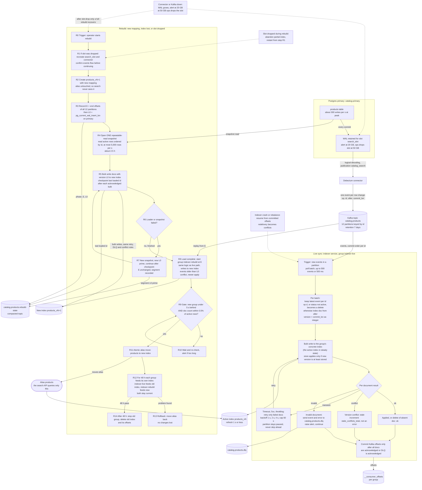

# Search sync: change data capture plan

This plan replaces the 15-minute cron job with a stream of every committed change to `products`. It also covers rebuilding the index from scratch without search ever going down.

In short:

- **Live path.** Postgres writes each committed change to its log. Debezium copies the change into Kafka. A new indexer service reads Kafka and writes to the search index. Each write carries a version, so a stale write can never overwrite newer data.
- **Rebuild.** Load a snapshot of the table into a new, hidden index. Replay the Kafka events that arrived during the load. When the new index has caught up, move the alias `products` to it. The old index stays for 48 hours as a rollback.

## Terms used below

- **CDC (change data capture):** reading a database's committed changes as a stream of events. Here the tool is Debezium, a connector that reads Postgres and writes to Kafka.
- **WAL:** Postgres's write-ahead log, the ordered record of every committed change.
- **Replication slot (`search_slot`):** a marker that makes Postgres keep WAL until the connector has read it. If the connector stops, WAL piles up on the primary's disk.
- **LSN:** a position in the WAL. A larger LSN means committed later. Each event carries `commit_lsn`, the LSN of its transaction's commit.
- **Topic, partition, offset:** Kafka stores events in topics. A topic is split into partitions, each an ordered log. An offset is an event's position in its partition. `catalog.products` has 12 partitions, keyed by product id, so all changes to one product are in one partition in commit order.
- **Consumer group:** a named set of Kafka consumers that share a stored read position (an offset) per partition. Kafka keeps these in `__consumer_offsets`. "Committing offsets" means saving that position.
- **Version:** a number sent with each index write. The search store applies the write only if the new version is at least the stored version. Otherwise it returns a **version conflict** for that document.
- **Alias and active index:** the search API queries only the alias `products`. The alias points at one concrete index (for example `products_v4`), the **active index**. Moving the alias is atomic, so a query goes to the old index or the new one, never neither.
- **Repeatable-read snapshot:** a Postgres transaction that sees the data exactly as it was when it began, however long it runs.
- **Compacted topic:** a Kafka topic that keeps only the latest message per key, so it works as a small key-value store.
- **DLQ (dead-letter queue):** a topic, `catalog.products.dlq`, that holds events the index refused.

## Live path

1. Debezium reads `search_slot` and writes one event per row change to `catalog.products`. Each event is `{op, id, after, commit_lsn}`. `op` is `c`, `u` or `d` (create, update, delete). `after` is the full row, or null for a delete.
2. The new indexer service consumes the topic as group `indexer-live`. It polls a batch (up to 500 events or 500 ms) and keeps only the highest-LSN event per id.
3. For each remaining event:
   - If `op = d` or `after.status` is not `active`, it sends a delete. Only active rows may appear in search. This also fixes hard deletes, which the cron never handled.
   - Otherwise it indexes a document built from `after`, with the same field mapping as `to_doc` in the cron script.
4. The document version is `commit_lsn` as an integer: `(hi << 32) | lo`, where `hi` and `lo` are the two hex parts either side of the `/`. Each indexer group writes to one fixed concrete index, never to the alias. For `indexer-live` in steady state, that is the active index. Because of the version rule and per-partition order, an older write can no longer overwrite newer data.
5. A version conflict means the change is stale. The indexer increments `stale_conflicts_total` and carries on. It is not an error.
6. The indexer commits Kafka offsets only after the index has acknowledged every write those offsets cover. After a crash, redelivered events are harmless, because replays become conflicts.

## Failure handling (live path and rebuild)

The rebuild writes to the new index with the same rules. Failures specific to the loader are in R6 and R7 below.

| Failure | Response |
|---|---|
| Timeout, 5xx, throttling | Retry only the failed documents. Backoff is 1 s, 2 s, 4 s and so on, capped at 60 s. The partition stays paused and never skips ahead. No offset is committed until the batch is acknowledged. |
| Index refuses a document as invalid | Produce the event and the error to `catalog.products.dlq` and wait for that produce to be acknowledged. Raise an alert, then continue. If the DLQ produce fails, retry it with the same backoff. |
| Version conflict | Count it as stale. Not an error. |
| Indexer crash or rebalance | Resume from the committed offsets. Redelivered events are applied again or conflict. |
| Kafka or connector down | Postgres keeps the WAL for the slot. Alert at 20 GB retained. At 50 GB ops drops the slot, and only a full rebuild recovers. |

## Freshness target (95% within 5 s)

Rough budget, in seconds: 1 from commit to topic, 0.5 batch window, 1 bulk write, 1 index refresh. That totals 3.5 s, leaving 1.5 s of margin. Set the index's refresh interval to 1 s or less.

## Rebuild

Use a rebuild for a new mapping, for index loss, or after the slot is dropped. Step labels R0 to R14 match the nodes in the diagram.

Two values are recorded at the start. **E** is the end offset of each of the 12 partitions at that moment. **L0** is the primary's current WAL position at that moment. They split history into "in the snapshot" and "in the topic from E onward".

- **R0. Trigger.** An operator starts the rebuild.
- **R1. Slot check.** If the slot was dropped, recreate `search_slot` and the connector first. Confirm events are flowing before anything else.
- **R2. New index.** Create the new index with the new mapping. The alias is untouched, so search never sees it.
- **R3. Mark the start.** In this order:
  1. Record `E`.
  2. Read `L0 = pg_current_wal_insert_lsn()` on the primary.
  3. Open the one repeatable-read snapshot (R4).

  This order guarantees that everything committed before `L0` is in the snapshot, and everything committed after `L0` is in the topic at or after `E`. Some changes appear in both, which is safe.
- **R4. Snapshot read.** The loader reads `status = 'active'` rows ordered by id, at no more than 5,000 rows/s (about 2.5 hours). This is the one long snapshot the DBA allows.
- **R5. Bulk load.** The loader bulk-writes the rows to the new index with version `L0`. After each acknowledged bulk it checkpoints the last loaded id.
- **R6 and R7. Loader crash or lost snapshot.** Take a new snapshot (R7) and continue after the last checkpoint with a new `L0'`. Keep the original `E`. Rows from the first segment keep version `L0`. Events between `L0` and `L0'` are replayed for them and converge, because per-key order is kept and the last event wins. Rows from the second segment ignore events older than `L0'`.
- **R8. Catch up.** The consumer group for the new index, `indexer-rebuild`, stays paused during the load. If it ran early, a delete could reach the new index before the loader inserted that row, and the loader would then bring back a deleted product. When the load finishes, the group starts at `E` and runs the same logic as the live path. Events older than `L0` conflict and are counted. Newer events apply.
- **R9 and R10. Switch gate.** Switch only when both hold: the new group is less than 5 s behind, and the new index's document count is within 0.5% of the active row count. Otherwise keep waiting (R10), and alert if it takes too long.
- **R11. Switch.** Move the alias atomically to the new index.
- **R12. Keep the old index for 48 hours.** Each group keeps feeding its own index: `indexer-live` feeds the old one and `indexer-rebuild` feeds the new one, so both stay current. 48 hours fits inside the 7-day topic retention.
- **R13. Rollback.** Switching back is another alias move and loses nothing.
- **R14. Cleanup.** After 48 hours, stop `indexer-live`, delete the old index and delete that group's offsets. `indexer-rebuild` is now the live sync. The next rebuild must use a fresh group name, because this one is in use.
- **Slot dropped during a rebuild.** Events after the drop are lost, so `E` is no longer valid. Abandon the partial new index and restart from R1.

## Where progress is stored

- Kafka offsets for each group: `__consumer_offsets`.
- Rebuild state (phase, `E`, each segment's `L0`, the loader's last-id checkpoint): a new compacted topic, `catalog.products.rebuild-state`.

## Flowchart

Solid arrows carry data or control. Dotted arrows show failures and their effects. Labels starting "Trigger" show what starts each path.

## Assumptions and open items

- **Freshness metric.** Events have no commit timestamp, so the 5 s target (and the "under 5 s behind" switch gate) cannot be measured in time. Either enable Debezium's source timestamp on the connector, or add a canary row.
- **Deletes and stale writes.** The plan assumes a delete keeps its version, so a stale write arriving after a delete cannot bring the document back. If the store forgets versions of deleted documents, a redelivered batch can briefly resurrect a deleted product. The same ordered batch then replays the delete and removes it again. Confirm this behavior with the store.
- **Active row count for the gate.** Run one `count(*)` of active rows on the primary at gate time. The DBA must approve this. The fallback is the loader's own row count at the snapshot. The gate is only a sanity check: 0.5% of 40 million rows is about 200,000 documents.
- **LSN versions.** The store must accept a 64-bit integer version.
- **State topic.** `catalog.products.rebuild-state` is new, and the Kafka team must create it on the shared brokers. Keeping this state in the search cluster would not survive the "index lost" case.
- **First migration.** The first rebuild, into `products_v4`, replaces the cron. Never mix cron writes (unversioned) and indexer writes in one index. The cron keeps writing to `products_v3` for 48 hours after the first switch, so a rollback loses nothing. Then remove it. In this first rebuild, the old index is fed by the cron, not by `indexer-live`.
- **Rollback after a slot loss.** If the rebuild followed a slot drop, the old index missed every change made while there was no slot. Rolling back to it loses data. The 48-hour lossless rollback holds only when the old index was fed continuously.
- **Two indexer versions.** If the new mapping needs a different document shape, `indexer-live` must keep running the old build for the old index while `indexer-rebuild` runs the new build.
- **Primary cost.** The long snapshot holds back vacuum on the primary for about 2.5 hours. The DBA has allowed this.
