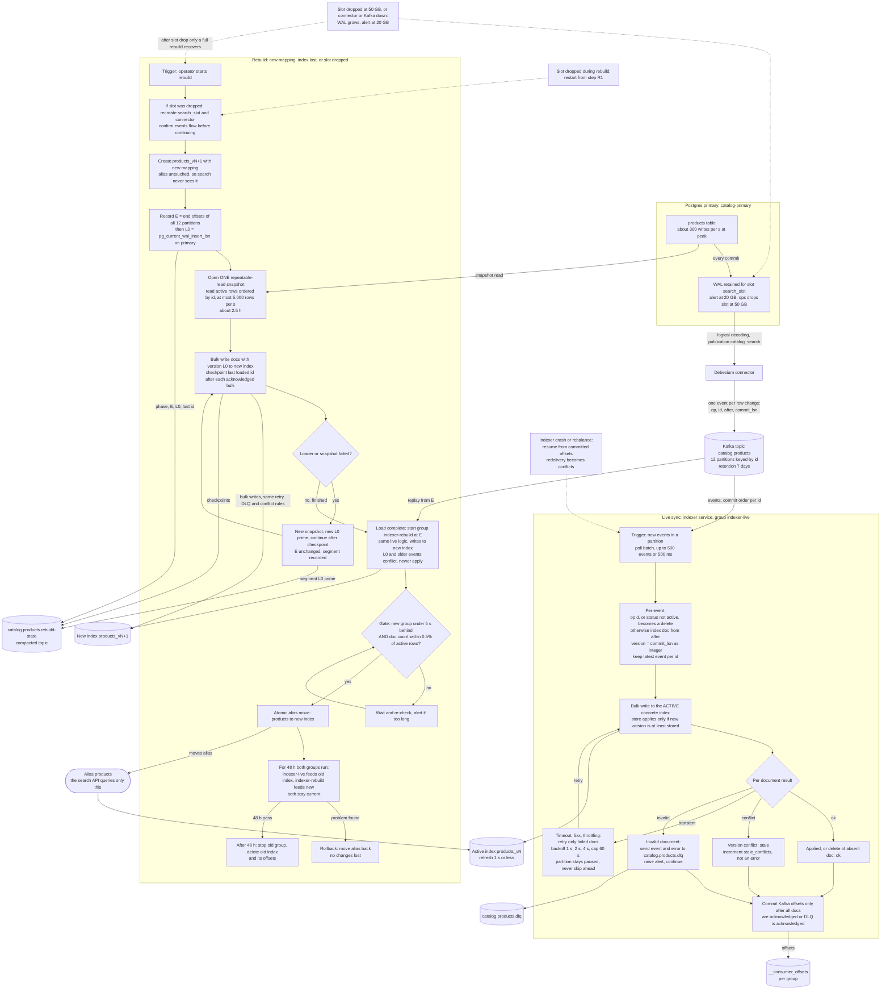

# Search sync: change data capture plan

This plan replaces the 15-minute cron with a stream of every committed change from `products`. It also covers rebuilding the index from scratch with no downtime.

## How it works

**Live path**
- Debezium reads slot `search_slot` and writes one event per row change to `catalog.products`. The topic has 12 partitions, keyed by product id.
- The new indexer service consumes the topic with consumer group `indexer-live`. It writes to the concrete active index (for example `products_v4`), never to the alias.
- Per event:
  - If `op = d`, or `after.status` is not `active`, it sends a delete. Only active rows may appear in search. This also fixes hard deletes, which the cron never handled.
  - Otherwise it indexes the document built from `after`, using the same field mapping as `to_doc`.
- The document version is `commit_lsn` as an integer: `(hi << 32) | lo` from `hi/lo` in hex. The store applies a write only if the new version is at least the stored one. Ordering is handled by the version plus per-partition order, so overlapping writers can no longer put older data last.
- A version conflict means the change is stale. The indexer increments `stale_conflicts_total` and carries on.
- Within a batch it keeps only the highest-LSN event per id.
- Kafka offsets are committed only after the index has acknowledged every write the offsets cover. A crash causes a redelivery, which is safe because replays turn into conflicts.

**Failure handling (live and rebuild)**

| Failure | Response |
|---|---|
| Timeout, 5xx, throttling | Retry only the failed documents. Backoff is 1 s, 2 s, 4 s and so on, capped at 60 s. The partition stays paused and never skips ahead. No offset is committed until the batch is acknowledged. |
| Index refuses a document as invalid | Produce the event and the error to `catalog.products.dlq`. Wait for that produce to be acknowledged, raise an alert, then continue. If the DLQ produce fails, retry it with the same backoff. |
| Version conflict | Count it as stale. It is not an error. |
| Indexer crash or rebalance | Resume from the committed offsets. Redelivered events are applied idempotently or conflict. |
| Kafka or connector down | Postgres keeps the WAL for the slot. Alert at 20 GB retained. At 50 GB ops drops the slot, and only a full rebuild recovers. |

**Freshness (95% under 5 s).** The budget is roughly 1 s for commit to topic, 0.5 s for the batch window, 1 s for the bulk write and 1 s for the store's refresh interval. Set the refresh interval on the index to 1 s or less.

**Rebuild**
1. If the slot was dropped, recreate `search_slot` and the connector first. Confirm events are flowing before anything else.
2. Create the new index with the new mapping. The alias is untouched, so search never sees it.
3. Record `E`, the current end offsets of all 12 partitions. Then read `L0 = pg_current_wal_insert_lsn()` on the primary. Then open the one repeatable-read snapshot. Taking `E` first, then `L0`, then the snapshot guarantees two things:
   - Everything committed before `L0` is in the snapshot.
   - Everything committed after `L0` is in the topic at or after `E`.
4. The loader reads `status = 'active'` rows ordered by id, at no more than 5,000 rows/s. It writes them in bulk to the new index with version `L0`. After each acknowledged bulk it checkpoints the last loaded id.
5. The stream consumer for the new index (group `indexer-rebuild`) stays paused during the load. If it ran early, a delete could reach the new index before the loader inserted that row, and the loader would then bring back a deleted product. When the load finishes, the group starts at `E`. Events with `commit_lsn` at or below `L0` conflict and are counted. Later events apply.
6. Switch only when both conditions hold: the new group is under 5 s behind, and the new index's document count is within 0.5% of the active row count. If not, keep waiting and alert if it takes too long. Then move the alias atomically.
7. For 48 hours, `indexer-live` keeps feeding the old index and `indexer-rebuild` feeds the new one. Switching back is another alias move and loses nothing. After 48 hours, stop the old group, delete the old index and delete its offsets. The 48 hours fit inside the 7-day topic retention.
8. If the loader crashes or the snapshot is lost, take a new snapshot and continue from the last checkpoint with a new `L0'`. Keep the original `E`. The first segment's rows keep version `L0`. Events between `L0` and `L0'` replay and converge, because per-key order is kept and the last event wins. Rows in the second segment ignore events at or below `L0'`.
9. If the slot is dropped during a rebuild, restart from step 1.

**Progress storage**
- Kafka offsets for each group are in `__consumer_offsets`.
- Rebuild state is in a new compacted topic, `catalog.products.rebuild-state`. It holds the phase, `E`, each segment's `L0` and the loader's last-id checkpoint.

## Assumptions and open items

- **Freshness metric.** The event shape has no commit timestamp. Either enable Debezium's source timestamp on the connector, or add a canary row. Without one, the "95% under 5 s" target can't be measured end to end.
- **Deletes and stale writes.** The plan assumes a delete carries the version, and that a stale write after a delete can't bring the document back. If the store forgets versions of deleted documents, a redelivered batch can briefly bring a deleted product back. It is removed again when the same ordered batch replays its delete. Confirm this with the store.
- **Active row count for the gate.** A `count(*)` of active rows is run once on the primary at gate time. The DBA should approve that. The fallback is the loader's own row count at the snapshot. The gate is a sanity check, because 0.5% of 40 million rows is about 200,000 documents.
- **LSN versions.** The 64-bit integer version must be accepted by the store.
- **State topic.** `catalog.products.rebuild-state` is new and needs the Kafka team to create it on the shared brokers. Using the search cluster for this state would not survive the "index lost" case.
- **First migration.** The first rebuild into `products_v4` replaces the cron. Do not mix cron writes (unversioned) with indexer writes in one index. Keep the cron running against `products_v3` for the 48 hours after the first switch, so that rolling back loses nothing. Then remove it.
- **Rollback after a slot loss.** If the rebuild followed a slot drop, the old index missed the changes made while there was no slot. Rolling back to it is lossy, and the 48-hour lossless guarantee only holds when the old index was fed continuously.
- **Two indexer versions.** If the new mapping needs a different document shape, `indexer-live` must keep running the old build for the old index while `indexer-rebuild` runs the new build.
- **Primary cost.** The long snapshot holds back vacuum on the primary for about 2.5 hours. The DBA has allowed this.
