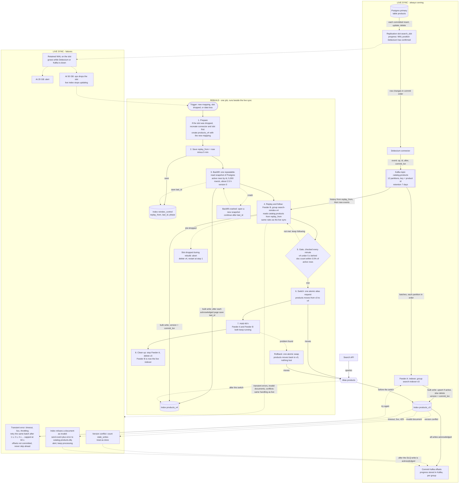

## Plan: move product search from the 15-minute cron to change data capture (CDC)

### What we are building

Today `existing/indexer_cron.py` polls Postgres every 15 minutes. It never sees hard deletes. When runs overlap, the slower run can write older data last. Changes show up in search up to 15 minutes late.

The replacement has two parts.

1. **Live sync.** Postgres records every committed change in its write-ahead log (WAL). Debezium (the CDC connector) reads that log and publishes one event per row change to the Kafka topic `catalog.products`. A new indexer service reads the topic and writes to the search index. The cron job is retired.
2. **Rebuild.** One job builds a complete new index (`products_v4`) next to the live one while search keeps working. It then moves the alias `products` to the new index in one atomic step. Use it for a new mapping, or to recover after data loss or a dropped slot.

Terms used below:
- **Replication slot (`search_slot`).** Postgres's bookmark for Debezium. Postgres keeps all WAL that the slot has not yet confirmed, so a stopped Debezium makes the WAL grow.
- **`commit_lsn`.** The WAL position of the transaction that made a change. A larger value means a later commit.
- **Alias.** A name (`products`) that points at one index. The search API queries only the alias. Moving the alias is atomic, so a query goes to the old index or the new one, never to neither.
- **Feeder.** One indexer process (one Kafka consumer group) that fills one target index. The same code serves both paths. Feeder A fills `products_v3`. Feeder B fills `products_v4`.
- **DLQ.** A dead-letter topic, `catalog.products.dlq`, that holds events the index refused.
- **Kafka offset.** A consumer group's position in each partition, stored by Kafka per group. Committing it means "everything before this is done".
- **Refresh.** The search store makes a written document searchable only after its next refresh. The refresh interval is part of the latency.

### Rules the indexer applies to every event

- **What to write.** An event has `op` (`c` create, `u` update, `d` delete), `id`, `after` (the full new row, or null for a delete) and `commit_lsn`.
  - If `op` is `c` or `u` and `after.status = 'active'`, upsert the document, built the same way as `to_doc` in the cron.
  - Otherwise (any other status, or `op = d`), delete the document. Deleting a document that is not there counts as success.
  - Together these enforce the schema rule that only active rows appear in search.
- **Version.** The document version is `commit_lsn` as an integer. The text before the `/` is the high 32 bits and the text after it is the low 32 bits, both in hex: `(high << 32) | low`. For example, `0/16B3748` is 23,803,720. The store applies a write only if its version is at least the stored version. Deletes carry the version too (see open items).
- **Version conflict.** The store reports a conflict when it already holds a newer version, so the event is stale. Increment a `stale_writes` counter and treat the event as done. It is not an error.
- **Replays are safe.** An event applied twice has an equal version, which the rule accepts. After a crash the indexer can re-read events without harm.
- **Ordering.** The topic is keyed by product id, so all changes to one product are in one partition, in commit order. Each partition is processed in order. Events are bulk-written in batches of up to 1,000 events or 500 ms.
- **Offsets.** Kafka offsets are committed only after the index has acknowledged every write the offsets cover.
- **Transient errors** (timeout, 5xx, throttling). Retry the same batch with backoff: 1 s, then doubling, capped at 60 s. Never skip ahead.
- **Invalid documents.** If the index refuses a document as invalid, send the event and the error to `catalog.products.dlq`, raise an alert and keep processing. If the DLQ write itself fails, retry it like a transient error.

### Diagram

How to read it: solid arrows are the normal path, labelled with the data that moves. Dotted arrows are failures or alternatives. Cylinders are stores. Labels starting with "progress" say where progress is saved.

### Live sync: what triggers what

- A committed write in Postgres reaches Debezium through the slot. The topic gets one event per change.
- A new batch in the topic triggers the indexer. Feeder A writes to `products_v3` by its real name, not through the alias.
- Progress is stored in two places. The slot holds the WAL position Debezium has confirmed. Kafka holds the indexer's committed offsets.
- If the indexer is slow or down, nothing is lost. Events wait in Kafka for 7 days, and the indexer resumes from its committed offsets. The WAL does not grow, because Debezium keeps reading.
- If Debezium or Kafka is down, WAL piles up on the primary. An alert fires at 20 GB. At 50 GB ops drops the slot to protect the primary, and the live index then goes stale. A full rebuild is the only way back, and it starts by recreating the slot and connector.
- Debezium should send a heartbeat so that the slot keeps advancing when `products` is quiet. It should also skip its own initial snapshot, because the rebuild job does the backfill.
- Latency budget for the target (95% of changes searchable within 5 seconds): capture and publish about 1 s, batch wait at most 0.5 s, bulk write about 0.5 s, refresh at most 1 s. That is about 3 s typical. These are estimates to verify. Measure from the event's Kafka timestamp to the acknowledged write, plus the refresh interval.

### Rebuild: step by step

The rebuild never stops the live sync. It does not touch the alias until step 6, so search never sees a half-built index.

1. **Prepare.** If the slot was dropped, recreate the connector and slot first. Events must already be flowing into the topic before the snapshot opens. Then create `products_v4`. During the backfill, use a longer refresh interval for speed. Restore the normal interval before the gate.
2. **Save the replay start.** Record `replay_from` as the current time minus 5 minutes in the control record. The control record is a one-document index named `reindex_control` in the same search cluster. It also holds `last_id` (the highest id backfilled so far) and the current phase.
3. **Backfill.** Open one repeatable-read snapshot, which is the single long snapshot the DBA allows. Read active rows in id order, one page at a time (`WHERE id > last_id ORDER BY id LIMIT 1000`), throttled to 5,000 rows/s. Write them to v4 with version 0, which is older than any real change. After each acknowledged page, save `last_id`.
4. **Replay and follow.** After the backfill ends, start Feeder B on `catalog.products`, positioned at the first offset at or after `replay_from` (Kafka can look up offsets by timestamp). Feeder B applies the same rules as the live sync.
   - Every event is newer than version 0, so replay brings each document to its latest state.
   - Events already reflected in the snapshot are applied again with no harm.
   - The 5-minute margin covers changes that committed just before the snapshot opened.
   - Feeder B then keeps following new events.
   - At the 300 writes/s peak, the 2.5-hour backfill leaves about 2.7 million events to replay. At an assumed 10,000 events/s that is under 5 minutes.
5. **Gate.** Every minute, check two things.
   - v4 is under 5 s behind: Feeder B has no unread events, or the newest event it applied was less than 5 s old when it was applied.
   - v4's document count is within 0.5% of the active row count in Postgres. Count on a replica if one exists, because the scan is large.

   Require both on 3 checks in a row, so a lucky moment does not trigger the switch.
6. **Switch.** In one alias request, remove `products` from v3 and add it to v4.
7. **Hold for 48 hours.** Feeder A keeps v3 current and Feeder B keeps v4 current. If something is wrong, one more atomic swap puts the alias back on v3, and v3 has every change.
8. **Clean up.** After 48 hours, stop Feeder A and delete v3. Feeder B becomes the live indexer. The next rebuild repeats these steps with `products_v5`.

### Failure summary

| Failure | What happens | Where progress is kept |
|---|---|---|
| Index timeout, 5xx or throttling | Retry the same batch with backoff of 1 s, doubling to 60 s. No offsets committed, no skipping. | Kafka offsets |
| Version conflict | Count it as stale and continue. | Kafka offsets |
| Invalid document | Send it to `catalog.products.dlq` with the error, alert, and continue. If the DLQ write fails, retry it like a transient error. | Kafka offsets |
| Indexer crash or restart | Resume at the last committed offsets. Re-applied events are harmless. | Kafka offsets |
| Backfill crash | Open a new snapshot and continue after `last_id`. Changes between the two snapshots are covered by the replay, which still starts from the original `replay_from`. | `reindex_control` |
| Debezium or Kafka down | WAL grows. Alert at 20 GB. At 50 GB ops drops the slot, and a full rebuild is needed. | Slot position |
| Slot dropped during a rebuild | Abort, delete v4 and start again from step 1. The alias is untouched. | None |
| Gate never met (for example, a count gap from DLQ documents) | The alias stays on v3, which keeps serving. Alert and investigate. | `reindex_control` |

### Open items

- **Versioned deletes.** The plan assumes the store accepts a version on a delete and keeps it, so a late older write cannot bring a deleted product back. This matters if two indexer instances briefly overlap during a consumer-group rebalance. If the store cannot do this, we need another way to reject stale writes after a delete.
- **First rollout.** Today there is no Feeder A. The cron writes `products_v3` without versions. Run the first rebuild as the migration and stop the cron at the switch. A rollback to v3 within 48 hours would lose changes unless a feeder also runs on v3. Verify that the store accepts versioned writes over cron-written documents. If it does not, keep the cron running for those 48 hours as a best-effort fallback.
- **Latency figures** above are estimates and need a measurement on the real pipeline.