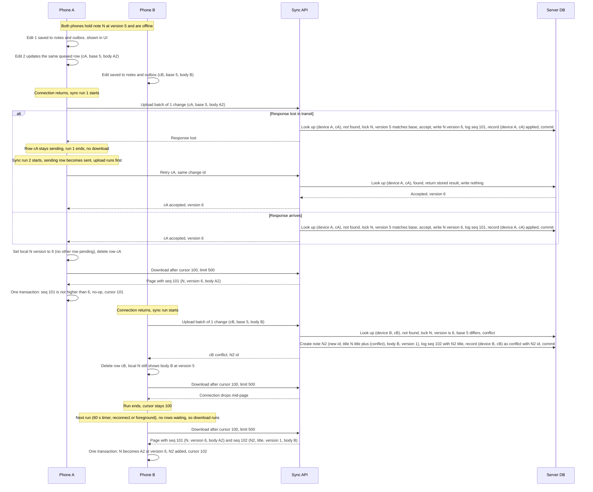

# Multi-device sync for the offline-first notes app

## Summary

Today the app is local only. Each phone keeps its notes in SQLite, and there is no server. This design adds a sync server as the source of truth. Every edit is saved on the phone first and queued with the server version it started from. The server accepts a queued change only if that version is still current. If it is not, the server saves the losing body as a new conflict note, so no text is lost. Phones catch up by reading the server's change log in order, so reading and editing never wait for the network.

## Terms

- **SQLite**: the small database file on each phone that holds its notes.
- **Server version**: an integer on each server note. It goes up by one on every accepted write.
- **Base version**: the server version an edit started from. Each change carries one.
- **Change id**: a UUID given to an outbox row once. A retry sends the same change id.
- **Device id**: a random id made on install and sent with each upload. The server trusts it, because auth is out of scope.
- **Outbox**: the phone's table of changes the server has not yet confirmed.
- **Change log**: the server's append-only list of accepted writes and conflict notes.
- **Seq**: the number of a change log entry. Seq numbers only go up.
- **Cursor**: the last change log seq the phone has applied.
- **applied_changes**: the server's record of the result of each change, keyed by (device id, change id).
- **Result**: the server's answer for one change: accepted, conflict or error.
- **Sync run**: one pass that uploads first and then downloads.
- **Upload batch**: one request that carries up to 100 changes.
- **Download page**: one reply that carries up to 500 change log entries.
- **Conflict note**: a new note that holds a losing body. Its title is the note's current server title plus (conflict).
- **Single-flight lock**: a lock on the phone that lets only one sync run go at a time.
- **Note lock**: a lock the server holds on a note while it checks and writes, so two changes to one note never run at once.

## Sequence: two phones edit note N offline, then sync one after the other

Both phones hold note N at version 5 and are offline. Phone A's edits end as one queued change, cA. Phone B makes one change, cB.

Notes on the diagram:

- Phone A's download returns only seq 101, because N2 did not exist yet. Its cursor becomes 101. N2 (seq 102) arrives on its next download, and the cursor then moves to 102. The cursor moves to the last seq applied, so this jump is normal.
- Phone B's local N keeps body B at version 5 until its download. Nothing on the phone points to N2. The download creates it.
- In the lost-response branch, the retry returns the stored result and writes nothing, so no second write happens.

## Where state lives

**Phone**

- `notes`: the local copy of each note (title, body, last known server version). Every edit writes here first, so the UI never waits for the network. An accepted upload may set the version. A download with a higher version replaces the body and version.
- `outbox`: one row per change not yet confirmed. Columns: change id, note id, base version, full body, state, creation time (used for ordering). States:
  - `queued`: never sent. It waits for the next upload. An edit updates its body and keeps its change id and base.
  - `sending`: in a batch now, or cut off during the last run.
  - `sent`: left from an earlier run with no result. It keeps its change id and body, and is sent again with the same change id.
- `sync_cursor`: the last seq applied. It moves only in the same local transaction that applies a download page.

**Server**

- `notes`: current title, body and integer version per note.
- `change_log`: append-only rows with seq, note id, title (the note's title at that write), version, full body, source device and change id. Seq numbers only go up.
- `applied_changes`: keyed by (device id, change id). It stores the result returned for that change. Each row is written in the same transaction as the note write and the log append.

## How it runs

1. **Edit.** Trigger: the user edits a note, online or offline. The phone writes the new body to `notes` and shows it. Then it updates the outbox:
   - If the note has a `queued` row, the edit updates that row's body. The change id and base stay. Several edits become one change that keeps the original base.
   - If the note has no row, or its row is `sending` or `sent`, a new `queued` row is added. Its base is the version the phone last applied. A sent change may already be on the server, so it is never changed.
   - Failure: none. The edit is saved locally and never waits for the network.

2. **Sync run.** Triggers: the connection comes back, the app comes to the foreground, or 60 seconds pass while online. The single-flight lock allows one run at a time. A trigger during a run does nothing. At the start of a run, every `sending` row becomes `sent`. Only one run goes at a time, so a `sending` row left from before was cut off by a crash or a drop. The run then uploads, and then downloads.
   - Failure: any failed request, upload or download, ends the run. The run does not retry inside itself. The next trigger starts a new run at this step. A run goes on only after a successful upload batch (more batches while rows wait) or a successful download page (more pages while a page is full).

3. **Upload batch.** Trigger: the run has rows waiting. The phone takes up to 100 waiting rows (`queued` or `sent`), oldest first by creation time, and marks them `sending`. One request carries the device id once. For each row it carries the change id, note id, base version and full body. If a `sent` row and a `queued` row for the same note are in one batch, the older one goes first. Batches repeat until no rows wait. Then the download runs.

   The server handles each change in batch order, in its own transaction:
   - a. It looks up (device id, change id) in `applied_changes`. If found, it returns the stored result and writes nothing. This check comes before any base check or lock, so a retry never re-checks the base.
   - b. If not found, it locks note N and reads N's current version. If the base equals that version, the change is **accepted**. The server writes version + 1, appends to `change_log`, records the result in `applied_changes`, and commits.
   - c. If the base differs, the change is a **conflict**. The server does not merge text. It creates note N2 with a new id, titled with N's current server title plus (conflict), holding the sent body at version 1. It appends N2 to `change_log` with its title, records the conflict result including N2's id, and commits.
   - d. Changes for the same note see the version left by earlier changes in the batch. If an earlier one was accepted, a later one with an older base conflicts. If an earlier one conflicted, N's version did not move, so the later base decides.
   - e. Server error: the server stops at that change. It returns the results for earlier changes and an error for this one. Earlier changes stay committed. The failed change is not committed. Later changes are not processed.
   - Failure: if the request fails in any way (dropped, response lost, server crash), rows with no result stay `sending`, and the next run handles them. A server crash during a change rolls that change back, so its retry behaves like the first attempt.

4. **Apply each result on the phone.** The phone reads the results in batch order.
   - **Accepted**: the local version is set to the accepted version only if no other row for that note is pending. Otherwise the version stays, because the local body holds a newer edit. The result never changes the local body. The row is deleted. The next download brings the server's body. If a newer row is pending, its later upload conflicts, because the server version has moved past its base.
   - **Conflict**: the body is already saved on the server as N2, so the row is deleted and the body is not lost. The phone does not store N2's id. N2 arrives only through a download, which is the only path that writes server notes into the local database. Local N keeps its body and version until then.
   - **Server error**: the phone applies the accepted and conflict results it received before the error, and deletes those rows. The error row and later rows stay `sending`. The next run marks them `sent` and sends them again.
   - **No result** (dropped or lost response): the rows stay `sending` until the next run.
   - A retried change always returns its stored result, so a retried conflict gives back the same N2 id and creates no second N2.

5. **Download pages.** Trigger: an upload step has succeeded in the same run. The phone asks for entries after its cursor, up to 500 per page. It keeps asking for the next page in the same run until a page has fewer than 500 entries. A page of exactly 500 causes one more request, which returns an empty page. A fresh install starts at cursor 0 and reads from seq 1, page by page like any other phone.

   Each page is applied in one local transaction, and the cursor moves in that same transaction. Entries apply in seq order. For each entry:
   - If the phone has no row for the note, it creates one with the entry's title, body and version. This is how N2 arrives. The phone does not choose the version itself.
   - If the entry's version is higher than the local version, the local body and version are replaced. This holds even when the note has a pending row. That row keeps its own body and base, and a download never changes it. Its later upload conflicts, and its body is saved as a conflict note. While the row waits, the note shows the server's body.
   - Otherwise the entry is a no-op. The version check alone decides, because each note's version only goes up. Re-applying a page changes nothing, and the newest version wins whatever order the entries arrive in.
   - The phone's own accepted change comes back in the download too. If the accept set the local version, the entry is a no-op. If it did not, the entry replaces the local body with the server's copy.
   - Failure: a dropped page ends the run. The cursor stays where it was, and the whole page is fetched again at the next run. A partial page is never recorded as done, because the apply is one transaction.

   Until a page is applied, the phone shows its local copy, and edits still save and upload. A new edit's base is the last version the phone applied. The phone learns that the server is at a newer version only from an accept result for its own change or from a download. A conflict result does not carry the server version. While downloads keep failing, each edit burst can add another conflict note. There is no timeout.

## What happens when things fail

| Failure | What happens | Why nothing is applied twice or skipped |
|---|---|---|
| Connection drops before the upload reaches the server | Request fails. Rows stay `sending`, the run ends, and there is no download. The next run marks them `sent` and sends them with the same change id | The server never saw the change, so the first apply is the only apply |
| Upload reaches the server, but the response is lost | Same as above. The next run retries with the same change id | `applied_changes` returns the stored result without a second write |
| Phone is cut off after upload, before it deletes a row | The row stays `sending`, then is sent again at the next run | The stored result is returned for (device id, change id) |
| Server crashes mid-change | The transaction rolls back. No note write, log entry or applied record exists | The retry behaves like the first attempt |
| Server error on one change in a batch | The server stops at that change and returns earlier results plus the error. The phone applies the earlier results. Rows with no result are sent again at the next run | The failed change was never committed. Earlier changes are committed and recorded, so their retry returns the stored result |
| Two phones upload to the same note at once | The note lock runs them one after the other. The second reads the new version and becomes a conflict | The note lock on N |
| Download drops mid-page | The run ends. The cursor stays. The whole page is fetched again at the next run | The apply is one transaction with a version guard |
| Two syncs overlap (foreground, reconnect, 60 s timer) | The single-flight lock lets only one run go. The second trigger does nothing | No two uploads of the same row are in flight |
| App is killed during apply | The cursor and note rows commit together or not at all | The next run re-downloads from the old cursor |
| Phone is offline when a sync starts | The first request fails. Same as a dropped connection | Same as a dropped connection |

## Open questions

- **Retention of `change_log`.** A phone offline for longer than retention needs a full snapshot download. This is not designed. A fresh install falls under this rule once the log has been trimmed.
- **Creating notes.** The design does not say how a new note is first created on a phone. It also does not say what the server does with a change for a note id it has never seen, or who gives a new note its first version. A server error would retry on every sync, but that is not decided.
- **Repeated server errors.** A change that keeps failing with a server error is sent on every sync. There is no backoff, no give-up rule and no message to the user. It is not known which server errors are transient.
- **Order across notes.** Order is by seq, which is global. Order within a note holds because waiting rows upload oldest first and rows in flight are never edited.
- **Edit while the row is sending.** A new row's base is the last applied version, which is older than the in-flight change's result. Example: cA (body A2, base 5) is in flight. The user types A3, which becomes cB (base 5). cA is accepted at version 6, and local N keeps A3 at version 5 because cB is pending. The next download brings A2 at version 6, so N shows A2. cB conflicts and is saved as N2 with body A3. Nothing is lost, but the user gets an extra copy.
- **Pending edit replaced by a download.** While a pending edit waits, a download can replace the body shown for that note. The edit still uploads and becomes a conflict note. Whether the UI should keep showing the pending edit is not decided.
- **Title edits.** The brief does not say how a title changes. A change carries only the body, so title edits are not synced yet. The conflict title uses the server's current title.
- **Device ids.** Device ids are trusted as sent until auth is designed.
- **Out of scope.** Deletes, attachments, sharing between users and auth.