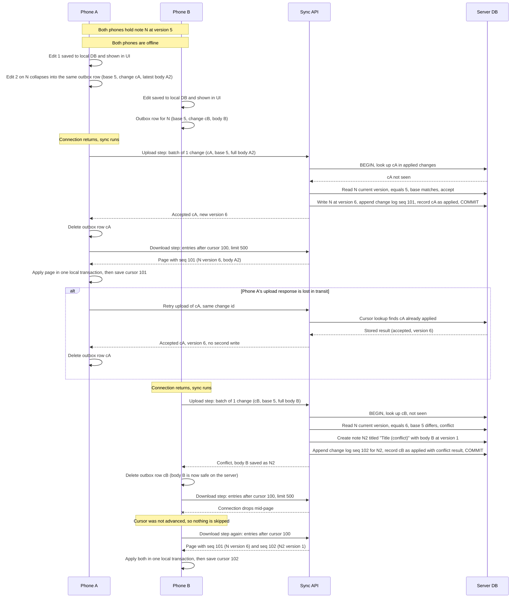

# Multi-device sync for the offline-first notes app

## Sequence: two phones edit note N offline, then sync one after the other

Both phones start with note N at server version 5. Phone A and Phone B are both offline.

## Where state lives

**Phone**
- `notes`: the local copy of each note (title, body, last known server version). Every edit writes here first, so the UI never waits on the network.
- `outbox`: one row per note with a pending change. Columns: change id (new UUID per row), note id, base version (the server version the edit started from), full body, state (`queued` or `sending`). Multiple edits to a queued row update its body and keep its base version. An edit made while a row is `sending` starts a new row whose base is the version the phone last applied, so the in-flight change is never altered.
- `sync_cursor`: the last change log sequence number this phone has applied. It moves only in the same local transaction that applies a download page.

**Server**
- `notes`: current title, body and integer version per note.
- `change_log`: append-only rows (seq, note id, version, full body, source device, change id). Seq numbers only increase.
- `applied_changes`: keyed by (device id, change id), storing the result returned for that change. It is written in the same transaction as the note write and the log append.

## Upload rules

- A batch holds at most 100 changes, processed in order. Each change is handled in its own server transaction.
- A change is accepted only if its base version equals the note's current version. On accept, the server writes version + 1, appends to `change_log`, and records the change id as applied, all in one transaction.
- A change whose base does not match is a conflict. The server does not merge text. It creates note N2 titled "<original title> (conflict)" with the losing body at version 1, and appends N2 to `change_log`. Both the conflict note and its log entry are written in the same transaction as the conflict record.
- The phone deletes an outbox row only after receiving that change's result (accepted or conflict). A conflict result means the body is already saved on the server, so the row is dropped and the body is not lost.

## Download rules

- Pages are at most 500 entries, requested with `after=cursor`. The phone advances `sync_cursor` only after the whole page is applied in one local transaction.
- Applying an entry is idempotent. A local note is replaced only when the entry's version is higher than the local version. Re-applying a page after an interruption changes nothing.
- Each sync runs upload first, then download. A failed upload ends that run, and the download waits for the next run.

## Failure and retry

| Failure | What happens | Why nothing is applied twice or skipped |
|---|---|---|
| Connection drops before the upload reaches the server | Outbox row stays `queued` (or is reset to `queued` from `sending`) and is sent again on the next sync | Server never saw the change, so the first apply is the only apply |
| Upload reaches the server, but the response is lost | Phone retries with the same change id | `applied_changes` returns the stored result without a second write |
| Server crashes mid-upload | The transaction rolls back, so no note write, log entry or applied record exists | Retry behaves like the first attempt |
| Download drops mid-page | Cursor stays at its old value, so the whole page is fetched again | Apply is version-guarded and runs in one transaction, so a partial page is never recorded as done |
| Two syncs overlap (foreground, reconnect, 60 s timer) | A single-flight lock on the phone lets only one sync run at a time | Prevents two uploads of the same outbox row in flight |
| App is killed during apply | Local apply is one transaction, so the cursor and note rows commit together or not at all | Next sync re-downloads from the old cursor |

## Open points for later

- Retention of `change_log`: a phone that has been offline longer than retention must do a full snapshot download. Not designed here.
- Ordering across notes is by seq, which is global. Per-note order is guaranteed because each note has at most one `queued` row and in-flight rows are never edited.
- Deletes, attachments, sharing and auth are out of scope.