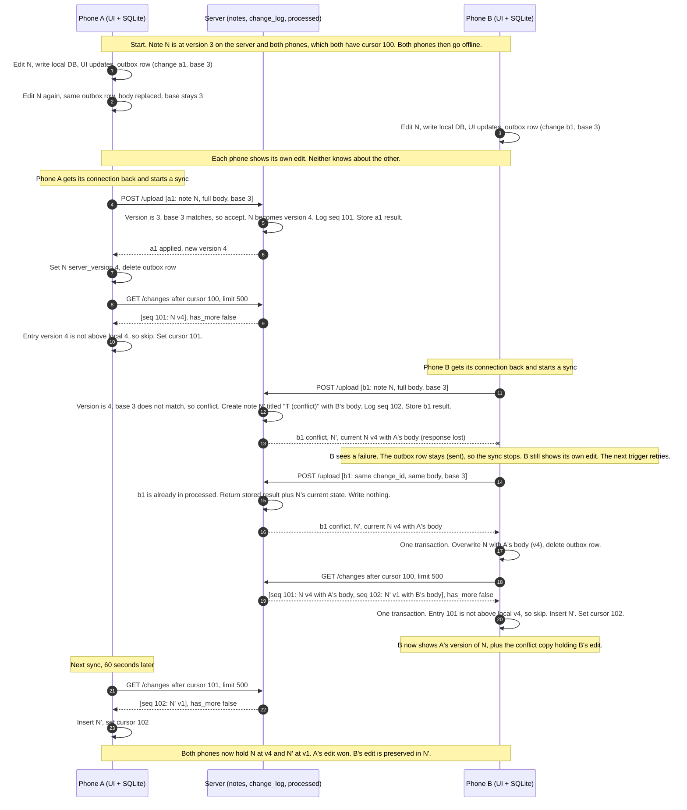

# Offline-first notes: multi-device sync flow

Today the app is local-only: notes live in SQLite on the phone and there is no sync server. This design adds multi-device sync. Every edit is saved locally at once and queued. Each sync then uploads queued changes to a server, which decides conflicts and keeps a numbered change log, and then downloads the log entries the phone has not seen. The server is the source of truth, so the shape is "upload first, then catch up from the log", and every step is safe to retry.

Scope: edits, creates and conflict copies. Deletes, attachments, sharing and auth are out of scope.

## Terms

- **Outbox**: the phone's table of edits waiting to upload. It holds at most one row per note.
- **Change**: one queued edit. It carries the full note body (no diffs), a `change_id` (UUID) and the `base_version` it started from.
- **Base version**: the server version of the note when the user began editing it. The server uses it to detect conflicts.
- **Version**: an integer per note on the server. It goes up by 1 on every accepted write.
- **Change log**: the server's append-only list of accepted writes. Each entry has an increasing sequence number (`seq`) that is never reused.
- **Cursor**: the last `seq` this phone has fully applied. It starts at 0, so a phone that has never synced downloads the whole log.
- **Conflict**: an upload whose `base_version` does not match the note's current version. We do not merge text. The write that reaches the server first wins.
- **Conflict note**: a new note the server creates to keep the losing body. Its title is the original title (as sent with the losing change) plus " (conflict)". Every device picks it up on its next download.
- **Batch and page**: an upload batch holds at most 100 changes. A download page holds at most 500 log entries.

## The scenario in the diagram

- Note N is at server version 3 on both phones. Both phones synced earlier and have cursor 100.
- Both phones go offline and edit N. Phone A edits twice. Phone B edits once.
- A syncs first, then B.
- B's upload response is lost once, to show a retry.

## Where state lives

**Phone, local SQLite (the source of truth for what the UI shows)**
- `notes(id, title, body, server_version)`. Every edit writes here first, so the UI updates with no network. `server_version` is the last version this phone knows the server has.
- `outbox(note_id PRIMARY KEY, change_id, title, body, base_version, sent, next_body)`.
  - The first edit creates the row. It sets `base_version` to the note's `server_version`, generates `change_id`, and sets `sent = 0`.
  - Later edits to the same note overwrite `body` and keep `base_version` and `change_id`. This is the collapse of several edits into one change.
  - When a batch is sent, its rows get `sent = 1`. From then on an edit to that row goes into `next_body` and `body` is never touched. A retry therefore always sends the same body under the same `change_id`.
- `sync_state(cursor)`. See Terms.

**Server (the source of truth overall)**
- `notes(id, title, body, version)`.
- `change_log(seq, note_id, version, title, body)`. The server assigns `seq` inside the write transaction and serves only committed entries. A later-committing write can never get a lower `seq` than one a phone has already read, so the cursor is safe.
- `processed(change_id, result)`. The result is `applied(new_version)` or `conflict(conflict_note_id)`. It is written in the same transaction as the note write or conflict note. It is what makes upload retries safe.

## How a sync runs

A sync starts on exactly three triggers: the phone gets its connection back (the OS reports the network is reachable again), the app comes to the foreground, and a 60-second timer while online. The phone counts itself offline when the OS reports no network or a request fails.

Only one sync runs at a time per phone. A trigger that arrives during a sync sets a flag and runs one more sync afterwards.

A failed request (error, timeout or non-2xx reply) ends the sync. The next trigger starts a new one, so a retry is never immediate. Until then the local database is untouched and the UI keeps showing the user's own edit.

### 1. Upload (first)

1. Read up to 100 outbox rows and set `sent = 1` on them. Send `POST /upload` with `[{change_id, note_id, title, body, base_version}]`.
2. For each change, the server runs one transaction:
   - If `change_id` is already in `processed`, it returns the stored result and writes nothing.
   - If `base_version` equals the note's current `version`, it accepts the change: `version = version + 1`, and it appends a log entry.
   - Otherwise it is a conflict. It creates a conflict note with the losing body and `version = 1`. The conflict note's id is derived from `change_id`, so it is deterministic. It appends a log entry for the conflict note. N is unchanged.
   - In both cases it stores the result in `processed`.
   - A conflict response also carries N's current state (version, title, body), read fresh when the response is built. This is why a retry after a lost response still brings the current N.
3. The response has one result per change. The phone handles each in one local transaction and deletes the outbox row:
   - `applied(v)` sets `notes.server_version = v`.
   - `conflict(...)` applies N's current state from the response as if it were a download entry: overwrite title and body and set `server_version`, under the same version check. The user's losing edit now lives only in the conflict note. The phone does not use the conflict note's id. That note reaches the phone through the download like any other entry.
4. If the outbox still has rows, send the next batch. Download starts only after all batches succeed. If a batch fails, the sync stops and the next trigger resends the whole batch. That is safe because already-processed changes return their stored results.

**Edit while a change is in flight.** An edit made after the batch was sent is held in `next_body` on the same row. When the ack arrives, the phone queues `next_body` as a new change with a new `change_id` and sets `notes.body` to it. On `applied(v)` its `base_version` is `v`. On `conflict` it is the version from the response's current state.

### 2. Download (second)

1. Send `GET /changes?after=<cursor>&limit=500`. The server returns entries ordered by `seq`, plus `has_more`. Each entry carries the full note state: note_id, version, title, body.
2. In one local transaction, the phone applies the entries and sets `cursor` to the last `seq` in the page. For each entry:
   - Skip it if `entry.version <= notes.server_version`. This covers the phone's own writes echoing back, a conflict state already applied at upload, and any re-applied page.
   - Skip it if the note has an outbox row. This happens only when the user edited the note after upload read the outbox. The local edit is not lost. It uploads with its old base version and conflicts, and the conflict response brings the current server state, so the skipped body is not missed even though the cursor moves past it.
   - Otherwise upsert the note and set `server_version`.
3. Repeat while `has_more` is true.

## Failure and retry

| Failure | What happens |
|---|---|
| Edit made offline | Saved locally and queued. Nothing is lost if the app is killed. |
| Upload request lost before the server sees it | The row is still in the outbox with `sent = 1`. The next trigger resends the same `change_id` and body. The UI keeps showing the user's own edit. |
| Upload applied but the response was lost | The retry sends the same `change_id`. The server returns the stored result without writing again. A lost conflict response does not create a second conflict note. |
| Partial batch applied | Each change is its own transaction with its own `processed` row. Resending the whole batch is safe. |
| Conflict, then download fails or is slow | The phone already shows the server's current N from the conflict response. The conflict note appears at the next successful download. The user is not told a conflict happened (open point). |
| Download interrupted | The cursor moves only in the same transaction as the applied entries. The phone refetches from the old cursor, and the version check makes re-applying harmless. No entries are skipped. |
| App killed mid-sync | All sync state is in SQLite, so the next trigger resumes from it. |

## Sequence diagram

## Open points for the build

- **New notes created offline.** Creating a note needs its own rule: a client-generated note id and an outbox row with a base version of 0 that the server treats as "create". The brief does not cover this, so confirm it before building.
- **Retention.** The server must keep `processed` rows at least as long as a phone can stay offline and still retry. This needs a retention decision. The brief gives no limit.
- **Telling the user about a conflict.** Nothing in this design notifies the user. They find the conflict note when it syncs in. Whether to add a notice is a product decision.
- **Malformed changes.** A change the server cannot process would fail its batch on every retry. How to reject or skip it is not decided.
