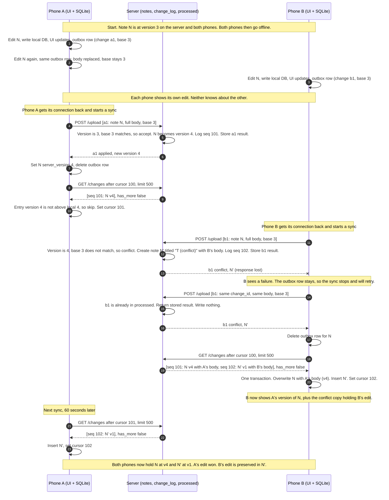

# Offline-first notes: multi-device sync flow

## Scope

This design covers sync for edits, creates and conflict copies. Deletes, attachments, sharing and auth are out of scope.

The scenario in the diagram:
- Note N is at server version 3 on both phones.
- Both phones go offline and edit N.
- Phone A edits twice. Phone B edits once.
- A syncs first, then B.
- B's response is lost once, to show a retry.

## Where state lives

**Phone, local SQLite (the source of truth for what the UI shows)**
- `notes(id, title, body, server_version)`. Every edit writes here first, so the UI updates with no network. `server_version` is the last version this phone knows the server has.
- `outbox(note_id PRIMARY KEY, change_id, title, body, base_version)`. There is at most one row per note.
  - The first edit creates the row. It sets `base_version` to the note's `server_version` and generates a `change_id` (UUID).
  - Later edits to the same note overwrite `body` and keep `base_version` and `change_id`. This is the collapse.
- `sync_state(cursor)`. This is the last log sequence number fully applied on this phone. It starts at 0.

**Server (the source of truth overall)**
- `notes(id, title, body, version)`. `version` goes up by 1 on every accepted write.
- `change_log(seq, note_id, version, title, body)`. `seq` increases with every accepted write and is never reused.
- `processed(change_id, result)`. The result is `applied(new_version)` or `conflict(conflict_note_id)`.
  - It is written in the same transaction as the note write or conflict copy.
  - It is what makes upload retries safe.

## Upload (runs first in every sync)

1. Read up to 100 outbox rows. Send `POST /upload` with `[{change_id, note_id, title, body, base_version}]`.
2. For each change, the server runs one transaction:
   - If `change_id` is already in `processed`, it returns the stored result and writes nothing.
   - If `base_version == notes.version`, it accepts the change. It sets `version = version + 1` and appends a log entry.
   - Otherwise it is a conflict. The server creates a new note with title `<title> (conflict)`, body = the losing body and `version = 1`. The new note's id is derived from `change_id`, so it is deterministic. The server appends a log entry for it. N is unchanged.
   - In both cases it stores the result in `processed`.
3. The phone handles each result and deletes the outbox row.
   - `applied(v)` sets `notes.server_version = v`.
   - `conflict(...)` leaves the local body as it is until the download replaces it.
4. If the outbox still has rows, repeat with the next batch. Download starts only after all batches succeed. If any batch fails, the sync stops and the next trigger retries.

**Edit while a change is in flight.** The row keeps its `change_id`, so a retry can never send a different body under the same id. An edit made after the batch was sent is held as `next_body` on the same row. When the ack arrives:
- On `applied(v)`, the phone makes `next_body` a new queued change with `base_version = v` and a new `change_id`.
- On `conflict`, the phone makes `next_body` a new queued change with `base_version` = the server's current version. The phone learns that version from the download, so the change is queued after the download.

## Download (runs second)

1. Send `GET /changes?after=<cursor>&limit=500`. The server returns entries ordered by `seq`, plus `has_more`. Each entry carries the full note state: note_id, version, title, body.
2. In one local transaction, the phone applies the entries and sets `cursor` to the last `seq` in the page:
   - Skip an entry if `entry.version <= notes.server_version`. This covers the phone's own writes echoing back and any re-applied page.
   - Skip the body overwrite if the note has an outbox row. The local edit is not lost. It will upload and conflict normally.
   - Otherwise upsert the note and set `server_version`.
3. Repeat while `has_more` is true.

The server assigns `seq` inside the write transaction and serves only entries whose transaction has committed. A later-committing write can never get a lower `seq` than one a phone has already read. So the cursor is safe.

## Failure and retry

| Failure | What happens |
|---|---|
| Edit made offline | Saved locally and queued. Nothing is lost if the app is killed. |
| Upload request lost before the server sees it | The row is still in the outbox. The next sync resends the same `change_id`. |
| Upload applied but the response was lost | The retry sends the same `change_id`. The server returns the stored result without writing again. A lost conflict response does not create a second conflict note. |
| Partial batch applied | Each change is its own transaction with its own `processed` row. Resending the whole batch is safe. |
| Download interrupted | The cursor moves only in the same transaction as the applied entries. The phone refetches from the old cursor, and the version check makes re-applying harmless. No entries are skipped. |
| App killed mid-sync | All sync state is in SQLite, so the next trigger resumes from it. |
| Triggers overlap (foreground, 60s timer, reconnect) | Run one sync at a time per phone. A trigger that arrives during a sync sets a flag and runs one more sync afterwards. |

## Sequence diagram

## Open points for the build

- **Conflict-note title.** The title is the original title as sent with the losing change, plus " (conflict)".
- **New notes created offline.** Creating a note needs its own rule: a client-generated note id and an outbox row with a base version of 0 that the server treats as "create". The brief does not cover this, so it should be confirmed before building.
- **Retention.** The server must keep `processed` rows at least as long as a phone can stay offline and still retry. This needs a retention decision. The brief gives no limit.
