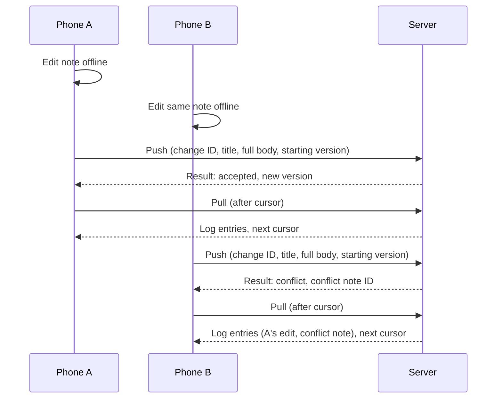

## Notes sync

The app today is local-only: notes live in SQLite on the phone and there is no server. This adds a server that is the source of truth. Each phone saves every edit locally at once, queues it in an outbox, and syncs by pushing (uploading) its queued changes and then pulling (downloading) the server's change log. The server accepts a change only if it started from the note's current version. A losing change is saved by the server as a separate conflict note, so no text is lost and no text is merged.

### Terms

- **Outbox**: the phone's queue of changes not yet uploaded.
- **Change**: one queued edit with its own change ID, note ID, title, full body (no diffs) and starting version.
- **Starting version**: the server version of the note that the edit began from. The server version for a note is the one the phone last got, from a pull or from an accepted result.
- **Version**: an integer per note on the server. It goes up by one on every accepted write.
- **Change log**: the server's append-only list of every accepted write. Each entry has an increasing sequence number, note ID, title, full body and the note's version after the write.
- **Cursor**: the highest log sequence number the phone has applied. The phone stores it.
- **Processed change IDs**: the server keeps each handled change ID with its result, so a retry never applies a change twice.
- **Conflict note**: a new note the server creates from a losing body, titled "<original title> (conflict)". The original title is the title carried by the losing change.

### Diagram

Example: both phones hold version 3 of a note. A's push is accepted and the server goes to version 4. B's push carries starting version 3, which is not 4, so it is a conflict.

### Steps

1. **Edit (phone).** Every edit is saved to local SQLite at once and shown in the UI, with no network wait. It is also queued in the outbox as a change that carries the note's current title and the full body. Several edits to one note before upload collapse into one change. It keeps the change ID and the original starting version of the unsent change and takes the latest title and full body. Collapsing happens only into a change that has not been sent (see step 5). A note created on the phone has no server version, so its first change carries starting version 0.

2. **Trigger (phone).** A sync starts when the connection returns, when the app comes to the foreground, and every 60 seconds while online. If a sync is still running when the timer fires, that tick is skipped, so two syncs never send the same changes. Every sync pushes first, then pulls.

3. **Push (phone to server).** The phone sends up to 100 outbox changes, oldest first. It sends the next batch only after handling the results of the previous one, and repeats until the outbox is empty, then pulls.

4. **Version check (server).** The server compares the change's starting version with the note's current version. An unknown note ID counts as version 0, so a new note is accepted and becomes version 1.
   - Equal: accepted. The version goes up by one and an entry is appended to the change log with the next sequence number, using the change's title and body.
   - Not equal: conflict. The first write to reach the server wins. The server saves the losing body as a conflict note with a new note ID and version 1, and logs it as an ordinary entry. The conflict note can be edited and synced like any note.
   - Either way the server stores the result under the change ID. If it sees that ID again, in any batch or later, it returns the stored result and applies nothing.

5. **Handle the result (phone).** Per change, the result is accepted with the new version, or conflict with the conflict note ID. The phone removes the change from the outbox on either result.
   - Accepted: the phone also sets the local note's version to the new version. When its own edit comes back in a pull, it is not newer than the local copy and is ignored.
   - A change that is part of a push is frozen. A new edit to that note makes a new queued change with its own new change ID. If the result was accepted, the new change's starting version becomes the new version. If it was a conflict, the new change keeps its old starting version and will conflict too (see open questions).
   - After a conflict, B keeps seeing its own text until it pulls. That text is safe on the server in the conflict note.

6. **Pull (phone from server).** The phone asks for entries after its cursor, at most 500. The server replies with the entries, the next cursor, and whether more remain. The phone keeps pulling until none remain. It applies a page and saves the new cursor together in one local transaction. A new phone starts at cursor 0 and receives every entry, 500 at a time.

7. **Apply an entry (phone).** If the phone does not know the note ID, it creates the note. If it does, it replaces the local title, body and version only when the entry's version is newer than the local version. This is how B's note (version 3) is replaced by A's version 4, and how the conflict note arrives in the same pull. If the user has an unsent change queued for that note, the local text is still replaced and the queued change stays in the outbox. It keeps its old starting version, so it will conflict and its body will be saved as a conflict note, not lost.

### What happens when things fail

A failed or timed-out request, or a server error, is any push or pull that does not return a normal response. The phone does not retry at once. The next trigger starts the next sync.

| Where | What happens |
|---|---|
| Push gets no response | Nothing is removed from the outbox. The sync is abandoned without pulling. The next sync pushes again, and change IDs make the repeat safe. This holds even if the user edited the note meanwhile: the retry sends the same frozen change and gets the stored result. |
| Server hits an unexpected error (not a conflict) in a batch | The server handles the batch in order and stops. It returns results only for changes already handled. The phone removes only those, keeps the rest in the outbox, and abandons the sync without pulling. The next sync pushes the rest. |
| Pull drops midway | The cursor only moves after a page is applied, so the next sync repeats the same request. B's UI is unchanged until a pull succeeds. |
| An entry is applied twice | Harmless. The phone ignores an entry whose version is not newer than its local copy. |

### Scope

Out of scope: deletes, attachments, sharing between users, auth.

### Open questions

- If a user edits a note again after a conflict but before pulling, that edit starts from the old version and will conflict again. This is accepted. The same holds for an edit queued while a change was in flight that then conflicts.
- If one change fails with a server error every time, it blocks the changes behind it in the outbox. No retry limit or skip rule is decided.
- The change log is never trimmed, so a new phone's first pull grows with the log. No snapshot or trimming is decided.
