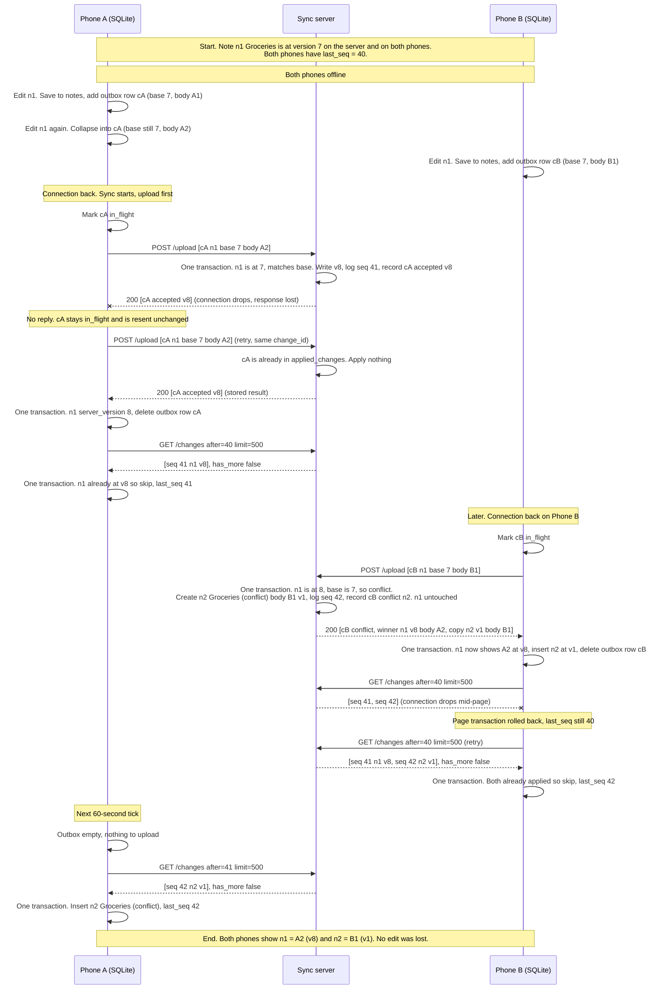

# Notes sync: sequence design

## Where state lives

**On each phone (SQLite)**

- `notes(id, title, body, server_version)` holds what the UI shows. `server_version` is the last server version this phone knows for the note. Note ids are UUIDs made on the phone, so a note can be created offline.
- `outbox(change_id, note_id, base_version, title, body, state)` has one row per queued change. `change_id` is a UUID made when the row is created. `state` is `pending` or `in_flight`.
  - If the user edits a note that has a `pending` row, the edit goes into that same row: title and body are replaced, and `change_id` and `base_version` stay as they were.
  - An `in_flight` row is frozen. It may already have been applied on the server, so nothing is ever collapsed into it (see "Edit during upload" below).
  - The edit to `notes` and the edit to `outbox` are written in one local transaction, so the UI and the queue always agree.
- `sync_state(last_seq)` is the download cursor: the highest log sequence number this phone has fully applied.

**On the server (one database)**

- `notes(id, title, body, version)` is the source of truth.
- `change_log(seq, note_id, version, title, body)` gets one row per accepted write, including the creation of conflict copies. `seq` comes from a single counter row that is updated inside the write transaction. That makes seqs commit in order with no gaps, so a reader can't see seq 42 while seq 41 is still uncommitted and then step past it.
- `applied_changes(change_id, result)` stores either `accepted(version)` or `conflict(conflict_note_id)`. This table is what makes uploads idempotent.

**Server rule for one uploaded change** (each change is one transaction: the version check, the note write, the log append and the `applied_changes` row are all saved or none are):

1. If `change_id` is already in `applied_changes`, apply nothing. Return the stored result.
2. Otherwise, if `base_version` equals the note's current version (or `base_version` is 0 and the note doesn't exist yet, which is a create), write the note at version + 1, append to the log and record `accepted`.
3. Otherwise it is a conflict. Leave the note as it is. Create a new note with a new id, the title plus " (conflict)", the uploaded body and version 1. Log it and record `conflict`. The response includes the winning note's current state and the conflict copy, so the phone can update right away without waiting for its download.

Title and body together count as the note's content here. The brief says "full note body", and I've assumed the title travels with it.

## Sequence: two phones edit the same note offline, then sync one after the other

## Failure and retry

- **Upload request lost before it reaches the server.** Nothing was applied. The row is still `in_flight` and is resent with the same `change_id` on the next sync.
- **Server applied the change but the response was lost** (shown above). The retry carries the same `change_id`. The server returns the stored result and doesn't write a second time.
- **Batch cut off partway.** Each change in a batch is its own server transaction, so some may be applied and others not. The phone resends the whole batch. Applied changes come back as stored results and the rest are applied normally. The response gives one result per `change_id`.
- **App killed mid-upload.** `in_flight` rows survive in SQLite. On the next launch they are resent exactly as they are, never edited. Because any `in_flight` row might already be applied, it can't be collapsed into.
- **Edit during upload.** An edit to a note whose row is `in_flight` creates a second `pending` row that waits behind it and is not sent until the first row has a result. If the first is `accepted(v)`, the waiting row's base becomes `v`. If the first is a `conflict`, the user's newer text belongs with their own copy, so the waiting row is moved to the conflict note with base 1. Locally, that note shows the newer text. Nothing overwrites the winner, so "first write wins" still holds.
- **Download interrupted** (shown above). Applying a page and moving `last_seq` forward happen in one SQLite transaction. A page that was lost or only half applied is rolled back, and the phone fetches again from the same cursor. Applying an entry is idempotent because it only writes when the entry's version is higher than the local `server_version`. Gap-free, in-order seqs on the server mean the cursor can't skip an entry.
- **Download entry for a note that still has an outbox row.** The local body isn't overwritten, because it holds the user's unsent text. The cursor still advances. That note's upload settles it: it will conflict, and the conflict response carries the winner.
- **More than 100 queued changes or more than 500 log entries.** Upload loops in batches of up to 100 until the outbox is empty. Download loops page by page while `has_more` is true.
- **Overlapping triggers** (reconnect, foreground and the timer firing close together). Only one sync runs at a time on a phone. A trigger that arrives during a sync sets a "run again" flag, and a single extra sync runs when the current one finishes.

## Open points to decide

- **How long to keep `applied_changes`.** Retries are only safe while the record exists. The simplest choice is to keep it forever, since it is one small row per write. If it is ever pruned, a phone that sends a retry after the record is gone could get that change applied twice.
- **First sync of today's local-only notes.** Each existing note is queued as a create (`base_version` 0) the first time the phone signs in. A second phone that signs in has its own notes uploaded the same way and then downloads everything from seq 0.
