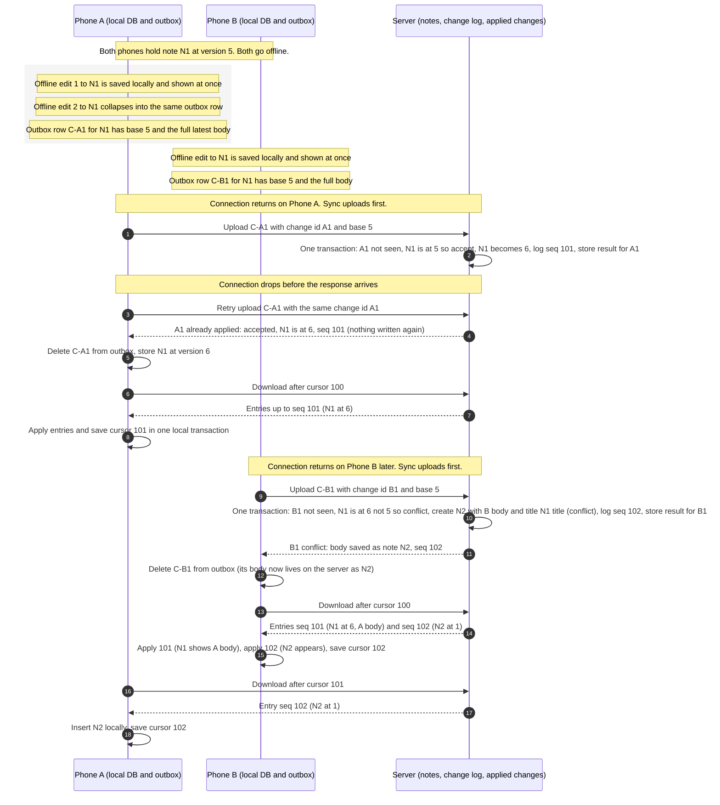

# Offline sync flow for the notes app

The notes app will sync notes across several phones, and each phone must work fully offline. Every edit is saved to the phone's own database and shown at once, then queued to upload when a connection is available. The server is the source of truth: it numbers each note's versions, logs every accepted write, and decides conflicts. Today the app is local-only (SQLite on the phone), and there is no sync server yet.

**Terms**

- **SQLite:** a small database file kept on the phone.
- **Version:** a whole number on each note on the server. It goes up by one on every accepted write.
- **Base version:** the note version that an edit started from.
- **Outbox:** the phone's queue of changes waiting to upload. It has one row per note.
- **Change id:** an id the phone gives each queued change, so the server can recognise a resent change.
- **In flight:** a change that has been sent to the server, with no result back yet.
- **Change log:** the server's ordered list of every accepted write.
- **Seq:** the position of an entry in the change log. Seq numbers only go up.
- **Cursor:** the highest seq a phone has applied. The phone asks for entries after it.
- **Conflict:** an upload whose base version is no longer the note's current version.
- **Conflict note:** the new note the server creates to keep a losing body.
- **Idempotent:** running it twice gives the same result as running it once.
- **Sync lock:** a lock per phone, so only one sync runs at a time.

The diagram shows two phones editing N1 (version 5) while offline. Phone A syncs first and wins. Phone B's losing body is saved by the server as conflict note N2, and both phones pick it up on download.

**Where state lives**

- **Server:** `notes` (id, title, body, integer version). `change_log` (seq, note id, version, title, body, device id, change id). `applied_changes` (device id and change id, unique, with the stored result of that change). One seq counter.
- **Phone:** `notes` (local body, last server version seen). `outbox` (one row per note: change id, note id, base version, full body). `sync_state` (download cursor, which is the last applied seq).
- The UI reads only the local database. Nothing about a phone's edits waits on the network.

**Steps**

1. **Edit.** Trigger: the user edits a note, online or offline. The phone saves the full new body in its local `notes` table and shows it at once. It then adds or updates one outbox row for that note. The row holds the change id, note id, base version and full body. A queued change carries the full body, never a diff.
   - If the note already has an unsent row, the edit overwrites that row's body. The base stays at the version the first edit started from, so several edits collapse into one queued change.
   - If the note's row is in flight, the edit goes into a new row. If the in-flight change is accepted, the new row's base becomes the returned version. That is safe, because these edits were made on top of the accepted body. If the in-flight change conflicts, the new row keeps its old base and makes its own conflict note. No text is merged.
   - Failure: none needed. The edit is safe in the local database and the outbox until it uploads.

2. **Sync.** Triggers: the connection returns, the app comes to the foreground, or 60 seconds pass while online. Each sync uploads first, then downloads. The phone holds one sync lock, so a trigger that fires during a sync waits or is dropped. With no network, no sync is tried.

3. **Upload.** The phone sends up to 100 outbox changes in one batch, oldest first. The server handles each change in its own transaction, which either commits fully or not at all. The transaction:
   - checks `applied_changes` for the change id. If it is there, it returns the stored result and writes nothing;
   - compares the change's base version with the note's current version;
   - if they match, accepts the change: the version goes up by one, and the change is appended to the change log with the next seq;
   - if they do not match, records a conflict: it creates a new note with the losing body, titled with the original title plus " (conflict)", version 1 and a new note id. That creation is also appended to the change log, so every device picks it up on download. The losing body is never thrown away;
   - stores the result under the change id.

   The seq is taken while holding the same lock that guards the version check (for example, a counter row updated in the same transaction). This keeps seq order equal to commit order. If two commits could finish out of order, a phone could read seq 102, move its cursor past it, and miss seq 101 when it commits later.

   The phone deletes an outbox row only after it receives a result (accepted or conflict) for that change id. A row with no result stays queued with the same change id.

4. **Download.** The phone asks for up to 500 log entries after its cursor. It applies the page in seq order in one local transaction, and it moves the cursor in that same transaction.
   - For each entry, it sets the local note only if the entry's version is higher than the local version. This makes applying idempotent, so applying a page again changes nothing.
   - If the note has an outbox row, the phone keeps showing its local body and the row's base does not change. The conflict is decided when that row uploads.
   - Failure: a dropped page rolls back and the cursor stays put. The same page is requested again.

**What happens when things fail**

| When this goes wrong | What happens |
|---|---|
| The server commits an upload, but the reply is lost | The retry carries the same change id. The server returns the stored result and writes nothing, so the change is never applied twice. |
| The connection drops mid-batch | Each change commits on its own. Committed changes have stored results. The rest retry with their original change ids. |
| The phone is killed after the server accepts, but before the outbox row is deleted | Same as a lost reply. The retry does nothing new. |
| The connection drops during a download | The page's transaction rolls back and the cursor stays put. The same page is requested again, so no change is skipped or missed. |
| No network | No sync is tried. Edits stay in the outbox and the local database. |
| Two sync triggers overlap | The sync lock allows one sync. The other waits or is dropped. |

**Out of scope:** deletes, attachments, sharing between users, auth.

**Open questions**

- New notes created offline need a client-generated note id and base version 0. The brief does not say how this works.
- Follow-up edits made while a conflicting change is in flight create a second conflict note. Decide whether to accept this, or to hold follow-up rows until the conflicting version is downloaded and decide then.
- Pruning `applied_changes` and `change_log` needs a floor: no pruning below the lowest cursor still in use. Without one, a phone that was offline for a long time can retry an old change id that has been deleted.
- Conflict notes get version 1 and a new note id, and their creation is logged like any other write. The brief does not settle this; it is the working choice.