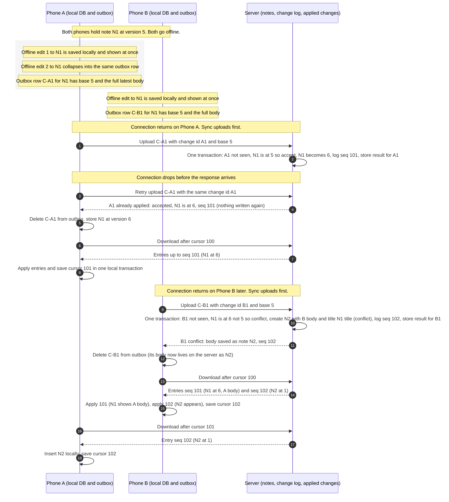

# Offline sync flow for the notes app

Two phones edit the same note (N1, version 5) while offline. Phone A syncs first and wins. Phone B's losing body is saved by the server as a conflict note (N2), and both phones pick it up on download.

## Notes

**Where state lives**

- **Server:** `notes` (id, title, body, integer version). `change_log` (seq, note id, version, title, body, device id, change id). `applied_changes` (device id plus change id, unique, with the stored result of that change). One seq counter.
- **Phone:** `notes` (local body, last server version seen). `outbox` (one row per note: change id, note id, base version, full body). `sync_state` (download cursor = last applied seq).
- Nothing about the phone's edits waits on the network. The UI reads only the local DB.

**Upload rules**

- A batch holds up to 100 changes, oldest first. The server handles each change in its own transaction. That transaction checks `applied_changes` for the change id, compares base version to the current version, and either bumps the version and appends to the log, or creates the conflict note and appends to the log. It also stores the result. All of this commits together or not at all.
- The phone removes an outbox row only after it receives a result (accepted or conflict) for that change id. Rows without a result stay queued with the same change id.
- Collapsing: while a row has not been sent, further edits overwrite its body and its base stays at the version the first edit started from.
- Edits made while a row is in flight go into a new row. If the in-flight change is accepted, the new row's base is set to the returned version, which is safe because those edits were made on top of the accepted body. If the in-flight change conflicts, the new row keeps its old base and will produce its own conflict note. No text is merged.

**Download rules**

- Pages hold up to 500 entries after the cursor. Each page is applied in seq order in one local transaction, and the cursor advances in that same transaction. A dropped page rolls back, so the same page is requested again.
- Applying an entry is idempotent: it sets a note only when the entry's version is higher than the local version. Re-applying a page therefore changes nothing.
- If a note has an outbox row, the phone keeps showing the local body, and the row's base does not change. The conflict is decided when that row uploads.
- Seq order must match commit order. Allocate the seq while holding the same lock that guards the version check (for example, a counter row updated in the same transaction). If two transactions could commit out of order, a phone could read seq 102, advance its cursor past it, and miss seq 101 when it commits later.

**Failure and retry**

- Connection drops after the server commits but before the phone sees the reply: the retry carries the same change id. The server returns the stored result and writes nothing, so the change is never applied twice.
- Connection drops mid-batch: each change committed on its own. Committed changes have stored results, and the rest retry with their original change ids.
- Phone is killed after the server accepts but before the outbox row is deleted: same as a dropped reply. The retry is a no-op.
- Connection drops during download: the transaction rolls back and the cursor stays put, so nothing is skipped.
- Triggers (connection back, app foreground, 60 second timer while online) can overlap. Use one sync lock per phone and let extra triggers wait or be dropped.
- No network: no sync attempts. Edits stay in the outbox and local DB.

**Open decisions (not settled by the brief)**

- New notes created offline need a client-generated note id and base version 0. The brief does not cover this.
- Follow-up edits made while a conflicting change is in flight create a second conflict note. Accept this, or hold follow-up rows until the download of the conflicting version and decide then.
- Pruning `applied_changes` and `change_log` needs a floor: no pruning below the lowest cursor still in use. Otherwise a phone that was offline a long time can retry an old change id that has been deleted.
- Conflict notes get version 1 and a new note id. Their creation is logged like any other write, so every device sees them on download.
