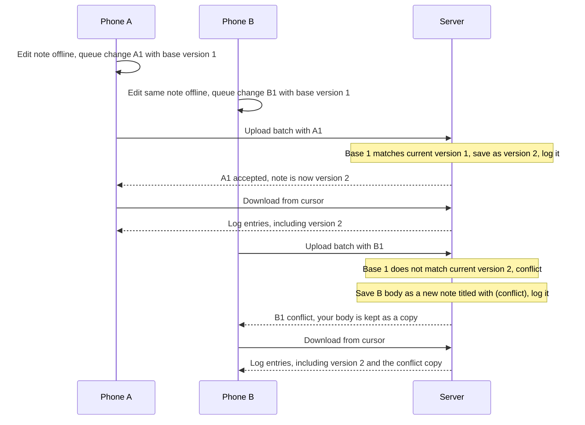

## Notes sync

Today the app is local-only: notes live in SQLite on each phone, and there is no sync server. We are adding sync so that several phones can read and edit the same notes with no network. Every edit is saved on the phone at once and queued as a change. When a connection is available, the phone uploads its queued changes first, then downloads new changes from the server. The server is the source of truth. It accepts a change only if the phone started from the current version. If two phones collide, the losing text is kept as a new note, so no text is ever lost. Deletes, attachments, sharing between users and auth are out of scope.

Terms:
- **Version**: a whole number on each note on the server. It goes up by one on every accepted write.
- **Base version**: the server version that an edit started from. Each change carries one.
- **Outbox**: the phone's SQLite table of changes that have not been confirmed by the server.
- **Change ID**: a unique ID that the phone gives each change when it queues it.
- **Change log**: the server's list of accepted writes. Each entry has a sequence number that only goes up.
- **Processed change IDs**: the server's record of change IDs it has already handled.
- **Cursor**: the phone's last applied sequence number. The next download starts after it.
- **Conflict copy**: a new note made from a losing body. Its title is the original title plus " (conflict)".

Steps:

1. **Edit.** Trigger: the user edits a note. The phone saves the full new body in its notes table and writes the change to the outbox at once, then updates the screen. No network is needed. If the same note already has an unsent change in the outbox, the phone replaces that change's body and keeps its original base version and change ID. So several edits before an upload become one change. A change that has been sent is never edited. A later edit creates a new change.
2. **Sync.** Triggers: the connection comes back, the app comes to the foreground, or 60 seconds pass while online. Each sync uploads first, then downloads.
3. **Upload.** The phone sends outbox changes in batches of at most 100. Each change has its change ID, base version and full body. For each change, the server first checks whether the change ID is already processed. If it is, the server returns the saved result and applies nothing. If the base version equals the note's current version, the server saves the body as the next version, adds it to the change log with the next sequence number, and records the change ID. If not, the server saves the losing body as a conflict copy, logs it, records the change ID and reports a conflict. The phone removes a change from the outbox once the server answers accepted or conflict. A conflict is removed too, because the body now lives on in the copy.
4. **Download.** The phone asks for log entries after its cursor, at most 500 per page. Each entry holds the note's version and body, so the phone can show the change with no further request. The phone skips any entry for a version it already has. It saves the new entries and the new cursor in one local write, so the cursor moves only past entries that were applied. It keeps asking until a page comes back empty.
5. **Conflict result.** The phone's edit is not lost. It is now a conflict copy that every device downloads. The phone then downloads the winning version of the original note.

What happens when things fail:

| What fails | What happens | What retry does |
|---|---|---|
| Phone is offline | Edits are saved and queued. No sync runs. | Next trigger runs a sync. |
| Upload is lost, or the answer is lost after the server saved it | The change stays in the outbox. | The same change ID is sent again. The server returns the earlier result and applies nothing twice. |
| Upload conflicts | The server keeps the body as a copy. | None needed. The phone removes the change. |
| Download is interrupted | Nothing is saved, and the cursor does not move. | The next sync asks again from the same cursor, so no entry is skipped or missed. |

Open questions:
- Which base version does a new edit get while an earlier change for the same note is still waiting for the server's answer? The brief does not say.
- The design assumes each log entry carries the full note body and version. The brief does not say this.