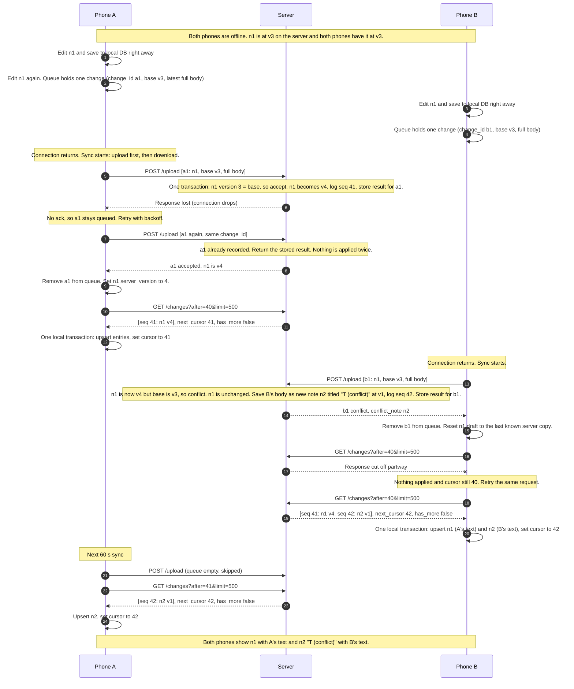

# Sync flow for the offline-first notes app

Today the app is local-only: notes live in SQLite on the phone and there is no sync server. This design adds a server and multi-device sync. Every edit is saved to the phone's database at once and queued. When online, the phone uploads its queue and then downloads what other devices wrote, by reading a numbered server log. The server decides conflicts, so the first write to arrive wins and the loser is kept as a new note.

Out of scope: deletes, attachments, sharing between users, auth.

## Terms

- **Version.** An integer on each note, kept by the server. It goes up by 1 on every accepted write.
- **Base version.** The server version an edit started from. It is sent with the change.
- **Change log.** The server's append-only list of accepted writes. Each entry has an increasing `seq`, `note_id`, `version` and a full snapshot of the note (title and body).
- **Cursor.** On a phone, the last `seq` it has applied.
- **Outbox.** On a phone, the queue of changes waiting to upload. Each row has `change_id`, `note_id`, the full body and `base_version`. No diffs are sent.
- **`change_id`.** A UUID made when an outbox row is first created. The server uses it to recognise a retry.
- **Applied-changes table.** On the server, keyed by `change_id`. It stores the outcome: accepted, or conflict plus the conflict note's id.
- **Conflict.** An upload whose base version differs from the note's current server version.
- **Sync.** One run of upload, then download.

## Diagram

The diagram follows one note, `n1`, that two phones edit while offline. Phone A syncs first and Phone B syncs second. Starting state: the server holds `n1` at version 3, the log's last `seq` is 40, and both phones have synced up to 40.

## Where state lives

**Phone (local SQLite)**
- **Notes table.** What the UI reads. Every edit writes here first, so it shows with no network round trip. Each note also keeps the last known server copy (`server_version`, `server_title`, `server_body`). The title is part of the note content sent in a change.
- **Outbox.** As defined above, at most one row per note.
- **Cursor.** As defined above.

**Server**
- **Notes.** Each note's current version, title and body.
- **Change log** and **applied-changes table**, as defined above. A write, its log entry and its applied-changes record are saved in one transaction.

The server is the source of truth.

## Steps

1. **Edit (phone, offline or online).** The edit is saved to the notes table straight away, then queued. If the note already has an outbox row, the new body overwrites the old one and the row keeps its `change_id` and `base_version`. So several edits collapse into one change that keeps the original starting version, and a batch never holds two changes for one note. If the user edits while that row is mid-upload, the edit becomes a separate pending row. When the ack arrives, its base version is filled in from the ack, or from the conflict outcome if the upload lost.
2. **Sync trigger (phone).** A sync starts when the connection returns, when the app comes to the foreground, and every 60 seconds while online. Only one sync runs at a time per phone. A trigger that fires while one is running is skipped. If the app is killed mid-sync, the local database is intact as of the last committed step, and the next trigger restarts the sync.
3. **Upload (phone to server).** The phone sends up to 100 outbox changes per request and repeats until the outbox is empty or a request fails. Each change is judged on its own, so one conflict does not block the others. An empty outbox skips the upload.
4. **Judge each change (server).** In one transaction, the server first looks up `change_id` in the applied-changes table. If found, it returns the stored result and applies nothing. If new, it compares the base version with the note's current version.
   - **Match: accept.** The version goes up by 1 and a log entry is added.
   - **Mismatch: conflict.** The existing note is left alone. The losing body is saved as a new note titled with the original title plus " (conflict)", at version 1. Its id is derived from `change_id`. It is logged like any other write, so every device downloads it. Text is never merged, and the losing body is never thrown away.
   - Either way the outcome is stored under `change_id`. Sequence numbers are assigned at commit, one writer at a time, so a reader can never see seq 42 before seq 41 has committed.
5. **Handle the ack (phone).** The outbox row is deleted only after an ack. On accept, the phone sets the note's `server_version` to the acked version. On conflict, it resets the displayed note to its server copy. The user's text is not lost, because it is now in the conflict note that arrives on download.
6. **Download (phone from server).** The phone asks for log entries after its cursor, at most 500 per page. In one local transaction it upserts the entries and sets the cursor to the page's `next_cursor`. It repeats while `has_more` is true. An upsert ignores an entry whose version is at or below the local one, so replays are harmless. Entries carry full snapshots, so no second request is needed to apply one.
   - The phone also downloads entries it caused. They match the stored server version and do nothing.
   - If the note has a queued change, only the server copy is updated, not the displayed draft. The queued change will then conflict, which is correct.

## What happens when things fail

| Failure | Effect | Recovery |
|---|---|---|
| Upload request fails or the response is lost | The phone cannot tell whether the server applied it. | Retry with backoff, resending the same batch with the same `change_id`s. The server replays stored results for known ids and applies only new ones. The outbox row stays until an ack. |
| Download interrupted | A partial response applies nothing, and the cursor has not moved because it advances only in the same transaction that applies a page. | Refetch from the unchanged cursor. Nothing is skipped or applied twice. |
| App killed mid-sync | Local database intact. | The next trigger restarts the sync (step 2). |
| More than 500 new entries | The server returns `has_more: true`. | The phone loops page by page (step 6). |
| Two syncs overlap on one phone | The 60 s timer could fire during a reconnect sync. | The second is skipped (step 2). |

## Open questions

None.