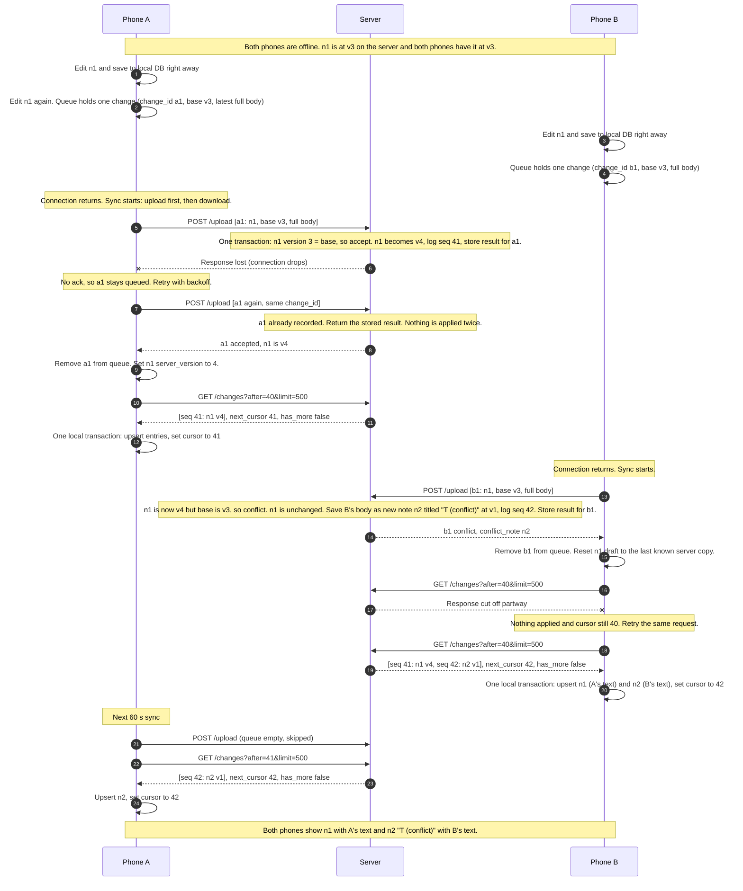

# Sync flow for the offline-first notes app

The diagram follows one note, `n1`, that two phones edit while offline. Phone A syncs first and Phone B syncs second. Notes on state, failure and retry come after it.

Starting state: the server holds `n1` at version 3, and the log's last sequence number is 40. Both phones have synced up to seq 40.

## Where state lives

**Phone (local SQLite)**
- **Notes table.** This is what the UI reads, and every edit writes to it first. For each note it keeps the displayed content plus the last known server copy (`server_version`, `server_title`, `server_body`).
- **Outbox.** There is at most one row per note, with `change_id`, `note_id`, full body, and `base_version`.
  - `change_id` is a UUID created when the row is first created.
  - Later edits to the same note overwrite the body and keep both `change_id` and `base_version`.
- **Sync cursor.** This is the last log sequence number the phone has applied.

**Server**
- **Notes.** Each note has its current version, title and body.
- **Change log.** Each row has an increasing `seq`, `note_id`, `version` and a full snapshot of the note.
- **Applied-changes table.** It is keyed by `change_id` and stores the outcome (accepted, or conflict plus the conflict note id). A write and its dedupe record are saved in the same transaction.

## Rules that make it safe

- **Collapse.** Repeated edits to one note merge into a single outbox row, so a batch never holds two changes for the same note. If the user edits while that row is mid-upload, keep the edit as a separate pending row. When the ack arrives, fill in its base version from the ack, or from the conflict outcome if the upload lost.
- **Batching.** Upload up to 100 changes per request and repeat until the outbox is empty or a request fails. Each change is judged on its own, so one conflict does not block the others.
- **Conflict check.** The server compares `base_version` with the note's current version.
  - A match is accepted. The version goes up by one and a log row is added.
  - A mismatch is a conflict. The existing note is left alone and the losing body is saved as a new note titled with the original title plus " (conflict)". That note is logged like any other write, so every device downloads it.
  - The conflict note's id is derived from `change_id` and stored with the result.
- **Ordering.** Sequence numbers are assigned at commit, one writer at a time, so a reader can never see seq 42 before seq 41 has committed.
- **Phone after a conflict ack.** The phone drops the outbox row and resets the displayed note to its server copy. The user's text is not lost, because it is now in the conflict note that arrives on download.

## Failure and retry

| Failure | Effect | Recovery |
|---|---|---|
| Upload request fails or the response is lost | The phone cannot tell whether the server applied it. | Resend the same batch with the same `change_id`s. The server replays stored results for known ids and applies only new ones. The outbox row is deleted only after an ack. |
| App killed mid-sync | The local DB is intact, with outbox and cursor as of the last committed step. | The next trigger (foreground, reconnect or the 60 s timer) restarts the sync. |
| Download interrupted | The phone advances its cursor only in the same local transaction that applies the page. A partial response applies nothing. | Refetch from the unchanged cursor. Entries are applied as upserts that ignore a version at or below the local one, so replays are harmless and nothing is skipped. |
| More than 500 new entries | The server returns `has_more: true`. | The phone loops, advancing the cursor page by page. |
| Phone's own writes in the log | The phone downloads entries it caused. | They match the stored server version and do nothing. |
| Download touches a note with a queued change | The phone updates only the server copy, not the displayed draft. | The queued change will conflict, which is correct. |
| Two syncs overlapping on one phone | The 60 s timer could fire during a reconnect sync. | Allow only one sync at a time per phone and skip a trigger if one is running. |

## Assumptions

- Each note's title is part of the note content sent in the change.
- Download entries carry the full note snapshot, so a phone never needs a second request to apply an entry.
