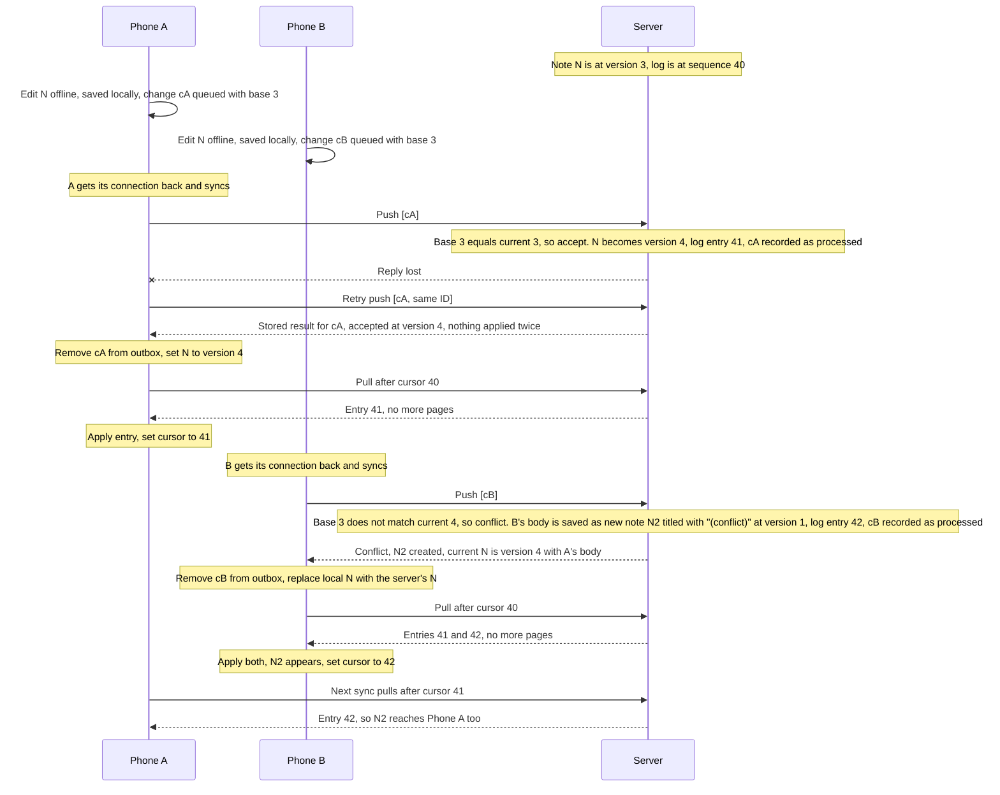

# Notes sync

Today the app is local-only: notes live in SQLite on the phone, and there is no sync server. This design adds a server that is the source of truth. Each phone saves every edit locally at once, queues it, and syncs by pushing its queue and then pulling the server's change log. The server settles conflicts by version check, first write wins, and keeps the losing text as a new note.

Out of scope: deletes, attachments, sharing between users, auth.

## Terms

- **Outbox**: the table in the phone's SQLite that holds changes waiting to upload.
- **Change**: one queued upload. It holds a unique change ID made on the phone, the note ID, the full note body (no diffs), the title, and the base version.
- **Base version**: the server version of the note when the user started editing. A new note has base version 0.
- **Note version**: an integer kept by the server per note. It goes up by 1 on every accepted write.
- **Change log**: a server table. Every accepted write adds one entry (sequence number, note ID, title, body, version). Sequence numbers only go up.
- **Cursor**: on each phone, the highest log sequence number it has fully applied.
- **Processed changes**: a server table of change ID and the result sent back for it. It makes retries safe.
- **Conflict**: an upload whose base version does not equal the note's current version.

## Rules and limits

- An upload batch holds at most 100 changes. A download page holds at most 500 log entries.
- A sync runs when the phone regains its connection, when the app comes to the foreground, and every 60 seconds while online. Each sync uploads first, then downloads. Only one sync runs per phone at a time. A trigger that arrives during a sync makes it run once more when it ends.
- Text is never merged. The write that reaches the server first wins.
- The losing body is never discarded.

## Flow

## Steps

1. **Edit (phone).** The edit is written to local SQLite and shown in the UI at once, with no network. The outbox then gets a change.
   - If the note already has a waiting change that has not been sent, the new body replaces that change's body. It keeps the original base version and change ID. Several edits become one change.
   - If the note's change has been sent but not yet answered, that change is never altered. The new edit becomes a second change that waits. When the first is accepted, the second takes the new version as its base. When the first is a conflict, the second keeps its old base, so it conflicts too and is saved as a conflict copy.
   - This step keeps its data in the phone's SQLite. If the app is killed, nothing is lost, because the edit and the change are saved before the UI updates.
2. **Push (phone to server).** The phone sends the oldest outbox changes, up to 100, in order. It repeats until the outbox has nothing to send, then it pulls.
3. **Decide (server).** For each change, in one database transaction:
   - If the change ID is in processed changes, return the stored result and do nothing else.
   - If the base version equals the note's current version, accept: save the body, add 1 to the version, add a log entry, and record the result. A new note (base 0) is accepted if the note ID does not exist yet.
   - Otherwise it is a conflict. Create a new note with the same body and the title plus " (conflict)", at version 1, add a log entry for it, and record the result. The existing note is not changed.
   - The reply for each change is either "accepted with this version" or "conflict, here is the current note and the ID of the conflict note".
4. **Handle the reply (phone).** The phone removes the change from the outbox and updates the note.
   - Accepted: it sets the local version to the one returned.
   - Conflict: it replaces the local note with the current server note it was sent. The losing text is in the conflict note, which arrives in the pull.
5. **Pull (phone from server).** The phone asks for log entries after its cursor, at most 500 per page, and repeats until the server says there are no more.
   - For each page, the phone applies the entries and moves the cursor to the page's last sequence number in one local transaction. An entry whose version is not newer than the local note is skipped. A note that still has a change in the outbox is not overwritten. Its reply from the server brings the current note instead.
   - The cursor lives on the phone. The server keeps no record of what each phone has seen.

## When things fail

| What fails | What happens |
|---|---|
| The connection drops before the push reaches the server | Nothing was applied. The change stays in the outbox, and the next sync sends it again. |
| The connection drops after the server accepted, before the reply arrives | The change is still in the outbox. The next sync resends the same change ID, and the server returns the stored result without writing again. |
| The connection drops during a pull | The cursor only moves after a page is applied, so the next pull starts from the old cursor. Entries are never skipped, and reapplied entries are skipped by the version check. |
| The app is killed during a sync | The outbox and cursor are in SQLite, so the next sync continues from them. |
| A sync trigger fires while offline | The sync does not start. The next trigger tries again. |
| Retry timing | There is no separate retry timer. Retries happen on the normal triggers, including the 60-second one. |

## Building it

1. Server: the notes, change log and processed changes tables, plus the push and pull calls.
2. Phone: add the outbox and cursor to local SQLite. Existing notes become changes with base version 0 on the first sync.
3. Phone: the sync runner with its triggers.

## Open questions

- How long the server keeps processed changes and old log entries is not decided. For now it keeps them forever, and a phone that is offline longer than any cleanup would need a full re-download.
- Two phones that first sync the same pre-existing local note would each create a note with base 0. How to detect that is not decided.