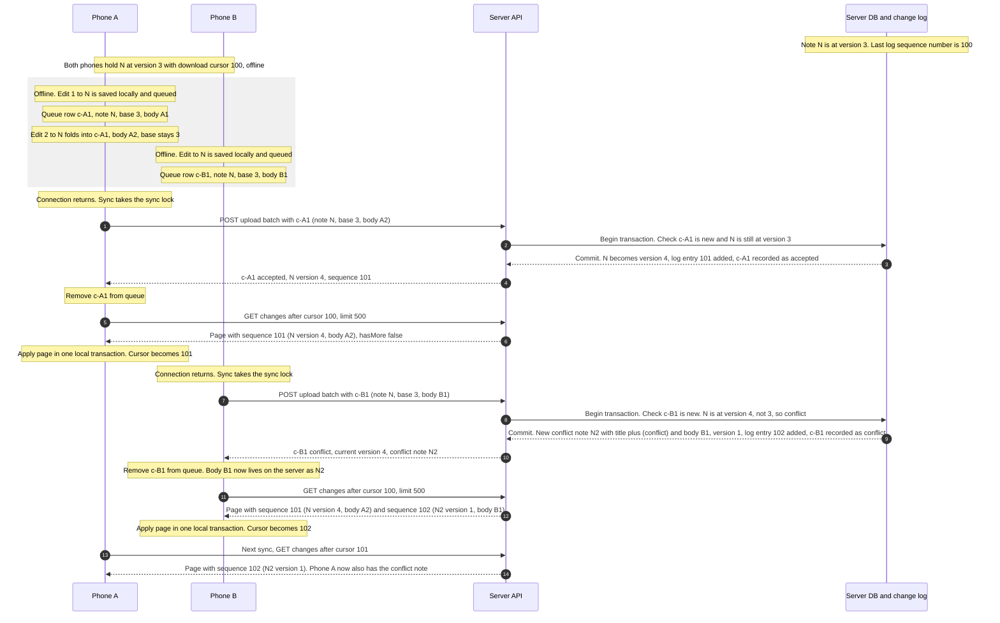

# Sync flow for the offline-first notes app

Status: design only, no code yet.

## Summary

The app works with no network. Each phone keeps its own copy of the notes in a local database, and the phone is the first place an edit lands. When the user edits a note, the phone saves the new text to that database right away, so the screen updates without waiting for the server. The phone also adds the edit to a queue of changes that still have to be sent to the server.

The server is the single source of truth. When a queued change arrives, the server checks whether the phone was editing the newest version of the note. If it was, the server accepts the change. If it was not, the change is a conflict. The server never merges text. The first write to reach the server wins. The losing text is saved as a new note, so nothing the user typed is lost.

Every accepted write raises the note's version by one and adds an entry to the server's change log. The change log only grows. Each entry gets a sequence number that always goes up. Phones catch up by reading the log from the last sequence number they processed.

A sync runs when the connection comes back, when the app comes to the foreground, and every 60 seconds while the phone is online. Each sync uploads first, then downloads. Uploads are sent in batches of at most 100 changes. Downloads come in pages of at most 500 log entries. Every step can be repeated safely. If a connection drops and the phone retries, the server does not apply the same change twice, and the phone does not skip any log entries.

## Key terms

- **Note**: one item the user can edit. It has a title and a body.
- **Version**: a whole number on each note on the server. It goes up by one on every accepted write. Version 1 is the first version of a note.
- **Base version**: the note version the phone was showing when the user made the edit. The server compares it with the note's current version to detect conflicts.
- **Queue**: the phone's list of changes the server has not accepted yet. Each item in the list is a queue row.
- **Queue row**: one queued change. It holds a change id, a note id, a base version, the full note body, and a state (queued or in flight).
- **Fold**: when the user edits a note that already has a queue row that has not been sent yet, the new text replaces the body in that row. The row keeps its change id and base version. Several edits become one change.
- **Change id**: a unique id for each queue row. It is created once, when the row is first written. The server uses it to recognise a retry of a change it has already handled.
- **Change log**: the server's append-only list of every accepted write. Each entry has a sequence number, the note id, the new version, the title, and the body.
- **Sequence number**: the position of an entry in the change log. Sequence numbers only go up.
- **Cursor**: the highest change log sequence number the phone has applied. The next download asks for entries after the cursor.
- **Download page**: up to 500 change log entries returned in one response. If the server says more entries exist, the phone asks for the next page.
- **Sync lock**: a per-phone lock so only one upload-then-download cycle runs at a time.
- **Applied-changes record**: the server's memory of each change id it has handled, and the result it gave back. A retry of the same change id gets the same result, and the server writes nothing new.
- **In flight**: a queue row that has been sent to the server, but whose response the phone has not handled yet.
- **Conflict note**: the new note the server creates to keep the losing text of a conflict.
- **Transaction**: a group of database writes that either all happen or none of them happen. If anything in the group fails, every write in it is rolled back.

## Where state lives

| Place | What it stores | Notes |
|---|---|---|
| Phone, notes table | Title and displayed body | What the user sees, including edits not yet uploaded |
| Phone, queue | One row per unsent change: change id, note id, base version, full body, state (queued or in flight) | Written in the same local transaction as the note edit |
| Phone, sync state | Download cursor (last applied log sequence number) | Moves only in the same transaction that applies a download page |
| Server, notes | Id, title, body, version | Version changes only inside a write transaction |
| Server, change log | Sequence number, note id, version, title, body | Append-only. The sequence number is the download cursor |
| Server, applied changes | Change id (per user), result, sequence number, conflict note id | Used to answer retries. A repeated change id gets the stored result back, and nothing is written again |

## Sequence diagram

Read the diagram from top to bottom. Each arrow is a request or a response between a phone and the server. Notes describe what happens on one side without a network call.

## Notes on the diagram

1. Both phones start with note N at version 3, and both have seen log entries up to 100. Phone A edits N twice while offline. The second edit folds into the same queue row, c-A1. Its base stays 3, because 3 is the version the first edit started from.
2. Phone A syncs first. Its base (3) matches the server's current version, so the server accepts the change. In one transaction, the server sets N to version 4, adds log entry 101, and records the result for c-A1.
3. Phone B syncs second. Its base is 3, but the server is now at version 4, so the server treats c-B1 as a conflict. It saves B1 as a new note, N2, and adds log entry 102. Note N is not changed by this step.
4. The losing text is never deleted. It stays on the server as N2, and every phone picks it up on its next download.
5. Phone B removes c-B1 from its queue only after it has stored the conflict result. When it downloads, it applies log entry 101 and its copy of N changes from B1 to the winning text, A2. Its queue is empty by then, so nothing is overwritten.
6. The base version lives in the queue row, not in the note row. A download can move the note to a newer version without changing what the pending change was based on.

## Failure and retry

| Failure | What happens | Why nothing is applied twice or skipped |
|---|---|---|
| Connection drops before the upload reaches the server | Nothing is committed. The change stays queued | Retry sends the same change id and base |
| Connection drops after the server commits but before the phone gets the response | The phone does not know the result | Retry sends the same change id. The server returns the stored result and writes nothing |
| Drop partway through a batch of up to 100 changes | Changes already committed stay committed. The rest are not sent | Each change commits on its own. Retry resends the batch, and committed changes return their stored results |
| Drop during a download page | The phone transaction does not commit, so the cursor does not move | Retry starts from the old cursor. Entries carry full bodies and versions, so replaying a page gives the same result |
| App is killed between applying a page and saving the cursor | Cannot happen | The page and the cursor are saved in one local transaction |
| Server crashes mid-write | The database rolls back the whole transaction | Nothing is half-applied, so the retry is a normal first attempt |
| A sync trigger fires while a sync is running | The second trigger does not start another sync | The per-phone sync lock allows only one upload-then-download cycle at a time |
| User edits a note whose change is already in flight | The edit goes into a new queue row for that note and waits | Only one change per note is in flight at a time. If the earlier change is accepted, the waiting row's base becomes the version the server gave that accepted change. If it conflicts, the waiting row keeps its old base, and the server judges it |
| Phone is offline for hours | Changes stay queued | The change id stays the same, so a late retry is still safe, as long as the server still has the applied-changes record (see open questions) |

Other rules:

- Every server write for a change commits together or not at all. This covers the note update or the conflict note, the change log entry, and the applied-changes record.
- Writes are serialized per account. Sequence numbers are assigned in the same order the writes commit. Without this, a download could see entry 102 committed while entry 101 is still open (not yet committed). The download would then move the cursor past 101, and the phone would miss 101 for good.
- A download applies an entry only when its version is higher than the version the phone already has stored for that note. Replaying an older entry does nothing.
- If a note has a queue row, a download updates only the stored server version. The displayed text keeps the user's unsent edit.
- A change id is created once, when its queue row is first written. It is kept when later edits are folded into that row.
- A sync loops over upload batches until the queue is empty. Then it loops over download pages until the server reports there are no more.

## Open questions

1. Retention of the applied-changes record. A phone that is offline longer than the retention window could retry a change the server has already forgotten, and that change would be applied twice. Keep records at least as long as the longest allowed offline period, or until the phone confirms it has the result.
2. Edits made after a conflict. A later edit sent with its old base will become a second conflict copy. The alternative is to rebase it onto the winning version and show the user both versions. That goes against the no-merge rule, so it needs a product decision.
3. Throughput of serialized writes per account. This is fine for one person's notes across a few phones. It needs a check if many devices write to the same account at once.