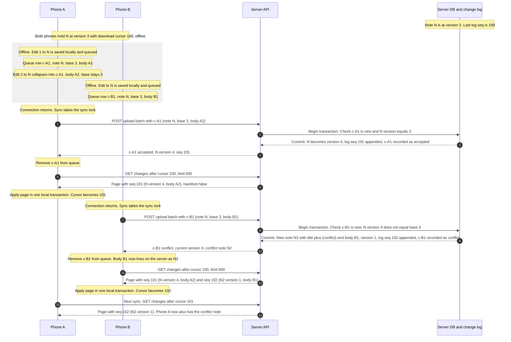

# Sync flow for the offline-first notes app

Status: design only, no code yet.

## Summary

Phones write every edit to their local database first and queue it for upload. The server is the single source of truth. It decides conflicts by comparing each change's starting version with the note's current version, and it never merges text. Every accepted write bumps the note version and appends to a change log with an increasing sequence number. A sync uploads the queue, then downloads the log from the phone's saved cursor. Every step can be repeated safely.

## Where state lives

| Place | What it stores | Notes |
|---|---|---|
| Phone, notes table | Title and displayed body | Shows the user's latest edit at once, including unsent edits |
| Phone, pending queue | Change id, note id, base version, full body, state (queued or in flight) | One row per queued change. Written in the same local transaction as the note edit |
| Phone, sync state | Download cursor (last applied log seq) | Moves only in the same transaction that applies a download page |
| Server, notes | Id, title, body, version | Version changes only inside a write transaction |
| Server, change log | Seq, note id, version, title, body | Append-only. Seq is the download cursor |
| Server, applied changes | Change id (per user), result, seq, conflict note id | Idempotency record. A repeated change id gets the stored result back |

## Sequence diagram

## Notes on the diagram

1. Both phones start at version 3. Phone A edits twice while offline. The second edit collapses into the queued change c-A1, which keeps base version 3.
2. Phone A syncs first. Its base matches the server, so the server accepts it, writes version 4, appends seq 101 and records the result. All three happen in one transaction.
3. Phone B syncs second. Its base 3 no longer matches version 4, so the server rejects c-B1 as a conflict. It saves B1 as a new note N2 and logs it as seq 102. Note N is not changed.
4. The losing body is never deleted. It stays on the server as N2, and every phone picks it up on its next download.
5. Phone B removes c-B1 only after it has stored the conflict result. Its local N then shows the winner once seq 101 is applied.
6. The base version lives in the queue row, not in the note row. A download can move the note forward without changing what the pending change was based on.

## Failure and retry

| Failure | What happens | Why nothing is applied twice or skipped |
|---|---|---|
| Connection drops before the upload reaches the server | Nothing is committed. The change stays queued | Retry sends the same change id and base |
| Connection drops after the server commits but before the phone gets the response | The phone does not know the result | Retry sends the same change id. The server returns the stored result and writes nothing |
| Drop partway through a batch of up to 100 changes | Changes already committed stay committed. The rest do not run | Each change commits on its own. Retry resends the batch, and committed changes return their stored results |
| Drop during a download page | The phone transaction does not commit and the cursor does not move | Retry starts from the old cursor. Entries carry full bodies and versions, so replaying a page gives the same result |
| App is killed between applying a page and saving the cursor | Cannot happen | Page and cursor are saved in one local transaction |
| Server crashes mid-write | The database rolls back the whole transaction | Nothing is half-applied, so retry is a normal first attempt |
| A sync trigger fires while a sync is running | The second trigger does not start another sync | A per-phone sync lock lets only one upload-then-download cycle run at a time |
| User edits a note whose change is already in flight | The edit goes into a new queue row for that note and waits | Only one change per note is in flight. If the earlier change is accepted, the waiting row's base becomes the accepted version. If it conflicts, the waiting row keeps its old base and the server judges it |
| Phone is offline for hours | Changes stay queued | The change id stays the same, so a late retry is still safe, as long as the server still has the applied-changes record (see open questions) |

Other rules:

- Every server write for a change, including the note update or conflict note, the log append and the applied-changes record, commits together or not at all.
- Writes are serialized per account, so seq order matches commit order. Without this, a download could see seq 102 committed while 101 is still open and move the cursor past 101 for good.
- A download applies an entry only when its version is higher than the phone's stored server version for that note. Replaying an older entry does nothing.
- If a note has a queue row, a download updates only the stored server version. The displayed body keeps the user's unsent edit.
- A change id is created once, when its queue row is first written, and kept when later edits collapse into that row.
- A sync loops over the upload batches until the queue is empty, then loops over download pages until the server reports no more.

## Open questions

1. Retention of the applied-changes record. A phone offline for longer than the retention window could retry a change the server has forgotten, and that change would be applied twice. Keep records at least as long as the longest allowed offline period, or until the phone confirms it has the result.
2. Edits made after a conflict. A later edit sent with its old base will become a second conflict copy. The alternative is to rebase it onto the winner and show the user both versions. That goes against the no-merge rule, so it needs a product decision.
3. Throughput of serialized writes per account. This is fine for one person's notes across a few phones. It needs a check if many devices write to the same account at once.