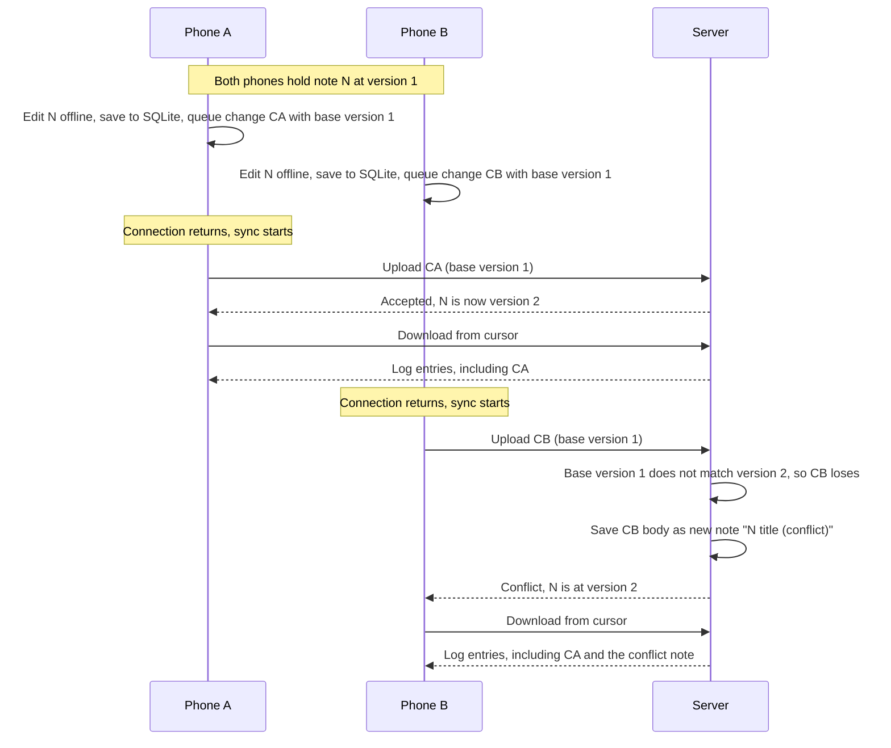

## Notes sync

This document describes how the notes app will keep notes in step across several phones. Each phone works fully offline. The server is the single source of truth: when phones disagree, the server decides.

### The short version

- Each phone keeps its own full copy of the notes in a local SQLite database (a database file stored on the phone). Reading and editing never wait for the network.
- Every edit is also added to an **outbox**: a list of changes that still need to be sent to the server.
- The server keeps each note's current text and version number. It also keeps a **change log**, a numbered list of every accepted write, and a record of every upload it has handled.
- A sync has two steps, always in this order: **upload first, then download**. A sync starts when the phone gets its connection back, when the app comes to the foreground, and every 60 seconds while the phone is online.

### Terms

- **Version**: a whole number on each note. A new note starts at version 1. The server adds 1 each time it accepts a write to that note.
- **Base version**: the version of a note that an edit started from. If you edit version 1 of a note, the change's base version is 1.
- **Change ID**: a unique ID the phone creates once for each queued change. The server uses it to recognise a change it has already handled, so a retried upload is never applied twice.
- **Outbox**: the phone's queue of changes the server has not yet confirmed. Each entry holds a change ID, a note ID, a base version and the full note body.
- **Change log**: the server's ordered list of accepted writes. Each entry has a sequence number that only goes up.
- **Cursor**: the phone's record of the last change log entry it has fully applied. It tells the phone where to resume reading the log.
- **Conflict note**: a new note the server creates to keep the text of a losing edit.

### How two phones edit the same note

In the diagram below, both phones hold note N at version 1. Both go offline and edit it. Phone A syncs first and wins. Phone B syncs second and loses. B's text is kept as a new conflict note, and both phones receive it.

Reading the diagram:

- Phone A's upload is accepted, so N moves to version 2 with A's text.
- Phone B's upload is rejected because it started from version 1, and the server is already at version 2. The server does not merge the two texts. It keeps B's text as a new note.
- When B downloads, its copy of N is replaced with the winning text from A. B's own edit survives only in the conflict note.

### Where state lives

- **Phone**: the local SQLite database holds three things. The notes table holds the text each note shows now. The outbox holds changes not yet confirmed by the server. The cursor is stored in the same database as the notes, so the two can be updated together.
- **Server**: the notes table holds each note's current text and version. The change log holds every accepted write. A table of processed change IDs holds the saved result of every upload the server has handled, including conflicts.

### Editing on the phone

- An edit is written to SQLite first. The screen updates from that local write, so no network call is needed.
- A change stores the whole note body, not a diff (a list of differences between versions).
- If you edit the same note several times before its change uploads, the edits overwrite one another inside one outbox entry. That entry keeps the base version of the first edit, because that is the version the server must compare against.
- Once a change has been sent to the server, its contents are fixed. Any later edit goes into a new outbox entry.

### Uploading

Each sync sends up to 100 changes per batch, in outbox order. For each change, the server does one of three things:

1. **Already seen.** If the change ID is in the processed table, the server returns the saved result and changes nothing.
2. **Accepted.** If the base version matches the note's current version, the server saves the body, adds 1 to the version, adds an entry to the change log, and records the change ID with an "accepted" result.
3. **Conflict.** If the base version does not match, the server does not merge text and does not change the note. It saves the losing body as a new note titled with the original title plus " (conflict)", records the change ID with a "conflict" result, and adds the new note's creation to the change log.

The phone removes a change from the outbox only after it receives a result for that change ID.

### Downloading

- The phone asks the server for change log entries after its cursor. The server returns up to 500 entries per page. The phone keeps asking until a page comes back empty.
- The phone applies a page's entries and moves its cursor forward in one local database transaction. Either both happen or neither does, so the cursor never moves past entries that were not applied.
- Each log entry names a note and the version it produced. Applying the same entry twice gives the same result, so downloading a page again is harmless.

### Failures and retries

- **Connection drops before the phone hears back about an upload.** The change stays in the outbox. The phone sends it again later with the same change ID. If the server already accepted or rejected it, the server returns the saved result and does nothing else. The change is never applied twice.
- **Connection drops during a download.** The cursor did not move, so the next sync starts from the same place. Nothing is skipped or lost.
- **Conflicts.** The first write to reach the server wins. The losing text is kept as a conflict note, not discarded. Every phone receives that note on its next download, because creating it is a change log entry.

### Out of scope

Deletes, attachments, sharing between users, and authentication are not covered by this design.