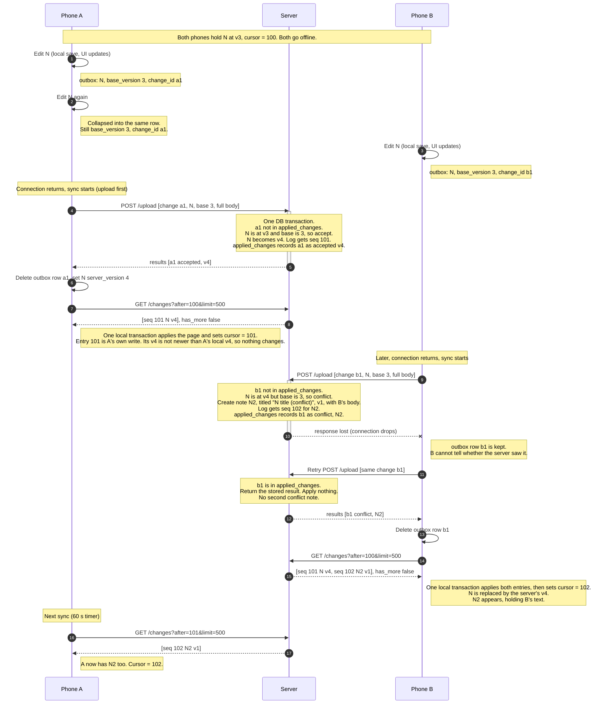

# Sync flow for the offline-first notes app

## Summary

Each phone keeps a local SQLite database and an **outbox**, a queue of edits not yet uploaded. An edit is saved locally at once and shows in the UI without waiting for the network.

A sync does two things, in this order:

1. **Upload** the outbox to the server.
2. **Download** new entries from the server's **change log**. The change log is an append-only list of every accepted write. Each entry has an increasing sequence number (`seq`).

How the pieces fit together:

- **Conflicts.** The server accepts an upload only if its starting version (`base_version`) equals the note's current version. Otherwise it saves the losing text as a new note titled "... (conflict)".
- **Retries.** Each upload carries a `change_id`. The server remembers every `change_id` it has handled, so a retried upload is never applied twice.
- **Downloads.** The phone keeps a **cursor**, the highest `seq` it has applied. It applies each download page and moves the cursor in one local transaction, so an interrupted download never skips or repeats entries.

## Scope and assumptions

- Out of scope: deletes, attachments, sharing, auth.
- Each queued change gets a `change_id` (UUID) when it is first queued. It never changes across retries or collapses. The server uses it to make uploads idempotent (safe to repeat).
- A log entry carries the full note (id, title, body, version), so a phone can apply an entry without a second request.
- Assumption to confirm: the brief says the conflict note is titled with the "original title". I read that as the title the server holds for the note at conflict time. If it should be the losing phone's title instead, that is a one-line change.

## Where state lives

**Phone (SQLite)**

| Table | Holds |
|---|---|
| `notes` | `id`, `title`, `body`, `server_version` (last version received from the server; 0 for a note never synced) |
| `outbox` | At most one row per note: `change_id`, `note_id`, `title`, `body`, `base_version` (the server version the edit started from), `in_flight` (true while an upload containing this row awaits a response) |
| `sync_state` | `cursor`: the highest log `seq` this phone has applied |

- An edit writes `notes` and `outbox` in one local transaction. The UI reads `notes`, so there is no network round trip.
- Collapsing: if an `outbox` row already exists for the note and is not in flight, an edit overwrites only its `title` and `body`. `base_version` and `change_id` stay as they were. Each queued change carries the full body, never a diff. (For a row that is in flight, see "Upload" below.)

**Server**

| Table | Holds |
|---|---|
| `notes` | `id`, `title`, `body`, `version` (+1 per accepted write) |
| `change_log` | `seq` (increasing), `note_id`, `title`, `body`, `version` |
| `applied_changes` | `change_id` mapped to its stored result: `accepted` plus the new version, or `conflict` plus the conflict note id |

The server is the source of truth. Only the server decides conflicts, and text is never merged: the write that reaches the server first wins.

## Sync rules

- A sync runs when the connection returns, when the app comes to the foreground, and every 60 seconds while online.
- Each sync uploads first, then downloads.
- Upload batches hold at most 100 changes. Download pages hold at most 500 log entries.
- Only one sync runs per phone at a time. A trigger that arrives mid-sync is ignored, and the 60 s timer picks up the remainder.

## Diagram

Note N is at version 3 on the server. Both phones have it at version 3 and a cursor of 100. Both edit N offline. Phone A syncs first, then Phone B. Phone B's first upload reaches the server but the response is lost, so B retries.

## What happens on failure and retry

**Upload**

- The phone sends at most 100 outbox rows per batch and repeats until the outbox is empty. Only then does it download.
- A phone deletes an outbox row only after it reads that row's result in a response. Anything else (timeout, crash, lost response) leaves the row in place, and the next sync resends the same `change_id`.
- The server handles each batch in one transaction. For each change it checks `applied_changes`, then checks the version, then writes the note, the `change_log` row and the `applied_changes` row. A crash rolls back the whole batch, so nothing is half-applied. A retry either re-runs the batch or replays the stored results.
- Replays include conflicts. The stored result holds the conflict note id, so a retry never creates a second conflict note.
- If the user edits a note while its change is in flight, the in-flight row is left untouched, so a retry sends exactly what the server may already have seen. The new text goes into `notes` only. After an `accepted` ack, the phone creates a new `outbox` row with a new `change_id` and a `base_version` equal to the version the ack returned. This keeps one change per note per batch.

**Download**

- The server returns entries with `seq > cursor`, in order, up to 500, plus `has_more`. The phone keeps requesting pages until `has_more` is false.
- The phone applies a page and advances `cursor` in one local transaction. If the connection drops mid-page, nothing is applied and the cursor does not move, so the next sync asks for the same entries again. No entry is skipped, and none is applied twice.
- Applying an entry is idempotent. A phone writes a note only if the entry's `version` is higher than its local `server_version` (or the note is new). Re-reading entries it already has changes nothing.
- If the note has a pending `outbox` row, the phone does not overwrite the local text, but it still moves the cursor on. The pending change keeps its original base, so the server will report the conflict at upload and the losing text becomes a conflict note.

**Log ordering (a server rule that matters for correctness)**

- Phones assume that once they have seen `seq` 102, nothing below 102 is still to come. Suppose two transactions took `seq` values 101 and 102 but committed out of order. A phone could read 102, move its cursor to 102, and permanently miss 101.
- To prevent this, the server assigns `seq` and commits log writes one at a time. It takes a single write lock (or uses a single-writer queue) around "check, write, append log, commit". The limit this puts on write throughput is acceptable for a notes app.

**Other cases**

- **Offline at sync time:** the sync fails fast and the edit stays queued. The next trigger (connection back, foreground, 60 s timer) tries again.
- **Server crash after commit, before the response:** this is the lost-response case in the diagram, and `applied_changes` covers it.

## Open items (no code yet)

- Decide how long to keep `applied_changes` rows. A phone that is offline for months may still retry an old `change_id`. Keep them at least as long as the longest offline period you support.
- Decide whether the UI tells the user "your edit was saved as a copy" on a conflict. The phone learns this from the `conflict` result.
- Decide what happens to an edit made while its change is in flight, if that change then comes back as `conflict`. As written, the later text exists only in `notes`, and the download replaces it with the server's version, so it is lost. One option is to queue it as another change against the new server version.