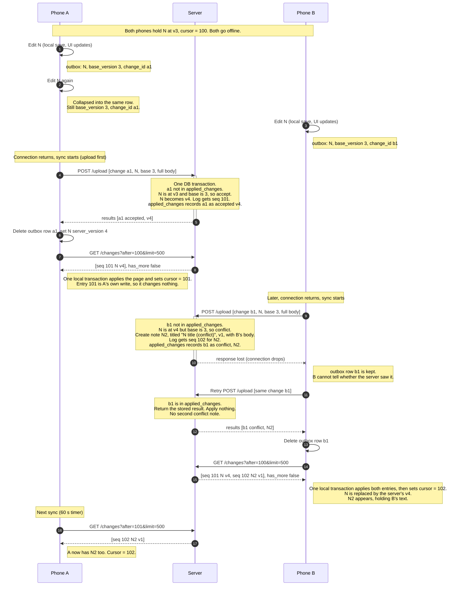

# Sync flow for the offline-first notes app

## Scope and assumptions

- Out of scope: deletes, attachments, sharing, auth.
- Each queued change gets a `change_id` (UUID) when it is first queued. It never changes across retries or collapses. The server uses it to make uploads idempotent.
- A log entry carries the full note (id, title, body, version). A phone can apply an entry without a second request.
- The brief says the conflict note is titled with the "original title". I read that as the title of the note as the server holds it at conflict time. This is the one assumption to confirm.

## Where state lives

**Phone (SQLite)**

| Table | Holds |
|---|---|
| `notes` | `id`, `title`, `body`, `server_version` (last version received from the server, 0 for a note never synced) |
| `outbox` | At most one row per note: `change_id`, `note_id`, `title`, `body`, `base_version`, `in_flight` |
| `sync_state` | `cursor`, the highest log `seq` this phone has applied |

- An edit writes `notes` and `outbox` in one local transaction and the UI reads `notes`, so there is no network round trip.
- Collapsing: if an `outbox` row already exists for the note, only `title` and `body` are overwritten. `base_version` and `change_id` stay as they were.

**Server**

| Table | Holds |
|---|---|
| `notes` | `id`, `title`, `body`, `version` (+1 per accepted write) |
| `change_log` | `seq` (increasing), `note_id`, `title`, `body`, `version` |
| `applied_changes` | `change_id` to stored result (`accepted` or `conflict`, plus the version or the conflict note id) |

## Diagram

Note N is at version 3 on the server. Both phones have it at version 3 and a cursor of 100. Both edit N offline.

## What happens on failure and retry

**Upload**

- The phone sends at most 100 outbox rows per batch and keeps repeating until the outbox is empty. Only then does it download.
- A phone deletes an outbox row only after it reads that row's result in a response. Anything else (timeout, crash, lost response) leaves the row in place, and the next sync resends the same `change_id`.
- The server handles each batch in one transaction. It checks `applied_changes`, then checks the version, then writes the note, the `change_log` row and the `applied_changes` row. A crash rolls back the whole batch, so nothing is half-applied. A retry either re-runs the batch or replays stored results.
- Replays include conflicts. The stored result holds the conflict note id, so a retry never creates a second conflict note.
- If the user edits a note while its change is in flight, the new text stays in `notes` and goes into a new `outbox` row after the ack. That row's base is the version the ack returned. This keeps one change per note per batch and keeps the original-base rule for edits made offline.

**Download**

- The server returns entries with `seq > cursor`, in order, up to 500, plus `has_more`.
- The phone applies a page and advances `cursor` in one local transaction. If the connection drops mid-page, nothing is applied and the cursor does not move, so the next sync asks for the same entries again. No change is skipped, and none is applied twice.
- Applying an entry is idempotent. A phone writes a note only if the entry's `version` is higher than its local `server_version` (or the note is new). Re-reading entries it already has changes nothing.
- If the note has a pending `outbox` row, the phone does not overwrite the local text. It still moves the cursor on. The pending change keeps its original base, so the server will report the conflict at upload and the loser's text becomes a conflict note.

**Log ordering (a server rule that matters for correctness)**

- Phones trust that if they have seen `seq` 102, nothing below 102 is still to come. If two transactions took `seq` values and committed out of order, a phone could read 102, move its cursor to 102, and miss 101.
- To prevent this, the server assigns `seq` and commits log writes serially. It takes a single write lock (or uses a single-writer queue) around "check, write, append log, commit". The throughput limit this puts on writes is fine for a notes app.

**Other cases**

- **Offline at sync time:** the sync fails fast and the edit stays queued. The next trigger (connection back, foreground, 60 s timer) tries again.
- **Overlapping syncs:** only one sync runs per phone at a time. A trigger that arrives mid-sync is ignored, and the 60 s timer picks up the remainder.
- **Server crash after commit, before the response:** this is the lost-response case in the diagram, and `applied_changes` covers it.
- **Conflict note title:** the title is built from the server's current title of the note. If it should come from the loser's title instead, that is a one-line change.

## Open items (no code yet)

- Decide how long to keep `applied_changes` rows. A phone that is offline for months may still retry an old `change_id`. Keep them at least as long as the longest offline period you support.
- Decide whether the UI tells the user "your edit was saved as a copy" on a conflict. The phone learns this from the `conflict` result.
