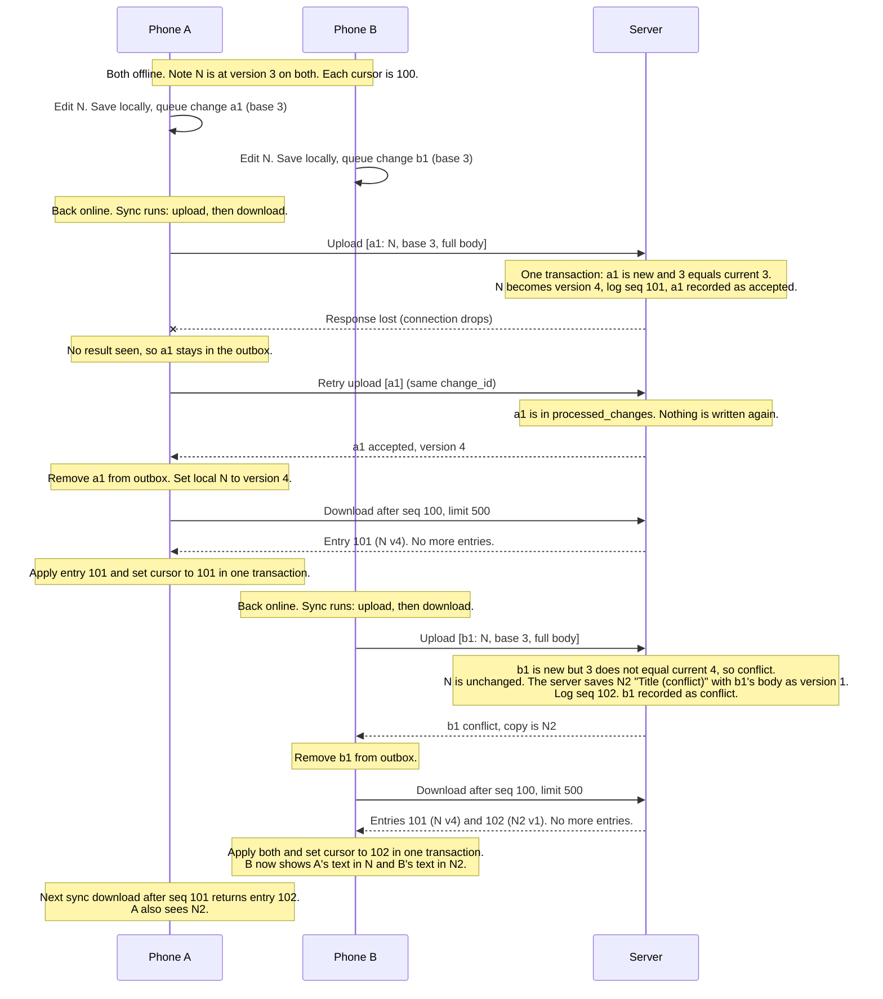

## Notes sync

Two phones edit the same note while offline, then sync one after the other. The server accepts whichever write reaches it first. It keeps the other phone's text as a separate "(conflict)" note, so no text is lost.

Terms used below:
- A **change** is one edit that a phone has queued but not yet uploaded.
- A **write** is a change the server has accepted.
- `base_version` is the server version of the note that the edit started from.
- A note's "body" includes its title. The server needs the title to name conflict copies.

### Where state lives

**On each phone (SQLite)**
- `notes`: the note as the user sees it. Every edit is written here immediately, so the UI never waits on the network.
- `outbox`: changes waiting to upload. Each row has:
  - `change_id`: a UUID made once, when the change is created
  - the note id
  - the full body (no diffs)
  - `base_version`
- `cursor`: the highest server log sequence number (`seq`) this phone has applied. It starts at 0.

**On the server**
- `notes`: each note's current body and an integer `version`. The version goes up by 1 on every accepted write.
- `change_log`: an append-only list of accepted writes. Each entry has an increasing `seq`, the note id, the new version and the full body. Phones catch up by reading this log.
- `processed_changes`: for every `change_id` the server has handled, the result it returned: either "accepted" with a version, or "conflict" with the id of the conflict note. This is what makes retries safe.

### Rules

**Queuing**
- Every edit is saved to the phone's `notes` table at once, then queued for upload.
- If the user edits a note again before its change is uploaded, the edits merge into that one change. It keeps the latest body and the original `base_version`.
- Once a change is part of an upload request, it is frozen: its `change_id` and body never change.
- An edit made after that starts a new change. Then:
  - If the earlier change is accepted, the phone sets the new change's `base_version` to the version the server returned.
  - If the earlier change was a conflict, the new change keeps its old `base_version`, so it will conflict too.

**When sync runs**
- A sync starts when the connection returns, when the app comes to the foreground, and every 60 seconds while online.
- Only one sync runs at a time on a phone.
- Each sync uploads first, then downloads.

**Upload**

The phone sends up to 100 outbox changes per request, oldest first, and repeats until the outbox is empty. For each change, the server does the following in one database transaction:
1. If `change_id` is in `processed_changes`, return the stored result and do nothing else.
2. If `base_version` equals the note's current version, the change is accepted. The server saves the body, increments the version, appends to `change_log`, and records "accepted".
3. Otherwise it is a conflict. The server leaves the note unchanged. It saves the losing body as a new note titled `<original title> (conflict)` at version 1, appends that new note to `change_log`, and records "conflict" with the new note's id.

The phone deletes a change from its outbox only after it has read the server's result for that change.

**Download**
- The phone asks for log entries with `seq` greater than its `cursor`, up to 500 per page.
- It applies a page and moves `cursor` to that page's last `seq` in a single SQLite transaction.
- It repeats until the server says there are no more entries.
- Applying an entry sets the note to the entry's body and version. The entry is skipped if the phone already has that version or a newer one.
- If the note has a pending change in the outbox, the phone does not overwrite the body. The UI keeps showing the local body, and the pending change resolves through the upload rules above.

### Sequence

Both phones start with note N at version 3, and the server log is at `seq` 100. Phone A syncs first. The crossed arrow (`--x`) shows A's first upload response being lost. A retries within the same sync.

### Failure and retry

- **Upload response lost, or connection drops mid-upload**
  - The phone cannot tell whether the server saw the request. It keeps the changes in the outbox and resends them unchanged, with the same `change_id`s.
  - The server returns the stored results for changes it already handled and processes the rest.
  - A change is never applied twice, and a conflict copy is never created twice.
- **The server crashes mid-request**
  - Each change is handled in a single transaction. It is either fully recorded (note, log entry and `processed_changes` row) or not at all.
  - A resend is handled correctly in either case.
- **Download interrupted**
  - The cursor moves only in the same transaction that applies a page.
  - If a page does not arrive or is not applied, the cursor stays put. The next sync asks for the same range again, so no entries are skipped.
  - Re-applying an entry is harmless because of the version check.
- **App killed mid-sync**
  - All phone state is in SQLite and changes only in transactions.
  - The next sync starts from the stored outbox and cursor.