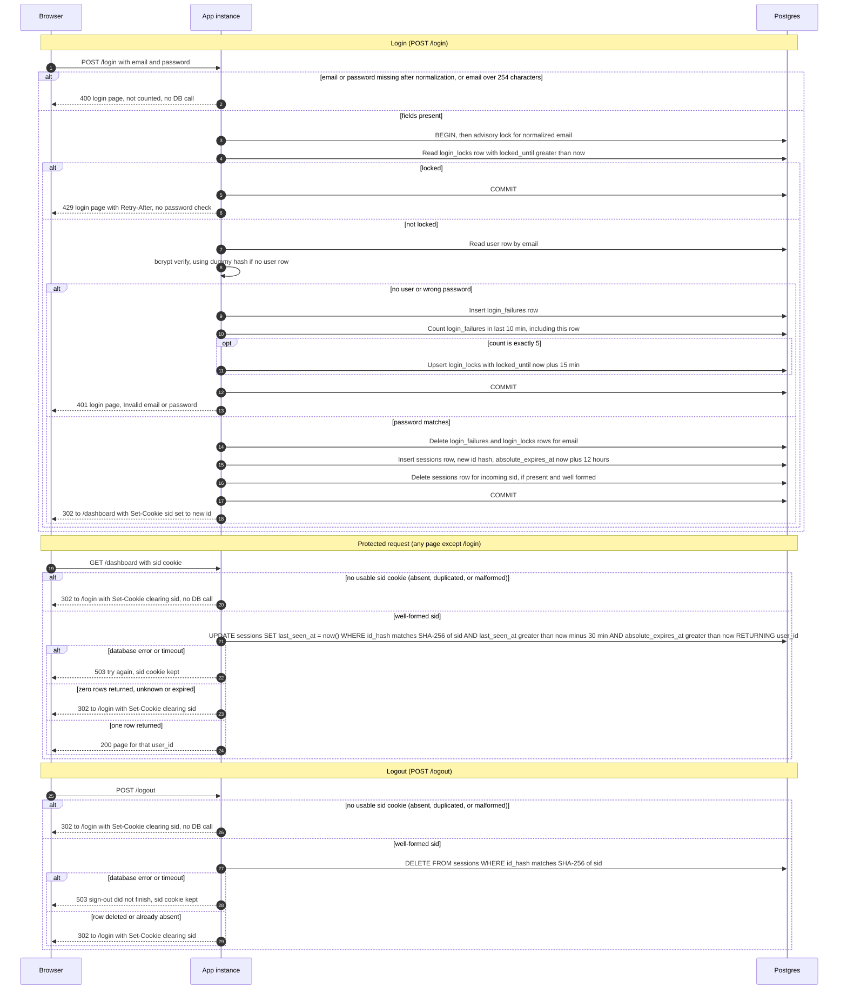

# Login with server-side sessions: design

## Requirements

These are the fixed requirements this design must meet. They come from the review brief and are restated here so this document can be read on its own.

1. Login is `POST /login` with email and password. Emails are matched in lowercase.
2. An unknown email and a wrong password get the identical response: HTTP 401 and the login page showing "Invalid email or password".
3. After 5 failed attempts for an email within any 10-minute period, refuse logins for that email for 15 minutes with HTTP 429, without checking the password. A successful login clears that email's failure count.
4. On success, always issue a new random session ID, even if the browser sent one, and destroy the session the incoming cookie pointed to. Then redirect to `/dashboard`.
5. The cookie carries only the opaque session ID, flagged HttpOnly, Secure and SameSite=Lax. No user data goes in the cookie.
6. A session ends after 30 minutes with no requests (each request restarts that clock) or 12 hours after login, whichever comes first.
7. Every protected request checks the session on the server. If it is missing, unknown or expired, clear the cookie and redirect to `/login`.
8. Logout is `POST /logout`. Destroy the server session first, then clear the cookie and redirect to `/login`. It behaves the same when there is no session.

## Scope

Every page except `/login` requires a signed-in user. The app is server-rendered, runs as two identical instances behind a load balancer with no sticky sessions, and uses one Postgres database that already has `users(id, email, password_hash)`. User rows are created outside this app by an existing process; this app only reads them. Sign-up and password reset are out of scope.

This design does not choose the implementation language, web framework or bcrypt library. Any CSPRNG and any bcrypt implementation at cost 12 satisfy it. Examples in this document are illustrative only.

## Request routing

- `GET /login` and `POST /login` are routed to the login handlers.
- `POST /logout` is routed to the logout handler.
- Every other route, including `/dashboard`, passes through the shared session check before its own handler runs. If the check returns a `user_id`, the handler runs as that user. If the check redirects or fails, the handler does not run.
- The 200 response for a protected page is the output of the existing handler, rendered in the app's existing standard layout. The 429, 503 and login-page responses are rendered in the same layout. This design does not define the layout or the existing page code.

## Connections

- Every application connection is opened with these session settings: `statement_timeout = 2s`, `idle_in_transaction_session_timeout = 5s`.
- Login transactions begin with `BEGIN ISOLATION LEVEL READ COMMITTED`, so the isolation level is explicit and does not depend on server defaults.
- Pool size is an implementation choice. The timeouts above apply to every connection the pool hands out.
- The cleanup job (decision 24) takes its session-level advisory lock on one dedicated connection. It must run the lock, the DELETEs and the unlock on that same connection. It must not return the connection to the pool while it holds the lock. The statement timeout and idle-in-transaction timeout also apply to that connection.

## Decisions

1. **Where sessions live: Postgres, not Redis.** Both instances already share Postgres, so a session row is visible to both with no new service. Postgres gives one atomic statement for "check the session and restart its idle clock", and a transaction for the lockout check and record. Load is small (one row per active session, one write per protected request), so the write cost is acceptable for a small team app. Redis would add a service to run, monitor, back up and fail over, plus a second failure domain. Revisit only if per-request writes become a measured bottleneck.

2. **Where failure counts and locks live: Postgres.** Same reason. Counts must be shared by both instances, so process memory is out.

3. **Session ID.** 256 random bits from a CSPRNG (for example `secrets.token_urlsafe(32)` or the platform equivalent), encoded as base64url without padding: exactly 43 characters. A new ID is generated on every successful login. The database stores only the SHA-256 hash of the cookie value. The hash input is the UTF-8 bytes of the 43 characters exactly as received, so a database read does not expose usable session IDs. The stored value is the 32-byte SHA-256 digest (`bytea`). A collision on the sessions primary key is not expected with 256 random bits. If it happens, the insert fails with a database error, which is handled as in decision 14: 503, rollback, no cookie.

4. **Cookie.** Name `sid`, value is the opaque ID only. Attributes: `Path=/; HttpOnly; Secure; SameSite=Lax`. There is no `Domain` attribute, so the cookie is host-only. No `Expires` or `Max-Age`, so it is a browser-session cookie. The server, not the browser, decides expiry. Clearing sends the same attributes with `Max-Age=0`.
   - **Reading the cookie.** The app reads the `Cookie` request header and collects every cookie named exactly `sid`. If there are zero, or more than one, the request has no cookie. Otherwise the single value is used only if it matches `^[A-Za-z0-9_-]{43}$`.
   - A request with no usable cookie is treated as no cookie: it never reaches the database. This applies to every route, including `POST /login`.

5. **Expiry is checked on the server, using the Postgres clock.** Both instances compare against the database clock, so clock skew between app instances cannot change results. See the Clock section for which function is used where.
   - Idle: a session is idle-active when `last_seen_at > now() - interval '30 minutes'`.
   - Absolute: a session is absolute-active when `absolute_expires_at > now()`. It is set once at login as `clock_timestamp() + interval '12 hours'` and is never extended.
   - Both checks are in the same `UPDATE` that restarts the idle clock.
   - Expiry is not stored as a status. A row is active when both conditions hold.

6. **Abandoned rows are removed by a cleanup job** that runs every 10 minutes on either instance (scheduling and single-run guard in decision 24). It is idempotent. It deletes:
   - `sessions` rows where `absolute_expires_at <= now()` or `last_seen_at <= now() - interval '30 minutes'`;
   - `login_failures` rows where `failed_at <= now() - interval '10 minutes'`;
   - `login_locks` rows where `locked_until <= now()`.
   Expired rows are never accepted, so a missed cleanup only grows the table; it never extends a session or a lock.

7. **Failure counting is a sliding window.** "5 failures within any 10-minute period" is read literally: each failure is stored with its timestamp, and the count is over rows with `failed_at > clock_timestamp() - interval '10 minutes'`. Within the failure transaction, the failure row is inserted first, with `failed_at = clock_timestamp()`, and the count is taken after it, so the count includes the current attempt. A fixed window would miss bursts that straddle a window boundary.

8. **Counting applies to every submitted email** after normalization (decision 12), whether or not the account exists. This is what keeps the 429 response identical for existing and unknown emails.

9. **The lock lasts 15 minutes from the 5th failure.** The 5th failure is still answered with 401, because that attempt was checked.
   - The count at the lock-setting failure is exactly 5. No attempt runs during a lock, and the lock (15 minutes) outlasts the window (10 minutes), so the count never exceeds 5 and the lock is always written on the 5th failure.
   - In the same transaction as the 5th failure, the lock is written as `locked_until = clock_timestamp() + interval '15 minutes'`.
   - A lock is in force only while `locked_until > clock_timestamp()`. A lock row whose `locked_until` has passed is ignored by that check, and cleanup removes it (decision 6).
   - The lock check is a plain SELECT that also returns `Retry-After` as `greatest(1, ceil(extract(epoch from locked_until - clock_timestamp())))`, in seconds, so the app does not compare times itself. The HTTP header value is that integer with no date format. The app reads only this SELECT result for lock state. It does not keep lock state in memory or derive it from anything else.
   - An attempt during the lock gets 429. It does not run the password check, insert a failure row or count failures. A correct password during the lock also gets 429; this is intended, because brief item 3 refuses logins for the email without checking the password.
   - A successful login clears that email's failures and lock.

10. **Concurrency.** Login runs at READ COMMITTED isolation (see Connections). Each login runs in one transaction. Its first statement after BEGIN is `SELECT pg_advisory_xact_lock(hashtextextended(<normalized email>, 0))`.
    - The key is the 64-bit result of `hashtextextended` on the normalized email with seed 0. Two different emails can share a key; that only serializes them and is harmless.
    - The lock is held across the lock check, the password check and the failure or success write. It is released at COMMIT or ROLLBACK.
    - A second attempt for the same email blocks inside that lock statement. The statement is bounded by the 2-second statement timeout (decision 14), which includes time spent waiting for a lock. A waiter that times out has not acquired the lock. It gets a database error, rolls back, returns 503 and is not counted. This stops parallel guesses from overshooting the limit of 5.
    - READ COMMITTED takes a new snapshot for each statement. Once the lock statement returns, the later statements see every row the previous holder committed.
    - Cost: attempts for the same email are serialized, which only slows an attacker. A waiter also gets 503 if the holder's bcrypt plus commit takes longer than 2 seconds. That is the fail-closed path, not a lockout.

11. **Timing.** For an unknown email, bcrypt verify is run against the dummy hash (decision 23), so response time does not reveal whether the account exists. Both branches run exactly one bcrypt verify.
    - A verify that completes and returns false is a wrong password. It goes down the failure path.
    - A bcrypt call that raises an error is not a wrong password. It is a storage-or-application fault and is handled as in decision 14 (503, rollback, not counted).

12. **Input normalization.** In this order, for the submitted email:
    1. Trim leading and trailing Unicode whitespace.
    2. Apply Unicode NFC normalization.
    3. Apply Unicode lowercasing.
    The normalized value is the only form used for lookups, locks, failure rows and logs.
    A missing or empty email (after trim), an email longer than 254 characters, or a missing or empty password returns 400 with the login page and the message in decision 21. It is not counted as a failure and makes no database call. Open item 8 asks whether the existing `users` rows were stored with this same rule.

13. **Successful login order.** In one transaction, with every time value taken from `clock_timestamp()` (see Clock):
    - delete the email's `login_failures` and `login_locks` rows;
    - insert the new `sessions` row with `last_seen_at = clock_timestamp()` and `absolute_expires_at = clock_timestamp() + interval '12 hours'`;
    - if the incoming `sid` is present and well formed (decision 4), delete its `sessions` row, whichever user it belongs to and whether or not it was valid. This includes a session that belongs to a different user from the one logging in. If the incoming `sid` is absent, duplicated or malformed, nothing is deleted and the login proceeds normally;
    - COMMIT.
    The `Set-Cookie` header is sent only after the commit succeeds. A failed write or a failed commit never results in a cookie. Browsers identify a cookie by name, domain and path (RFC 6265). This design sends the same name, no Domain attribute and `Path=/` on every response, so the `Set-Cookie` with the new ID replaces the old value in the browser. No second `sid` cookie is kept.

14. **Storage failure: fail closed.**
    - **Error mapping.** Any exception from the database driver, any statement or idle-in-transaction timeout, any lost connection, and any exception from bcrypt is an error. An empty result from a SELECT, UPDATE or DELETE is the no-row outcome. The app never maps a driver or bcrypt error to a no-row outcome, and never maps a no-row outcome to an error. A bcrypt verify that returns false is a normal wrong-password outcome, not an error.
    - **Pooling.** Connection pool size is an implementation choice. Every application connection must still carry the timeouts in this decision and decision 18 (see Connections).
    - Login: any database error, timeout, lost connection or bcrypt error at any step after BEGIN rolls back the whole transaction. The steps are the lock wait, the login read, the failure insert, the count, the lock write, the success writes and COMMIT. This also covers the connection being ended by `idle_in_transaction_session_timeout` (decision 18), because the next statement or COMMIT then fails. The rollback releases the lock and undoes the failure insert, so the attempt is not counted. The response is 503 with the login page message in decision 21. No cookie is set, no session is created, and the response is never 401 or 429 because of a storage fault.
    - Protected request: 503 with the retry message in decision 21. The `sid` cookie is kept, so a brief outage does not log the user out.
    - Logout: 503 with the message in decision 21. The cookie is kept, because the server session must be destroyed before the cookie is cleared.
    - Statement timeout on application database connections is 2 seconds, so outages surface quickly. It also bounds the advisory lock wait (decision 10).

15. **Logout with no session** returns the same 302 to `/login` with the cookie cleared as logout with a session. No database call is made when there is no usable `sid` under decision 4.

16. **Logging.** Log lock events and failed attempts with the SHA-256 of the normalized email, as lowercase hex. Never log the password, the email in clear text, or the cookie value.

17. **A failed login leaves any existing session unchanged.** The incoming session stays valid until its own idle or absolute expiry. Only a successful login ends it (decision 13).

18. **Transaction time limits.** Bcrypt runs inside the login transaction, because decision 10 requires the lock to cover the password check. Bcrypt is application time, so the 2-second statement timeout does not cover it.
    - Set `idle_in_transaction_session_timeout` to 5 seconds on application connections (see Connections), so a stuck instance cannot hold the lock indefinitely.
    - This clock measures only the time between statements. It starts when a statement finishes and stops when the next statement starts. It therefore counts bcrypt and any other application time inside the transaction.
    - It does not count the advisory lock wait, because that wait is a running statement bounded by the 2-second statement timeout (decision 10).
    - If the server ends a login transaction for this reason, the attempt is a database error: 503, not counted (decision 14).
    - Decision 23 governs the measurement that confirms bcrypt fits under this limit. If it does not, raise the timeout; do not remove it.

19. **`GET /login` ignores the session cookie.** It shows the form to every visitor, including a visitor who has a valid session. It does not check, refresh or redirect based on the session, and makes no database call. Because it makes no database call, it always returns 200 with the form and cannot return 503 from storage. `POST /login` with a valid session runs the normal login path (decision 13 on success, decision 17 on failure).

20. **Login form, layout and encoding.** The login page uses the app's standard layout. Inside it is a message block above a form. The message block is shown only when a response carries a message, and it shows the single fixed message from decision 21 for that response. The form has two fields: `email` (input type `email`, name `email`) and `password` (input type `password`, name `password`), plus a submit button. It posts `application/x-www-form-urlencoded` to `POST /login`. The logout control is a form with one submit button, posting with no fields to `POST /logout`.

21. **Fixed messages.** Each response is a server-rendered page in the app's standard layout, with the status code given here.
    - 400 login page: `Enter your email and password.`
    - 401 login page: `Invalid email or password`
    - 429 login page: `Too many failed sign-in attempts. Try again later.` with `Retry-After` set to the integer number of seconds from decision 9. The text is the same for locked known and unknown emails.
    - 503 login page: `We could not check your sign-in. Try again in a moment.`
    - 503 protected page: `We could not check your session. Try again in a moment.`
    - 503 logout page: `Sign-out did not finish. Try again.`
    - The 302 to `/login` for a missing, malformed, unknown or expired `sid` carries no message, so the login page shows no error after that redirect. Decision 29 gives no return target.

22. **Protected page handoff.** The protected-request check (decision 5 and the diagram) returns `user_id`. The request handler passes that `user_id` to the existing page code as the signed-in user. This design does not change `/dashboard` or any other page's content. The protected-request path reads no `users` row, so any page that needs the user's email or other fields must query `users` by `user_id` itself. Open item 7 covers the lack of a disabled state.

23. **bcrypt cost and dummy hash.** The cost factor is 12. The dummy hash is a bcrypt hash at cost 12 of a random string. It is generated once, offline, when the app is set up, with any bcrypt tool at cost 12. Its value is committed as a constant in the app's configuration. It is not stored in the database. It matches no password. For an unknown email, verify runs against the dummy hash and its result is ignored.
    **Measurement status: not yet measured.** Before implementation, time bcrypt verify at cost 12 on the production instance type. If verify time plus the rest of the login transaction leaves less than 1 second of margin under the 5-second limit in decision 18, lower the cost or raise the timeout. Expectation only, not a measurement: cost 12 usually takes a fraction of a second on server CPUs.

24. **Cleanup scheduling and single-run guard.** Each instance starts a timer that fires every 10 minutes. Each run takes a session-level advisory lock on a dedicated connection with `SELECT pg_try_advisory_lock(hashtextextended('session-cleanup', 0))`. If it returns false, the instance skips that run. If it returns true, the instance runs the three DELETEs from decision 6 on that same connection and then releases the lock with `pg_advisory_unlock` on that connection. If an instance dies mid-run, Postgres releases the lock when its connection closes. The DELETEs are idempotent, so a duplicate run is harmless. A DELETE that hits the statement timeout is logged and retried on the next cycle.

25. **The `login_locks` read is a plain SELECT.** It takes no row lock. It is safe because only a transaction holding the email's advisory lock (decision 10) writes that email's lock row. The cleanup job can delete a lock row without the advisory lock, but it only deletes rows where `locked_until <= now()`, which the check already treats as clear, so the result is the same whether the row is present or not.

26. **The `sid` on `/login` and `/logout` is not checked against an identity.** The `sid` is the credential. Possession of a well-formed, existing `sid` is enough to end that session. A successful login deletes the row for the incoming `sid` whichever user owns it (decision 13). Logout deletes the row whichever user owns it. A failed login does not touch any session (decision 17).

27. **TLS and Secure.** The load balancer terminates TLS, and the app receives plain HTTP from it. The app sets `Secure` on every cookie unconditionally and does not read `X-Forwarded-Proto` to decide. Local development over plain HTTP is open item 4. The real client IP is open item 2.

28. **CSRF on logout and the other POSTs.** `SameSite=Lax` means a cross-site POST does not carry the `sid` cookie. A cross-site `POST /logout` therefore arrives with no usable `sid` and gets the no-session response from decision 15, which is harmless. `POST /login` has no CSRF token in this design; open item 1 covers it.

29. **No return-to page after login.** The design does not remember the page the user asked for before being sent to `/login`. A successful login always redirects to `/dashboard`, as brief item 4 requires. A return URL would need validation against open redirects, and the brief does not ask for one.

## Schema (sketch)

```sql
CREATE TABLE sessions (
  id_hash             bytea PRIMARY KEY,          -- SHA-256 of the cookie value (UTF-8 bytes of the 43 characters)
  user_id             bigint NOT NULL REFERENCES users(id) ON DELETE CASCADE,
  created_at          timestamptz NOT NULL DEFAULT now(),
  last_seen_at        timestamptz NOT NULL DEFAULT now(),  -- login sets clock_timestamp() explicitly
  absolute_expires_at timestamptz NOT NULL        -- no default; login sets clock_timestamp() + interval '12 hours'
);
CREATE INDEX ON sessions (user_id);                 -- cascade delete from users
CREATE INDEX ON sessions (last_seen_at);            -- cleanup
CREATE INDEX ON sessions (absolute_expires_at);     -- cleanup

CREATE TABLE login_failures (
  email     text NOT NULL,                        -- normalized (decision 12)
  failed_at timestamptz NOT NULL DEFAULT now()    -- login sets clock_timestamp() explicitly
);
CREATE INDEX ON login_failures (email, failed_at);  -- attempt count
CREATE INDEX ON login_failures (failed_at);         -- cleanup

CREATE TABLE login_locks (
  email        text PRIMARY KEY,                  -- written with INSERT ... ON CONFLICT (email) DO UPDATE
  locked_until timestamptz NOT NULL               -- login sets clock_timestamp() + interval '15 minutes'
);
```

`users(id)` is assumed to be a `bigint`. Adjust the type if it differs.

## Sequence diagram



## State and rules

**Clock.** Protected requests, logout and cleanup compare against `now()`. In a single autocommit statement this is the statement's start time, and both instances use the same database clock. The login transaction is the exception. Inside a transaction, `now()` is fixed at BEGIN, which is before the lock wait (up to 2 seconds) and the bcrypt verify. So every time the login transaction writes or compares (the failure time, the count window, the lock check, the lock expiry, `Retry-After`, and the session times) uses `clock_timestamp()`, which reads the current database time at the statement that uses it. Using `now()` there would shorten the 15-minute lock and the 10-minute window by up to about 7 seconds. `clock_timestamp()` still comes from the database clock, so instance clock skew does not affect it.

**Session states.** These are derived from timestamps; there is no status column.
- **Active:** `last_seen_at > now() - 30 min` and `absolute_expires_at > now()`. Each accepted protected request restarts the idle clock only, never the absolute clock.
- **Expired:** either condition is false. Expired rows are never accepted. The cleanup job removes them later.
- **Deleted:** the row was removed by logout, or by a successful login from the same cookie.

**Failure and lock states.** These are derived from rows, using the login clock (`clock_timestamp()`) described above.
- **Clear:** no lock row with `locked_until > clock_timestamp()`, and fewer than 5 failure rows with `failed_at > clock_timestamp() - 10 min`.
- **Counting:** fewer than 5 such failure rows, and no active lock.
- **Locked:** a lock row with `locked_until > clock_timestamp()`. Every attempt gets 429 and writes nothing.
- A lock row whose `locked_until` has passed is ignored, so the email is clear, until cleanup deletes it. The sliding window is already empty by then, because the lock (15 min) is longer than the window (10 min).
- A successful login clears the email's failure and lock rows.

**Storage faults.** Any database error, timeout or bcrypt error inside a login rolls back that transaction. The lock is released and the attempt is not counted. Protected requests and logout follow decision 14.

**Cookie rules.** The cookie never contains user data. A missing, duplicated or malformed `sid` is cleared and the browser is sent to `/login` with no database call. On `POST /login` such a cookie is treated as no cookie: nothing is deleted, and the login proceeds. An unknown or expired `sid` reaches the database, returns zero rows, and is handled the same way.

**Lockout scope.** The lock is per normalized email. It applies to unknown emails too, so it cannot be used to test whether an account exists.

## Open items for review

These are unresolved. None of them is answered by this document, and the design is not ready for implementation until item 9 is closed.

1. **Login CSRF.** `SameSite=Lax` stops cross-site POSTs from sending the session cookie, which covers logout. It does not stop a cross-site form from posting the attacker's own credentials to `/login`. Recommend adding a per-form CSRF token to the login form. This is not in the brief, so it needs a decision.
2. **Targeted lockout and client IP.** A per-email lock means anyone can lock out a known email for 15 minutes. The brief requires this. Adding a per-IP limit would reduce it, but the load balancer must pass the real client IP, which needs confirming.
3. **Password length.** bcrypt uses only the first 72 bytes. Reject passwords longer than 72 bytes at login or sign-up, or document the truncation.
4. **Local development.** `Secure` cookies are not stored over plain HTTP, so local development needs HTTPS or a localhost exception. This must not weaken production.
5. **Write load.** One `UPDATE` per protected request is accepted for a small team app. Measure it before adding any batching. Batching the idle-clock write would make idle expiry fire early, so it is not an option as written.
6. **Storage-outage behavior** (decision 14) is a product choice: users see errors during a database outage rather than being signed out. Confirm this is wanted.
7. **Disabled accounts and password changes.** The protected request does not read the `users` row (decision 22). Deleting a user removes their sessions through the cascade. The brief has no disabled state, and password change is out of scope, so a password change does not end existing sessions. Confirm both are wanted.
8. **Email normalization match.** Confirm that the existing `users.email` values were stored with the same rule as decision 12 (NFC, then Unicode lowercasing). If they were stored with ASCII-only lowercasing, lookups for non-ASCII addresses will miss.
9. **bcrypt timing measurement.** Decision 23 has no measured result yet. Implementation must not start until it is measured on the production instance type.