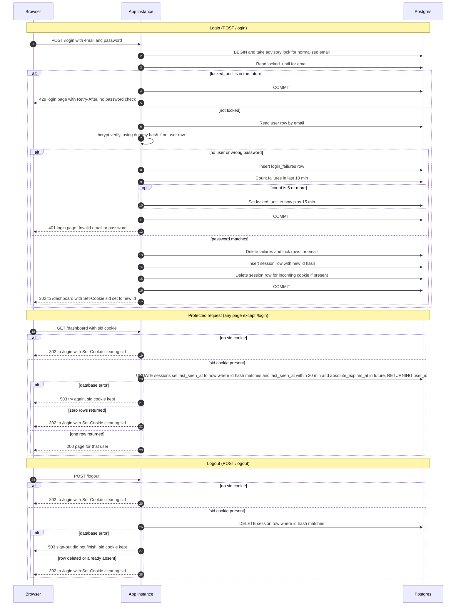

# Login with server-side sessions: design

## Scope

Every page except `/login` requires a signed-in user. The app is server-rendered, runs as two identical instances behind a load balancer with no sticky sessions, and uses one Postgres database that already has `users(id, email, password_hash)`. Sign-up and password reset are out of scope.

## Decisions

1. **Where sessions live: Postgres, not Redis.** Both instances already share Postgres, so a session row is visible to both with no new service. Postgres gives a single atomic statement for "check the session and restart its idle clock", and a transaction for the lockout check-and-record. Load is small (one row per active session, one write per protected request), so the write cost is acceptable for a small team app. Redis would add a service to run, monitor, back up and fail over, plus a second failure domain. Revisit only if per-request writes become a measured bottleneck.

2. **Where failure counts live: Postgres.** Same reason. Counts must be shared by both instances, so process memory is out.

3. **Session ID.** 256 bits from a CSPRNG, base64url encoded (43 characters). A new ID is generated on every successful login. The database stores only the SHA-256 hash of the ID, so a database read does not expose usable session IDs.

4. **Cookie.** Name `sid`, value is the opaque ID only. Attributes: `Path=/; HttpOnly; Secure; SameSite=Lax`. No `Expires` or `Max-Age`, so it is a browser-session cookie. The server, not the browser, decides expiry. Clearing sends the same attributes with `Max-Age=0`.

5. **Expiry is checked on the server, using the Postgres clock.** Both instances compare against `now()` in the database, so clock skew between app instances cannot change results. Idle expiry is `last_seen_at` more than 30 minutes ago. Absolute expiry is `absolute_expires_at`, fixed at `created_at + 12 hours` and never extended. Both checks are in the same `UPDATE` that restarts the idle clock.

6. **Expired sessions are removed by a cleanup job** that runs every 10 minutes on either instance (it is idempotent). It deletes sessions past either limit and failure rows older than 10 minutes. Expired rows are never accepted, so a missed cleanup only grows the table; it never extends a session.

7. **Failure counting is a sliding window.** "5 failures within any 10-minute period" is read literally: each failure is stored with its timestamp, and the count is over the last 10 minutes. A fixed window would miss bursts that straddle a window boundary.

8. **Counting applies to every submitted email**, whether or not the account exists. This is what keeps the 429 response identical for existing and unknown emails.

9. **The lock lasts 15 minutes from the 5th failure.** The 5th failure is still answered with 401, because that attempt was checked. Attempts during the lock get 429 and do not touch the password check or the failure log. A successful login clears that email's failures and lock.

10. **Concurrency.** Each login takes a transaction-scoped Postgres advisory lock keyed on the normalized email. The lock is held across the lock check, the password check and the failure or success write. This stops parallel guesses from overshooting the limit of 5. Cost: attempts for the same email are serialized, which only slows an attacker.

11. **Timing.** For an unknown email, bcrypt is run against a fixed dummy hash, so response time does not reveal whether the account exists.

12. **Input normalization.** Trim whitespace and lowercase the submitted email before any lookup, lock or count. Missing fields return 400 and are not counted as failures.

13. **Successful login order.** In one transaction: clear the email's failures and lock, insert the new session, delete the session the incoming cookie pointed to (whether or not it was valid), and commit. The `Set-Cookie` header is sent only after the commit succeeds. A failed failure-count write or a failed commit never results in a cookie.

14. **Storage failure: fail closed.**
    - Login: 503 with the login page ("We could not check your sign-in. Try again in a moment."). No cookie is set, no session is created, and the response is never 401 or 429 because of a storage fault.
    - Protected request: 503 with a retry message. The `sid` cookie is kept, so a brief outage does not log the user out.
    - Logout: 503 ("Sign-out did not finish. Try again."). The cookie is kept, because the rule is that the server session is destroyed before the cookie is cleared.
    - Statement timeout on the database connection is 2 seconds, so outages surface quickly.

15. **Logout with no session** returns the same 302 to `/login` with the cookie cleared as logout with a session. No database call is made when there is no cookie.

16. **Logging.** Log lock events and failed attempts with a hash of the email, never the password, and never the cookie value.

## Schema (sketch)

```sql
CREATE TABLE sessions (
  id_hash             bytea PRIMARY KEY,          -- SHA-256 of the cookie value
  user_id             bigint NOT NULL REFERENCES users(id) ON DELETE CASCADE,
  created_at          timestamptz NOT NULL DEFAULT now(),
  last_seen_at        timestamptz NOT NULL DEFAULT now(),
  absolute_expires_at timestamptz NOT NULL        -- created_at + 12 hours
);

CREATE TABLE login_failures (
  email     text NOT NULL,                        -- normalized (trimmed, lowercase)
  failed_at timestamptz NOT NULL DEFAULT now()
);
CREATE INDEX ON login_failures (email, failed_at);

CREATE TABLE login_locks (
  email        text PRIMARY KEY,
  locked_until timestamptz NOT NULL
);
```

`users(id)` is assumed to be a `bigint`. Adjust the type if it differs.

## Sequence diagram



## State and rules

**Session states.** `active` (both clocks running) moves to `idle-expired` when 30 minutes pass with no request, or to `absolute-expired` at 12 hours after login. Any protected request while `active` restarts the idle clock but not the absolute clock. Logout or a successful login from the same cookie moves a session to `deleted`. Expired and deleted rows are never accepted. The cleanup job removes them later.

**Failure and lock states.** `clear` (no lock, fewer than 5 failures in the last 10 minutes) moves to `counting` on a failure. The 5th failure within 10 minutes moves it to `locked` until `now + 15 min`. While `locked`, every attempt gets 429 without a password check and is not recorded. When the lock expires, the sliding window is already empty because the lock outlasts the 10-minute window. A successful login returns the email to `clear` from any state it was in while not locked.

**Cookie rules.** The cookie never contains user data. An unknown, malformed or expired `sid` is treated the same way: the cookie is cleared and the browser is sent to `/login`.

**Lockout scope.** The lock is per normalized email. It applies to unknown emails too, so it cannot be used to test whether an account exists.

## Open items for review

1. **Login CSRF.** `SameSite=Lax` stops cross-site POSTs from sending the session cookie, which covers logout. It does not stop a cross-site form from posting the attacker's own credentials to `/login`. Recommend adding a per-form CSRF token to the login form. This is not in the brief, so it needs a decision.
2. **Targeted lockout.** A per-email lock means anyone can lock out a known email for 15 minutes. The brief requires this. Adding a per-IP limit would reduce it, but the load balancer must pass the real client IP, which needs confirming.
3. **Password length.** bcrypt uses only the first 72 bytes. Reject passwords longer than 72 bytes at login or sign-up, or document the truncation.
4. **Local development.** `Secure` cookies are not stored over plain HTTP, so local development needs HTTPS or a localhost exception. This must not weaken production.
5. **Existing sessions on failed login.** A failed login leaves any existing session unchanged. The brief does not say otherwise.
6. **Write load.** One `UPDATE` per protected request is accepted for a small team app. Measure it before adding any batching, and note that batching the idle-clock write would make idle expiry fire early, so it is not an option as written.
7. **Storage-outage behavior** (decision 14) is a product choice: users see errors during a database outage rather than being signed out. Confirm this is wanted.