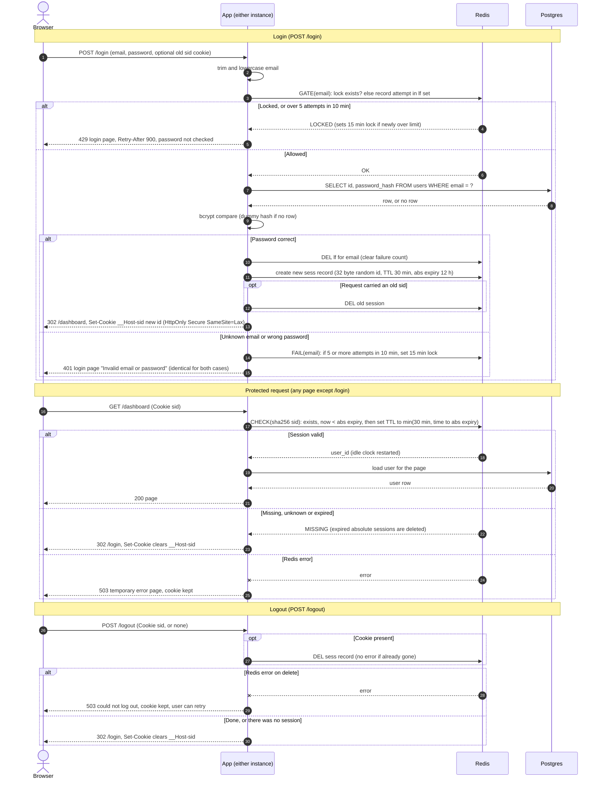

# Login with server-side sessions: design

## Summary of choices

| Question | Choice |
|---|---|
| Where sessions and failure counts live | One Redis instance shared by both app instances. New infrastructure, justified below. |
| Session ID | 32 bytes from a CSPRNG, base64url encoded. Redis keys use SHA-256 of the ID, so a Redis read does not yield usable cookies. |
| How expiry is checked and recorded | The session record stores `created_at` and `abs_expires_at`. The Redis TTL is always set to `min(30 min, abs_expires_at - now)` and is reset on every request. The app also compares `abs_expires_at` to the Redis clock. |
| How abandoned sessions are removed | Redis TTL removes them. There is no sweeper job. |
| When storage fails | Fail closed with HTTP 503 and a generic "temporarily unavailable" page. See "Storage failure behavior". |
| Cookie | `__Host-sid=<id>; Path=/; HttpOnly; Secure; SameSite=Lax`, with no `Domain` attribute. It is a browser-session cookie. The server decides when a session ends. |

## Why Redis

Sessions and failure counters must be visible to both instances immediately, because there are no sticky sessions. Process memory fails that test. The two realistic options are Postgres, which we already run, and Redis.

- **Redis (chosen).**
  - Every protected request must restart the 30-minute idle clock. That is a write per request, and Redis does it in one cheap call.
  - Key expiry is built in, so abandoned sessions and stale failure counters clean themselves up. Postgres would need a cleanup job.
  - Lua scripts make "check the lock, then record the attempt" and "check the session, then slide the TTL" atomic across both instances.
- **Postgres (rejected, still viable).** It needs no new infrastructure, but it adds a row update to every page view and a purge job. If the team decides a new service is not worth it for this app, the same design works with a `sessions` table and a `login_failures` table. In that case the TTL becomes an `expires_at` column and a periodic delete.
- **Cost of the choice.**
  - One more service to run and monitor. Use a managed instance with a replica or restart policy.
  - Turn on AOF with `appendfsync everysec`, so a Redis restart does not sign everyone out. Losing about a second of state is acceptable.
  - Set `maxmemory-policy noeviction`. Redis then returns errors when full instead of silently dropping sessions, and the app handles those errors by failing closed. Memory use is small: one short record per active session.

## State in Redis

| Key | Type | Content | TTL |
|---|---|---|---|
| `sess:{sha256(id)}` | hash | `user_id`, `created_at`, `abs_expires_at` (epoch ms) | `min(1800 s, abs_expires_at - now)`, reset on every request |
| `lf:{sha256(email)}` | sorted set | one entry per login attempt, score = time in ms | 10 min, refreshed on each attempt |
| `lock:{sha256(email)}` | string | `1` | 15 min, set once and never extended |

Notes on these keys:

- Emails are trimmed and lowercased, and capped at 254 characters, before they are hashed. This bounds key size and gives the same keys for known and unknown emails.
- All times come from the Redis clock (`TIME` inside the Lua scripts), so the two app instances cannot disagree about expiry.
- Key and `Set-Cookie` details: the cookie is set with `Path=/` and no `Domain`. When clearing it, send the same name, path and flags with `Max-Age=0`.

## Rules not shown on the arrows

**Login gate (requirement 3).** A Lua script runs before the password is checked.
1. If `lock:{email}` exists, return LOCKED. The password is not checked.
2. Otherwise drop entries older than 10 minutes from `lf:{email}` and add this attempt.
3. If the set now holds more than 5 entries, set the lock for 15 minutes and return LOCKED.
4. Otherwise return OK.

Details on how this behaves:

- **Recording the attempt up front.** This closes the race where many parallel requests all get past a check-then-increment. Parallel guesses cannot exceed the limit.
- **The failure path.** After a wrong password, a second script checks the set. If it holds 5 or more entries, it sets the 15-minute lock with `SET NX EX 900`. The fifth failing request still gets 401. Every later request is refused with 429 until the lock expires.
- **Success.** Success deletes `lf:{email}`, which clears the count. A successful login can never happen while locked.
- **Where it applies.** Limits apply to every email string, whether or not the account exists. This stops lockout from revealing which accounts exist.
- **Crashes mid-attempt.** An attempt that crashes mid-way stays counted. That errs toward locking.

**No account enumeration (requirement 2).**
- An unknown email and a wrong password both return 401 with the same page and the same "Invalid email or password" text. The 401 response sets no cookie.
- For an unknown email, the app still runs a bcrypt comparison against a fixed dummy hash, so response time does not distinguish the two cases.
- Lockout returns a generic 429 with `Retry-After: 900`, the same for any email.

**Session fixation (requirement 4).** The app discards the incoming cookie's session after a successful password check. The order matters:
1. Create the new session with a fresh ID.
2. Delete the old session if the request carried a cookie. If this delete fails, delete the new session as well (best effort) and return 503. A login never succeeds with the old session left alive.
3. Reply with `302 /dashboard` and `Set-Cookie` for the new ID.

**Session creation.** The script writes `created_at = now` and `abs_expires_at = now + 12 h`, then sets the TTL to 30 minutes. The ID is never derived from user data and is never reused.

**Protected request check (requirements 6 and 7).** One Lua script does the whole check atomically.
1. Look up `sess:{sha256(id)}`. If it is missing, return MISSING.
2. If `now >= abs_expires_at`, delete the session and return MISSING.
3. Otherwise set the TTL to `min(1800, abs_expires_at - now)` and return the `user_id`.

Details on how this behaves:

- **Idle limit.** The 30-minute idle limit is enforced by the Redis TTL, so an expired session is simply absent.
- **12-hour limit.** The 12-hour cap is enforced by the clamped TTL and, redundantly, by the explicit comparison.
- **Every request counts.** Because every protected request goes through this script, every request restarts the idle clock. The TTL never extends beyond the absolute deadline.
- **Unauthenticated requests.** No cookie, an unknown ID and an expired ID all lead to the same result: `Set-Cookie` that clears the cookie, then `302 /login`.
- **Deleted users.** If the user row has been deleted from Postgres, the session is destroyed the same way. Loading the user for the page is what detects this.

**Logout (requirement 8).** `POST /logout` deletes `sess:{sha256(id)}` if a cookie was sent. Deleting a key that does not exist is not an error. The reply is always the cookie-clearing `Set-Cookie` plus `302 /login`, whether or not a session existed. Because the cookie is `SameSite=Lax`, a cross-site POST to `/logout` or any other form post does not carry it, which covers cross-site request forgery for this scope.

**Cookie contents (requirement 5).** The cookie holds only the opaque ID. Nothing about the user is in it.

## Storage failure behavior

All of these fail closed. Redis errors never grant access, skip the rate limit or log anyone out by accident.

| Situation | What happens |
|---|---|
| Redis fails during the login gate | HTTP 503, generic page: "Sign-in is temporarily unavailable. Please try again in a few minutes." The password is not checked and no session is created. |
| Redis fails when creating the session, after the password was correct | 503, same page, no cookie. The user can retry. |
| Redis fails on a protected request | 503 error page. The cookie is **not** cleared and there is no redirect to `/login`, because the session may still be valid. |
| Redis fails during logout | 503 page saying logout could not be completed, and the cookie is kept. We do not claim the user is signed out when the server-side session may still exist. The user can retry. |
| Postgres fails during login | Same 503 page as the Redis login failure. The failed lookup is not counted as a bad credential and does not return 401. |

All 503 responses are logged with the error, not with the email or the session ID.

## Sequence diagram

## Out of scope

Sign-up, password reset, remember-me, concurrent-session limits, and an admin "sign out everywhere" tool are not covered. A per-user session index would be needed for "sign out everywhere" and is not part of this design.
