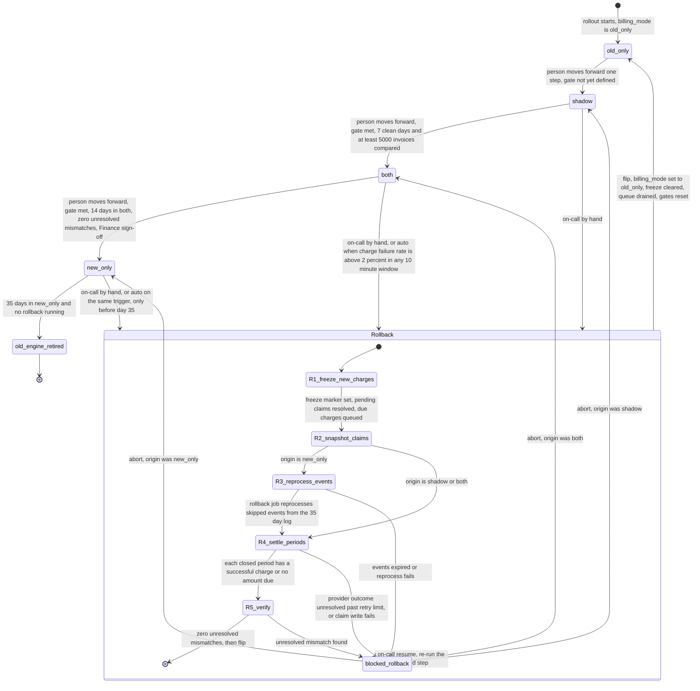

# Billing engine rollout: state machine

## Terms

- **Mode.** The value of `billing_mode`: `old_only`, `shadow`, `both` or `new_only`.
- **Person.** The human who requests a forward move, rollback, resume or abort. Each request must name the person, and the controller records it in the rollout record. **Not defined:** who the person is, and whether requests come through a UI, a command or an API (see Open questions).
- **Rollout controller.** The only component that writes `billing_mode` and the rollout record. Every forward move, gate check, rollback step, abort, resume and flip goes through it. It processes one request at a time. **Not defined:** where it runs, what hosts it, and how it restarts after a crash (see Open questions).
- **Rollout record.** Controller-owned state beside the config service. Holds: current mode, any pending move, entry time, rollback origin, rollback step and its status, blocked reason, freeze marker, pending-claim count, R2 snapshot time, gate counters, Finance sign-off, auto-trigger audit. **Not defined:** the exact structure of the gate counters, including days in `both` and consecutive clean days (see Open questions).
- **Origin.** The mode a rollback started from. It is the value of `billing_mode` read when the rollback starts. It is recorded then and never changed during the rollback.
- **Freeze marker.** A field in the rollout record, set in R1 and cleared at the flip or an abort. It is separate from `billing_mode`. While it is set, no engine creates a claim except the rollback job in R4.
- **Rollback job.** The old engine code run by the controller to carry out the current rollback step. It is separate from the old engine's normal billing work. It reads the origin and the step from the rollout record, never from `billing_mode`. It is the only way the old engine creates claims during a rollback, apart from the queue drain after the flip or an abort.
- **Invoice.** The total computed by one engine for one (customer, billing period). An invoice is data. It is not a charge. Old-engine invoices live in the billing ledger (origin `shadow`) or in the shadow store (origin `both`). New-engine invoices live in the ledger (`both`, `new_only`) or the shadow store (`shadow`).
- **Charge.** A provider charge made against a charge claim. A charge has an amount, a claim and a provider outcome. One period can have one successful charge but many invoices over time.
- **Queue.** Due charges waiting for an engine to charge them. Rows in the billing ledger with status `queued`. Each row stores the customer, the billing period, the amount due and the invoice it came from. A queued row is not a claim.
- **Mismatch.** An invoice whose total differs by more than one cent between the two engines for the same customer and billing period.
- **Charge claim.** The ledger row for one (customer, billing period) charge attempt. See Charge claims.
- **Closed period.** A billing period whose end time is at or before the snapshot time taken in R2. A rollback never charges an open period.
- **In scope.** Every (customer, billing period) that has an invoice from either engine, or usage events, since the rollout entered `shadow`.
- **Clean day.** See Forward moves and gates.

## Diagram

Notes on the diagram:
- The flip is the only flag write in a rollback. The flag is written first, then the freeze is cleared. If the flag write fails, the rollback stays at R5 complete, the freeze stays set, and the controller retries. Crash recovery for the flip is in Rollback steps.
- Resume re-enters the rollback at the blocked step, not at R1. Only the blocked step is re-run.
- The `old_only` to `shadow` move has no gate yet. The controller refuses it until one is set (see Forward moves and gates). **Until then, a rollout cannot leave `old_only`.**
- The diagram shows the state machine only. It does not show what triggers the auto-rollback path in code. That mechanism is not defined (see Open questions).

## What each mode does

- **old_only.** The old engine computes, charges and writes the ledger. The new engine is off. This is the only mode without a rollout in progress, and it is where every rollback ends.
- **shadow.** The old engine still charges and writes the ledger. The new engine reads the same usage events and writes its invoices to the shadow store. It never charges and never writes the ledger. The nightly comparison pairs the new engine's shadow invoices with the old engine's ledger invoices. New-engine errors are recorded here but never trigger a rollback.
- **both.** The new engine charges and writes the ledger. The old engine keeps computing every invoice into the shadow store without charging, so it stays current. The nightly comparison pairs the new engine's ledger invoices with the old engine's shadow invoices.
- **new_only.** The new engine is the only engine charging. The old engine's normal work stops, so usage events it skips are not reprocessed until a rollback needs them. The old engine can be retired at day 35 if no rollback is running.
- **Rollback (composite).** Always ends in `old_only`. Steps R1 to R5 run in order, driven by the controller. The rollback job does the old engine's part. From `shadow`, R3 is skipped because the old engine has nothing to reprocess. From `both`, R3 is skipped because the shadow store is current, but R4 and R5 still run against the ledger. From `new_only`, R3 is required.
- **Who may charge during a rollback.** `billing_mode` still shows the origin, so the mode alone does not say who may charge. The rollout record decides. While the freeze marker is set, neither engine's normal work creates a claim. The new engine's normal work is suspended, and so is the old engine's normal work, including the old engine's normal charging when the origin is `shadow`. Due charges from either engine are queued instead. The rollback job creates claims only in R4. Normal work resumes only after the flip or an abort clears the freeze.

## Where the rollout state lives

- **`billing_mode` in the config service.** The single authoritative flag. Only the rollout controller writes it. Both engines read it fresh before every charge attempt and every ledger write, with no caching. The flag is not written during R1 to R5. It changes once, at the flip (see Rollback steps). A worker that cannot read it does not charge (see What happens when something fails).
- **Rollout record, beside the config service.** Written only by the rollout controller and persisted after each step, so a crash resumes at the last completed step.
- **Billing ledger (system of record).** Holds charges, invoices (the ledger invoices), charge claims and queued rows. Every engine checks the claim before it charges or writes the ledger. This is the guard against double charges in every mode, including when an engine acts on a stale read of the flag.
- **Shadow store.** Invoices from the non-charging engine, one comparison result per day (invoices compared, mismatches, unresolved mismatches), and resolution records for mismatches.
- **Usage event log.** Kept 35 days. This is the clock for rollback from `new_only`. The new engine (in shadow and both), the old engine (in both and new_only, during reprocessing) and the nightly comparison job all read events from this log. **Not defined:** what schedules each of these runs, and how each pulls events from the log (see Open questions).
- **Engine and job triggers.** The brief does not say what schedules the old engine's normal run, the new engine's runs, or the nightly comparison job. This is open (see Open questions).

## Forward moves and gates

**Forward move.** A person asks the rollout controller to move one step. The controller refuses, naming the unmet condition, if any of these holds: the gate is not met, a rollback is running or blocked, or another move is pending. If the gate is met, the controller writes the pending move to the rollout record, then writes `billing_mode`, then marks the move done. If the flag write fails, the pending move stays in the record and the controller retries. The mode does not change until the flag is written.

**Restart during a forward move.** On start, the controller reads any pending move. If `billing_mode` already equals the pending target, the write happened before the crash, so the controller marks the move done. Otherwise it writes `billing_mode` to the target and then marks the move done. The gate is not checked again, because the move was accepted before the crash and no rollback can start while it is pending.

**Rollback request while a move is pending.** A rollback request is accepted while a forward move is pending. The controller first clears the pending move in the rollout record. Then it reads `billing_mode` and records that value as the origin. The origin is therefore the mode the flag holds when the rollback starts, not the pending target. Because the controller handles one request at a time, the cleared move cannot write the flag afterwards.

**Old_only to shadow gate.** The brief sets no gate for this move. Until one is set, the controller refuses it and names 'gate not defined'. The gate is an open question.

**Nightly comparison.** Once per day, the comparison job compares each customer's invoices from the two engines for the same billing periods, using the mismatch rule above. It writes one result per day to the shadow store: invoices compared, mismatches, and unresolved mismatches. The controller reads these results to update the gate counters. **Not defined:** how the controller turns these results into counters, and how days in `both` and consecutive clean days are tracked.

**Clean day.** A day is clean when all three hold: the comparison job completed for that day, at least one invoice was compared, and the number of mismatches divided by invoices compared is under 0.1%. The one-cent rule decides which invoices are mismatches. The rate is computed from those counts, and no other input is used. A day with no completed job is not clean. Unresolved mismatches are not part of the clean-day test. They block the move instead, at the time of the move. Whether they should also make a day unclean is an unconfirmed assumption (see Open questions).

**Shadow to both.** Seven consecutive clean days, at least 5,000 invoices compared (whether that minimum is per day or across the window is open, so this gate cannot be evaluated until it is settled), and zero unresolved mismatches at the time of the move.

**Both to new_only.** Fourteen days in `both` on which the comparison job completed, zero unresolved mismatches at the time of the move, and a Finance sign-off recorded in the rollout record. A day with missing data is not counted. **Assumed, not confirmed:** an unresolved mismatch pauses this count and does not reset it. A day counts only if the job completed and no mismatch was unresolved at the end of that day.

**Unresolved mismatch.** A mismatch stays unresolved until a resolution entry is written to the shadow store, with the reason. **Not defined:** who may write it. An unresolved mismatch blocks the move gate. It does not start a rollback by itself. On-call decides.

## Charge claims

- A claim is one row per (customer, billing period) per attempt, in the billing ledger.
- The engine that is about to charge creates the claim **before** it calls the provider. The create is conditional: it succeeds only if no successful claim and no pending claim exists for that (customer, billing period). If it fails, the engine does not charge that period. The due charge goes to the queue, with its amount.
- Each claim carries an idempotency key derived from the customer, the billing period and the attempt number. The same key is sent to the provider with the charge.
- States: **pending** (created, provider outcome not yet known), **successful** (provider confirmed the charge), **failed** (provider reported a definitive decline).
- A timeout or no answer leaves the claim pending. The engine then queries the provider by idempotency key. It does not charge again until that query shows no charge was made.
- A failed claim may be retried as a new attempt (attempt number plus one, new key) only after the provider confirms the previous attempt was declined. **Not defined:** the retry limit and timing. Until they are set, a failed claim is not retried and the period needs on-call.
- Guarantee: at most one successful charge per (customer, billing period), whichever engine makes it. A stale read of `billing_mode` cannot cause a second charge, because the claim check still applies.

## Rollback steps

The flag is not changed during R1 to R5. `billing_mode` stays at the origin until the flip. The rollback job acts only through the controller, and reads the current step and origin from the rollout record. While the freeze marker is set, the new engine and the old engine's normal work create no claims.

The freeze check is made against the rollout record before each new claim by either engine. It reads the freeze marker and the fresh `billing_mode` separately, and the freeze check does not depend on the flag. **Not defined:** how the freeze check and the claim create are made atomic, so that a stale freeze read cannot create a claim during R1. Until it is decided, R2 does not start while any claim is pending. This does not by itself stop a claim created after R1 completes (see Open questions).

1. **R1, freeze new charges.** The controller sets the freeze marker. Each engine checks it before each new claim and creates none while it is set. Due charges that either engine would make are queued by customer and period, with the amount due and the invoice reference, and no claim is created, so they are not dropped. Pending claims are resolved by querying the provider with their idempotency keys. R1 completes when no claim is pending. A provider that never answers keeps R1 running. **Not defined:** the wait and retry limit. Until it is set, R1 has no time limit. It stays running and shows the pending claim count in the rollout record. The old engine keeps computing invoices into the shadow store while R1 runs, because computing is not charging.
2. **R2, snapshot.** The controller records the snapshot time. It refuses to proceed if any claim is pending. For each in-scope (customer, billing period), it records whether there is a successful claim from either engine, a failed claim, or no claim. Closed periods are identified here by their end time against the snapshot time. For each closed period with origin `both` or `shadow` it also records the invoice version the rollback will charge: the old engine's shadow-store invoice for origin `both`, and the old engine's ledger invoice for origin `shadow`. R4 charges these pinned versions. Invoices that change after the snapshot do not change the R4 amount.
3. **R3, reprocess (origin `new_only` only).** The rollback job recomputes the invoices for usage events skipped during `new_only`, from the 35-day log. Results go to the shadow store. For closed periods these invoices are final, and R4 uses them. Expired events, or a failed recompute, move the rollback to `blocked_rollback`.
4. **R4, settle periods.** For each closed in-scope period:
   - If a successful claim exists, nothing is done. A closed period with a successful new-engine claim is not re-charged, even if its amount differs from the old engine's invoice. Such a difference is a mismatch and is caught by R5.
   - Otherwise, if the amount due is above zero, the rollback job creates a claim, charges once with that claim's key, and writes the ledger entry. The amount due is the final invoice from R3 (origin `new_only`), or the pinned invoice version from R2 (origin `shadow` or `both`). A queued row for the period carries the same amount, and the drain must match it (see Flip).
   - Otherwise, if the amount due is zero, nothing is charged. "Due" means the invoice total is above zero and there is no successful claim for the period.
   - Open periods are not charged now. They go to the queue and normal processing charges them after the flip.
   - A pending outcome past the retry limit, or a failed claim write, moves the rollback to `blocked_rollback`. **Not defined:** the retry limit for unresolved provider outcomes. **Not defined:** what R4 does when the R2 snapshot shows a failed claim, because the retry rule for failed claims is not set.
5. **R5, verify.** For each closed in-scope period, the old engine's current invoice total must match the successful charges for that period in the ledger within one cent, and no unresolved mismatch may remain. The old engine's invoice is the ledger invoice for origin `shadow` and the shadow-store invoice for origin `both` or `new_only`. A successful charge is a charge with a successful claim. Otherwise the rollback moves to `blocked_rollback`. Open periods are not checked here. The nightly comparison covers them after the flip.
6. **Flip.** The controller does these steps in this order, each one persisted in the rollout record before the next:
   1. Write `billing_mode` to `old_only`. This is the only flag write in the rollback. If it fails, the rollback stays at R5 complete, the freeze marker stays set, and the controller retries.
   2. Clear the freeze marker.
   3. Drain the queue through the old engine under the normal claim checks. Each drained row is charged at its stored amount. If the old engine's current invoice for that period differs from the stored amount by more than one cent, the row is not charged. The period is marked for on-call and the drain continues with other rows.
   4. Reset all gates. The consecutive clean-day count and the days-in-`both` count return to zero. The next forward move therefore goes through `shadow` again, and its 7-day count starts over. Which gate-counter fields are cleared, and what in-scope tracking does on reset, is open (see Open questions).
   5. Mark the flip done.

   The flag is written before the freeze is cleared. If the freeze were cleared first and the controller crashed, the flag would still hold the origin and the new engine could charge while the rollback is still in progress. With the order above, a crash after step 1 leaves the freeze set, so nothing charges. On restart the controller re-runs the remaining steps from the record. Step 1 is an idempotent write. Steps 2 to 5 are safe to repeat because the claim checks and the stored amounts prevent a second charge. **Not defined:** the order in which queued rows are drained, and how they are re-claimed.

**Blocked rollback.** The controller records the blocked step and the reason in the rollout record and sends an alert on the same channel used for auto-rollback triggers. **Not defined:** the channel, and the escalation path beyond on-call. The rollback stays blocked until on-call either aborts or resumes.

**Resume.** After fixing the cause, on-call sends a resume command to the controller naming the blocked step. **Not defined:** the transport for this command (see Open questions). The controller re-checks that step's precondition and re-runs that whole step. Earlier steps are not re-run. Each step is idempotent: R1 re-queries the provider, R2 re-snapshots, R3 overwrites the same invoices, R4 finds existing claims before creating any, and R5 re-verifies. The claim checks prevent a double charge when a step is re-run.

**Abort from `blocked_rollback`.** On-call issues an abort through the controller. The controller sets the rollout's mode (in the rollout record, not `billing_mode`) back to the recorded origin and clears the freeze marker. `billing_mode` still holds the origin, so no flag write is needed. The origin's engines resume normal work. Claims are not changed, so no period is charged twice. Queued rows go to the engine that charges in the origin mode: the new engine for `both` and `new_only`, the old engine for `shadow`. Rows whose period already has a successful claim are dropped. Rows for open periods wait in the queue for normal processing to charge them when their period closes. An abort does not reset gates and does not restart the day-35 clock. **Assumed, not confirmed:** that an abort does not reset gates.

## What happens when something fails

- **Charge failure monitor.** Checks the new engine's resolved charge attempts in each rolling 10-minute window. A failure is a provider decline, a timeout that resolves as not charged, or an engine error on a charge attempt. Claim-check refusals and queued items are not attempts. The rate is failures divided by all new-engine charge attempts in the window. In `both` and `new_only` only the new engine charges, so only its charges count.
- **Auto rollback.** In `both` or `new_only`, a charge failure rate above 2 percent in any 10-minute window, as measured by the monitor, starts the rollback automatically. In `shadow`, new-engine errors are recorded and never start one. **Not defined:** the mechanism by which the controller learns the monitor tripped and starts the rollback. **Not defined:** a minimum attempt count per window. Until one is set, a single failure in a quiet window can start a rollback. Check this before enabling auto-rollback.
- **Unknown charge outcome.** Query the provider by idempotency key before any retry. Never re-charge blindly.
- **Nightly comparison job fails for a day.** That day is not clean and is not counted. The consecutive count breaks. Gate counters are never advanced by missing data.
- **Mismatches.** An unresolved mismatch in `shadow` blocks the shadow to both gate. An unresolved mismatch in `both` blocks the both to new_only gate. Neither starts a rollback by itself.
- **Flag cannot be read.** The engine does not charge. It writes each due charge to the queue with no claim, including its amount, raises an alert, and retries the read on its next cycle. Queued charges are drained once a read succeeds, so nothing is dropped. **Not defined:** the drain order (see Open questions).
- **Flag write fails on a forward move.** The rollout stays in its current mode, the pending move stays recorded, and the controller retries the write.
- **Reprocessing fails, or events are past 35 days.** The rollback moves to `blocked_rollback` and does not flip the flag.
- **Closed period where the new engine's charge differs from the old engine's total.** R5 blocks the rollback. **Not defined:** the resolution (credit, refund, or accepting the new engine's amount). The rollback stays blocked at R5 until one is chosen.
- **Abort safety.** Claims are per (customer, billing period), regardless of engine. A partly settled rollback can be aborted or resumed without charging any period twice.
- **Crash mid-rollback.** Resume from the last persisted step. Each step is idempotent. A crash inside the flip is handled by the order given in Flip.
- **Crash during a forward move.** Restart completes the move as described in Forward moves and gates.
- **Day 35 during a rollback.** Decommission of the old engine is blocked while a rollback is running. A rollback cannot start after day 35. A rollback still running at day 35 and not finished is blocked. **Not defined:** its escalation path (see Open questions).

## Open questions

Each item below is not defined in this document. The rollout cannot proceed past the point it affects until it is decided.

- **Person and interface.** The brief says a person makes each forward move and each rollback request. Who that person is, and whether the request is made through a UI, a command or an API, is not set. The same applies to resume and abort.
- **Rollout controller.** Where it runs, what hosts it, how it restarts after failure, and what hosts the rollback job (the controller starts it, but the process it runs in is not set) are not set. Its triggers are: a person's move, rollback, resume or abort request; the auto-trigger from the charge failure monitor; the nightly job's results; and a restart after a crash. **How the auto-trigger reaches the controller is not set.**
- **Old_only to shadow gate.** The brief names no gate for this move. The controller refuses it until one is set.
- **Engine and job triggers.** What schedules the old engine's normal run, the new engine's runs in shadow and both, and the nightly comparison job, and how each gets its usage events from the log, is not set.
- **Freeze check and claim create.** How the freeze check and the claim create are made atomic, so a stale freeze read cannot create a claim during R1 or after R1 completes, is not set. Until it is, the rule that R2 refuses to start while any claim is pending is the only check against a late claim.
- **Alert channel.** The brief does not name the channel used for auto-rollback triggers and blocked-rollback alerts. The file refers to it as the same channel for both.
- **Escalation and sign-off.** Who is on the escalation path beyond on-call is not set. How Finance records sign-off in the rollout record is not set.
- **R1 wait and retry limit.** How long R1 waits for pending claims, and the retry limit for unresolved provider outcomes, are not set.
- **Failed claims.** Retry limit and timing for a declined charge are not set. What R4 does with a failed claim from the R2 snapshot is therefore also not set.
- **5,000 invoices.** Is the minimum per day or across the 7-day window? Until settled, the shadow to both gate cannot be evaluated.
- **Unresolved mismatches and clean days.** The brief does not say an unresolved mismatch makes a day unclean. This document adds it to the move-time check only. Confirm.
- **Unresolved mismatches and the 14-day count.** Assumed: an unresolved mismatch pauses the count without resetting it. Confirm.
- **Resolution entries.** Who may write a mismatch resolution entry to the shadow store is not set.
- **Gate counter structure.** How days in `both` and consecutive clean days are represented in the rollout record is not set. Which counter fields a reset clears, and what in-scope tracking records after a reset to `old_only`, is not set.
- **Low-volume windows.** The 2 percent auto-rollback trigger needs a minimum attempt count per 10-minute window, or one failure in a quiet window will trigger it. The brief does not set one.
- **Gates on abort.** An abort is not a completed rollback, so this document does not reset gates on abort. Confirm.
- **Closed-period disagreement.** If the new engine has already charged a closed period and the old engine's total differs by more than a cent, R5 blocks. The brief does not say whether the resolution is a credit, a refund, or accepting the new engine's amount.
- **Billing close job.** The file defines a closed period by its end time. It does not know whether the current system has a billing close job. Confirm.
- **Rollback deadline.** Each usage event expires 35 days after it was written, so the oldest skipped event expires at day 35 of `new_only`. A rollback should start well before then to leave time for R3 and R4. The target lead time is not set.
- **Day 35 escalation.** A rollback still running and blocked at day 35 is blocked and escalated like any other failure. The escalation path for this case is not set.
- **Queue order on drain.** The order in which queued rows are drained, and how they are re-claimed, is not set.
- **Resolving a mismatch.** The action that marks a mismatch resolved is a resolution entry in the shadow store, with a reason. Who may write it is not set.
- **Rollback from `old_only`.** Not a transition. It is a no-op.
- **Drifted invoices.** If the old engine's invoice for a closed period changes after the R2 snapshot, R4 still charges the pinned amount and R5 blocks on the difference. Whether on-call or the controller resolves that case automatically is not set.
- **Resume transport.** The transport for the resume command is not set (see Resume).
- **Old engine retirement.** How the day-35 'old engine retired' step is carried out, and who or what triggers it, is not set.