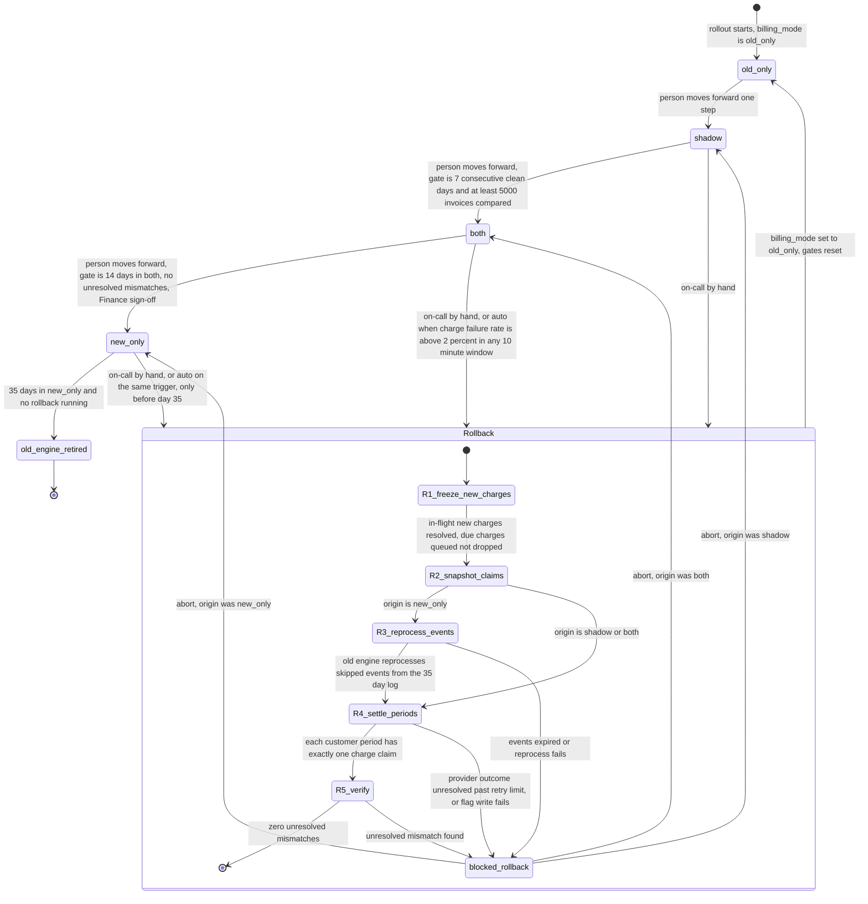

# Billing engine rollout: state machine

## Diagram

## What each mode does

- **old_only.** The old engine computes, charges and writes the ledger. The new engine is off. This is the only mode without a rollout in progress, and the state rollback always ends in.
- **shadow.** The old engine still charges and writes the ledger. The new engine reads the same usage events and writes invoices to the shadow store. It never charges and never writes the ledger. A nightly job compares the two engines per customer, and a mismatch is any invoice total differing by more than one cent. New-engine errors are recorded here but never trigger rollback.
- **both.** The new engine charges and writes the ledger. The old engine keeps computing every invoice into the shadow store without charging, so it stays current. The nightly comparison continues. In this mode the comparison pairs the new engine's ledger invoices with the old engine's shadow invoices.
- **new_only.** The new engine is the only engine charging. The old engine stops computing, so usage events it skips are not reprocessed until a rollback needs them. The old engine can be retired at day 35 if no rollback is running.
- **Rollback (composite).** A path into `old_only` only. Steps R1 to R5 run in order. From `shadow`, R3 is skipped because the old engine has nothing to reprocess. From `both`, R3 is skipped because the shadow store is current, but R4 still checks every period against the ledger. From `new_only`, R3 is required.

## Where the rollout state lives

- **`billing_mode` in the config service.** The single authoritative flag. Both engines read it before acting, and a worker that cannot read it does not charge. It queues due charges and alerts, so nothing is dropped.
- **Rollout record, beside the config service.** Holds the current mode, entry time, origin of any rollback, gate counters (clean days and invoices compared), the sign-off record, the auto-trigger audit, and the current rollback step. It is written only by the rollout controller and persisted after each step, so a crash resumes at the last completed step.
- **Billing ledger (system of record).** Holds charges and invoices. Each (customer, billing period) has at most one charge claim, with an idempotency key that is also sent to the payment provider. This is the guard against double charges in every mode. Any engine must check the claim before charging or writing to the ledger.
- **Shadow store.** Invoices from the non-charging engine, plus nightly comparison results.
- **Usage event log.** Kept 35 days. This is the clock for rollback from `new_only`.

## Rollback steps

1. **R1, freeze new charges.** The new engine starts no new charges. In-flight charges are resolved by querying the provider with their idempotency keys. Due charges are queued with their due dates, not dropped.
2. **R2, snapshot claims.** Record which (customer, period) pairs already have a successful charge claim from either engine.
3. **R3, reprocess (origin `new_only` only).** The old engine recomputes the usage events skipped during `new_only`. These must still be in the 35-day log. Recomputed invoices go to the shadow store.
4. **R4, settle periods.** For each (customer, period): if a claim exists, the old engine does not charge and does not write a second ledger entry. If no claim exists and an invoice is due, the old engine charges once with the period's idempotency key. A charge with unknown outcome is checked at the provider before any retry.
5. **R5, verify.** Reconcile invoice totals against the ledger. Zero unresolved mismatches is required before the flag changes.
6. **Flip.** Set `billing_mode` to `old_only`. Drain the queue through the old engine. Reset all gates. The rollout returns to `shadow` only through a person's forward moves, with the 7-day count starting at zero.

## What happens when something fails

- **Auto rollback.** In `both` or `new_only`, a charge failure rate above 2 percent in any 10-minute window starts the rollback automatically. In `shadow`, new-engine errors are recorded and never start one.
- **Unknown charge outcome.** Check the provider by idempotency key before any retry. Never re-charge blindly.
- **Nightly comparison job fails for a day.** That day does not count toward the 7-day or 14-day gates, so the streak breaks. The gate counters are not advanced by missing data.
- **Mismatches.** An unresolved mismatch in `shadow` blocks the `shadow` to `both` gate. An unresolved mismatch in `both` blocks the `both` to `new_only` gate. Neither triggers rollback by itself. On-call decides.
- **Reprocessing fails, or events are past 35 days.** The rollback moves to `blocked_rollback`. It does not flip the flag. On-call can abort back to the recorded origin, and the origin's engines resume. No charge is lost, because queued charges go to whichever engine is active and the claims still block duplicates.
- **Abort safety.** Charge claims are per (customer, period), regardless of engine. So a partially settled rollback can be aborted, or resumed, without charging any period twice.
- **Crash mid-rollback.** Resume from the last persisted step. Each step is idempotent.
- **Day 35 during a rollback.** Decommission is blocked while a rollback is running. A rollback cannot start after day 35. If one is still running at day 35 and cannot finish, it is blocked and escalated like any other failure.
- **Config flag write fails.** The rollout stays in its current mode. Engines keep their last-verified behaviour, and the controller retries the write.

## Assumptions and open questions

- **Gate wording.** "7 consecutive days with a mismatch rate under 0.1% and at least 5,000 invoices compared" is read as each of the 7 days below 0.1% and at least 5,000 invoices over the window. Confirm whether the 5,000 applies per day or in total.
- **Low-volume windows.** The 2 percent auto-rollback trigger needs a minimum attempt count per 10-minute window, or a single failure in a quiet window will trigger it. The brief does not set one.
- **Counter reset.** The brief resets gates only on rollback. It is assumed that an unresolved mismatch pauses the 14-day count but does not reset it. Confirm.
- **Rollback deadline.** The usage event log expires each event 35 days after it was written. So the oldest skipped event expires at day 35 of `new_only`, and a rollback should start well before then to leave time for R3 and R4.
- **Rollback from `old_only`.** Not a transition. It is a no-op.
