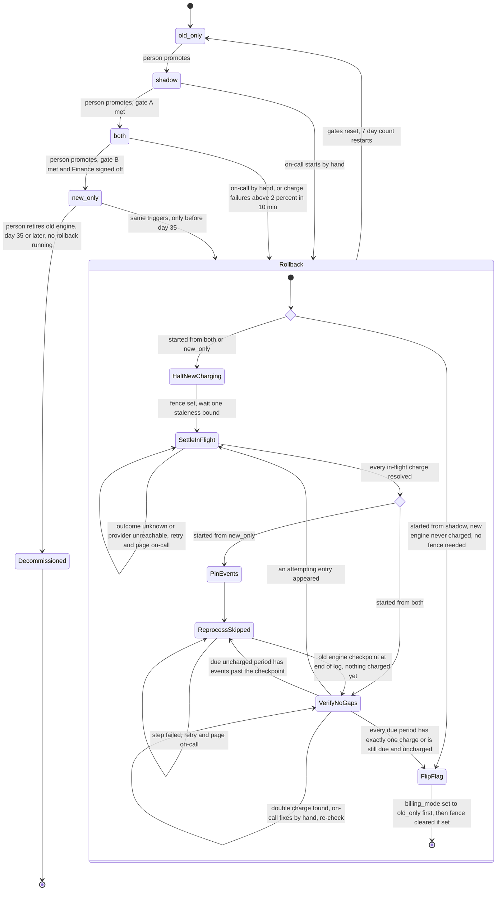

# Billing engine rollout: state machine

## Diagram

Gate A: 7 consecutive days, each with a nightly mismatch rate under 0.1%, and at least 5,000 invoices compared in total over those days.
Gate B: 14 days in `both` with no unresolved mismatches, plus Finance sign-off.

Mismatch rate for one night = customers whose two invoice totals differ by more than 1 cent, divided by customers compared that night. An unresolved mismatch is one that has not yet been explained and closed (see open question 11).

Gate counting: the controller recomputes the gate counters from the nightly result rows each time a new row arrives and each time status is requested, so both give the same answer. "Consecutive" means consecutive calendar nights counting back from the latest row. A night with no row, or a night that fails the 0.1% test, ends the run, and the count restarts from the next passing night.

## What each mode does

| Mode | Old engine | New engine | Notes |
|---|---|---|---|
| `old_only` | Computes, writes the ledger, charges | Off | Safe state. Every rollback ends here. |
| `shadow` | Computes, writes the ledger, charges | Reads the same usage events and writes invoices to the shadow store. Never charges and never writes the ledger. | A nightly job compares invoice totals per customer. A mismatch is a difference of more than 1 cent. |
| `both` | Computes every invoice into the shadow store, without charging | Charges and writes the ledger | The comparison continues. The old engine skips no events, so its checkpoint stays current and a rollback from here needs no reprocessing. |
| `new_only` | Stopped. It reads no events, so they pile up unprocessed in the usage event log. | Does everything | The old engine's checkpoint falls behind from here on. |
| `Decommissioned` | Retired | Does everything | Terminal. A state in the rollout record only: the `billing_mode` flag stays `new_only`. There is no way back, so failures are fixed forward. |

Forward moves are made by a person, one step at a time. This includes retiring the old engine: day 35 only makes it allowed, it never happens by itself. Gates are preconditions, not triggers. Meeting a gate never moves the mode on its own.

## Who runs it

The **rollout controller** is a service still to be built. It runs every promotion, retirement and rollback step. A person (promotion, retirement, Finance sign-off) or the auto-trigger (rollback) sends it a request. How requests are sent and how a person authenticates are not decided (open question 15). The controller checks the preconditions, runs the steps, and writes its progress to the rollout record after each step, so it can resume after a crash. Workers do not run rollout steps. They only read the flag and the fence. The controller refuses to start a rollback or a retirement while another rollback is running.

**Every request gets a reply:** accepted, or refused with the reason. A refusal (promotion, retirement or rollback) changes nothing. A person sees the reply to their request; the monitor just records it. Refused promotions and retirements do not page anyone; only the refusals listed under "Paging on-call" do.

**Finance sign-off** is recorded by the controller in the rollout record when a request from an authorised person arrives (a sign-off request, with who and when). Gate B reads it from the record. Who counts as authorised is open question 19.

**A promotion has three steps.** The engines start and stop by reading the flag, so the controller does not start or stop anything itself.
1. Check: the current mode is the one just before the requested mode, no rollback is running, the gate is met (gate A for `shadow` to `both`; gate B and the Finance sign-off for `both` to `new_only`; no gate for `old_only` to `shadow`), and the rollout record shows no half-finished promotion. If any check fails, the request is refused with that reason.
2. Write `billing_mode` to the next mode in the config service.
3. Record in the rollout record the time the new mode was entered and start the new mode's counters at zero.
If the controller crashes after step 2, it resumes from the rollout record and repeats step 3. Retirement is checked the same way (day 35 or later, no rollback running; otherwise refused with the reason, nothing changed); its effect is that the old engine is switched off for good and the rollout record is set to `Decommissioned`. The flag is not changed. How the old engine is physically shut down is not decided.

The **nightly comparison job** compares the two engines' invoice totals per customer and writes one result row per night (date, customers compared, mismatches). The controller reads those rows and updates the gate counters in the rollout record (see Gate counting above). A night with no row counts for nothing. A person asks the controller for the rollout status, which shows the current mode, the gate counters and whether each gate is met. The controller also checks the gate itself and refuses a promotion request when the gate is not met. Where the job runs and how the status is shown are not decided (open question 13).

The **auto-trigger** is a charge-failure monitor, also still to be built. It reads the charge results that workers record in the billing ledger and computes failed charge attempts divided by all charge attempts over a sliding 10-minute window, only while the mode is `both` or `new_only`. Every attempt counts, retries of the same period included, because each is a real call to the provider (open question 3). If there are no attempts in the window the rate is undefined and nothing triggers. This is what happens once a rollback has set the fence and charging stops. When the rate is above 2% it sends the controller a rollback request and pages on-call. If a rollback is already running the controller ignores the request. Where the monitor runs is not decided (open question 12).

**Paging on-call** means a human is alerted to do something the system cannot do itself. Which paging system sends it, and the runbook on-call follows, are not decided (open question 16). The cases where this document pages are: a rollback step stuck and retrying (for example a charge outcome the provider will not give), a double charge found, a rollback refused on day 35 or later, and an automatic rollback start. In each case the system holds a safe state (fence set, flag unchanged) until a person acts.

**Day 35** is counted from the time `new_only` was entered, as stored in the rollout record. It applies only to `new_only`; `shadow` and `both` have no day-35 limit. Day 35 is also when the oldest events the old engine skipped start to expire from the 35-day usage event log. A rollback must start before day 35. One already running on day 35 finishes, because it pinned its events (step 3). Retirement is refused (with the reason "rollback running") until it ends. A rollback request that arrives in `new_only` on day 35 or later (manual or automatic) is refused by the controller. The controller answers the requester with a refusal that says why, changes nothing, and pages on-call, who fix forward.

## Where the rollout state lives

- **`billing_mode` flag (config service):** the single value workers read to learn which engine acts. It holds exactly one of four modes: `old_only`, `shadow`, `both`, `new_only`. It never holds `Decommissioned`. It changes only on a forward promotion or at the last rollback step.
- **Rollout record (durable, owned by the controller):** I added this beyond the brief. It holds:
  - the time the current mode was entered
  - the gate counters
  - the Finance sign-off (who, when)
  - the current rollback step
  - the `charging_halted` fence (authoritative copy) and the time it was written
  - whether the old engine is `Decommissioned`
- **Why the fence exists:** the flag holds only the four modes, so it cannot express "rollback in progress". If a rollback crashed while the flag still said `both` or `new_only`, the new engine would resume charging. Workers, of either engine, charge only if the mode allows it and the fence is not set. A rollback from `shadow` never sets the fence, because the old engine is already the only one charging and keeps charging throughout.
- **How workers see the fence:** the controller writes the fence to the rollout record first, then mirrors it to a second key in the config service, next to `billing_mode`. Workers read both keys from the config service and never read the rollout record. If the mirror write fails, the step fails and is retried. (A decision I made; open question 6 covers the record's own storage.)
- **Billing ledger (system of record):** every charge is keyed by customer and billing period. A worker writes the key as `attempting` before calling the payment provider, then records the result: `charged`, or `failed` if the provider declined. Workers pass the same key to the provider as its idempotency key. The key makes a second charge for the same period a no-op whichever engine attempts it, even if a worker's view of the flag or fence is briefly stale. This is the real guard against double charges. The fence and flag only keep the system orderly. Only a `charged` entry counts as a charge. A `failed` entry leaves the period due and uncharged. The controller finds in-flight and due periods by querying the ledger by entry status and period; how this scales is not examined.
- **Shadow store:** holds invoices computed but not charged, and the comparison data. It is never read to decide what to charge. Whichever engine charges recomputes the invoice from the usage events at charge time.
- **Usage event log:** retained 35 days. It is the source for reprocessing.
- **Pinned event copy:** made by rollback step 3 and used only by step 4. It is kept until the rollback finishes and is deleted by step 7. If the rollback is abandoned or the controller is restarted, the copy stays until a later rollback finishes. Where it is stored is not decided (open question 18).
- **Old engine checkpoint:** the position up to which the old engine has read the usage event log. Where it is stored is not known (open question 9).

## Rollback steps

Rollback always ends in `old_only`. From `shadow` the new engine never charged and the old engine never stopped, so steps 1 to 5 are skipped: go straight to step 6, which flips the flag and has no fence to clear.

1. **Halt new charging.** Set the fence (rollout record first, recording the write time, then the config service key). There is no separate queue: workers simply do not charge, so a period that falls due stays due and uncharged in the ledger. Nothing is dropped. The controller cannot see each worker's view, so after the fence is written it waits one staleness bound (the longest a worker may go without re-reading the fence, see open question 7), counted from the write time stored in the rollout record, before step 2. Because the time is stored, a controller that crashes and resumes here waits only the remainder, measured from the stored time. After that wait, every worker has seen the fence, so no new charge attempt starts.
2. **Settle in-flight charges.** An in-flight charge is a ledger entry still `attempting`, because the provider call timed out, errored or the worker crashed before the result was recorded. The controller lists every `attempting` entry, asks the provider for the outcome of each using its idempotency key, and records it as `charged` or `failed`. Do not continue until all are known. If the provider is unreachable or still says unknown, stay in this step, retry and page on-call. On-call may resolve a charge by hand (for example through the provider's own tools) and record the outcome; the time limit is open question 8. When all are resolved: from `new_only` go to step 3; from `both` go to step 5.
3. **Pin events (only from `new_only`).** Copy the usage events from the start of `new_only`, so that 35-day retention cannot erode them mid-rollback. From `both` this is unnecessary: the old engine skipped no events.
4. **Reprocess skipped events (only from `new_only`).** Starting at its checkpoint, the old engine reads the pinned events and the events that arrived since. It skips any customer and period that the ledger already shows as `charged`. For the rest it computes invoices into the shadow store as a dry run. These invoices are not used for charging. It writes nothing to the ledger and charges nothing. Its purpose is to move the old engine's checkpoint to the end of the event log, so that when it resumes it neither re-reads weeks of events nor skips any. I assume the checkpoint advances as the old engine reads events, whether or not it charges; nothing else has to be written to move it (open question 9, unverified). "End of the log" means the end at the moment the step finishes reading. Events keep arriving meanwhile, so some may land after it; step 5 detects those and sends the rollback back here for a short catch-up pass. If the checkpoint is not brought current, the old engine would resume from a stale position. What exactly would go wrong depends on how the old engine uses it (open question 9). Double charges are still prevented by the ledger key, and step 5 catches periods that would be missed.
5. **Verify no gaps.** The controller checks each billing period that is due. A period is due when its period has ended; the billing schedule decides this (open question 10). Each due period must have exactly one `charged` entry in the ledger, or be still due and uncharged (no entry, or a `failed` entry). A gap is one of:
   - an entry still `attempting` (a stale worker wrote it after step 2): go back to step 2;
   - a due, uncharged period with usage events past the old engine's checkpoint (events arrived after step 4 read the log): go back to step 4;
   - a period with two `charged` entries: this should be impossible because of the ledger key. If found, stop and page on-call, who resolve it by hand (for example by refunding one charge; the policy is open question 16), then the check repeats.

   From `both` the ledger holds the new engine's charges and the old engine's checkpoint is already current, so only the first and third gaps can occur.
6. **Flip the flag, then clear the fence, in that order.** First set `billing_mode` to `old_only`, then clear the fence if one was set. They are two writes, so there is a short window between them. In that window the flag says `old_only` but the fence still blocks charging, so no one charges: charges are delayed, never doubled. If the controller crashes between the two writes, it resumes from the rollout record and repeats both, which is safe. Once the fence clears, the old engine's normal run charges what is owed. I assume it picks periods from the ledger and the billing schedule, not from its checkpoint: every period that is due and has no `charged` entry gets its invoice recomputed from the usage events and is charged using the same ledger key. The checkpoint only says which events it has already read. A period with a `failed` entry is retried by that same run (open question 14). Whether the old engine really works this way is unverified (open question 9).
7. **Reset gates and clean up.** The 7-day count, the 14-day count and the comparison history start over, the shadow store is reset (assumed, open question 5), and the pinned event copy (if one was made) is deleted. The rollout must go through `shadow` again.

## What happens when something fails

- **New-engine errors in `shadow`:** recorded only. No rollback.
- **Charge failure rate above 2% over any 10-minute window in `both` or `new_only`:** rollback starts automatically and pages on-call. On-call can also start it by hand from `shadow`, `both` or `new_only`.
- **A rollback step fails:** retry that step and page on-call. The flag does not flip until verification passes, and the fence stays set. Charges are delayed, never dropped or duplicated.
- **A worker with a stale view starts a charge after the fence is set:** the ledger key makes it at most one charge for that period. If it leaves an `attempting` entry after step 2, step 5 finds it and returns to step 2.
- **Controller crashes mid-rollback:** it resumes from the step in the rollout record. The fence is already set, and its write time is in the record, so the step 1 wait is not restarted.
- **Rollback triggered twice (for example auto and manual):** the second request is ignored while one is running.
- **A charge is declined:** the ledger records `failed`. The period stays due and uncharged and is retried by the engine that is charging.
- **Nightly comparison job fails or is missing:** that day does not count toward a gate and ends any consecutive run. Gates fail closed.
- **Config service unreachable:** workers do not charge until they can read the mode and the fence. A delayed charge is acceptable, a double charge is not.
- **Day 35 in `new_only`:** the old engine may be retired by a person. Before retirement, a rollback request is refused (the requester gets a refusal, nothing changes) and on-call is paged; after it there is no rollback. Failures are fixed forward with on-call.

## Assumptions and open questions

1. **Day-35 cutoff for rollback:** a rollback must start before day 35 and must pin its events (step 3) at that moment. Without pinning, events from the start of `new_only` could expire during reprocessing.
2. **Gate A volume:** I read "at least 5,000 invoices" as the total over the 7 days, not per day, and "mismatch rate under 0.1%" as true on each of the 7 nights. Please confirm both.
3. **Automatic trigger:** the brief has no minimum charge count for the 2% rule, and does not say whether retries count as attempts. I count every attempt. At low traffic, a few failures could trigger a rollback, or retries could inflate the rate. Consider a minimum and counting one attempt per period.
4. **Rollback in `new_only` on or after day 35:** there is no rollback path. The auto trigger instead pages on-call, who fix forward. Not verified with on-call that this is acceptable.
5. **Shadow store after rollback:** I assumed it is reset along with the gates. Please confirm.
6. **Where the rollout record is stored:** not decided. It must be durable and writable by the controller alone.
7. **How workers read the flag and fence (polling or push), and the maximum staleness:** not known. Safety does not depend on it, because the ledger key stops double charges. A maximum must still be set, because step 1 waits that long and a halt should take effect quickly.
8. **Unresolved provider outcomes:** there is no time limit in step 2. How long on-call waits before resolving a charge by hand is not decided.
9. **Old engine checkpoint and normal run:** I assume the old engine keeps a read position in the event log, that reading events advances it, and that its normal run charges any due period with no `charged` ledger entry, choosing periods from the ledger and billing schedule rather than from the checkpoint. If so, it is unclear what a stale checkpoint would break. Where it keeps the position, what it does if it is stale, and whether writing dry-run invoices to the shadow store is right for it, are not known. Please confirm with the old engine's owners.
10. **What "due" means:** I assume a period is due once it has ended, per the billing schedule the engines already use. Not verified.
11. **Unresolved mismatches (gate B):** the brief does not say who resolves a mismatch or what closes one. Needs an owner and a rule, for example "root cause recorded and the next comparison matches".
12. **Where the charge-failure monitor runs and how it sends the request:** not decided. It must be able to read ledger results and call the controller.
13. **Nightly comparison job host and status display:** where the job runs and how a person sees gate status (the controller's status request is assumed) are not decided.
14. **Retry of declined charges:** I do not know how the old and new engines retry a declined charge, how often, or whether the provider returns the same decline for a repeated idempotency key. Needs the engine owners and the provider's documentation.
15. **Controller request transport and authentication:** how people and the monitor send requests to the controller, and how they are authenticated and authorised, are not decided.
16. **Paging and on-call runbook:** which system sends pages, who is on call, and what they do for a stuck step 2, a double charge (refund policy) or a refused day-35 rollback are not decided. Needs the on-call team.
17. **Retirement mechanics:** how the old engine is physically shut down on retirement is not decided.
18. **Pinned event copy storage:** where the copy made in step 3 is stored, and its size and cost for up to 35 days of events, are not decided. Its deletion at step 7 is a decision I made.
19. **Finance sign-off:** that the controller stores it in the rollout record from a sign-off request is a decision I made. Who may send it, and whether a sign-off expires or is cleared after a rollback, are not decided. I assume a rollback clears it with the gates.
