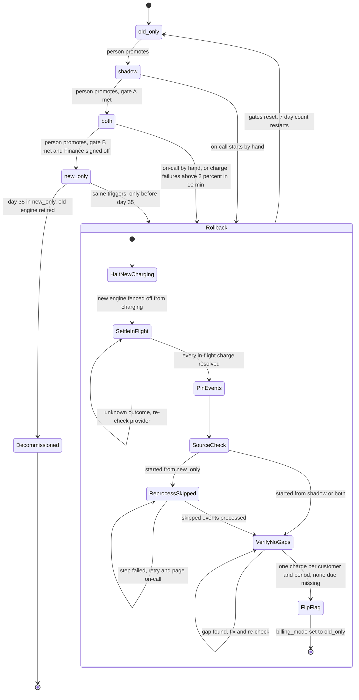

# Billing engine rollout: state machine

## Diagram

Gate A: 7 consecutive days with a mismatch rate under 0.1%, and at least 5,000 invoices compared.
Gate B: 14 days in `both` with no unresolved mismatches.

## What each mode does

| Mode | Old engine | New engine | Notes |
|---|---|---|---|
| `old_only` | Computes, writes the ledger, charges | Off | Safe state. Every rollback ends here. |
| `shadow` | Computes, writes the ledger, charges | Reads the same usage events and writes invoices to the shadow store. Never charges and never writes the ledger. | A nightly job compares invoice totals per customer. A mismatch is a difference of more than 1 cent. |
| `both` | Computes every invoice into the shadow store, without charging | Charges and writes the ledger | The comparison continues. The old engine stays current, so a rollback from here needs no reprocessing. |
| `new_only` | Stopped | Does everything | The old engine falls behind on usage events from here on. |
| `Decommissioned` | Retired | Does everything | Terminal. There is no way back, so failures are fixed forward. |

Forward moves are made by a person, one step at a time. Gates are preconditions, not triggers. Meeting a gate never moves the mode on its own.

## Where the rollout state lives

- **`billing_mode` flag (config service):** the single value workers read to learn which engine acts. It holds one of the four modes. It changes only on a forward promotion or at the last rollback step.
- **Rollout record (durable, controller-owned):** I added this beyond the brief. It holds:
  - the time the current mode was entered
  - the gate counters
  - the rollback step
  - a `charging_halted` fence
  - a mode epoch
- **Why the fence exists:** the flag holds only the four modes, so it cannot express "rollback in progress". If a rollback crashed while the flag still said `both` or `new_only`, the new engine would resume charging. Workers charge only if the mode allows it and the fence is not set.
- **Billing ledger (system of record):** every charge is keyed by customer and billing period. This key makes double charging impossible whichever engine attempts it. Workers pass the same key to the payment provider.
- **Shadow store:** holds the comparison data only. It is never read to decide what to charge.
- **Usage event log:** retained 35 days. It is the source for reprocessing.

## Rollback steps

Rollback always ends in `old_only`. From `shadow` the first steps are no-ops, because the new engine never charged.

1. **Halt new charging.** Set the fence. Charges that fall due now are queued, not dropped.
2. **Settle in-flight charges.** Ask the provider for the outcome of every charge with an unknown result, using its idempotency key. Do not continue until all are known.
3. **Pin events.** Copy the usage events from the start of `new_only` so that 35-day retention cannot erode them mid-rollback.
4. **Reprocess skipped events (only from `new_only`).** The old engine computes the periods it skipped. It skips any customer and period that the ledger already shows as charged.
5. **Verify no gaps.** Every due period has exactly one charge, or is queued for one. Fix gaps and re-check.
6. **Flip the flag** to `old_only`, clear the fence, and release the queued charges to the old engine.
7. **Reset gates.** The 7-day count, the 14-day count and the comparison history start over. The rollout must go through `shadow` again.

## What happens when something fails

- **New-engine errors in `shadow`:** recorded only. No rollback.
- **Charge failure rate above 2% over any 10-minute window in `both` or `new_only`:** rollback starts automatically and pages on-call. On-call can also start it by hand from `shadow`, `both` or `new_only`.
- **A rollback step fails:** retry that step and page on-call. The flag does not flip until verification passes, and the fence stays set. Charges are delayed, never dropped or duplicated.
- **Rollback triggered twice (for example auto and manual):** the second request is ignored while one is running.
- **Nightly comparison job fails or is missing:** that day does not count toward a gate. Gates fail closed.
- **Config service unreachable:** workers do not charge until they can read the mode and the fence. A delayed charge is acceptable, a double charge is not.
- **Day 35 in `new_only`:** the old engine may be retired, and after that there is no rollback. Failures are then fixed forward with on-call.

## Assumptions and open questions

1. **Day-35 cutoff for rollback:** a rollback must start before day 35 and must pin its events (step 3) at that moment. Without pinning, events from the start of `new_only` could expire during reprocessing.
2. **Gate A volume:** I read "at least 5,000 invoices" as the total over the 7 days, not per day. Please confirm.
3. **Automatic trigger on low volume:** the brief has no minimum charge count for the 2% rule. At low traffic, a few failures could trigger a rollback. Consider a minimum.
4. **Rollback in `both` or `new_only` after day 35:** there is no rollback path. The auto trigger instead pages on-call, who fix forward.
5. **Shadow store after rollback:** I assumed it is reset along with the gates. Please confirm.
