# Checkout across Cart, Inventory, Payment and Order

## How the services talk (read first)

There are two kinds of message.

- **HTTP commands with a reply.** Cart calls Order to place an order. Order calls Inventory (reserve, claim, release) and Payment (charge, refund). Each reply answers that one step.
- **Broker events.** These carry outcomes that happen later.
  - Payment publishes PaymentSucceeded, PaymentDeclined and RefundSucceeded. Order consumes them.
  - Order publishes OrderConfirmed and OrderFailed. Cart consumes them.
  - Inventory publishes no events, has no outbox and has no consumers. Order is its only caller, over HTTP.
  - The broker has durable queues and delivers each message at least once. A consumer acknowledges a message only after its state change and any outbox rows are committed. Every consumer must still handle repeats.

Only Payment calls the payment provider, and only Payment receives its webhooks.

**Event fields.** OrderConfirmed and OrderFailed carry `order_id`, `attempt_id`, `cart_id`, `outcome` (CONFIRMED or FAILED) and, for FAILED, a `reason` code: DECLINED or OUT_OF_STOCK. Cart finds its cart by `cart_id` and applies the event only if `attempt_id` is its current attempt. PaymentSucceeded, PaymentDeclined and RefundSucceeded carry `order_id` only.

**What the Place order request returns.** The request returns once Order has finished its steps (reserve, then charge) or once the request time runs out. It returns one of five answers:

- **AWAITING_PAYMENT**, with the order id. Stock is held and Payment has acknowledged the charge (charge recorded at Payment). Cart waits for an event, and its retry worker keeps checking (see Cart retry worker).
- **REJECTED_OUT_OF_STOCK**, with the stored short items. Nothing is reserved and nothing is charged.
- **CHECKOUT_FAILED**, with a reason code (codes not yet listed, open question 13). Only used before any charge request could have been sent to Payment.
- **FINAL**, with the order's outcome: CONFIRMED, or FAILED with reason DECLINED or OUT_OF_STOCK. Used when a retry finds the order already past its charge with a final result (for example, Cart missed the event).
- **IN_PROGRESS**, with the order id. Order is still working on the steps, or the charge is not yet acknowledged when the request time runs out. Cart stays read-only and retries with the same attempt id.

**Who runs the steps.** Order's steps do not depend on the HTTP request. The Place order handler starts the unfinished steps and waits up to the request time (not set, open question 6). If the steps finish in that time, the handler returns the answer from the table below. If they do not, the handler returns IN_PROGRESS, and the steps keep running inside Order after the reply. Each step stores its progress, so if the process stops, the recovery worker resumes it. A Cart retry with the same attempt id does not start the steps again: it reads the order and joins the same keyed steps. Concurrent drivers are safe because every step is keyed.

**Reply on a retry, by the order's current state.**

| Order state when Place order is retried | Reply |
|---|---|
| PENDING_STOCK, or AWAITING_PAYMENT with the charge not acknowledged | Resume the unfinished steps. Reply IN_PROGRESS if the request time runs out first |
| AWAITING_PAYMENT with the charge acknowledged, or CANCELLED_OUT_OF_STOCK (refund still owed) | AWAITING_PAYMENT |
| REJECTED_OUT_OF_STOCK | REJECTED_OUT_OF_STOCK, with the stored short items |
| CHECKOUT_FAILED | CHECKOUT_FAILED, with its stored reason |
| CONFIRMED, PAYMENT_DECLINED or CANCELLED_REFUNDED | FINAL, with the outcome |

These five answers are HTTP replies only. They publish no event. If Cart gets no reply, or gets IN_PROGRESS, it retries Place order with the same attempt id, at an interval that is not yet set (open question 6). A retry does not start the checkout again. It finds the order by attempt id (the order record is unique on it), resumes the unfinished steps, each with its own key, and then returns the answer in the table above. The timeouts are not set (open question 6).

The payment result arrives later as a broker event (OrderConfirmed or OrderFailed). Cart then shows the final result.

How the customer enters card details, and how the payment method reaches the charge call, is not decided (open question 4). This design starts at Place order and does not cover it.

## Notes before the diagram

**What each service stores**

- **Cart:** cart lines, cart status (OPEN or AWAITING_PAYMENT), the current checkout attempt id, the order id it was given, and the order status Cart has last applied (blank until a final status is applied). Cart status becomes AWAITING_PAYMENT when Place order is pressed. It returns to OPEN when a final status is applied, and the attempt id is kept at that point. While AWAITING_PAYMENT the cart is read-only, so that OrderConfirmed cannot empty lines the customer added after pressing Place order. The attempt id is replaced only when the next Place order starts a new attempt. The Cart retry worker resends Place order with the stored attempt id after a restart (see Cart retry worker).
- **Order:** order id, checkout attempt id (unique), status, frozen lines and price snapshot taken at Place order, the short items (filled only for REJECTED_OUT_OF_STOCK), the number of reserve attempts made so far, whether the charge is acknowledged (yes or no), refund state (NONE, REQUESTED, ACKNOWLEDGED, SUCCEEDED), pending releases (one row per release, kept until Inventory acknowledges), and an outbox. Order writes OrderConfirmed and OrderFailed to its outbox in the same transaction as the status change. Refund state REQUESTED means the refund is recorded and Payment has not yet replied. ACKNOWLEDGED means Payment has replied REFUND_PENDING. The customer's email address is not in this list: where Order gets it is open (open question 14).
- **Inventory:** stock on hand, and reservations keyed by order id with status HELD, CLAIMED, RELEASED, EXPIRED or SHORT, plus `expires_at` (created time + 10 minutes, for HELD rows). A SHORT row holds nothing. It stores the short items, so a repeated reserve gets the same answer. Inventory has no outbox.
  - **Stock model.** Stock on hand goes down only when a reservation is CLAIMED. Available stock for a new reserve is stock on hand minus the quantities of HELD rows. Each reservation row leaves HELD once, to CLAIMED, RELEASED or EXPIRED, and each of those moves is a conditional update on HELD. Only HELD rows count against availability, so one hold cannot be counted twice.
  - SHORT, RELEASED and EXPIRED rows hold nothing. They are kept, not deleted, because they block late reserves and make late claims refuse. Retention of these rows is open (open question 19).
- **Payment:** charges keyed by order id (PENDING, SUCCEEDED, DECLINED), refunds keyed by `refund:` + order id, the provider event ids it has already processed, and an outbox of events waiting to be published.

**Order statuses and allowed moves**

| From | Move | Trigger |
|---|---|---|
| PENDING_STOCK | REJECTED_OUT_OF_STOCK | a line is short (Inventory replied with the short items) |
| PENDING_STOCK | CHECKOUT_FAILED | Inventory gives no reply within the reserve attempt limit, or the reserve returns a RELEASED, EXPIRED or unreserved answer |
| PENDING_STOCK | AWAITING_PAYMENT | Inventory replied that all lines are reserved. Order commits this move before it sends the charge request |
| AWAITING_PAYMENT | CONFIRMED | PaymentSucceeded and the claim is accepted |
| AWAITING_PAYMENT | PAYMENT_DECLINED | PaymentDeclined |
| AWAITING_PAYMENT | CANCELLED_OUT_OF_STOCK | PaymentSucceeded and the claim is refused |
| CANCELLED_OUT_OF_STOCK | CANCELLED_REFUNDED | RefundSucceeded |

- Final statuses: REJECTED_OUT_OF_STOCK, CHECKOUT_FAILED, PAYMENT_DECLINED, CONFIRMED, CANCELLED_REFUNDED. CANCELLED_OUT_OF_STOCK is not final, because its refund is still owed.
- A message that asks for the status the order already has is a no-op. This includes a redelivered PaymentSucceeded when the order is CANCELLED_OUT_OF_STOCK, CANCELLED_REFUNDED or CONFIRMED. Order never claims again after a refusal, and never starts a second refund.
- A message whose move is not in this table (for example PaymentDeclined when the order is CONFIRMED) is acknowledged, logged as an error, and changes nothing.
- The one exception is a PaymentSucceeded or PaymentDeclined for an order still in PENDING_STOCK. Payment records a charge only after it receives the charge request, and Order commits AWAITING_PAYMENT before it sends that request. So this cannot happen in normal running. If it does happen (a fault), Order does not acknowledge the message, so the broker redelivers it, and operations are alerted. A payment result is never acknowledged and dropped.
- An order's status does not change when its hold expires. Order stays AWAITING_PAYMENT until PaymentSucceeded arrives and the claim is refused.

**Idempotency and safety rules**

- **Place order.** On the first press Cart sets its status to AWAITING_PAYMENT, creates a checkout attempt id, stores it with the cart, and sends it with the cart snapshot. Order's record is unique on the attempt id, so Order finds an existing order by attempt id. A repeated Place order for the same attempt (a lost reply, a second press, or Cart's retry) finds the same order and does not start over. It runs the steps that are not yet finished, each with its own key, then replies as in the table above. Cart reuses the open attempt id while its recorded order status is not final. It starts a new attempt only after it has recorded a final status for the old order.
- **Cart retry worker.** While a cart is AWAITING_PAYMENT, Cart's retry worker resends Place order with the stored attempt id on a timer, and it also runs after a Cart restart for every cart still AWAITING_PAYMENT. It resends when there was no reply, when the reply was IN_PROGRESS, and when the reply was AWAITING_PAYMENT. The last case is what covers a lost OrderConfirmed or OrderFailed event, so the cart cannot stay read-only forever. The worker stops when Cart applies a final outcome, from an event or from a reply. If Cart crashed before the first request got through, the resend is the first request: Order creates the order, and the cart snapshot is sent again. That is safe, because the cart is read-only in AWAITING_PAYMENT and so has not changed. The timer interval is not set (open question 6). Its retries have no upper bound yet (open question 6).
- **Cart applies HTTP outcomes.** Cart applies a reply of REJECTED_OUT_OF_STOCK, CHECKOUT_FAILED or FINAL only if its status is AWAITING_PAYMENT and the attempt id matches. It then sets status OPEN and keeps the cart lines unchanged. It shows the short items, the reason, or the outcome, and records the order status as final. For FINAL with CONFIRMED it also empties the cart, as in "Cart applies a final outcome" below. A reply of AWAITING_PAYMENT or IN_PROGRESS keeps the cart read-only. A late reply that arrives when Cart is already OPEN is ignored.
- **Reserve.** Keyed by order id. Inventory first looks for a reservation row for that order id. If one exists, Inventory returns that row's answer and reserves nothing new. A HELD or CLAIMED row means "reserved". A SHORT row returns the stored short items. A RELEASED or EXPIRED row means "not reserved". If no row exists, Inventory checks every line against available stock in one transaction. If all lines are free, it writes a HELD row. If any line is short, it writes a SHORT row with the short items and holds nothing. Reserve and release for the same order id are serialized by a unique key on the order id, so whichever commits first decides the row. Order retries with the same key when there is no reply, up to a bounded number of attempts (the number and the time are not set, open question 6). When the limit is reached with no reply, Order gives up (see the failure table).
- **Release.** Keyed by order id. A release for an order id with no reservation row writes a RELEASED row. This stops a late reserve from creating a hold. A release for a reservation that is not HELD does nothing. That includes SHORT (which holds nothing), EXPIRED, and CLAIMED. So a release that arrives after the sweeper has expired the hold cannot return the same stock twice. Order writes a pending-release row in the same transaction as the status change that needs it (PAYMENT_DECLINED or CHECKOUT_FAILED). A worker retries each unacknowledged row with the same key until Inventory acknowledges. What happens if Inventory never acknowledges is open (open question 16). The sweeper is the backstop for a hold that was made and never released.
- **Charge.** Keyed by order id. Order commits status AWAITING_PAYMENT before it sends the charge request. Payment records the charge PENDING before it calls the provider. If a charge with that order id already exists, Payment finds it and does not create another. Payment then replies CHARGE_RECORDED, which carries no outcome, whatever state the charge is in (PENDING, SUCCEEDED or DECLINED). Order records charge acknowledged = yes on any CHARGE_RECORDED. Order does not act on any state in the reply: the outcome reaches Order only as PaymentSucceeded or PaymentDeclined. A repeated charge call therefore never changes an order's status and never starts a second provider call from Order's side. Payment retries the provider call itself with the same key on timeout or 5xx. Order retries its charge call to Payment with the same key until Payment answers. Order does not give up while a charge may exist. The provider must honour the idempotency key (open question 7). Any retry reuses the key, so the customer is never charged twice.
- **Recovery worker (Order).** After a restart, Order finds orders whose unfinished step no worker is currently driving. A PENDING_STOCK order resumes by repeating the reserve with the same key. It counts against the same reserve attempt limit. An AWAITING_PAYMENT order whose charge is not acknowledged resumes by repeating the charge with the same key. A CANCELLED_OUT_OF_STOCK order with refund REQUESTED resumes the refund (see Refund (Order)). Pending-release rows and outbox rows are retried as described elsewhere. Every resumed step reuses its stored key, so it cannot reserve or charge twice.
- **Provider outcome.** The outcome comes by webhook, or by a status query after 30 minutes (whether the provider offers that query is open question 5). If the provider's immediate reply already gives a final outcome, Payment handles it the same way as a webhook (open question 10).
- **Final charge.** A charge that is SUCCEEDED or DECLINED does not change again. A later outcome with the same result (by webhook or status query) changes nothing. A later outcome with the opposite result is recorded as a conflict. Operations are alerted, and no event is published. What happens to the money is open (open question 11).
- **Webhook dedupe.** Payment records the provider event id in the same transaction as the state change. A duplicate delivery, including one that arrives while the first is being processed, changes nothing.
- **Outbox.** Payment and Order each write the events they will publish in the same transaction as their state change. A relay in each service reads its outbox rows that are not yet marked published, publishes them to the broker, and marks each one published. The relay runs on a timer. The interval is not set (open question 12). A crash after commit still publishes the event. The relay may publish an event twice, and consumers handle that.
- **Claim.** One conditional update. Inventory converts a reservation to CLAIMED only if it is HELD and now is before `expires_at`, or if it is already CLAIMED for the same order id (so a retry succeeds). On a successful claim it also reduces stock on hand by the reserved quantity. Otherwise it refuses. An expired hold cannot be claimed, even before the sweeper has run. A reservation that is RELEASED or EXPIRED is also refused.
- **Refund (Payment).** Keyed by `refund:` + order id. Payment retries the provider call with the same key until it succeeds. A failed refund stays open, Payment alerts operations, and the refund is never dropped. Payment replies REFUND_PENDING to Order once it has recorded the refund. Payment does not report provider failures to Order. Order learns the result only from RefundSucceeded.
- **Refund (Order).** Order records the status CANCELLED_OUT_OF_STOCK and refund state REQUESTED in one transaction. A worker finds each order in REQUESTED and sends the refund command with key `refund:` + order id. It repeats until Payment replies REFUND_PENDING. Order then sets refund state ACKNOWLEDGED and stops sending. If Order crashes in between, the stored state makes the worker send the command again after restart. The key is the same on every send, so Payment makes the refund once even if it receives the command more than once. If Payment stays unreachable, the worker keeps retrying with no stated limit (open question 6).
- **Refusal versus silence.** Order starts a refund only on an explicit claim refusal from Inventory. A timeout or lost reply on the claim is retried with the same key and is never treated as a refusal. A refused claim sends no release, because the reservation is already EXPIRED or RELEASED and its stock is no longer held by this order.
- **Cart applies a final outcome.** A final outcome is an HTTP reply of FINAL, or an OrderConfirmed or OrderFailed event. Cart applies it only if its status is AWAITING_PAYMENT, the attempt id matches, and (for an event) the cart id matches. Applying it sets the status to OPEN and keeps the attempt id. For CONFIRMED, it also empties the cart in the same step. A duplicate event finds the status already OPEN and does nothing. An event for an older attempt is ignored.
- **Time limits.** Inventory owns the 10-minute sweeper. The sweeper runs on a timer, not yet set (open question 12). It only changes HELD rows to EXPIRED, as a conditional update on HELD. Payment owns the 30-minute reconciliation timer for each charge that has no outcome.
- **Decline message.** Cart shows the customer a fixed message for each reason code. The message texts are not yet given (open question 13). Provider decline details are not sent to the customer. A late success that ends in a refund uses reason OUT_OF_STOCK, so the customer sees the out-of-stock message.
- **Customer view during refunds.** Cart shows payment pending (read-only) from AWAITING_PAYMENT until a final outcome is applied. In a late success, this covers the whole refund, because Order publishes OrderFailed only after RefundSucceeded. If the refund keeps failing, Cart stays pending and operations is alerted (open questions 2 and 8).

**Timing risk**

The hold lasts 10 minutes, but the webhook can take up to 30 minutes. Many successful payments will therefore arrive after the hold has lapsed. The late-success path is a normal path, not a rare edge case. This is open question 1.

## Flowchart

```mermaid
flowchart TD
    BR["Shared message broker: durable queues, at-least-once delivery"]

    subgraph CART["Cart service: stores cart lines, cart status, attempt id, order id, last applied order status"]
        C1(["Customer presses Place order"])
        C2["Set status AWAITING_PAYMENT. Reuse the open attempt id, or create one. Send cart snapshot and attempt id to Order. Retry same attempt id if no reply or IN_PROGRESS"]
        C7["Cart retry worker: while AWAITING_PAYMENT, resend Place order with the stored attempt id on a timer, and after a restart. Stops at a final outcome"]
        C3["Set status OPEN. Show short items. Cart unchanged, customer can change the cart and retry"]
        C4["Set status OPEN. Show failure message for the reason. Cart unchanged, customer can retry"]
        C5["Set status OPEN and empty cart. Only if status is AWAITING_PAYMENT and attempt id matches"]
        C6["Show payment pending with order id. Cart is read-only. Wait for OrderConfirmed or OrderFailed"]
    end

    subgraph ORDER["Order service: stores order status, frozen lines and prices, short items, reserve attempts, charge acknowledged, refund state, pending releases, outbox"]
        O1["Create order PENDING_STOCK with frozen lines and prices, unique on attempt id. If it already exists, join its unfinished steps"]
        O2["Ask Inventory to reserve all lines, keyed by order id. Retry same key if no reply, up to the attempt limit (not set)"]
        O3["Reserve succeeded: commit status AWAITING_PAYMENT before any charge is sent. Ask Payment to charge, keyed by order id"]
        O4["Payment replied CHARGE_RECORDED: record charge acknowledged, no state change. Reply AWAITING_PAYMENT to Cart. If not acknowledged when request time runs out, reply IN_PROGRESS and keep running"]
        O5["On PaymentSucceeded: ask Inventory to claim, keyed by order id. Retry same key until answered"]
        O6["Status CONFIRMED. Write OrderConfirmed to outbox and publish"]
        O7["Status REJECTED_OUT_OF_STOCK. Store short items. Reply to Cart with short items"]
        O8["Status PAYMENT_DECLINED. Write pending release, retry same key. Publish OrderFailed with reason DECLINED"]
        O9["Status CANCELLED_OUT_OF_STOCK and refund REQUESTED in one transaction. Send refund to Payment, keyed by refund plus order id, retry until Payment replies, then set ACKNOWLEDGED"]
        O10["Status CANCELLED_REFUNDED. Publish OrderFailed with reason OUT_OF_STOCK and email the customer (address source open, question 14)"]
        O11["Status CHECKOUT_FAILED. Reply to Cart with reason. Write pending release, retry same key"]
        O12["Recovery worker after a restart: finds orders whose unfinished step no worker is driving. Repeats the reserve or the unacknowledged charge with the same key"]
    end

    subgraph INV["Inventory service: stores stock on hand, reservations with status, expires_at, SHORT rows"]
        I1["Reserve check: if a row exists for this order id, return its answer and reserve nothing new. Otherwise check every line against available stock in one transaction"]
        I2{"Any line short?"}
        I9["Write SHORT row with the short items. Nothing held"]
        I3["Write reservation HELD, expires in 10 min. Available stock drops by the held quantity. Keyed by order id"]
        I4{"Claim: HELD and now before expires_at, or already CLAIMED for this order?"}
        I5["Mark reservation CLAIMED and reduce stock on hand. Stock is sold to this order"]
        I6["Refuse claim: hold expired or not HELD, so the stock may now belong to another order. Not re-reserved. Order sends no release"]
        I7["Sweeper (interval not set): conditional update, HELD past expires_at becomes EXPIRED. Stock is available again. Order state does not change"]
        I8["Release: if HELD, set RELEASED. If no row, write RELEASED so a late reserve cannot hold stock. SHORT, EXPIRED, CLAIMED or RELEASED rows: nothing"]
    end

    subgraph PAY["Payment service: stores charges and refunds keyed by order id, processed event ids, outbox"]
        P1["Record charge PENDING keyed by order id, or find the existing charge. Reply CHARGE_RECORDED with no outcome"]
        P2["Call provider charge with order id as idempotency key. Retry same key on timeout or 5xx"]
        P3["Webhook arrives. Verify signature, read provider event id"]
        P4{"Event id already recorded?"}
        P5["Acknowledge only. No state change, no event"]
        P6{"Provider outcome and charge state?"}
        P7["One transaction: charge SUCCEEDED, event id recorded, PaymentSucceeded in outbox"]
        P8["One transaction: charge DECLINED, event id recorded, PaymentDeclined in outbox"]
        P9["No outcome after 30 min: query provider status (API not confirmed, open question 5)"]
        P10["Record refund PENDING keyed by refund plus order id. Reply REFUND_PENDING to Order"]
        P11["Call provider to refund full amount, same key on retry"]
        P12{"Refund outcome?"}
        P13["One transaction: refund SUCCEEDED, RefundSucceeded in outbox"]
        P14["Refund failed or not accepted. Stays open, retry with backoff, alert ops, never dropped"]
        P15["Charge already final. Same outcome: no change. Opposite outcome: record conflict, alert ops, publish nothing"]
    end

    PROV["Payment provider (external). Sends webhooks, may send duplicates"]

    C1 --> C2
    C2 -- "HTTP Place order" --> O1
    O1 --> O2
    O1 -. "Still running when request time runs out: reply IN_PROGRESS, steps keep running" .-> C2
    C7 -. "Timer or restart: resend Place order, same attempt id" .-> O1
    O2 -- "HTTP reserve" --> I1
    O2 -. "No reply after the attempt limit: no charge was sent. CHECKOUT_FAILED" .-> O11
    O12 -. "Resume reserve" .-> O2
    O12 -. "Resume unacknowledged charge" .-> O3
    I1 --> I2
    I2 -- "Yes: nothing held, no payment" --> I9
    I9 -- "HTTP reply: short items" --> O7
    O7 -- "HTTP reply: short items" --> C3
    I2 -- "No: all lines free" --> I3
    I3 -- "HTTP reply: reserved" --> O3
    I3 -. "Not claimed within 10 min" .-> I7
    O3 -- "HTTP charge, key = order id" --> P1
    P1 -- "HTTP reply: CHARGE_RECORDED" --> O4
    O4 -- "HTTP reply: AWAITING_PAYMENT" --> C6
    C6 -. "Still waiting: retry worker" .-> C7
    P1 --> P2
    P2 --> PROV
    P2 -. "No outcome after 30 min" .-> P9
    P9 --> PROV
    PROV -- "Webhook: seconds to 30 min" --> P3
    PROV -- "Status query result" --> P6
    PROV -- "Immediate reply, if it is final (open question 10)" --> P6
    P3 --> P4
    P4 -- "Yes: duplicate delivery" --> P5
    P4 -- "No: first delivery" --> P6
    P6 -- "Declined, charge PENDING" --> P8
    P6 -- "Succeeded, charge PENDING" --> P7
    P6 -- "Charge already final" --> P15
    P8 -- "publish PaymentDeclined" --> BR
    BR -- "PaymentDeclined to Order" --> O8
    O8 -- "HTTP release, key = order id" --> I8
    O8 -- "publish OrderFailed" --> BR
    BR -- "OrderFailed to Cart" --> C4
    P7 -- "publish PaymentSucceeded" --> BR
    BR -- "PaymentSucceeded to Order" --> O5
    O5 -- "HTTP claim, key = order id" --> I4
    I4 -- "Yes" --> I5
    I5 -- "HTTP reply: claimed" --> O5
    O5 -- "Claimed: confirm" --> O6
    O6 -- "publish OrderConfirmed" --> BR
    BR -- "OrderConfirmed to Cart" --> C5
    I4 -- "No: late success after hold lapsed" --> I6
    I6 -- "HTTP reply: refused" --> O9
    O9 -- "HTTP refund, key = refund plus order id" --> P10
    P10 -- "HTTP reply: REFUND_PENDING, Order sets ACKNOWLEDGED" --> O9
    P10 --> P11
    P11 --> PROV
    PROV -- "Refund result (sync or webhook, open question 3)" --> P12
    P12 -- "Succeeded" --> P13
    P13 -- "publish RefundSucceeded" --> BR
    BR -- "RefundSucceeded to Order" --> O10
    O10 -- "publish OrderFailed" --> BR
    BR -- "OrderFailed to Cart" --> C4
    P12 -- "Failed or not accepted" --> P14
    P14 -. "Retry after backoff, same key" .-> P11
    O11 -- "HTTP reply: reason" --> C4
    O11 -- "HTTP release, key = order id" --> I8

    classDef fail fill:#fde2e2,stroke:#b00020,color:#000
    class C3,C4,O7,O8,O9,O10,O11,I6,I9,P8,P14,P15 fail
```

Red nodes are failure outcomes. Solid arrows are the main path. Dotted arrows are timers, retries, recovery and fallbacks. Arrows labelled "HTTP" are commands with a reply. Arrows into or out of BR are broker events. Payment never sends a failure to Order over HTTP. The only way Order learns the refund result is RefundSucceeded.

## Failure cases

| Case | Caught by | What happens | Cart | Money | Stock |
|---|---|---|---|---|---|
| Short stock | Inventory `I2`, `I9` | Nothing held. A SHORT row stores the short items, so a lost reply or a retry gets the same answer. Order stores the short items and replies to Cart | Unchanged, short items shown | None taken | None held |
| Inventory gives no reply | Order `O2` | Reserve retried with the same key up to the attempt limit (value not set, open question 6). If the limit is reached with no reply, no charge has been sent: CHECKOUT_FAILED, release requested with the same key. A reserve that arrives late finds the RELEASED row and holds nothing. Sweeper is the backstop for any hold made before the release | Unchanged, reason shown | None taken | Released, or expired by sweeper |
| Order crashes before the charge is acknowledged | Order recovery worker `O12` | Status AWAITING_PAYMENT is committed before the charge is sent. The stored state shows the charge is not acknowledged, so the worker repeats the charge with the same key. A crash in PENDING_STOCK resumes the reserve with the same key, which returns the stored row | Read-only, waiting, then per outcome | Charged once (the provider must honour the key, open question 7) | Held by this order, or expired by sweeper if not claimed |
| Place order retried while steps are running | Order `O1` | The retry joins the unfinished steps and returns the answer for the order's current state (see the reply table). If the request time runs out first, it replies IN_PROGRESS, the steps keep running, and Cart retries | Read-only, retrying with the same attempt id | Unchanged | Unchanged |
| Place order retried after the outcome is known | Order `O1` (reply table) | Replies FINAL for a final order, AWAITING_PAYMENT while a refund is owed, or the stored short items or reason. Cart applies the reply the same way as the event | Applied per reply | Unchanged | Unchanged |
| Lost OrderConfirmed or OrderFailed event | Cart retry worker `C7` | Cart is still AWAITING_PAYMENT, so the worker resends Place order with the same attempt id. The reply is FINAL (or AWAITING_PAYMENT while a refund is owed), and Cart applies it | Read-only until the reply arrives | Unchanged | Unchanged |
| Cart crashes after AWAITING_PAYMENT | Cart retry worker `C7` after restart | The stored attempt id is resent. If Order has no order yet, it creates one. If it has one, it joins it | Read-only | Unchanged | Unchanged |
| Payment result arrives while the order is still PENDING_STOCK | Order `O5` and the carve-out rule | Cannot happen in normal running, because Order commits AWAITING_PAYMENT before the charge is sent. If it does, Order does not acknowledge, so the broker redelivers, and operations are alerted | Unchanged | Unchanged | Unchanged |
| Payment unreachable when charging | Order `O3` | Charge retried with the same key until Payment answers. Order does not give up while a charge may exist. Customer waits on the pending state. No time limit is set (open question 6) | Read-only, waiting, then per outcome | Unknown until the charge outcome is known | Held. Sweeper expires it if not claimed |
| Payment declined | Payment `P8` | Order PAYMENT_DECLINED, release requested and retried with the same key until acknowledged, OrderFailed published | Unchanged, generic decline message shown | None taken | Released to sale |
| Late success after hold lapsed | Inventory `I4` refuses claim | Order CANCELLED_OUT_OF_STOCK and refund REQUESTED in one transaction. Refund sent until Payment replies. CANCELLED_REFUNDED and OrderFailed published after the refund is confirmed, then customer emailed (address source open, question 14) | Stays payment pending (AWAITING_PAYMENT, read-only) until the refund succeeds, then out-of-stock message | Refunded in full | Not held by this order |
| Refund fails at provider | Payment `P12`, `P14` | Refund stays open, retried with the same key, ops alerted. Order stays CANCELLED_OUT_OF_STOCK. Order learns only through RefundSucceeded | Stays payment pending until refunded (open questions 2, 8) | Owed to customer until refunded | Not held |
| Order crashes after CANCELLED_OUT_OF_STOCK, before the refund is acknowledged | Order `O9` | The refund REQUESTED state is stored in the same transaction, so the worker sends the refund after restart, with the same key | Unchanged | Owed until refunded | Not held |
| Order crashes after CONFIRMED, before OrderConfirmed is published | Order outbox | OrderConfirmed was written in the same transaction as CONFIRMED, so the relay publishes it after restart | Unchanged until the event arrives | Charged once | Sold to this order |
| Duplicate webhook | Payment `P4` | Acknowledged, no state change, no event published | Unchanged | Charged once | Unchanged |
| Opposite outcome for a final charge | Payment `P6`, `P15` | Recorded as a conflict, ops alerted, no event published. Money action is open (open question 11) | Unchanged | Unresolved until a person decides | Unchanged |
| Provider webhook never arrives | Payment `P9` | Charge status queried from provider after 30 min (API unconfirmed, open question 5), then handled from `P6`. If no status API exists, the charge stays PENDING (open question 5) | Unchanged until outcome | Per provider status | Per outcome |
| Claim reply lost or times out | Order `O5` | Order retries the claim with the same key. The claim is idempotent. No limit is set, so the order stays AWAITING_PAYMENT until Inventory answers (open question 17) | Unchanged until outcome | Unchanged | Held by this order |
| Order crashes after claim, before CONFIRMED | Broker redelivers PaymentSucceeded (Order acknowledges only after its commit) | Claim retry returns CLAIMED, then order is confirmed | Unchanged until confirmed | Charged once | Sold to this order |
| Release reply lost (declined or checkout failed) | Order `O8`, `O11` | Order retries the release with the same key until Inventory acknowledges. Sweeper is the backstop. Escalation if never acknowledged is open (open question 16) | Unchanged | Unchanged | Released, or expired by sweeper |
| Sweeper expires a hold, then a release arrives | Inventory `I8`, `I7` | The release finds an EXPIRED row, which is not HELD, so it does nothing. Stock is counted once, as available | Unchanged | Unchanged | Available once |
| Late reserve after CHECKOUT_FAILED | Inventory `I1`, `I8` | The RELEASED row blocks a new hold. Order ignores the late reply | Unchanged | None taken | None held |
| Repeated or redelivered event | Order status table, Cart rule | No-op if the status already matches or the cart already applied the outcome. Error logged and ignored if the move is not allowed | Unchanged | Unchanged | Unchanged |

The cart is emptied only on OrderConfirmed (`C5`), so every failure above leaves it exactly as it was.

## Open questions

1. **Hold length against webhook delay.** A 10-minute hold and a webhook of up to 30 minutes mean many good orders will take the refund path. Options include lengthening the hold to at least 30 minutes, which ties up stock longer, or accepting refunds as a common outcome. The brief does not decide this.
2. **Who sends the customer email, and when.** The diagram has Order send it after the refund is confirmed (`O10`). If the refund is failing, the customer hears nothing until it succeeds, and Cart stays payment pending. Confirm this timing.
3. **Refund result channel.** The diagram assumes the provider returns the refund result either synchronously or by webhook. If it is a webhook, the same event-id dedupe rule applies. The brief does not say which.
4. **Card entry.** The brief does not say how the customer enters card details, which party collects them, or how the payment method reaches the charge call (`P2`). Not decided.
5. **Reconciliation at 30 minutes.** Payment owns the timer. Whether the provider offers a status-query API is not confirmed. If the provider reports success for a charge still PENDING, the flow continues from `P7`. It is also not decided how often Payment queries again if the charge is still PENDING after a query. If there is no status API, a charge with no webhook stays PENDING and no transition happens. This needs a decision.
6. **Timeouts and retry limits.** No values are set for HTTP timeouts (including Cart's wait for Place order, Cart's retry interval, the Cart retry worker's timer, and the request time after which Order replies IN_PROGRESS), the reserve attempt limit, charge retries, or refund backoff. Order retries reserve up to the attempt limit, and CHECKOUT_FAILED follows only when that limit is reached with no reply. There is no "one retry" rule. Order never gives up on a charge while a charge may exist. Cart has no upper bound on retrying Place order while it is AWAITING_PAYMENT, IN_PROGRESS, or gets no reply. Order has no limit on retrying the refund command while Payment is unreachable.
7. **Broker and provider guarantees.** The design assumes durable queues, at-least-once delivery, a retention window that covers an Order outage, and a provider that honours the order id idempotency key on charge and refund. The brief states none of these.
8. **How the customer's page learns the outcome.** Polling Cart or a push from Cart is not decided.
9. **Re-reserving instead of refunding.** The brief requires a refund when stock has gone. Re-reserving stock for a late success is not in the brief, so this design does not do it.
10. **Provider's immediate reply to a charge.** The brief does not say whether the provider's direct reply can carry a final outcome. If it can, Payment handles that outcome as in `P6`.
11. **Money on a conflicting outcome.** When the provider's later outcome contradicts a final charge (for example DECLINED recorded, then SUCCEEDED reported), the design records and alerts but does not decide who is right or whether money must be returned. The brief does not say.
12. **Relay, sweeper and Cart retry intervals.** The outbox relays, the Inventory sweeper and the Cart retry worker each run on a timer. The intervals are not set.
13. **Reason codes and customer messages.** The reason codes for CHECKOUT_FAILED are not listed, and the fixed customer messages for each reason code are not given. Only DECLINED and OUT_OF_STOCK are defined for events.
14. **Customer email address.** Order sends the late-success email (`O10`), but the Order storage list has no contact field. Not decided whether the address is copied into the order at Place order or read from elsewhere, and if elsewhere, by what means.
15. **Cart restart after AWAITING_PAYMENT.** Decided in this round: the Cart retry worker (see Idempotency and safety rules) runs for every AWAITING_PAYMENT cart, including after a restart, and resends Place order with the stored attempt id. Order finds any existing order by attempt id, or creates it. What remains open is only the timer interval (open question 12).
16. **Pending release never acknowledged.** Order retries each pending release until Inventory acknowledges, and the sweeper frees any hold. Not decided whether anyone is alerted or escalated when a release is never acknowledged.
17. **Claim retry limit.** Order retries the claim until Inventory answers, with no limit. Not decided whether a limit or an operations alert is needed. While this is open, the order stays AWAITING_PAYMENT and the customer stays payment pending.
18. **Broker routing.** The design does not say how events reach Cart and Order (topics, queues or subscriptions), or which consumer group each service uses.
19. **Retention of SHORT, RELEASED and EXPIRED rows.** These rows are kept, never deleted, so that late reserves and late claims are still refused. Whether they can ever be archived, and after how long, is not decided. Storage growth is the cost of keeping them.