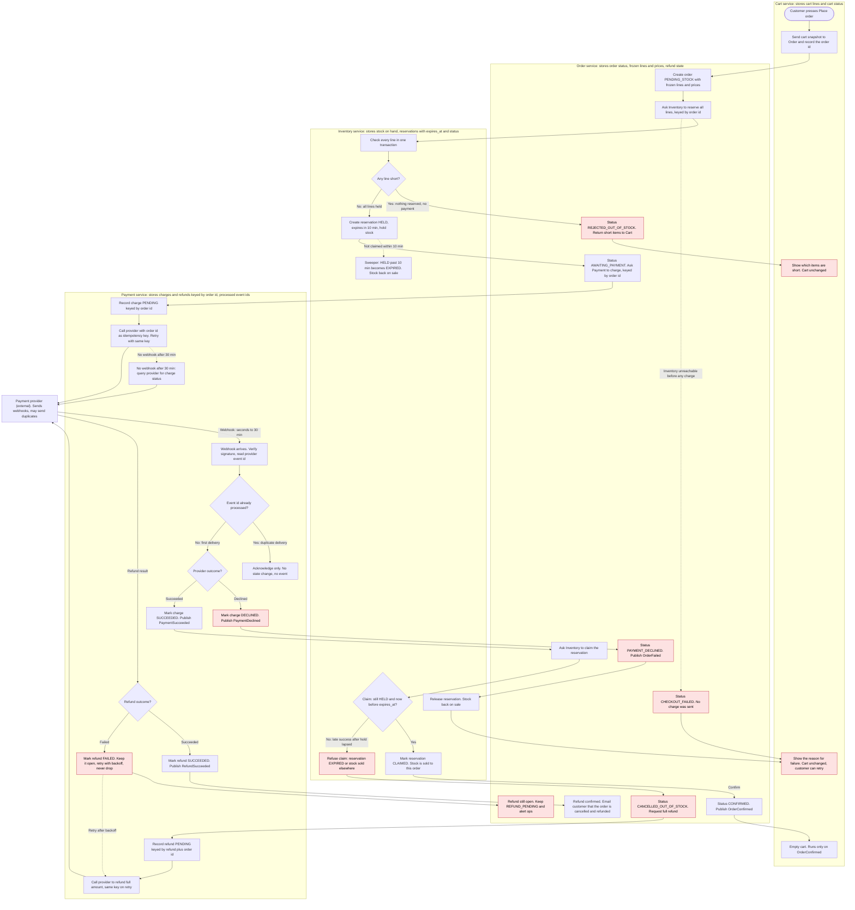

# Checkout across Cart, Inventory, Payment and Order

## Notes before the diagram

**What each service stores**

- **Cart:** cart lines and cart status. Cart is emptied only when it receives OrderConfirmed. It keeps the order id it was given so a repeated Place order press reuses it.
- **Order:** order id, status, the frozen line and price snapshot taken at Place order, and refund and email state. The order id is the key for the reservation and for the charge.
- **Inventory:** stock on hand, and reservations with status HELD, CLAIMED or EXPIRED plus `expires_at` (created time + 10 minutes).
- **Payment:** charges keyed by order id (PENDING, SUCCEEDED, DECLINED), refunds keyed by `refund:` + order id, and the provider event ids it has already processed.

**How the services talk**

- HTTP for commands: Cart calls Order, Order calls Inventory and Payment.
- Broker events for outcomes: PaymentSucceeded, PaymentDeclined, OrderConfirmed, OrderFailed, RefundSucceeded.
- Only Payment calls the payment provider, and only Payment receives its webhooks.

**Idempotency and safety rules**

- The charge idempotency key is the order id. Any retry of the charge call reuses it, so the customer is never charged twice.
- The webhook dedupe key is the provider event id. It is recorded in the same database transaction as the state change, so a duplicate delivery changes nothing.
- The claim is one conditional update: Inventory converts a reservation to CLAIMED only if it is still HELD and now is before `expires_at`. An expired hold cannot be claimed even before the sweeper has run, which prevents a double sale.
- Refunds are retried with the same key until they succeed. A failed refund stays open and alerts operations. It is never dropped.

**Timing risk**

The hold lasts 10 minutes, but the webhook can take up to 30 minutes. Many successful payments will therefore arrive after the hold has lapsed. The late-success path is a normal path, not a rare edge case. This is listed as an open question below.

## Flowchart

Red nodes are failure outcomes. Solid arrows are the main path. Dotted arrows are timers, retries and fallbacks.

## Failure cases

| Case | Caught by | What happens | Cart | Money | Stock |
|---|---|---|---|---|---|
| Short stock | Inventory `I2` | Nothing reserved, no payment requested, short items returned | Unchanged, short items shown | None taken | None held |
| Payment declined | Payment `P8` | Order PAYMENT_DECLINED, reservation released | Unchanged | None taken | Released to sale |
| Late success after hold lapsed | Inventory `I4`, claim refused | Order cancelled as out of stock, full refund, customer emailed after refund is confirmed | Unchanged | Refunded in full | Not held by this order |
| Refund fails at provider | Payment `P12`, `P14` | Refund stays open, retried with same key, ops alerted, order stays REFUND_PENDING | Unchanged | Owed to customer until refunded | Not held |
| Duplicate webhook | Payment `P4` | Acknowledged, no state change, no event published | Unchanged | Charged once | Unchanged |
| Provider webhook never arrives | Payment `P9` | Charge status queried from provider after 30 min, then handled as above | Unchanged until outcome | Per provider status | Per outcome |

The cart is emptied only on OrderConfirmed (`C5`), so every failure above leaves it exactly as it was.

## Open questions

1. **Hold length against webhook delay.** A 10-minute hold and a webhook of up to 30 minutes mean many good orders will take the refund path. Options include lengthening the hold to at least 30 minutes, which ties up stock longer, or accepting refunds as a common outcome. The brief does not decide this.
2. **Who sends the customer email, and when.** The diagram sends it after the refund is confirmed (`O10`). If the refund is failing, the customer hears nothing until it succeeds. Confirm this timing and the owning service.
3. **Refund result channel.** The diagram assumes the provider returns the refund result either synchronously or by webhook. If it is a webhook, the same event-id dedupe rule applies.
4. **Repeated Place order presses.** The Order is created before stock is checked. The design assumes Cart reuses the order id it already holds so a double press cannot create two orders. Confirm this.
5. **Reconciliation at 30 minutes.** `P9` queries the provider. If the provider reports success for a charge still PENDING, the flow continues from `P7`. This needs an owner for the timer.
