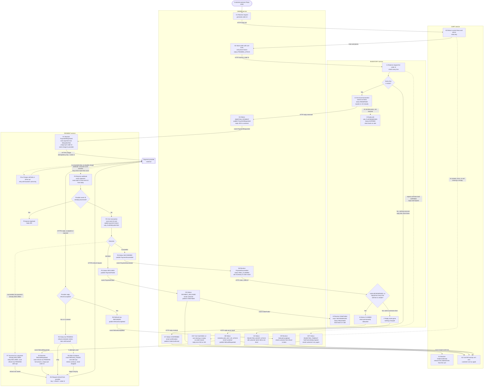

# Checkout across Cart, Inventory, Payment and Order

## How to read this

- Four services. Each owns its own database and never reads another service's tables.
- **HTTP** is used where the caller needs the answer now (reserve stock, claim stock, read the cart). **Events** on the broker are used for everything else.
- A solid arrow is a call, a reply or an event, labelled with what triggers the next step. A dotted arrow is something that happens by time or from outside the system.
- **Background loops.** Every "job", "relay", "sweeper" or "scheduler" below is a loop inside the owning service's own process. It wakes on a timer, queries its own database for rows that need work, and does the work. No separate process or service is involved. Intervals are placeholders (see the open questions). **More than one instance of a service.** Every step a loop performs is safe to repeat (idempotent keys, conditional updates, unique rows), so two instances picking up the same row can only waste work, never do harm. Whether to add row locking (for example "skip rows another instance has locked") so they do not duplicate work is not decided (see the open questions).
- **Outbox.** Order and Payment publish events. Each saves its state change and the event row in one local transaction (the event row goes into the service's `outbox` table with `published_at` empty). The relay is one of the background loops. Every second or so it reads the oldest rows with empty `published_at`, publishes each to the broker, and then sets `published_at`. If it crashes between publishing and marking, the row is published again, so consumers must tolerate duplicates. A crash therefore never loses an event. Cart and Inventory publish no events, so they have no outbox. **Ordering:** the relay publishes oldest first, but the design does not rely on events for one order arriving in order. Every consumer decides by the order's or reservation's current status (see the status rules below), so a late, early or repeated event is either applied once or ignored.
- **The broker and event delivery.** The broker is the shared message broker the brief names. Which product it is, and whether a consumer is pushed events or pulls them, is not known (see the open questions); the design only relies on "at least once" delivery, which any such broker offers. Each consumer handles an event like this: do all of its local work in one database transaction (including its repeat check), and only after that transaction commits, acknowledge the event to the broker. If handling fails partway, the transaction rolls back, the consumer does not acknowledge, and the broker delivers the event again. Because every handler is safe to repeat, the retry cannot do harm. This is the only retry for events: Cart receiving `OrderConfirmed` and Inventory receiving `OrderFailed` have no extra retry loop of their own. How many times the broker retries before it parks the event in a dead-letter queue is an open question; a parked event must alert ops and never be dropped silently.
- Every event consumer is idempotent, because the broker delivers at least once.
- **Emails and ops alerts.** Order sends customer emails through the existing email sender. An email is sent after the local transaction that changes the status commits, and is best-effort: if sending fails, the failure is logged and ops is alerted, and the status is not rolled back. The order status (shown by the poll) is the source of truth, and the email is a convenience. The wording of each email is a template detail and is not specified here. "Alert ops" means a message on the team's existing alerting channel; how that channel is reached is not known (see the open questions).
- **Why 10 minutes and 30 minutes.** The 10-minute stock hold is a business requirement, so stock is not locked for long. The 30 minutes is the provider's worst-case delay for reporting the outcome. The gap between them is why the "late success" branch exists.
- **HTTP details.** This document gives what each HTTP call means and carries, not paths, payload formats or status codes (except the Place order error codes below). Those are open (see the open questions).

## What the customer sees

1. **Place order** has four possible replies. Only the last three come with an order id, because an order exists only after O2 stores it. Order never holds the request open longer than the short waits for Cart and for Inventory (a few seconds each, placeholders); when a wait runs out, it replies at once as described below.
   - The cart could not be read (Cart fails, times out or is unreachable), or the cart does not exist or has no lines: no order is stored and nothing else happens (O1F). Order replies with an error: HTTP 503 "please try again" if Cart failed, HTTP 422 "your cart is empty" if the cart is missing or empty. The checkout token is not used up, so the customer can press Place order again. The cart is untouched.
   - Inventory says stock is short: a normal (non-error) reply whose body carries the order id, the status `REJECTED_SHORT_STOCK` and the list of short items. The exact HTTP status code is open, like the other codes except the ones named here.
   - Inventory reserved the stock: HTTP 202 with the order id and "payment processing".
   - Inventory did not answer within a few seconds (a placeholder), or is unreachable: HTTP 202 with the order id and "checking stock". The order stays `PENDING_STOCK` and the Order sweeper keeps retrying the reserve call (see "When a step fails"). The customer finds the final result of this case through the poll below (for example `REJECTED_TIMEOUT` or `AWAITING_PAYMENT`) and through the email sent for a final result.
2. The screen keeps the order id and polls Order for that order (read by order id). How often it polls, and the endpoint and response shape, are open (see the open questions); the response carries the order status and, for `REJECTED_SHORT_STOCK`, the short items. What each status shows:

   | Order status | What the poll shows |
   |---|---|
   | `PENDING_STOCK` | "Checking stock" |
   | `AWAITING_PAYMENT`, `PAID_CLAIMING` | "Payment processing" |
   | `REJECTED_SHORT_STOCK` | The list of short items (Order stores them on the order), and the cart is unchanged |
   | `REJECTED_TIMEOUT` | "We could not hold your items in time, please try again" |
   | `PAYMENT_DECLINED` | Payment declined |
   | `CONFIRMED` | Order confirmed |
   | `CANCELLED_OUT_OF_STOCK` | Out of stock, refund on its way |

   The customer is also emailed for each final result. A result can take seconds, or up to about 30 minutes, so the screen can be closed and the email is the fallback. The poll only ever shows the order's status. In the "should not happen" case where Order refunds an order that is not confirmed (see "Assumptions"), the status is left alone, so the poll shows whatever it showed before, no extra message is sent, and the customer receives only the `RefundCompleted` email when the refund is done.

## What the Place order request carries

Customer id, cart id, a client-generated checkout token (see "Assumptions"), and a payment method reference (for example a token from a provider-hosted form). Order reads the cart by HTTP (K0) using the cart id, and stores the cart id on the order. The token is a random unique value (for example a UUID) that the customer's screen creates once per checkout attempt and resends unchanged on a repeat press; the endpoint path and request format are open.

## Flowchart

## The paths in words

**Happy path.** O1 to O2 to I1 to I2 to O4 to P1 to provider to P2 to P4 to P6 to O6 to I6 to O7 to K1.

1. The order is created and the cart is read once. After O2, the order's frozen lines and prices are the only source of truth, so later cart or price changes cannot affect it. If the cart read fails or the cart is empty, the flow stops at O1F before any order exists.
2. Stock is reserved for 10 minutes.
3. The charge is requested. The `PaymentRequested` event carries the order id, customer id, total amount and currency, and the payment method reference that came with the Place order request. Payment needs nothing else and never calls Order.
4. When the success webhook arrives, the stock is claimed, the order is confirmed, and only then does Cart remove the ordered lines.

**The charge call and the webhook (Payment and the provider).**
- P1 sends one HTTPS charge request with the amount, currency, payment method reference, and the order id as the idempotency key. The order id is also sent as the charge's reference field, so the provider can echo it back.
- The HTTPS reply to the charge only acknowledges that the provider accepted the request. When a charge call returns a success reply, Payment sets `provider acknowledged` to yes on the `payments` row. A call that errors or times out leaves it no. Payment ignores any final outcome in that reply. Only a webhook (or the reconciliation job below) can set `SUCCEEDED` or `DECLINED`. This keeps one path to a final status.
- If the call fails or times out, Payment retries with the same key and backoff, so a retry cannot charge twice. The `payments` row keeps an attempt count and next attempt time, and a payment loop retries rows that are still `REQUESTED` and have `provider acknowledged` = no. If the provider never accepts the call, the retries stop at the retry limit (a placeholder). The row stays `REQUESTED` until the reconciliation job asks the provider about that key: it sends a lookup request, "what is the status of the charge with idempotency key = this order id?". If the provider has no record of a charge with that key, Payment sets `DECLINED` and publishes `PaymentFailed`. If it has a record, Payment follows the recorded outcome.
- **The reconciliation job** is a loop in Payment that runs about every 5 minutes (a placeholder). Each run selects payments that are still `REQUESTED` and whose `created_at` is more than 35 minutes ago, and does the lookup above for each. So a stuck payment is checked between 35 and about 40 minutes after it was requested.
- The webhook body carries the provider's event id, the outcome (succeeded or declined), and the reference field, which is our order id. P2 finds the payment by that order id. P2 checks the signature by computing an HMAC of the raw request body with a shared secret from Payment's configuration and comparing it with the signature header. A webhook with a bad signature is rejected (HTTP 401) and nothing is read from it. This webhook format is an assumption, because the brief does not name the provider (see the open questions).
- **A valid webhook with no payment row.** P1 saves the payment row before it calls the provider, so this should not happen. If it does, P2 does not record the event id, replies HTTP 503 so the provider redelivers, and alerts ops.

**Payment status rules (P4).** P4 changes a payment's status only if it is still `REQUESTED` (a conditional update inside the transaction). The webhook and the reconciliation job both go through P4, so whichever commits first wins and the other finds the status already final. The reconciliation job does not write a provider event id; the status check is what stops it clashing with a real webhook. When an outcome arrives for a payment that is already final:

| Payment is | Outcome arrives | What Payment does |
|---|---|---|
| `SUCCEEDED` or `DECLINED` | the same outcome | Nothing (the event id is still saved). |
| `SUCCEEDED` | declined | Nothing, status stays `SUCCEEDED`. Alert ops, because the provider contradicted itself. |
| `DECLINED` | succeeded (P7) | Status stays `DECLINED` and nothing is published to Order, which already told the customer the payment was declined. Payment saves a refund row `PENDING` for the full amount (unique per order id) and alerts ops. The refund then follows the normal refund path from R2. Order later receives `RefundCompleted` and emails the customer that a refund was made. This is how money is never kept: it covers a reconciliation that declined a charge the provider did in fact make. |

**Short stock.** I1 checks every line inside one transaction. If any line is short, no reservation is written, so Order never asks Payment for anything. The reply names the short items, Order stores them on the order, and the cart is untouched.

**Reserve rules in Inventory.** A reserve call for an order id is idempotent. If a reservation for that order id already exists, Inventory never reserves again; it returns the existing state:

| Existing reservation | Reply to a reserve call |
|---|---|
| none | Run I1 and I2 (reserved, or short items). |
| `RESERVED` or `CLAIMED` | reserved (with `expires_at`) |
| `EXPIRED` | hold lapsed |
| `RELEASED` | hold lapsed. This cannot happen while the order is `PENDING_STOCK`, because release only follows `OrderFailed`, which is published only after payment was requested. |

**What Order does with a reserve reply.** This is the same whether the call came from Place order or from the sweeper (the sweeper's retry runs exactly the same steps):

| Reply | What Order does |
|---|---|
| reserved | O4: in one local transaction set `AWAITING_PAYMENT` and write `PaymentRequested` to the outbox. The relay publishes it. If the call came from Place order, also reply 202 "payment processing". |
| short items | O3: set `REJECTED_SHORT_STOCK`, store the short items on the order, email the customer. If the call came from Place order, reply with the order id, the status and the short items. |
| hold lapsed | O3T: set `REJECTED_TIMEOUT`, email the customer to try again with a new checkout token, leave the cart untouched. No payment was requested, so there is nothing to refund. |

Order changes the status only if the order is still `PENDING_STOCK` (a conditional update), so a reply that arrives twice, from Place order and from the sweeper at the same time, is applied once.

**Declined payment.**
- P5 publishes `PaymentFailed`.
- Order marks the order declined and publishes `OrderFailed`.
- Inventory releases the hold early, but only if it is still `RESERVED` (see the release rules below). Inventory consumes `OrderFailed` like any event: one transaction that reads the reservation for that order id and applies the I4 rule. If there is no reservation, or its status is not `RESERVED`, the transaction does nothing and the event is acknowledged.
- The customer is emailed.
- The cart is untouched.

**Late success after the hold lapsed.**
- I3 returns the stock to sale after 10 minutes, possibly to another customer.
- When the success webhook finally arrives, Order asks Inventory to claim.
- Inventory answers yes if the hold is still `RESERVED`. It also answers yes if the hold lapsed (`EXPIRED`) but every line can still be taken, which saves needless refunds. The check and the writes happen in one local transaction (see the claim rules below).
- Otherwise it answers no and changes nothing, so no partial orders are possible.
- Order then cancels as out of stock, emails the customer, and publishes `RefundRequested`.
- Payment receives `RefundRequested` and refunds the full amount.
- The cart is untouched.

**Claim rules in Inventory.** `stock` has `on_hand` and `reserved` counts per sku. Available = `on_hand` - `reserved`.

| Hold status when claim arrives | What Inventory does | Reply |
|---|---|---|
| `RESERVED` | In one transaction: for each line `on_hand` -= qty and `reserved` -= qty. Status becomes `CLAIMED`. | claimed |
| `CLAIMED` (a repeat of the same claim) | Nothing. | claimed |
| `EXPIRED` | In one transaction: if every line has available >= qty, then for each line `on_hand` -= qty (`reserved` is unchanged, because I3 already released it) and status becomes `CLAIMED`. If any line is short, change nothing. | claimed, or out of stock |
| `RELEASED` or no reservation | Nothing. | out of stock |

**Expiry and release rules in Inventory.** Each of these is one local transaction that first reads the reservation status, and writes only if the status is `RESERVED`. Then, for each line, `reserved` -= qty and the status is set (`EXPIRED` for I3, `RELEASED` for I4). If the status is anything else, the transaction does nothing. So `reserved` is never subtracted twice, whether I3, I4 or a claim comes first or they race: they all serialise on the reservation row.

**The expiry job (I3).** It runs inside Inventory about every 30 seconds (a placeholder). Each run selects reservations with status `RESERVED` and `expires_at` in the past, and applies the expiry rule above to each one. A hold can therefore be returned up to one interval late, and a claim that arrives in that gap still finds it `RESERVED` and succeeds.

**Failed refund.** The refund row is saved before the provider is called, so the refund is a durable obligation and not an in-memory retry.
- The provider's answer to a refund request is the HTTPS reply (accepted or rejected). No reply, an error or a timeout counts as rejected.
- A failed attempt leaves the row `PENDING`. The refund scheduler is a loop inside Payment that runs about every minute (a placeholder). It selects refunds that are `PENDING` or `REFUND_FAILED` and whose next attempt time has passed, and repeats R2 with backoff and the same refund key, so a retry cannot refund twice.
- After N failures the row becomes `REFUND_FAILED` and ops is alerted, but retrying continues. The row is never deleted until it is `REFUNDED`.
- Open: whether the provider can later report a refund as failed by webhook after accepting it. The brief does not say. If it can, those webhooks would go through the same duplicate check as payment webhooks.

**Duplicate webhooks.** P4 writes the provider event id to a unique-keyed table in the same transaction as the status change. If a repeat arrives, the insert collides, nothing else runs, and P3 returns 200 so the provider stops resending. The payment state machine also refuses backward moves, for example `SUCCEEDED` back to `REQUESTED`. The one contradiction that matters, success after `DECLINED`, is handled by the table under "Payment status rules" and never keeps the customer's money.

**What Cart removes (K1).** `OrderConfirmed` carries the order id, the cart id and the ordered lines (sku and quantity). Cart does this in one local transaction: insert the order id into `applied_orders` (unique), then subtract the quantities from that cart and delete lines that reach zero. If the insert collides, the event is a repeat, the transaction does nothing, and the subtraction never runs twice. Anything the customer added or changed in the cart after pressing Place order is kept, so the customer does not lose it. If the transaction fails, the event is not acknowledged and the broker redelivers it; the cart is never emptied early.

## When a step fails or a service crashes

Each call is safe to repeat, and a recovery job in Order repeats stalled steps. **The Order sweeper** is a loop in Order that runs about every 30 seconds (a placeholder). It measures how long an order has been stalled from `status_changed_at`, a timestamp on the order that is set every time the status changes. It acts on orders whose status is `PENDING_STOCK` or `PAID_CLAIMING` and whose `status_changed_at` is more than 1 minute ago.

| Stalled state in Order | Cause | Recovery |
|---|---|---|
| (no order stored) | The cart read in Place order failed, timed out, or found no cart or an empty cart. | Nothing to recover: the customer gets an error (O1F) and presses Place order again. |
| `PENDING_STOCK` for over 1 minute | Order crashed, or the reserve call timed out, failed or its reply was lost (even if Inventory did reserve), or Inventory is unreachable. | The Order sweeper sends the same reserve call again. Inventory reserve is idempotent on order id (see the reserve rules): it returns the existing reservation's state instead of reserving again. Order then handles the reply exactly as in "What Order does with a reserve reply": reserved moves the order to `AWAITING_PAYMENT` and publishes `PaymentRequested` (O4); short items give `REJECTED_SHORT_STOCK`; hold lapsed gives `REJECTED_TIMEOUT`. |
| `PAID_CLAIMING` for over 1 minute | The claim call timed out, or Order crashed before saving `CONFIRMED` or `CANCELLED_OUT_OF_STOCK`. | The sweeper sends the same claim again. Claim is safe to repeat (see the claim rules above) and returns the same answer. |
| `AWAITING_PAYMENT` | Webhook never arrives. | Payment's reconciliation job (see "The charge call and the webhook"). |

**If Inventory stays unreachable.** The sweeper keeps retrying with no upper limit, in both `PENDING_STOCK` and `PAID_CLAIMING`. This is deliberate: in `PAID_CLAIMING` the customer's money is already taken, so the order must reach a final status. The customer sees "checking stock" or "payment processing" meanwhile. An order whose `status_changed_at` is more than 10 minutes ago while it is in `PENDING_STOCK` or `PAID_CLAIMING` (a placeholder) alerts ops once (the order keeps an `ops_alerted` flag so the sweeper does not repeat the alert), so a long outage is noticed. No other escalation exists; this is listed in the open questions.

## What each service stores

| Service | Tables | Key fields |
|---|---|---|
| **Cart** | `carts`, `cart_lines`, `applied_orders` | customer, sku, quantity, current price. `applied_orders`: order ids whose `OrderConfirmed` was already applied (unique, written in the same transaction as the subtraction). Lines are removed only on `OrderConfirmed`. |
| **Inventory** | `stock`, `reservations`, `reservation_lines` | `stock`: sku, `on_hand`, `reserved`. `reservations`: order id (unique), status (`RESERVED`, `CLAIMED`, `EXPIRED`, `RELEASED`), `expires_at`. |
| **Payment** | `payments`, `refunds`, `processed_webhook_events`, `outbox` | `payments`: order id (unique), amount, currency, payment method reference, status (`REQUESTED`, `SUCCEEDED`, `DECLINED`), `created_at`, charge attempt count, next attempt time, provider acknowledged (yes or no; set to yes when a charge call gets a success reply). `refunds`: order id (unique), status (`PENDING`, `REFUNDED`, `REFUND_FAILED`), attempt count, next attempt time. `processed_webhook_events`: provider event id (unique). |
| **Order** | `orders`, `order_lines`, `outbox` | Frozen lines and prices, customer, cart id, total, checkout token (unique), short items (when rejected for short stock), `status_changed_at`, `ops_alerted`, status (`PENDING_STOCK`, `REJECTED_SHORT_STOCK`, `REJECTED_TIMEOUT`, `AWAITING_PAYMENT`, `PAYMENT_DECLINED`, `PAID_CLAIMING`, `CONFIRMED`, `CANCELLED_OUT_OF_STOCK`). |

## Events on the broker

| Event | Published by | Consumed by |
|---|---|---|
| `PaymentRequested` | Order | Payment |
| `PaymentSucceeded`, `PaymentFailed` | Payment | Order |
| `OrderFailed` | Order | Inventory |
| `OrderConfirmed` (carries order id, cart id, ordered lines) | Order | Cart |
| `RefundRequested` | Order | Payment |
| `RefundCompleted` | Payment | Order |

## Assumptions and decisions to confirm

- **Double-click on Place order.** The request carries a client-generated checkout token. Order has a unique constraint on it and returns the existing order on a repeat. If the first request is still being processed (its order is not stored yet), the repeat is stopped by the unique constraint when it tries to store its own order at O2. It then reads the existing order and replies HTTP 202 with that order id and the text for its current status, exactly as the poll would. A Place order that fails at the cart read (O1F) stores no order, so its token is free to use again.
- **Stuck payments.** Payment runs a reconciliation job (every ~5 minutes). For any payment still `REQUESTED` more than 35 minutes after `created_at`, it asks the provider for the status using the order id key, then follows the same path as a webhook (through P4, with the status rules above). This covers a webhook that never arrives, and a charge the provider never accepted (see above).
- **`PaymentSucceeded` arriving when Order is not `AWAITING_PAYMENT`.** Order decides by the order's current status:
  - `AWAITING_PAYMENT`: normal path (O6).
  - `PAID_CLAIMING`, `CONFIRMED` or `CANCELLED_OUT_OF_STOCK`: a repeat event, so ignore it.
  - Any other status (`PAYMENT_DECLINED`, `REJECTED_SHORT_STOCK`, `REJECTED_TIMEOUT`, `PENDING_STOCK`): this should not happen, because Payment does not publish success for a declined payment (P7) and no payment is requested for a rejected order. If it does, Order leaves the status alone, publishes `RefundRequested` and alerts ops. Money is never kept for an order that is not confirmed. A second `RefundRequested` is harmless because the refund row is unique per order id. The customer is not told anything at this point; they receive the `RefundCompleted` email later.
- **`PaymentFailed` arriving when Order is not `AWAITING_PAYMENT`.** Order decides by the current status:
  - `AWAITING_PAYMENT`: normal path (O5).
  - `PAYMENT_DECLINED`: a repeat event, so ignore it.
  - Any other status: Payment holds one final outcome per payment, so this should not happen. Order ignores the event, leaves the status alone and alerts ops. It never undoes a `CONFIRMED` or cancelled order.
- **Emailing.** Order sends the customer emails through the existing email sender, best-effort after the status commits (see "How to read this"). No separate notification service was specified.
- **Retaking lapsed stock.** Letting a late payment retake stock whose hold lapsed, when the stock is still free, is my addition. If you prefer strict behaviour, remove the "lapsed but still free" branch from the claim decision, and every lapsed hold then refunds.
- **Partial cart removal.** The brief says the cart is emptied once the order is confirmed. I remove only the ordered lines, so changes the customer made after pressing Place order are not lost. If you want the whole cart emptied, K1 clears the cart by cart id instead.
- **`REJECTED_TIMEOUT`.** This status is my addition, for an order whose reserve step stalled past the 10-minute hold. The brief does not cover it. The alternative is to reuse `REJECTED_SHORT_STOCK` with no items, which would mislead the customer.
- **Cart read failure (O1F).** Failing Place order before any order exists, with 503 or 422, is my decision. The alternative is to store a failed order, which adds a status and a row for something the customer can simply retry.
- **Open: how the customer supplies payment details** (for example a provider-hosted form that returns a token). The brief does not say. This document only assumes the Place order request carries a payment method reference.
- **Open: the provider's exact API.** The brief does not name the provider. I assume it echoes our reference field in webhooks, signs webhooks with an HMAC and a shared secret, redelivers when we reply 5xx, acknowledges charges by HTTPS reply, answers refund requests by HTTPS reply, and can be asked for a charge's status by idempotency key. If the real provider differs, P2, P1, R2 and the reconciliation job change.
- **Open: the broker product and delivery style.** The brief says only "the shared message broker". Whether consumers are pushed events or pull them, how many redeliveries happen before an event is parked, and where parked events go are not known. The design assumes only at-least-once delivery and acknowledgement after the local transaction commits.
- **Open: how ops alerts and the email sender are reached.** The design says "alert ops" and "the existing email sender" but not the interface or channel. Email failures are logged and alerted, never rolled back into the order status.
- **Open: escalation for a long Inventory outage.** Retrying has no limit and ops is alerted after 10 minutes (placeholder). Whether something stronger is needed, such as refunding an order stuck in `PAID_CLAIMING`, is not decided.
- **Open: HTTP interfaces.** Paths, payloads and status codes of the Cart read, Inventory reserve and claim calls, the Place order endpoint (including the status code of the short-stock reply), and the poll endpoint (and how often the screen polls) are not specified. This document fixes only what each call means and carries. The real values come from the existing service stubs.
- **Open: several instances of one service.** The loops are safe to run twice (see "How to read this"), but whether to lock rows so that only one instance works on a row at a time is not decided.
- **Open: values for the sweeper interval (30 seconds) and its 1-minute stall age, expiry job interval (30 seconds), reconciliation job interval (5 minutes), refund scheduler interval, the few-second Place order wait for Inventory and for Cart, the 10-minute ops alert threshold, charge and refund retry limits and backoff, and the refund failure count N.** These are placeholders, not decisions.
