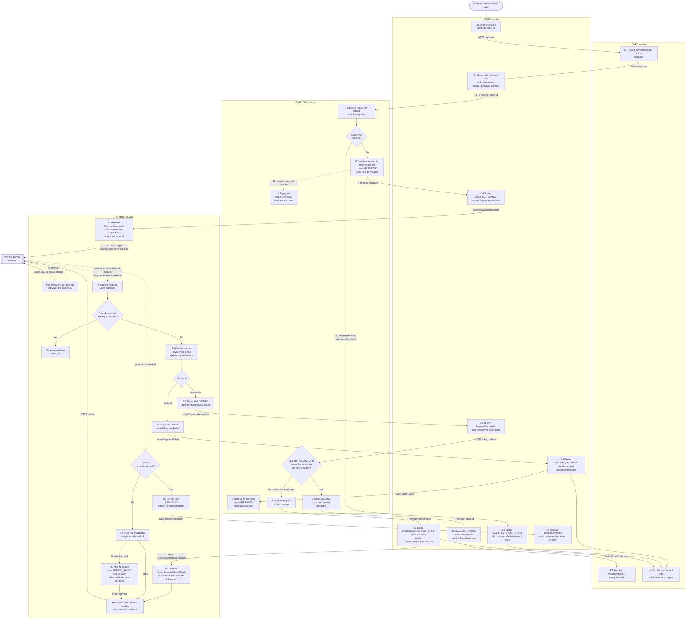

# Checkout across Cart, Inventory, Payment and Order

## How to read this

- Four services. Each owns its own database and never reads another service's tables.
- **HTTP** is used where the caller needs the answer now (reserve stock, claim stock, read the cart). **Events** on the broker are used for everything else.
- A solid arrow is a call or event, labelled with what triggers the next step. A dotted arrow is something that happens by time or from outside the system.
- Every event is written through a transactional outbox. A service saves its state change and the event it must publish in one local transaction, and a relay publishes it afterwards. This means a crash cannot lose an event.
- Every event consumer is idempotent, because the broker delivers at least once.

## Flowchart

## The paths in words

**Happy path.** O1 to O2 to I1 to I2 to O4 to P1 to provider to P2 to P4 to P6 to O6 to I6 to O7 to K1.

1. The order is created and the cart is read once. After O2, the order's frozen lines and prices are the only source of truth, so later cart or price changes cannot affect it.
2. Stock is reserved for 10 minutes.
3. The charge is requested.
4. When the success webhook arrives, the stock is claimed, the order is confirmed, and only then does Cart empty itself.

**Short stock.** I1 checks every line inside one transaction. If any line is short, no reservation is written, so Order never asks Payment for anything. The reply names the short items, and the cart is untouched.

**Declined payment.**
- P5 publishes `PaymentFailed`.
- Order marks the order declined and publishes `OrderFailed`.
- Inventory releases the hold early.
- The customer is emailed.
- The cart is untouched.

**Late success after the hold lapsed.**
- I3 returns the stock to sale after 10 minutes, possibly to another customer.
- When the success webhook finally arrives, Order asks Inventory to claim.
- Inventory answers yes if the hold is still `RESERVED`. It also answers yes if the hold lapsed but every line can still be taken in one transaction, which saves needless refunds.
- Otherwise it answers no and changes nothing, so no partial orders are possible.
- Order then cancels as out of stock and emails the customer.
- Payment receives `OrderCancelledOutOfStock` and refunds the full amount.
- The cart is untouched.

**Failed refund.** The refund row is saved before the provider is called, so the refund is a durable obligation and not an in-memory retry.
- A failed attempt leaves the row `PENDING`, and a scheduler retries it with backoff and the same refund key, so a retry cannot refund twice.
- After N failures the row becomes `REFUND_FAILED` and ops is alerted, but retrying continues. The row is never deleted until it is `REFUNDED`.
- Refund results that arrive by webhook go through the same duplicate check as payment webhooks.

**Duplicate webhooks.** P4 writes the provider event id to a unique-keyed table in the same transaction as the status change. If a repeat arrives, the insert collides, nothing else runs, and P3 returns 200 so the provider stops resending. The payment state machine also refuses backward moves, for example `SUCCEEDED` back to `REQUESTED`.

## What each service stores

| Service | Tables | Key fields |
|---|---|---|
| **Cart** | `carts`, `cart_lines` | customer, sku, quantity, current price. Emptied only on `OrderConfirmed`. |
| **Inventory** | `stock`, `reservations`, `reservation_lines`, `outbox` | `reservations`: order id (unique), status (`RESERVED`, `CLAIMED`, `EXPIRED`, `RELEASED`), `expires_at`. Stock on hand and reserved counts live in `stock`. |
| **Payment** | `payments`, `refunds`, `processed_webhook_events`, `outbox` | `payments`: order id (unique), amount, status (`REQUESTED`, `SUCCEEDED`, `DECLINED`). `refunds`: order id, status (`PENDING`, `REFUNDED`, `REFUND_FAILED`), attempt count, next attempt time. `processed_webhook_events`: provider event id (unique). |
| **Order** | `orders`, `order_lines`, `outbox` | Frozen lines and prices, customer, total, status (`PENDING_STOCK`, `REJECTED_SHORT_STOCK`, `AWAITING_PAYMENT`, `PAYMENT_DECLINED`, `CONFIRMED`, `CANCELLED_OUT_OF_STOCK`). |

## Events on the broker

| Event | Published by | Consumed by |
|---|---|---|
| `PaymentRequested` | Order | Payment |
| `PaymentSucceeded`, `PaymentFailed` | Payment | Order |
| `OrderFailed` | Order | Inventory |
| `OrderConfirmed` | Order | Cart |
| `OrderCancelledOutOfStock` | Order | Payment |
| `RefundCompleted` | Payment | Order |

## Assumptions and decisions to confirm

- **Double-click on Place order.** The request carries a client-generated checkout token. Order has a unique constraint on it and returns the existing order on a repeat.
- **Stuck payments.** Payment runs a reconciliation job. For any payment still `REQUESTED` after about 35 minutes, it asks the provider for the status using the order id key, then follows the same path as a webhook. This covers a webhook that never arrives.
- **Payment success for an order that is no longer awaiting payment.** If Order receives `PaymentSucceeded` for an order that is not `AWAITING_PAYMENT`, for example because it was cancelled, it takes the same refund path. Money is never kept for an order that is not confirmed.
- **Emailing.** Order sends the customer emails through the existing email sender. No separate notification service was specified.
- **Retaking lapsed stock.** Letting a late payment retake stock whose hold lapsed, when the stock is still free, is my addition. If you prefer strict behaviour, remove the "lapsed but still free" branch from the claim decision, and every lapsed hold then refunds.
