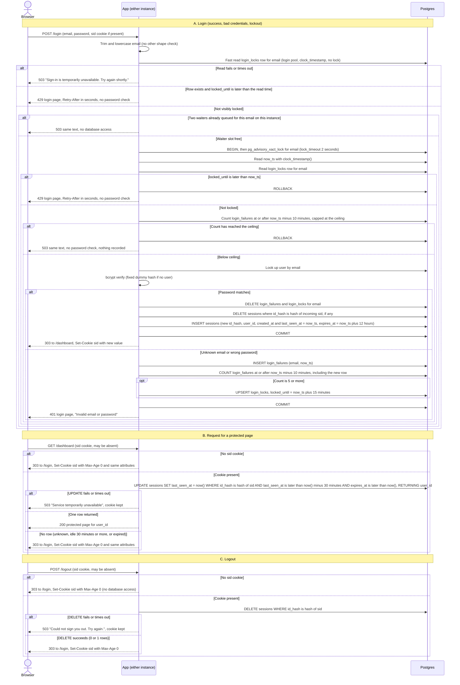

# Login with server-side sessions: design

## Summary

Sessions and login failure counts live in the existing Postgres database, not in process memory and not in a new Redis service. Both app instances read and write the same tables, so a session or lockout created on one instance is honored by the other.

Requirement R3 forbids judging a password once an email is locked. That rule holds across two instances only if attempts for one email are serialized in the database. Login therefore takes a transaction-level advisory lock on the email and holds it through the password check. A locked email is refused by a fast read that takes no lock. Login uses its own bounded connection pool, so login load cannot exhaust the connections that protected requests use. Every storage failure fails closed.

Three parts are chosen only to bound load and growth, and each can be removed without changing R1 to R8: the per-email waiter cap, the failure-row ceiling, and the sweeper's batch size. The alternatives and their rejection reasons are under "Alternatives considered".

## Requirements this design implements

"R1" to "R8" refer to these fixed requirements.

- R1. `POST /login` takes email and password. Emails are matched in lowercase.
- R2. An unknown email and a wrong password get the same response: HTTP 401 and the login page with "Invalid email or password".
- R3. After 5 failed attempts for an email within any 10-minute period, refuse that email's logins for 15 minutes with HTTP 429, without checking the password. A successful login clears the failure count.
- R4. On success, always issue a new random session ID, destroy any session the incoming cookie pointed to, and redirect to `/dashboard`.
- R5. The cookie carries only the opaque session ID, with HttpOnly, Secure and SameSite=Lax.
- R6. A session ends after 30 minutes with no requests (each request restarts that clock) or 12 hours after login, whichever is first.
- R7. Every protected request checks the session on the server. If the session is missing, unknown or expired, clear the cookie and redirect to `/login`.
- R8. `POST /logout` destroys the server-side session before replying, clears the cookie and redirects to `/login`. It behaves the same when there is no session.

## Sequence diagram



Any error or timeout in section A before COMMIT rolls back the transaction and returns the 503 for that step. The failure table below lists each step.

## Rules that do not fit on the arrows

**Time source.** Login reads two timestamps, both from the database clock.

- The fast read uses `clock_timestamp()` on the same connection, before BEGIN. A row that reads as locked stays locked, because locks never shorten and the database clock does not step backward. So a 429 from the fast read is always correct. A not-locked result from it is advisory only and is checked again inside the transaction.
- The transaction reads `now_ts = clock_timestamp()` after the advisory lock is acquired. That value is used for the lock check, the window count, the failure insert, the lock expiry and session times. Its order against other transactions for the same email is the order they acquired the lock (see Lockout invariant).

Protected requests use `now()` inside their single UPDATE. Instance clock skew cannot change any outcome.

**Lock-wait budget.** Every login has an 8-second budget. Pool waits count against it. Each statement gets `statement_timeout = min(2 seconds, remaining budget)`, and the app rolls back when the budget is spent. The advisory lock wait has `lock_timeout = 2 seconds`. The transaction is idle-in-transaction only while bcrypt runs, so `idle_in_transaction_session_timeout` is 5 seconds, which must stay well above the measured verify time (target about 250 ms). A login transaction therefore lasts at most about 8 seconds plus rollback, which is under the 10-second bound used in the cleanup argument.

**Session state.** A session row is `(id_hash, user_id, created_at, last_seen_at, expires_at)`. `expires_at = created_at + 12 hours` is set at creation and never changed. `last_seen_at` is set at creation and refreshed by each valid protected request.

**Validity.** A session is valid only when `last_seen_at > now() - 30 minutes` and `expires_at > now()`. The request path enforces this in the WHERE clause of the touch UPDATE. Idle exactly 30 minutes is invalid. The request path never deletes rows. A session with no row returned is cleared and the user is redirected to `/login`.

**Expiry is permanent.** Validity is rejected when `expires_at <= now()` or `last_seen_at <= now() - 30 minutes`. Neither condition can become false again, because a rejected session cannot be refreshed. A rejected row can therefore be deleted at any later time without changing any outcome.

**Lockout invariant.** Let a lock be set by a transaction with `now_ts = T`, so `locked_until = L = T + 15 minutes`. Four facts hold for that email:

- F1, refusal: a transaction judges a password only when `now_ts` is at or after the `locked_until` in force. The lock check in the same transaction enforces this.
- F2, order: transactions for one email hold the advisory lock one at a time. Each reads `now_ts` after acquiring the lock, so the `now_ts` values follow lock order and do not decrease.
- F3, recording: a failure row is inserted only by a transaction that passed F1. So a failure row recorded before the lock was set has `failed_at <= T`. A failure row recorded after the lock expires has `failed_at >= L`. None has `failed_at` strictly between T and L, because between T and L every transaction is refused and records nothing.
- F4, duration: `locked_until` changes only by a transaction with `now_ts >= L`, so the lock stays at L until it expires.

From these, for any count at time `t >= L`, the window starts at `t - 10 minutes >= T + 5 minutes`. Every failure that set the lock has `failed_at <= T`, so none is inside the window. The new count holds only failures recorded after expiry. The lock duration (15 minutes) must stay longer than the window (10 minutes). If either value changes, this argument must be checked again.

**Failure window.** A failure counts toward a window if `failed_at >= now_ts - 10 minutes`. The window is inclusive. A failure exactly 10 minutes old counts. This matches "within any 10-minute period" and fails toward the limit. It is a sliding window. A fixed window that resets every 10 minutes would let four failures at 0:09 and four at 0:10 pass, which violates R3.

**Lock trigger.** The count includes the row just inserted, because the INSERT and the COUNT run in the same transaction. The fifth failure in the window sets `locked_until = now_ts + 15 minutes`. That fifth attempt still gets 401, because its password was checked. The next attempt gets 429.

**Refused attempts are not recorded.** Attempts refused while locked, refused by the waiter cap, or refused by the ceiling are never inserted into `login_failures`, so they cannot extend a lock or fill the ceiling.

**Success clears state.** A successful login deletes that email's `login_failures` rows and its `login_locks` row. Success cannot happen while locked, because the lock check runs first.

**Atomicity.** The lock check, ceiling check, failure INSERT, window COUNT, lock UPSERT and COMMIT are one transaction. An error before COMMIT rolls back all of them, so a fifth failure is never stored without its lock. If COMMIT fails with an unknown outcome, either all writes committed or none did. If they committed, the client gets 503 for an attempt that was counted, which only makes the lock more likely. On the success path, an unknown COMMIT outcome may leave the old session deleted and no new one. The user then sees a sign-in page on the next request, which fails closed.

**Concurrency across instances.** The first statement after BEGIN is `SELECT pg_advisory_xact_lock(hashtextextended('login:' || $1, 0))`. The lock is released at COMMIT or ROLLBACK. `hashtextextended` returns a 64-bit key, so two emails sharing a key are rare. When they do, they serialize with each other, which is harmless.

**Waiter cap (per instance).** At most 2 requests may wait on the advisory lock for one email on one instance, in addition to the holder. A third gets 503 at once, with no database access. The count is held in process memory. It only limits load. Correctness never depends on it. Across both instances, one email can therefore have at most 3 holding or waiting attempts per instance, which is 6 in total for two instances. Each holds one login-pool connection. The cap bounds one email's share of the login pool to 3 connections per instance.

**Failure-row ceiling.** Before the password check, a count of failure rows in the last 10 minutes is capped at the ceiling of 50,000. If the cap is reached, the attempt gets 503 with no password check and records nothing. Every recorded failure runs one bcrypt verify on a login-pool connection. With two instances, a pool of 8 and a 250 ms verify, the insert rate is at most about 64 per second. That is about 38,400 rows in 10 minutes, below the ceiling. The ceiling is a backstop for when verify time falls or the instance count rises. An alert fires at 80 percent of the ceiling. The ceiling also refuses correct passwords for that period, which is the stated trade-off: an attacker who fills it forces 503 for all logins, and that fails closed.

**Malformed emails.** No shape check is applied. After trimming and lowercasing (Unicode-aware, the same function used to store `users.email`), an input is processed exactly like any other email string. A string that matches no account is an unknown email. Its failures are counted and its lock is keyed on the string. The form body is limited to 4 KB, which bounds the key size. This removes the special case in the earlier draft. R2 and R3 apply to the string with no exception, and no stored-address check is needed before deployment.

**Retry-After.** Its value is `ceiling(locked_until - read time)` in seconds, using the time of the read that produced the 429.

**Cookie.** The cookie is named `sid` and holds only the opaque token. Attributes are `HttpOnly; Secure; SameSite=Lax; Path=/`. It has no Domain attribute, so it is host-only. It has no Expires or Max-Age, so it is a browser-session cookie. The server alone decides expiry. Every clear response repeats the name and all attributes with `Max-Age=0`. The rules for when the cookie is set or cleared are in the table below.

| Response | Cookie |
|---|---|
| Login success (303 to /dashboard) | Set, new value |
| Login 401, 429 or 503 | Unchanged. A failed login does not end an existing session, which is intended |
| Protected request, cookie unknown, idle or expired | Cleared (Max-Age 0) |
| Protected request, no cookie sent | Cleared (Max-Age 0), so the response meets R7 literally |
| Protected request, storage fails (503) | Kept, so the next request can retry |
| Logout, cookie present, DELETE succeeds | Cleared |
| Logout, no cookie sent | Cleared, no database access |
| Logout, DELETE fails (503) | Kept, so the cookie is never cleared while the server-side session may still exist |

**Enumeration and timing.** R2 is about whether an account exists. The design meets it as follows.

- Unknown email and wrong password return the same 401 page and body. Both run the same statements: the failure INSERT, the COUNT and the lock UPSERT. Both perform one bcrypt verify, against a fixed dummy hash generated at startup with the cost factor read from a stored hash. At startup the app reads the cost factor from stored hashes and refuses to start if the dummy hash does not match it.
- Lock state reveals nothing about existence. Unknown emails are counted and locked exactly like real ones, so a 429 appears for both.
- These responses differ, and the design does not claim they are equal: 429 (no bcrypt), 503 (depends on database health, not on the account) and successful logins (extra writes, reached only after the password is known). None of these depends on whether an account exists, except that successful logins reveal that the password was right, which is the purpose of login.
- The known-versus-unknown timing gap is tested by the load test criteria below.

## Cookie and session choices, stated explicitly

1. **Store: Postgres.** Both instances already share it. Login, lock clearing and session creation share one transaction, which Redis cannot do without extra coordination. A protected request costs one primary-key UPDATE. Process memory is ruled out because the instances do not share it. Redis is the migration path if the protected UPDATE becomes a bottleneck. That would be a new decision.
2. **Session ID:** 32 bytes from a cryptographically secure random source, base64url-encoded. The database stores the SHA-256 in `id_hash`, so a database read does not expose usable cookie values.
3. **Expiry:** enforced by the WHERE clause of the touch UPDATE against the database clock. There is no separate read-then-write check, and the cookie carries no Expires or Max-Age.
4. **Removal:** one sweeper every 10 minutes per instance, with batched, idempotent deletes. Request-time deletion is not used.
5. **Failure counts:** per-failure rows in Postgres, with a sliding window computed from timestamps. No counter needs resetting.
6. **Lockout key:** the trimmed, lowercased email string, whether or not an account exists. Keying on existence would make 429 an account oracle.
7. **Redirects after POST:** 303, for login success and logout.
8. **Login concurrency:** a dedicated login pool with a 2-second wait limit, isolated from protected requests. A per-email waiter cap of 2 applies on top.
9. **Login time source:** `clock_timestamp()` read after the advisory lock, used for the whole login transaction. The fast read uses `clock_timestamp()` too, and its result is advisory except for 429.
10. **Session ID:** changes only at login. It is not rotated during a session.

## Cleanup (one mechanism)

Abandoned and expired rows are removed by one sweeper. The request path does not delete rows.

- Each app instance runs the sweeper on a 10-minute timer with a random initial offset. No leader election is needed. Duplicate runs are harmless because every DELETE is idempotent, and the indexes keep each run cheap. The sweeper can be disabled by configuration, so it can later move to a scheduled job without a code change.
- Each run deletes in batches of up to 1000 rows, under a statement timeout, and repeats while a batch is full.
  - Rejected sessions: `DELETE FROM sessions WHERE id_hash IN (SELECT id_hash FROM sessions WHERE expires_at <= now() OR last_seen_at <= now() - interval '30 minutes' LIMIT 1000)`. This matches the validity rule exactly. Expiry is permanent, so deleting a rejected row never changes an outcome.
  - `login_failures` with `failed_at < now() - interval '1 hour'`.
  - `login_locks` with `locked_until < now() - interval '1 hour'`.
- **Why the lock and failure cleanup use a one-hour margin.** A login transaction lasts under 10 seconds. Any count or lock read that runs after the sweeper deletes a row therefore has `now_ts` at least about 10 seconds before the deletion. For a failure row deleted by the sweeper, `failed_at < deletion - 1 hour`, and the reader's window starts at about `reader now_ts - 10 minutes`, which is later than `failed_at`. So the row was not in the reader's window anyway. For a lock row deleted by the sweeper, `locked_until < deletion - 1 hour`, and the reader's `now_ts` is later than `locked_until`. So deleting an expired lock never changes an outcome. A margin shorter than the transaction bound would break this argument, which is why the margin is one hour.
- **Retention, derived.** A session is rejected at `last_seen_at + 30 minutes`, or at `expires_at`. Under normal load, the next sweep deletes it within 10 minutes. With one instance, the worst case is 30 + 10 = 40 minutes after the last valid request. With N instances the bound is no worse. The bound is best-effort: a run that cannot finish its batches leaves rows for the next run. Correctness does not depend on the bound, because rejected rows are never accepted. A metric counts rows past rejection, and an alert fires when it grows.

## Schema

```sql
CREATE TABLE sessions (
  id_hash      bytea PRIMARY KEY,          -- SHA-256 of the cookie value
  user_id      bigint NOT NULL REFERENCES users(id) ON DELETE CASCADE,  -- match the type of users.id
  created_at   timestamptz NOT NULL,
  last_seen_at timestamptz NOT NULL,
  expires_at   timestamptz NOT NULL
);
CREATE INDEX sessions_last_seen_at_idx ON sessions (last_seen_at);  -- sweeper; also makes each touch UPDATE non-HOT
CREATE INDEX sessions_expires_at_idx   ON sessions (expires_at);    -- sweeper

CREATE TABLE login_failures (
  id        bigserial PRIMARY KEY,
  email     text NOT NULL,                  -- no length check; the form body limit bounds it
  failed_at timestamptz NOT NULL
);
CREATE INDEX login_failures_email_failed_at_idx ON login_failures (email, failed_at);  -- window count
CREATE INDEX login_failures_failed_at_idx       ON login_failures (failed_at);         -- ceiling count and sweeper

CREATE TABLE login_locks (
  email        text PRIMARY KEY,
  locked_until timestamptz NOT NULL
);
```

Configuration values: failure-row ceiling 50,000; alert at 80 percent; waiter cap 2; login pool size 8 per instance, pending the measurements below.

## Load and connection use

- **Login pool.** Sized at 8 connections per instance. This is a starting value, not a derived constant. A login holds one pooled connection through the fast read, the transaction and the bcrypt verify, which is a few short statements plus one verify. The pool size is valid only if the instance has spare CPU for bcrypt. bcrypt is CPU-bound, so a separate pool does not isolate CPU. If bcrypt shares cores with protected requests, login load still slows them. The load test below covers this.
- **Throughput per instance** is about pool size divided by verify time, which is about 32 logins per second at 250 ms and pool 8. That is far above the peak a small team app expects. Verify time at the chosen cost factor must be measured on the target hardware before the pool size is confirmed.
- **Locked-email fast read** runs on the login pool, on the same connection that later runs the transaction. Earlier drafts put it on the request pool. That contradicted isolation: a flood of locked-email attempts would then starve protected requests. Now a locked-email flood can exhaust only the login pool. Its cost is one primary-key read.
- **Holding the lock through bcrypt is deliberate.** R3 forbids checking a password once an email is locked. A queued attempt must see the lock before it judges a password, so the lock must span the check. Releasing it before bcrypt would let several in-flight attempts be judged after the limit was reached.
- **Per-email bound.** One email occupies at most 3 login-pool connections per instance (holder plus 2 waiters). Under attack, a legitimate user of an attacked email may wait up to 2 seconds and then get 503. Waiters past the fast read still wait behind in-flight verifies, which is the cost of R3.
- **Many-email attack.** An attacker using many emails can keep the login pool busy at about pool size divided by verify time, per instance. Legitimate logins then get 503. Protected requests use the request pool and are not affected by login-pool exhaustion. They are affected by database-wide load, such as CPU or lock contention, which pools do not isolate. Per-IP throttling is the real fix and is an open decision.
- **Protected requests.** Each costs one primary-key UPDATE with an index filter. It is a write on every request, which R6 requires, since each request restarts the idle clock. Each one changes an indexed column (`last_seen_at`), so it is not a HOT update. The cost is accepted. The load test below measures it.

## Storage failure behavior

Every DB statement has a timeout of at most 2 seconds. Every pool wait is bounded at 2 seconds. Every login is bounded by the 8-second budget. The login 503 text is identical across all login paths.

| Stage | Response | Cookie | Database state |
|---|---|---|---|
| Login page (GET) | Renders normally | Unchanged | Reads no storage |
| Login fast read fails or times out | 503 "Sign-in is temporarily unavailable. Try again shortly." | Unchanged | Nothing written. No password judgement |
| Waiter cap reached | Same 503 | Unchanged | No database access. No password judgement |
| Advisory lock timeout, lock read, or ceiling count fails | Same 503 | Unchanged | Rolled back. No password judgement |
| User lookup fails | Same 503 | Unchanged | Rolled back. No password judgement |
| bcrypt error | Same 503 | Unchanged | Rolled back |
| Failure path fails (INSERT, COUNT, UPSERT or COMMIT) | Same 503 | Unchanged | Rolled back. The attempt is not counted, and it never looks like a wrong password |
| Success path fails (session INSERT, clearing failures or locks) | Same 503 | Old session kept if present | Rolled back. Failures and locks are not cleared |
| Login budget exhausted | Same 503 | Unchanged | Rolled back |
| Protected request, session check fails | 503 "Service temporarily unavailable." | Kept | Protected content is not rendered. Redirecting to `/login` is avoided so it cannot loop |
| Logout, DELETE fails | 503 "Could not sign you out. Try again." | Kept | The cookie is never cleared while the server-side session may still exist |
| Sweeper fails | None | None | Logged and retried on the next tick. Validity checks still reject expired rows |

Logs record the operation name and error class. They never include passwords, session IDs, cookie values or email addresses.

During a Postgres outage, the whole app is unavailable: login returns 503, and protected requests return 503 with the cookie kept. This is the fail-closed behavior by design, not a gap.

## Alternatives considered

- **Redis sessions and counters with TTLs.** Simpler expiry. Rejected for now: it adds a second stateful service, and login, lock clearing and session creation would span two stores with no shared transaction. Revisit if the protected UPDATE becomes a bottleneck.
- **Signed, stateless cookies.** Rejected. R4 and R8 require server-side destruction, R6's idle timeout needs server state, and R5 forbids user data in the cookie.
- **Row lock on `login_locks` (SELECT FOR UPDATE) instead of an advisory lock.** Equally safe, but a row must exist before it can be locked. Unknown emails would need rows created and swept, so every submitted string would leave a row. The advisory lock needs no row and releases at COMMIT or ROLLBACK. This is an acceptable substitute if reviewers prefer it. The invariants above hold for either.
- **Atomic counter UPSERT without serialization.** Rejected. Counting failures needs the verdict, which needs bcrypt. Incrementing before the check also counts successful attempts, and decrementing afterwards is a race. Checking the count and then judging without a lock lets every in-flight attempt be judged after the fifth failure. That violates R3.
- **Fixed-window counter.** Rejected. It violates "within any 10-minute period," as shown in the failure window rule.
- **Counter stored on the `users` row.** Rejected. Unknown emails have no row, so they could not be locked, which would break R2.
- **One row per email holding the last five failure times.** A viable simplification: it removes `login_failures` and its sweeper. It still needs a row per email and cleanup of abandoned rows. Per-failure rows are kept because the window query is simple and indexed. Reviewers may prefer the alternative.
- **Request-time deletion instead of a sweeper.** Rejected. It adds writes to the protected path.
- **One shared pool.** Rejected. A login burst would starve protected requests.

**What can be removed without changing R1 to R8.** The waiter cap and the failure-row ceiling are load and growth bounds, not correctness mechanisms. Removing either leaves the lockout correct. The cost is more connections held per email and unbounded `login_failures` growth under attack.

## Enumeration and timing: load test acceptance criteria

The load test runs against one instance, with a warm cache, after a warm-up of at least 200 requests.

- **Timing.** Send 1,000 requests for each class: (a) an existing account with a wrong password, and (b) an unknown email. Both classes are unlocked, and the requests are interleaved. Pass if the 95 percent bootstrap confidence interval for the difference in median response time lies within plus or minus 5 percent of the unknown-email median, and the difference in p95 lies within plus or minus 10 percent of the unknown-email p95. A failure means the expected cause is a statement that differs between the two classes, and that must be fixed before launch.
- **Bodies and headers.** The 401 responses for classes (a) and (b) are byte-identical, and the headers match except for timing-independent values such as the date.
- **Login-flood isolation.** Run a flood of about 2 times the measured login-pool throughput for 10 minutes, with half the requests against locked emails and half against unlocked ones. Protected-request p95 latency must stay within 10 percent of its unflooded baseline. This checks the request-pool isolation claim.
- **Protected write cost.** Measure protected-request p95 at the expected peak session count. The result is recorded before launch and is the basis for revisiting the Redis migration path.

## Open decisions for review

Each decision lists the interim mitigation the design uses until it is made.

- **Lock griefing.** Anyone who knows an email can lock that login for 15 minutes with five wrong guesses. This follows from R3 as written, and R3 is unchanged. It also queues legitimate logins for that email. Interim: the waiter cap and the per-email 503 path, both in the design above. Per-IP throttling at the load balancer is recommended.
- **Login pool exhaustion by many emails.** This is the residual risk in the load section. Protected requests are isolated from it. Login is not. Interim: the waiter cap, plus load-balancer rate limiting if available. Per-IP throttling is the real fix and remains open.
- **Password change and user disable.** Out of scope. Existing sessions remain valid until they expire, up to 12 hours. `ON DELETE CASCADE` ends a user's sessions only when the user row is deleted. Decide whether a password change or disable should also delete that user's sessions.
- **Local HTTP development.** `Secure` cookies are not stored over plain HTTP. Local development needs HTTPS or a documented exception.
- **Sign-up and password reset.** Out of scope, as the brief states.

## Outside R1 to R8: login CSRF (required before launch, needs reviewer approval)

`SameSite=Lax` does not stop a cross-site POST to `/login`, because the login request carries no cookie. R1 to R8 do not cover this. The recommended fix is a CSRF token on the login form. It changes the form contract and is not part of R1 to R8, so it needs reviewer approval. Until it is added, a third-party site can submit credentials to `/login`. The effect is a login as the attacker's account, not takeover of the victim's account. Logout CSRF is covered by Lax, because a cross-site POST does not send the cookie.