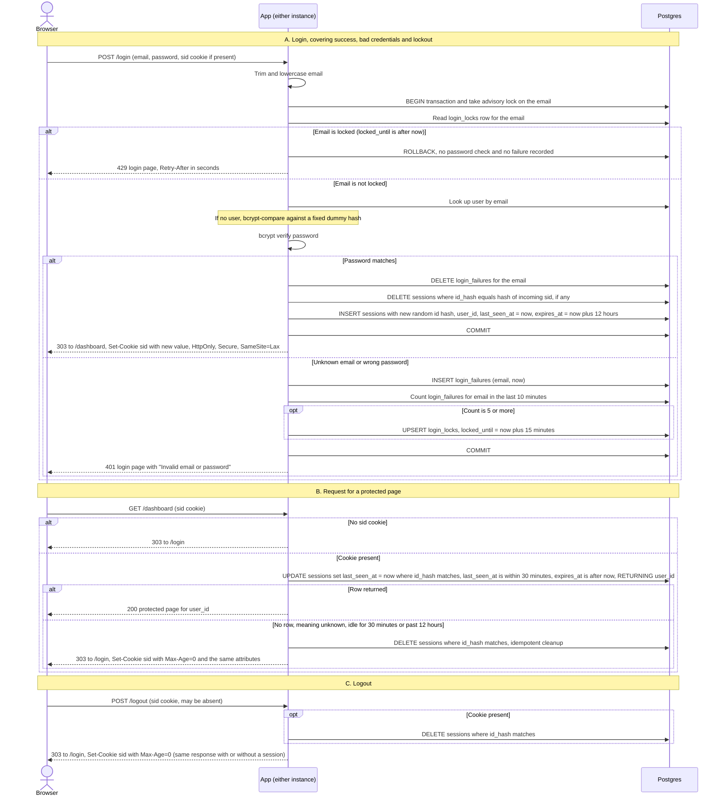

# Login with server-side sessions: design

## Summary

Sessions and login failure counts live in the existing Postgres database, not in process memory and not in a new Redis service. Both app instances read and write the same tables, so a session or lockout created on one instance is honored by the other. Session checks and session touches happen in single statements, and the login success path is one transaction. Every storage failure fails closed.

## Sequence diagram

## Rules that do not fit on the arrows

- **Session state.** A session row is `(id_hash, user_id, created_at, last_seen_at, expires_at)`. `expires_at = created_at + 12 hours` is set at creation and never extended. `last_seen_at` is refreshed on every valid protected request.
- **Expiry test.** A session is valid only when `last_seen_at` is within the last 30 minutes and `expires_at` is in the future. Both comparisons use the Postgres clock (`now()`), so instance clock skew cannot change outcomes.
- **Lockout state.** `login_failures(email, failed_at)` holds one row per failed attempt, for real and unknown emails alike. `login_locks(email PK, locked_until)` holds the active lock. Failures are counted over a sliding 10-minute window.
- **Lock trigger.** The fifth failure inside any 10-minute window sets `locked_until` to 15 minutes after that failure. That fifth attempt still gets 401, because its password was checked. The next attempt gets 429.
- **Refused attempts are not recorded.** Attempts refused while locked are not counted, so they cannot extend the lock. The lock ends exactly 15 minutes after it was set, and no failure from before it is still inside the 10-minute window at that point.
- **Success clears failures.** A successful login deletes that email's `login_failures` rows. It cannot succeed while locked, because the lock check comes first.
- **Concurrency across instances.** The per-email advisory lock (`pg_advisory_xact_lock`) serializes login attempts for one email across both instances. Without it, two instances could both read four failures and both record a fifth without triggering the lock correctly.
- **Session fixation.** The success transaction deletes the incoming session (if any) and inserts a new one, so the pre-login session ID never becomes valid after login.
- **Enumeration.** Unknown and wrong-password cases return the same 401 page and body. The unknown-email path runs a bcrypt compare against a fixed dummy hash, so timing is close. The lock check happens before any password check, so a locked email gets 429 whether or not the account exists.
- **Cookie.** The cookie is named `sid` and holds only the opaque token. Attributes are `HttpOnly; Secure; SameSite=Lax; Path=/`. It has no `Expires` or `Max-Age`, so it is a browser-session cookie, and the server alone decides expiry. Clearing it sends the same name and attributes with `Max-Age=0`.

## Choices made explicit

1. **Store: Postgres, not Redis and not process memory.** Both instances already share Postgres, so no new service is needed. Login, lockout clearing and session creation can share one transaction, which Redis cannot do without extra coordination. A protected request costs one indexed primary-key UPDATE. For a small team that load is modest. If that cost becomes a bottleneck, the migration path is Redis with key TTLs. That would be a new decision, not a silent change.
2. **Session ID: 32 bytes from a cryptographically secure random source, base64url-encoded.** The database stores SHA-256 of the ID, so a database read does not expose usable cookie values.
3. **Expiry: checked on the server in the same statement that touches the session.** This avoids a race between a read and a write, and avoids a separate expiry check.
4. **Abandoned session removal: two mechanisms.** Access-time deletion removes a row the moment a request finds it expired. A sweeper runs every 10 minutes and deletes rows where `expires_at` is past or `last_seen_at` is more than 30 minutes old. Both instances may run the sweeper, which is harmless because the DELETEs are idempotent. Failure rows older than 10 minutes and expired lock rows are swept too.
5. **Failure counts: per-email rows in Postgres.** The window is sliding and computed from timestamps, so no counter needs resetting.
6. **Lockout key: lowercased email, regardless of whether the account exists.** Keying on existence would turn the 429 into an account oracle.
7. **Redirects after POST use 303.** This applies to login success and logout.

## What the user sees when storage fails

Every storage failure fails closed. Each DB call has a short statement timeout (2 seconds suggested) and a bounded connection-pool wait, so failures surface quickly and do not hang.

- **Login page (GET).** Renders normally, since it reads no storage.
- **Login POST, failure before the password decision** (lock check or user lookup fails). The response is 503 with "Sign-in is temporarily unavailable. Try again shortly." The password is not judged, no cookie is set, and the transaction rolls back. The 503 is identical for known and unknown emails.
- **Login POST, failure while recording a failed attempt.** The response is also 503, not 401. An attempt that could not be counted must not look like an ordinary wrong password, and brute-force protection should not run silently without its counter.
- **Login POST, failure on the success path** (session insert or failure clearing). The transaction rolls back, failures are not cleared, the response is 503, and no cookie is set. The old session cookie, if any, is left as it was.
- **Protected request, failure on the session check.** The response is a 503 error page with "Service temporarily unavailable." Protected content is not rendered. The cookie is kept, because the server cannot tell whether the session is valid. Redirecting to `/login` is avoided so that it cannot loop.
- **Logout, failure on the DELETE.** The response is 503 with "Could not sign you out. Try again." The cookie is kept, so the user can retry. The cookie is never cleared while the server-side session may still exist.
- **Sweeper failure.** Harmless. Expired rows stay until the next run, and access-time checks still reject them.
- **Logging.** Storage errors are logged with the operation name and error class. Logs never include passwords, raw session IDs or cookie values.

## Open decisions for review

- **Lock griefing.** Anyone who knows an email address can lock that account's login for 15 minutes with five bad guesses. This follows from requirement 3 as written. Per-IP throttling would reduce it but goes beyond the brief. Decide whether to add it.
- **Login CSRF.** `SameSite=Lax` does not stop a cross-site POST to `/login`, because the login request carries no cookie. A CSRF token on the login form is recommended. The brief does not cover it.
- **Password change and user disable.** Out of scope here. Existing sessions stay valid until they expire, up to 12 hours. Decide whether a password change or user disable should delete that user's sessions.
- **Local HTTP development.** `Secure` cookies are not stored over plain HTTP, so local development needs HTTPS or a documented exception.
- **Sign-up and password reset.** Out of scope, as the brief states.
