# Login with server-side sessions: design

## Summary

- Sessions and brute-force counters live in **Redis** (7.x, single primary plus one replica, not Cluster), shared by both app instances.
- The cookie, named `__Host-sid`, holds only a random session ID.
- Expiry is enforced by one Redis Lua script (`TOUCH`). It checks the 12-hour limit against Redis `TIME` and sets the key's TTL to the sooner of the idle timeout and the time left to that limit.
- If storage fails, the app **fails closed** with a 503. It never lets a request through unchecked.
- Each Lua script is atomic. A whole login is not: it is several steps (see Atomicity).
- **The sequence diagram is the single source of truth for status codes, bodies, headers and cookie effects.** The prose gives state, rules and rationale, and does not restate every response.

## Scope

**In scope:** login, logout, server-side sessions, idle and absolute expiry, per-email brute-force lockout, storage-failure behavior.

**Non-goals** (deliberate omissions, flagged for review):
- **Login CSRF.** Not addressed; see "Login CSRF" below for the impact and the recommended cheap fix.
- **Session-ID rotation on privilege change.** There are no roles today.
- **Password change or reset invalidating sessions; per-user session listing or revoke.** All need a per-user session index (`user:<id>` set), which this design does not keep.
- **Per-IP rate limiting, MFA, "remember me".** Not requested.
- **Lockout as a denial-of-service lever.** Anyone can lock a known email for 15 minutes by failing five times. This follows from requirement 3 (per email). Accepted and flagged.
- **`GET /login` for an already-signed-in user.** It renders the form and does no session check. Redirecting to `/dashboard` is a later nicety.

## Decisions

**1. Where sessions and failure counts live: Redis, added as a new component.**
- Both instances must see the same state, so process memory is out, and sticky sessions are ruled out.
- Redis gives native per-key TTLs and atomic Lua scripts. Abandoned sessions are removed by TTL alone: no sweeper, no cron job, nothing in Postgres to clean.
- Postgres could do this without a new component, but it would add a write to the main database on every page view, plus a sweeper job and hand-written atomic window logic.
- Sessions are disposable: a lost Redis means everyone signs in again.
- Setup:
  - One managed primary, one asynchronous replica, automatic failover. **Not Redis Cluster**, so multi-key scripts need no hash tags. Every key a script touches is still passed in `KEYS`.
  - Redis 7.x. Scripts call `TIME` and write with `PEXPIRE`/`DEL`/`SET`. Replication is by script effects (the only mode in 7.x), so the replica receives the resulting commands, not the script.
  - `maxmemory-policy noeviction`: sessions are never silently evicted. Memory pressure shows as write errors, which become 503s.
  - AOF with `everysec`: a plain restart loses at most about one second of writes.
- **Accepted durability limits.** Lockout state is best-effort.
  - Asynchronous failover or total Redis loss can drop the last moments of sessions and locks. Affected users sign in again.
  - It can also reset lockouts, giving an attacker one fresh window of 5 guesses per event. Accepted: failovers are rare and not attacker-triggerable through the app. Stronger guarantees would need synchronous replication or a Postgres-backed lockout.
- Cost: Redis is now a hard dependency for every page (see decision 5).

**2. Session ID and storage format.**
- The ID is 32 bytes from a CSPRNG, base64url-encoded, generated by the app.
- The key is `sess:<sha256(id)>`, so a leaked Redis dump holds no usable cookies. The value is a hash `{user_id, created_at}`.
- Every script reads Redis `TIME` for "now", including `created_at` and failure timestamps, so clock skew between instances cannot matter.

**3. Cookie, and when it is set or cleared.**
- `__Host-sid=<id>; Path=/; HttpOnly; Secure; SameSite=Lax`. No `Domain`, no `Max-Age`; the server decides expiry. Clearing uses the same name and attributes with `Max-Age=0`. Protected responses send `Cache-Control: no-store`.
- All set/clear rules in one place (the diagram shows the same outcomes per branch):

| Situation | Cookie | Server-side session |
|---|---|---|
| Protected page or logout, no cookie | no `Set-Cookie` | none |
| Protected page, cookie present but session missing, unknown, expired or malformed | cleared | gone |
| Logout, cookie present, delete succeeded or key already gone (including a session that already expired) | cleared | gone |
| Login success | new ID set | old session (if any) destroyed, new one created |
| Login 401 (bad credentials) or 429 (lock), with or without an old cookie | untouched | old session, if any, **stays live** |
| Login 503 | untouched | old session, if any, normally live; see the `LOGIN_OK` error case in decision 5 |
| Protected page 503 | untouched (session may be valid) | unchanged |
| Logout 503 | untouched | possibly still live |

A failed login never signs anyone out: a user who is signed in and mistypes a password in another tab keeps their session.

**4. How expiry is checked and recorded.** All of it is in the `TOUCH` script, which runs on every protected request. The app only passes the key and acts on the result. One validity rule covers every malformed case:
1. The session is **valid** only if the hash has a non-empty `user_id` and a `created_at` that is an integer, and `created_at <= now`. If the key is missing, or any of this fails (missing `user_id`, missing or non-integer `created_at`, a `created_at` in the future), `DEL` the key and return nil. A malformed session is treated as no session.
2. `now` comes from `TIME`; `remaining_abs = 12h - (now - created_at)`.
3. If `remaining_abs <= 0`, `DEL` the key and return nil.
4. Otherwise `PEXPIRE key min(30 min, remaining_abs)` and return `user_id`.

All four steps, including the `TIME` read, the `PEXPIRE` and the return, run inside one script, so they are atomic.
- **Idle (30 min)** lives in the key's TTL, restarted by each request. The TTL is the record of last activity, so no "last seen" field exists.
- **Absolute (12 h)** is checked explicitly, so it holds even if a TTL were wrong. The `min()` also lets Redis drop the key at the 12-hour mark without any request.
- Missing, unknown, expired and malformed sessions are indistinguishable to the client: all get the same redirect.

**5. What the user sees when storage fails.** Fail closed; never skip a check because storage is down. Responses per branch are in the diagram. The rules behind them:
- **Login.** Any Redis or Postgres error gives 503 and no cookie change. A wrong-password attempt whose `FAIL` errors also gets 503, not 401: the attempt may go uncounted, which is acceptable because the response grants nothing and the next attempt is checked again.
- **`LOGIN_OK` error.** The outcome is unknown (see Atomicity): the script either applied entirely or not at all. If it applied, the old session is already destroyed and the new one was never delivered, so the user's next request redirects to `/login`. If it did not apply, the old session is intact. The user simply retries.
- **Protected page.** Redis error gives 503, a plain page and `Retry-After: 5`. It does not redirect to `/login` (the login form would fail too) and does not clear the cookie (the session may be valid). During a Redis failover users see this page until the replica is promoted; sustained 503s are what alerting watches.
- **Logout.** If the delete fails: 503 with the cookie kept, because clearing it while the session survives would falsely say the user is signed out.
- Every 503 is logged; alert on a sustained 503 rate, not single events.
- **What 503 does and does not reveal.** The lock check uses only the email hash and never touches `users`, and the user lookup cannot fail differently for known and unknown emails, so those 503s say nothing about the account. A 503 after bcrypt is weaker, and we state the residual leak rather than claim otherwise: if a fault hits only one script (for example memory pressure that fails the session-creating `LOGIN_OK` write but not the `FAIL` write), then during that fault a **correct** password returns 503 while a wrong one returns 401. An observer could learn "this guess was correct" for an existing account. This needs a partial Redis fault, and the observer learns only what they would learn by retrying once the fault clears. Accepted and flagged; mitigating it would mean failing both scripts the same way, which cannot be guaranteed.

## Atomicity: what is guaranteed

- **Per script (`TOUCH`, `FAIL`, `LOGIN_OK`):** all-or-nothing. A call never leaves a half-applied session or counter.
- **Delivery is at-least-once, outcome unknown on error.** If a script call errors (for example the connection drops after Redis ran it), the app cannot tell whether it applied. It does not retry automatically; it returns 503 and the user may retry. Consequences of a retry:
  - `FAIL` is **not idempotent**: a duplicate counts twice, so a user can be locked one failure early (and an errored `FAIL` that did not apply is an uncounted attempt). Either way the counter is off by at most one per error, and the cost is a slightly early or slightly late lock, never a skipped check.
  - `LOGIN_OK` duplicates are harmless: each makes another new session, and an orphan from an undelivered response is removed by TTL.
  - `TOUCH` is idempotent apart from restarting the idle clock.
- **Not atomic across steps (best-effort):** the sequence lock check, user lookup, bcrypt, then `LOGIN_OK` or `FAIL`. State can change between steps, notably a lock appearing. The scripts re-check the lock so that the outcome stays safe.
- What can be lost or shifted is a count, never a check.

## Lockout rules

- **Email key.** Trim and lowercase, then use `sha256(email)` in all Redis keys. The same key is used whether or not the account exists, so lockout state cannot reveal existence.
- **Failure window.** `fails:<h>` is a sorted set of failure timestamps (Redis `TIME`), each with a unique nonce, TTL 10 minutes. The `FAIL` script:
  1. If `lock:<h>` exists, change nothing and return `ALREADY_LOCKED`.
  2. Add the entry, trim entries older than 10 minutes, count what remains, reset the set TTL to 10 minutes.
  3. If the count is 5 or more, `SET lock:<h>` with a 15-minute TTL, delete the set, and return `LOCKED_NOW`. Otherwise return `COUNTED`.

  This is a true sliding window. The fifth failure itself returns 401 (`LOCKED_NOW`); later attempts get 429.
- **`LOGIN_OK`.** If `lock:<h>` exists the script changes nothing, even for a correct password. Otherwise it deletes the old session (if any), creates the new one and deletes `fails:<h>`. No session and lock ever coexist.
- **While locked.** The lock is checked first, so no bcrypt runs. Attempts during a lock are not counted and do not extend it. After expiry the counter starts at zero.
- **Bound on guesses (deviation from requirement 3).** Requirement 3 reads: after 5 failures, refuse without checking the password. This design meets that for every attempt that starts after the lock exists. It does **not** meet it for attempts already past the lock check when the fifth `FAIL` lands, because `FAIL` runs after bcrypt.
  - Each instance has 4 bcrypt workers and **no queue**: a worker slot is taken before the lock check, and overflow gets an immediate 503. So at most 8 verifications are in flight across both instances, and only those can be extras.
  - **Stated limit: 5 counted guesses plus up to 8 uncounted extras, so at most 13 password verifications per lockout cycle** under normal Redis latency. Extras that fail are not counted (their `FAIL` hits the lock and skips); an extra that is correct before the lock lands succeeds legitimately, and after it lands `LOGIN_OK` refuses it.
  - This is an engineering estimate, not a hard guarantee: if Redis is slow the window before the lock lands stretches. **Decision requested:** we propose accepting this small constant as a known deviation from the letter of requirement 3. A strict version needs a per-email mutex or in-flight reservation around bcrypt and is not worth the complexity here. If the requirement must hold exactly, say so and we add it.
- **Lock disclosure (one argument, covering every 429).** A 429 reveals only "this email hash is locked". Anyone can create that state for any email, real or not, by failing five times, and the lock exists for unknown emails too, so it says nothing about whether an account exists. This one argument covers: the faster response of a 429 (it skips lookup and bcrypt, so it is quicker than a 401); a correct password refused by `LOGIN_OK` after a lock lands; and `ALREADY_LOCKED` after a wrong password. Those last two return the same 429 as any attempt during a lock, so a 429 does not confirm that the password was correct. The user-facing text is the same for every email: "Too many failed attempts. Try again in 15 minutes."

## Login rules

- **Identical failures.** Unknown email and wrong password follow one code path. For an unknown email the app compares against a fixed dummy bcrypt hash of the same cost. Both get identical 401 body and headers.
- **Session fixation.** `LOGIN_OK` deletes the session the incoming cookie pointed to (if any), even if the new login is for a different user, creates a session under a fresh ID, and clears the failure counter. The incoming ID is never reused. `KEYS` are `lock:<h>`, `fails:<h>`, the new `sess:` key and the old `sess:` key (a placeholder when no cookie came).
- **Redirects.** `POST /login` and `POST /logout` redirect with 303.

## Protected requests

- **Deleted users.** A protected request already reads the user from Postgres for the page, so this adds no extra query. If the user no longer exists, destroy the session and treat the request as unauthenticated.

## Login CSRF (non-goal, with impact)

`SameSite=Lax` protects cookies the browser *sends* on cross-site POSTs, such as `POST /logout`. It does not protect `POST /login`, because login CSRF *sets* a cookie: an attacker's page can auto-submit a form to `/login` with the **attacker's own** credentials, and the response's `Set-Cookie` is accepted. Impact: the victim's browser is signed in as the attacker, and the victim's own session cookie is overwritten (their old session is not destroyed, since Lax cookies are not sent on that POST, but the browser no longer presents it). Anything the victim then enters, such as events, availability or personal details, lands in the attacker's account, where the attacker can read it. It is also a nuisance logout.

It is accepted for now because requirement 3 and the brief ask for no CSRF defense, this is an internal team scheduler with low-sensitivity data, and the attacker needs valid credentials. **Recommended before launch:** reject `POST /login` whose `Origin` (or `Referer`) does not match our host. That is a few lines, needs no token store, and closes the hole for modern browsers.

## Verification plan

Test with a real Redis: both-instance session sharing; idle and 12-hour expiry using a controllable clock or shortened constants; each malformed hash case (missing `user_id`, missing, non-integer or future `created_at`); fixation (old ID dead after login); a failed login leaving an old session live; identical 401 bodies; lockout at the fifth failure, 429 afterwards, reset on success; racing `FAIL`/`LOGIN_OK` against a lock, and measuring the in-flight extras against the stated bound of 13; and each Redis/Postgres error path returning 503 with no cookie change.

## Sequence diagram

```mermaid
sequenceDiagram
    autonumber
    participant B as Browser
    participant A as App (either instance)
    participant R as Redis
    participant P as Postgres

    Note over B,P: LOGIN - POST /login (email, password, maybe an old __Host-sid cookie)
    Note over B,P: On every 401, 429 and 503 below the cookie is untouched and any old session stays live
    B->>A: POST /login
    A->>A: take a bcrypt worker slot (no queue), else 503
    A->>A: email = trim and lowercase, h = sha256(email)
    A->>R: GET lock:h
    alt Redis error on lock check
        A-->>B: 503 login page, "Sign-in is temporarily unavailable. Please try again in a moment."
    else lock exists (lockout)
        A-->>B: 429 login page, "Too many failed attempts. Try again in 15 minutes.", Retry-After 900, no password check
    else no lock
        A->>P: SELECT id, password_hash WHERE email
        alt Postgres error
            A-->>B: 503 login page
        else row or no row
            A->>A: bcrypt compare (dummy hash if no row, same cost)
            alt password valid (success)
                A->>R: LOGIN_OK - if lock:h exists do nothing, else DEL old sess if cookie sent, create new sess, DEL fails:h
                alt Redis error, outcome unknown
                    A-->>B: 503 login page, old session intact or already destroyed
                else lock appeared meanwhile
                    A-->>B: 429 login page, Retry-After 900, old session intact
                else ok
                    A-->>B: 303 to /dashboard, Set-Cookie __Host-sid=new id
                end
            else unknown email or wrong password (bad credentials)
                A->>R: FAIL - ALREADY_LOCKED if lock:h exists, else add to fails:h, trim, count, if 5 or more then SET lock:h 15 min and DEL fails:h
                alt Redis error
                    A-->>B: 503 login page, attempt may be counted or not
                else ALREADY_LOCKED (lock appeared meanwhile)
                    A-->>B: 429 login page, Retry-After 900
                else COUNTED or LOCKED_NOW
                    A-->>B: 401 login page, "Invalid email or password"
                end
            end
        end
    end

    Note over B,P: PROTECTED REQUEST - GET /dashboard (cookie rules: see decision 3)
    B->>A: GET /dashboard
    alt no cookie
        A-->>B: 302 to /login
    else cookie present
        A->>R: TOUCH on sess:sha256(sid)
        Note right of R: now from TIME. Missing key, bad user_id or created_at, or over 12h: DEL and nil. Else PEXPIRE min(30 min, 12h left), return user_id
        alt Redis error
            A-->>B: 503 "Service temporarily unavailable", Retry-After 5, cookie kept
        else nil (missing, unknown, expired or malformed)
            A-->>B: 302 to /login, cookie cleared
        else user_id
            A->>P: load user and page data
            A-->>B: 200 page, Cache-Control no-store
        end
    end

    Note over B,P: LOGOUT - POST /logout
    B->>A: POST /logout
    alt no cookie
        A-->>B: 303 to /login
    else cookie present
        A->>R: DEL sess:sha256(sid)
        alt Redis error
            A-->>B: 503 "We couldn't sign you out. Please try again.", cookie kept
        else deleted, or key already gone
            A-->>B: 303 to /login, cookie cleared
        end
    end
```

