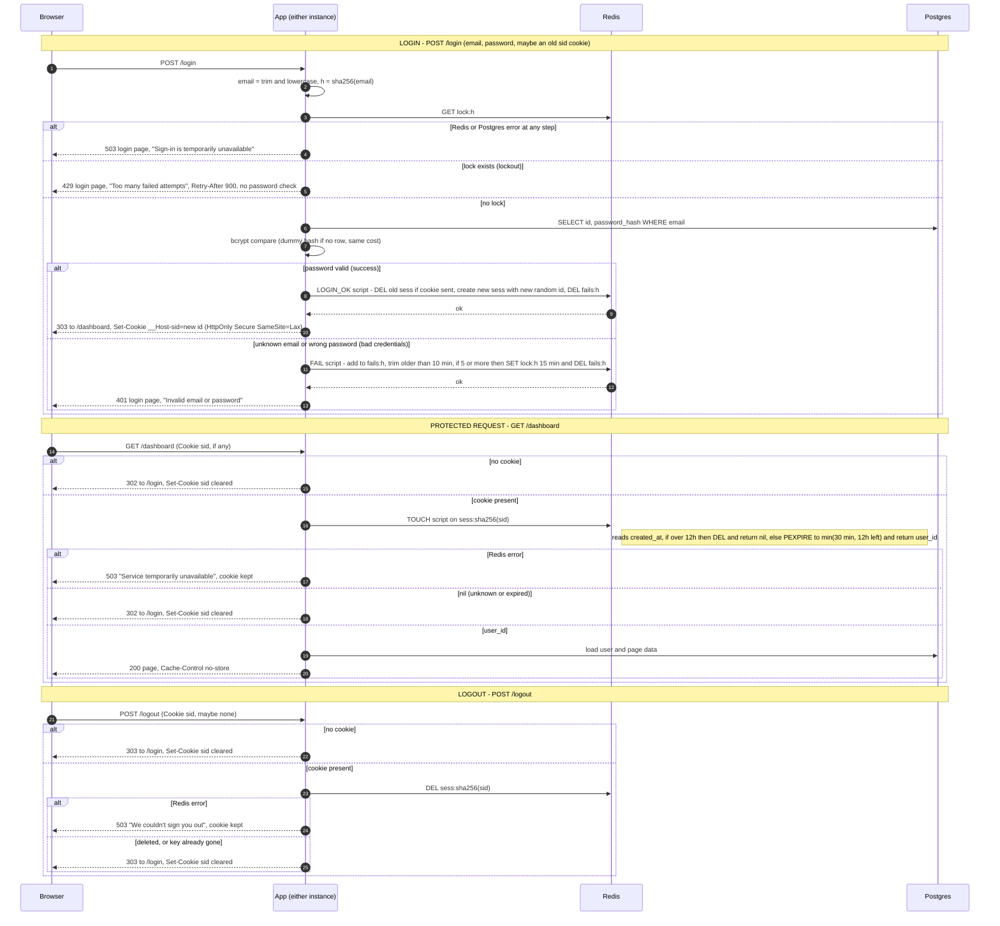

# Login with server-side sessions: design

## Summary

- Sessions and brute-force counters live in **Redis**, which both app instances share.
- The cookie holds only a random session ID.
- Redis key expiry enforces the idle timeout and the 12-hour limit. The app also checks the 12-hour limit itself on every request.
- If storage fails, the app **fails closed** with a 503. It never lets a request through unchecked.

## Decisions

**1. Where sessions and failure counts live: Redis, added as a new component.**
- Both instances must see the same state, so process memory is out. Sticky sessions are ruled out.
- Redis has native per-key TTLs and atomic Lua scripts. A session then needs no cleanup code. Touch-on-every-request and the sliding failure window are each one atomic call.
- Postgres could do this, and it would avoid a new component. But it would add a write to the main database on every page view, and it would need a sweeper job and hand-written atomic window logic.
- Redis is one small, well-understood component whose data is disposable. A lost Redis means everyone signs in again, nothing worse.
- Setup:
  - One managed instance, preferably with a replica and failover.
  - `maxmemory-policy noeviction`, so sessions are never silently evicted. Memory pressure shows up as write errors, which become 503s.
  - AOF with `everysec`, so a restart rarely loses lockout state.
- Cost: Redis is now a hard dependency for every page. See decision 6.

**2. Session ID and storage format.**
- The ID is 32 bytes from a CSPRNG, base64url-encoded.
- The key is `sess:<sha256(id)>`, so a leaked Redis dump contains no usable cookies.
- The value is a hash `{user_id, created_at}`. `created_at` is taken from Redis `TIME`, so clock skew between instances cannot matter.

**3. Cookie.**
- `__Host-sid=<id>; Path=/; HttpOnly; Secure; SameSite=Lax`.
- No `Domain` and no `Max-Age`, so it is a browser-session cookie. The server decides expiry.
- Clearing sets the same name and attributes with `Max-Age=0`.
- Protected responses send `Cache-Control: no-store`.

**4. How expiry is checked and recorded.**
- **Idle timeout (30 min).** It lives in the key's TTL. Every protected request runs one Lua script (the `TOUCH` step in the diagram), which does this:
  1. Read `created_at`.
  2. Compute `remaining_abs = 12h - (now - created_at)`.
  3. If `remaining_abs <= 0`, delete the key and return nil.
  4. Otherwise run `PEXPIRE key min(30min, remaining_abs)` and return `user_id`.
- **Absolute limit (12 h).** The script checks it explicitly, so it holds even if a TTL were ever set wrongly. The `min()` also means Redis drops the key at the 12-hour mark without the app being involved.
- "Whichever comes first" falls out of that `min()`. No "last seen" field is stored, because the TTL is the record of last activity.
- Missing, unknown and expired sessions are indistinguishable, since the key is simply gone. All three get the same redirect.

**5. How abandoned sessions get removed.** Redis TTL removes them. There is no sweeper and no cron job. Nothing in Postgres needs cleaning.

**6. What the user sees when storage fails.** The app fails closed. It never skips a check because storage is down.
- **Login.** Redis or Postgres error at any step gives HTTP 503 and the login page with "Sign-in is temporarily unavailable. Please try again in a moment." The lockout check runs before any user lookup, so a storage error cannot be used to tell known emails from unknown ones. No cookie is set or cleared.
- **Protected page.** A Redis error gives HTTP 503 with a plain "Service temporarily unavailable" page and `Retry-After: 5`.
  - It does **not** redirect to `/login`. That would send a user with a valid session to a login form that also fails.
  - It does **not** clear the cookie, because the session may still be valid.
- **Logout.** If the delete fails, the app gives 503 with "We couldn't sign you out. Please try again." and leaves the cookie in place. Clearing the cookie while the session survives on the server would falsely tell the user they are signed out.
- Every 503 is logged and alerted on.

## Lockout rules

- **Email key.** The email is trimmed and lowercased. All Redis keys use `sha256(email)`, which bounds the length of attacker-supplied input. The same key is used whether or not the account exists, so lockout cannot reveal existence.
- **Failure window.** `fails:<h>` is a sorted set of failure timestamps, each with a unique nonce. On each failure, one Lua script:
  1. Adds the entry.
  2. Trims entries older than 10 minutes.
  3. Sets the set's TTL to 10 minutes.
  4. If the count is 5 or more, sets `lock:<h>` with a 15-minute TTL and deletes the set.
- This is a true sliding window, so "5 failures within any 10 minutes" holds.
- **Fifth failure.** The fifth failed attempt itself returns 401. The sixth and later attempts return 429 until the lock expires.
- **While locked.** The lock is checked first, so the password is never verified and no bcrypt runs. Attempts during a lock are not counted and do not extend it. When the lock expires, the counter starts from zero.
- **429 page.** It reads "Too many failed attempts. Try again in 15 minutes." and sends `Retry-After: 900`. The text is the same for every email.
- **Success.** The success script deletes `fails:<h>`. A successful login cannot happen while locked, so there is no lock to clear.
- **Concurrency.** The lock check and the password check are separate steps. A burst of parallel attempts can get a few extra guesses past the check before the lock lands. The failure recording is atomic, so the lock still triggers. I accept this small overshoot. The alternative is a per-email mutex around bcrypt, which is not worth the complexity.

## Other rules that don't fit on the arrows

- **Identical failures.** Unknown email and wrong password follow the same code path. For an unknown email, the app compares against a fixed dummy bcrypt hash (same cost factor) so the response time matches. Both get 401 with the same body and headers.
- **Session fixation.** The `LOGIN_OK` script runs in one atomic step. It deletes the session the incoming cookie pointed to (if any), creates a new session with a fresh ID, and clears the failure counter. The incoming ID is never reused, and it is destroyed even when the new login is for a different user.
- **Deleted users.** If a session's `user_id` no longer exists in Postgres, the handler destroys the session and treats the request as unauthenticated.
- **Redirects.** Form posts redirect with 303 and page requests with 302.
- **Out of scope, flagged for review.** CSRF tokens on other form posts and on login. `SameSite=Lax` already stops cross-site `POST /logout` from carrying the cookie, but it does not stop login CSRF.

## Sequence diagram

## Redis keys

| Key | Type | TTL | Purpose |
|---|---|---|---|
| `sess:<sha256(sid)>` | hash `{user_id, created_at}` | min(30 min, 12 h left), reset on every protected request | the session |
| `fails:<sha256(email)>` | sorted set of failure timestamps | 10 min | sliding failure window |
| `lock:<sha256(email)>` | string | 15 min | active lockout |
