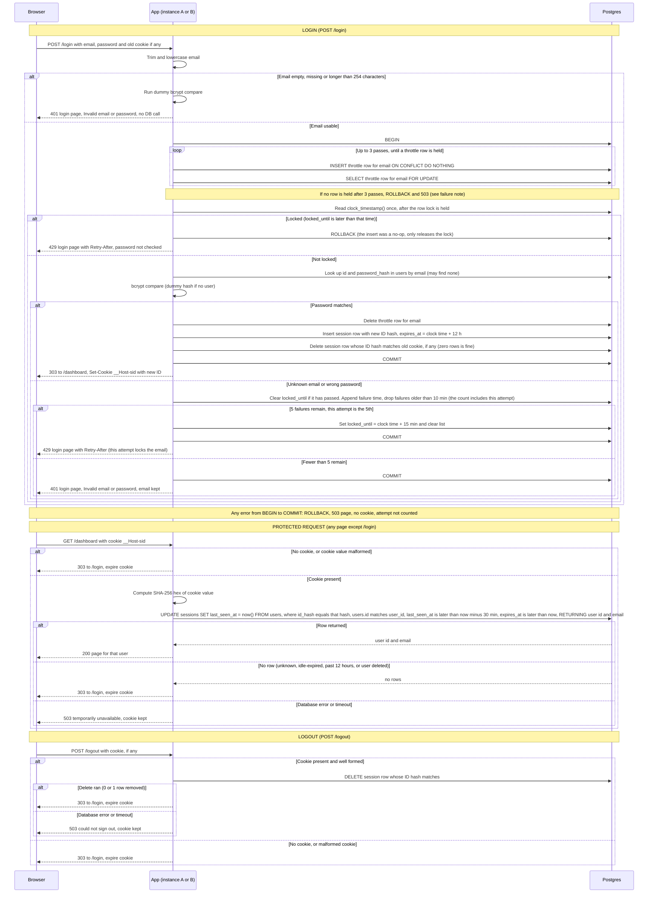

# Login with server-side sessions: design

## Requirements

This design must meet eight fixed requirements. The rest of the document refers to them as R1 to R8.

- **R1.** Login is `POST /login` with email and password. Emails are matched in lowercase.
- **R2.** An unknown email and a wrong password get the identical response: HTTP 401 and the login page showing "Invalid email or password". Nothing reveals whether an account exists.
- **R3.** Brute-force limit: once an email has 5 failed attempts within any 10-minute period, refuse logins for that email for 15 minutes with HTTP 429, without checking the password. A successful login clears that email's failure count.
- **R4.** On success, always issue a brand-new random session ID, even if the browser sent one, and destroy the session the incoming cookie pointed to. Then redirect to `/dashboard`.
- **R5.** The cookie carries only the opaque session ID, flagged HttpOnly, Secure and SameSite=Lax. No user data goes in the cookie.
- **R6.** A session ends after 30 minutes with no requests (every request restarts that clock) or 12 hours after login, whichever comes first.
- **R7.** Every protected request checks the session on the server. If it is missing, unknown or expired, clear the cookie and redirect to `/login`.
- **R8.** Logout is `POST /logout`. Destroy the session on the server before replying, then clear the cookie and redirect to `/login`. It behaves the same when there is no session.

## Context

- Server-rendered web app: HTML pages and form posts. No SPA and no API clients.
- Two identical app instances run behind a load balancer, with no sticky sessions. Any instance can serve any request. No session state lives in process memory, so the load balancer needs no affinity.
- One Postgres database. Its `users` table has `id`, `email` (stored lowercase and unique) and `password_hash` (bcrypt).
- Sign-up and password reset are out of scope.

## Decisions

1. **Storage: Postgres, not Redis.** Two new tables, `sessions` and `login_throttle`. Both app instances already share Postgres. A login must check the throttle, verify the password, create the session and clear the throttle as one unit (R3, R4). A single database transaction does that. Redis could not do it without a second system and a compensation path when one step fails. Expected traffic is team-sized, so one primary-key lookup per request is cheap. Redis would add a service, a secret and a second failure domain for no gain at this scale. Revisit if request volume grows a lot.

2. **Session ID.** The app generates the ID: 32 bytes from a cryptographic random number generator, base64url encoded without padding (43 characters). The database never generates IDs. The database stores only the SHA-256 hex of the ID, computed by the app, so a database read does not reveal live cookie values. Two logins producing the same ID is not handled as a special case. The ID has 256 random bits, so a collision is effectively impossible. If an insert did hit the primary key, it is an error inside the login transaction. Decision 12 applies: the transaction rolls back, the user gets the 503 page, no cookie is set, and the user signs in again. The design does not retry the insert.

3. **Cookie.** Name `__Host-sid` (chosen by this design; R5 does not name it). The value is the opaque ID only. Attributes: `HttpOnly; Secure; SameSite=Lax; Path=/`. No `Domain`, and no `Max-Age` or `Expires`. The `__Host-` prefix requires `Path=/` and no `Domain`. Without `Max-Age` the cookie is a browser-session cookie. The server clock alone decides expiry. See "Browser closing" in the notes. Clearing the cookie (on every expiry, logout and redirect-to-login path) sends `Set-Cookie: __Host-sid=; Path=/; Max-Age=0; HttpOnly; Secure; SameSite=Lax`.

4. **Expiry is checked on the database clock.** Each session row has `last_seen_at` (set to `now()` on every accepted request) and `expires_at` (login plus 12 hours, never extended). The protected-request query tests both, so the 30-minute idle clock restarts on every request (R6). `now()` in a single statement is the statement's start time. Inside the login transaction the app uses `clock_timestamp()` (decision 8). Both are database clocks. Using the database clock avoids clock skew between the two instances.

5. **No write throttling on the touch.** Every accepted request updates `last_seen_at`. This costs one write per protected request, which is acceptable at this scale, and it keeps the idle rule exact.

6. **Abandoned sessions are swept, not trusted.** An expired row is never accepted, so the sweep only reclaims storage. Each app instance runs its own timer that fires every 10 minutes. Each run opens a transaction and calls `pg_try_advisory_xact_lock` with one fixed key. The run that gets the lock performs the sweep. A run that does not get the lock ends at once, so the two instances never sweep at the same time and neither waits for the other. If a sweep fails, the error is logged by the instance that ran the sweep, through its normal application log, and the next run retries. No alerting on sweep errors is specified (open item). The sweep uses `now()`.
   - It removes session rows where `expires_at` is past, or `last_seen_at` is more than 30 minutes old. The protected-request query rejects exactly these rows already, so the sweep never changes what a browser sees (see the cookie notes).
   - It removes throttle rows where no lock is active (`locked_until` is NULL or past) and no entry in `failed_at` is newer than 10 minutes.
   - The DELETEs are idempotent and only match dead rows, so an overlapping run would still be safe. The advisory lock only avoids doing the work twice.

7. **Failure counting is per normalized email, whether or not the account exists.** The key is the trimmed, lowercase email, the same value used for the user lookup (decision 14). The window is sliding: the row keeps the timestamps of recent checked failures. The lock check uses the clock time from decision 8. A `locked_until` that is not later than that time is not a lock. On each checked failure the app does this, in order:
   1. Clears `locked_until` if it has passed.
   2. Appends the current attempt's failure time to the list.
   3. Drops every timestamp older than 10 minutes.
   4. Counts what remains. The count includes the current attempt. If the count is 5, this attempt is the 5th failure within the window. Then `locked_until` is set to the clock time plus 15 minutes and the list is cleared. Otherwise the list is kept.

   That 5th failing attempt returns 429, so the user learns of the lock immediately.
   - This is an interpretation of R2 and R3 that the owner must confirm (see open items). R2 says a wrong password gets a 401. R3 says a lock starts on the 5th failure, and this design answers that failure with the lock response.
   - Unknown emails and wrong passwords take the same path at every step, so this reveals nothing about existence.
   - A successful login deletes the row (R3).
   - Attempts during a lock return 429 without any bcrypt call.
   - The lock (15 minutes) is longer than the window (10 minutes), so the failures that caused it have aged out when it ends.
   - An email that is empty, missing, or longer than 254 characters after trimming and lowercasing gets the R2 response: 401 with the same body. It makes no database call and creates no throttle row. It still runs the dummy bcrypt comparison (decision 9), so its timing matches the other failures. This assumes no stored account has an email longer than 254 characters (open item).

8. **Exact counting under concurrency, and one clock.** Each login runs in one transaction. Each pass of the row-lock step inserts the throttle row for the email if it is missing (`INSERT ... ON CONFLICT DO NOTHING`), then runs `SELECT ... FOR UPDATE` on it. If that SELECT returns no row, a concurrent successful login deleted the row while this one waited (or the sweep removed it). The next pass repeats the insert and the lock. A login makes at most 3 passes. If no row is held after the third pass, the login takes the 503 path (decision 12), with no counted attempt. Concurrent guesses for the same email therefore serialize, and the limit is exact for that email.
   - `lock_timeout` (2 seconds) applies to each wait separately. Each pass has two waits: the INSERT, which waits if another uncommitted transaction has inserted the same email, and the SELECT FOR UPDATE. Worst case is 3 passes × 2 waits × 2 seconds = 12 seconds of lock waiting before the 503. The 3-pass cap and the 2-second value are starting points, to be tuned.
   - The cost is that bcrypt runs while that row lock is held, which only delays other attempts on the same email. The transaction holds one database connection from BEGIN to COMMIT, including the bcrypt step (timeouts are in decision 17).
   - After the row lock is held, the transaction reads `clock_timestamp()` once and uses that value for every time check and timestamp in the login: the lock check, failure time, window, `locked_until` and `expires_at`. Reading the clock after the lock means a wait for the lock does not make the time stale.
   - The database clock is the only clock used for these rules. The app's clock is never used.
   - Every write in the login, including the delete of the throttle row on success, is inside this transaction. If COMMIT fails, the transaction rolls back, so the throttle row and its recent failures are unchanged (decision 12).

9. **Unknown emails take the same path.** A dummy bcrypt hash, generated at startup with the cost factor from decision 15, is compared when no user matches. Response timing and body are the same for both failure cases. Over-length or empty emails (decision 7) also run the dummy comparison. The dummy hash is computed once when the process starts and kept in memory. It is not stored in the database. Each instance computes its own, and both use the same cost factor.

10. **Session rotation (R4).** On success the app generates a new ID and computes its hash, inserts the new session row, deletes the row whose ID hash matches the hash of the incoming cookie value (if any), deletes the throttle row, and commits. The delete is keyed only on that hash. It does not check the owner, validity or expiry. A cookie that matches no row deletes nothing and is not an error. Only a holder of the cookie value can name a row, so the delete can only hit the session that cookie pointed to. An incoming cookie value that fails the format check (see Cookie format) is treated as no cookie: nothing is deleted and the login continues. The new cookie is sent only after the commit succeeds. If the commit fails, every change in this transaction is rolled back, including the throttle delete, so the attempt counts are unchanged and the old session row is still present (decision 12).

11. **Redirects and direct responses.**
    - A successful login, a logout and a protected-page redirect use 303 See Other.
    - A failed login (401 or 429) re-renders the login form directly with that status. It does not redirect. The form keeps the email the user typed and never keeps the password.
    - The 503 page is rendered directly too. It is a standalone page with the wording from the storage policy table. It does not include the login form, does not echo the email, and does not change the cookie.

12. **Every failure inside login is a 503, with no side effects.** Any error from BEGIN through COMMIT (including the statements around the bcrypt step, lock waits, timeouts, a duplicate session ID and a row-lock pass limit reached without a held row) rolls the transaction back. The app sends the 503 page, sets no cookie, and does not count the attempt. The 503 is the same whatever the password result, so it reveals nothing. A cookie is sent only after COMMIT succeeds.

13. **GET /login always shows the form.** It ignores any cookie and makes no database call. A signed-in user who visits `/login` sees the form. The old session stays live until they sign in, and a successful sign-in rotates it (decision 10). The login page therefore still works while the database is down.

14. **User lookup.** After the row lock is held, the transaction runs `SELECT id, password_hash FROM users WHERE email = $1`. `$1` is the trimmed, lowercase input from decision 7. The Context section says `users.email` is stored lowercase and unique. The lookup therefore compares the column directly and uses its unique index, with no `lower()` on the column. This is taken from the existing-system description and has not been checked against the live table (open item). The lookup reads only `id` and `password_hash`. No match means the dummy hash is compared (decision 9).

15. **Password hashing cost.** Real hashes and the dummy hash use one bcrypt cost factor, set as one configuration value. That value must equal the cost factor of the existing `password_hash` values, because a mismatch would let response timing reveal whether an email exists. The existing cost is not in the requirements and must be confirmed before release (open item).

16. **Route protection (R7).** One guard runs in front of the router for every request. It is default deny. Every route needs a valid session unless it is on the public list, which holds `GET /login` and `POST /login`. The guard applies to all HTTP methods, so a POST to any other page also needs a session. `POST /logout` is not behind the guard. Its handler does its own cookie check (see the logout branch of the diagram), so it succeeds with no session. Static assets are an open question (open item).

17. **Timeouts and connections.** Every login and protected request uses these limits. The values are starting points, to be tuned under load:
    - Waiting for a pooled connection: 2 seconds.
    - `lock_timeout` on each throttle row lock wait (each INSERT and each SELECT FOR UPDATE in a pass, see decision 8): 2 seconds.
    - `statement_timeout` on each statement: 5 seconds.
    - `idle_in_transaction_session_timeout` for the app's database role: 10 seconds. During bcrypt the transaction is open but idle from Postgres's view, so this value must stay above the bcrypt time at the chosen cost. It is a backstop that frees a lock held by a stuck app. If bcrypt ever runs past this value, Postgres ends the idle transaction, the next statement in that login fails, and the login takes the decision 12 path: rollback, 503, no cookie, attempt not counted. Measure bcrypt at the chosen cost on the target hardware before release, and set this value above that measurement.

    bcrypt itself has no timeout. It is CPU-bound and bounded by the cost factor. Every timeout or database error inside a login transaction is handled as in decision 12: rollback, 503, no cookie, attempt not counted. A timeout on the protected-request query is a 503 with the cookie kept. A protected request that cannot get a pooled connection within 2 seconds gets the same 503.

    The pool must hold connections for every login and protected request that can run at once. A login holds its connection through the bcrypt step and through any wait for the row lock, so logins can use up the pool. The pool size is not yet set (open item).

## Storage failure policy

| Where | Failure | What the user sees | Reason |
|---|---|---|---|
| Login | Database unavailable at BEGIN, a connection wait or statement times out, any statement or COMMIT fails, a duplicate session ID, or no throttle row is held after 3 passes | 503 page: sign-in is temporarily unavailable, try again shortly. No cookie change. The attempt is not counted. | Fail closed, so the throttle cannot be bypassed while its state is unknown. The password check may already have run; the 503 is the same either way, so it reveals nothing. |
| Protected page | Database unavailable, connection wait or query times out | 503 page, same wording. Cookie kept. No page content. | Cannot confirm the session, so show nothing. The session may still be valid when storage returns. |
| Logout (cookie present) | Database error or timeout on delete | 503 page: could not sign out, try again. Cookie kept. | Not logged out until the server row is gone, so do not clear the cookie and claim success. |
| Logout (no cookie, or malformed cookie) | None possible | Redirect to `/login` with cookie expiry. | No database call is made, so this path cannot fail. |
| Sweep job | Fails | Nothing visible. Logged, retried on the next run. | Expired rows are never accepted, so correctness does not depend on the sweep. |

## Schema

```sql
CREATE TABLE sessions (
  id_hash      text PRIMARY KEY,           -- SHA-256 hex of the session ID, computed by the app
  user_id      bigint NOT NULL REFERENCES users(id) ON DELETE CASCADE,  -- same type as users.id (to be confirmed, see open items)
  created_at   timestamptz NOT NULL DEFAULT now(),
  last_seen_at timestamptz NOT NULL,
  expires_at   timestamptz NOT NULL        -- login + 12 h, never extended
);
CREATE INDEX ON sessions (user_id);         -- lets ON DELETE CASCADE find rows without a scan
CREATE INDEX ON sessions (last_seen_at);    -- sweep
CREATE INDEX ON sessions (expires_at);      -- sweep and protected-request check

CREATE TABLE login_throttle (
  email        text PRIMARY KEY CHECK (char_length(email) <= 254),  -- trimmed, lowercase
  failed_at    timestamptz[] NOT NULL DEFAULT '{}',  -- checked failures in the last 10 min (older ones are dropped on the next failure)
  locked_until timestamptz                 -- NULL when not locked
);
```

## Sequence diagram



## Notes on state and rules

**Session states.** A session is *live* when `last_seen_at` is later than now minus 30 minutes and `expires_at` is later than now. It becomes *dead* by the clock alone, with no write needed. A dead row is removed by logout, by login rotation (the old row), or by the sweep. A live row only moves forward by touching `last_seen_at`. `expires_at` is never extended, so a session always ends within 12 hours of login. The user's details are loaded in the same UPDATE that checks the session, so there is no second query.

**Deleted users.** `ON DELETE CASCADE` removes a user's session rows. A session for a deleted user returns no row, and the request is treated as an unknown session. The requirements and the `users` table have no disabled state, so disabling an account is not handled (open item).

**Protected pages.** A successful login redirects to `/dashboard`, which the brief names. The material does not describe what `/dashboard` contains, what the other protected pages contain, or whether any of them change data. This design does not change any of them. It only decides whether a request may reach them. Their contents are not specified here (open item).

**Throttle states.** A row is *clear* (empty list, no lock), *counting* (1 to 4 recent failures), or *locked* (`locked_until` in the future). Counting moves to locked on the 5th checked failure within the window, and that response is 429. Locked moves back to clear when `locked_until` passes. The next checked attempt clears the stale `locked_until`, and the sweep removes the row once it is clear. A successful login deletes the row, which returns it to clear.

**Unknown-email rows.** Each attempt for a new email creates one throttle row. The sweep removes it 10 minutes after its last failure, or when its lock ends, if no later failure exists. Each row is therefore bounded in time, about 10 to 25 minutes, and the email length cap bounds its size. The number of rows is not bounded: a flood of distinct emails creates rows at the attack rate for that period. Rate limiting by source address is not in scope (open item).

**Login page responses.** The 429 page shows the login form, the message "Too many failed sign-in attempts for this email. Try again in N minutes.", and the header `Retry-After` set to the seconds until `locked_until`, rounded up, with a minimum of 1. N is the same value expressed in minutes: the `Retry-After` seconds divided by 60, rounded up, with a minimum of 1. The 429 shows only that an email is locked. Anyone can lock any email, known or not, so a 429 does not reveal whether an account exists. The 401 page shows the form with the typed email filled in and no password. After a failed login (401 or 429), the POST response re-renders the form directly with that status, as decision 11 says.

The 503 page (login, and the protected-page variant) shows the wording from the storage policy table and nothing else: no login form, no echoed email, no page content, and no cookie change. It is a standalone page, as decision 11 says. The logout 503 shows its own wording from the policy table and keeps the cookie.

**What the 401 reveals.** The 401 body and status are identical for unknown and wrong-password cases, and timing is matched by the dummy hash. The 5th-failure 429 also runs bcrypt, so its timing matches a 401. The faster 429 during a lock skips bcrypt. That difference shows only that an email is locked, which anyone can cause, so it reveals nothing about existence and is not meant to match the 401.

**Cookie handling.** The app never reads user data from the cookie, never logs the raw session ID and never sets a cookie on a 503. The app reads the cookie only to check its shape and to hash it. The raw cookie value never goes to the database. Every query (the login delete, the protected-request UPDATE and the logout DELETE) compares the app-computed SHA-256 hex against the `id_hash` primary key.

**Cookie format.** A valid session cookie value is exactly 43 characters from the base64url alphabet (32 random bytes, encoded without padding). One shared parser checks this in the app before any database call, and only values that pass are hashed. A value that fails the check is treated as no cookie everywhere: the guard redirects to `/login` with the cookie expired, logout redirects without a database call, and login deletes nothing (decision 10). A malformed cookie therefore never reaches the database.

**Sweep and the browser.** When the sweep removes a row that a browser still holds a cookie for, the browser's next request gets the same response as for any unknown session: a 303 to `/login` with the cookie expired. The sweep only removes rows that the protected-request check already rejects, so it can never end a live session.

**Logout and cross-site requests.** `POST /logout` has no CSRF token. A page on another site can submit a form to it. Browsers send a `SameSite=Lax` cookie only with same-site requests or top-level GET navigations, so a cross-site form POST arrives with no cookie. That request takes the no-cookie path: no database call, a redirect to `/login` and an expired cookie. It cannot end a session. A page on a sibling subdomain counts as same-site, so this rule does not cover it. Login CSRF is a separate case (open item).

**Browser closing.** Because the cookie has no `Max-Age` or `Expires`, a browser deletes it when the browser closes. Some browsers (for example Chrome, Edge and Firefox with session restore) restore session cookies after a restart. Either way the server rules decide: a restored cookie for an idle or expired session is rejected and the user is sent to `/login`. Closing the browser therefore usually ends the sign-in. A "remember me" option is not in scope.

## Open items and flagged risks

- **Login CSRF.** `SameSite=Lax` does not stop a cross-site form from posting credentials and logging the victim into the attacker's account. The requirements do not cover this. Recommend a per-form token on the login form. Needs a decision.
- **5th failure returns 429.** Decision 7 reads R3 as making the 5th failing attempt a 429. R2 says a wrong password gets a 401. The owner must confirm this reading. If the owner wants every wrong password to get a 401, the lock response moves to the next attempt, and the design changes in decision 7, the diagram and the 401 notes.
- **Lockout as denial of service.** Five bad guesses lock a real account for 15 minutes. This follows R3. A per-IP limit could be added later, but it is not in scope.
- **Lock queue during a guessing burst.** Guesses for one email queue on the throttle row lock, and each of the first few runs bcrypt. Each waiting login holds a pooled connection. A burst on one email can therefore use up the pool and delay protected requests for every user. A real user who signs in during such a burst can hit the 2-second lock timeout and get a 503. This fails closed, and the queue drains once the lock is set. Options not yet decided: a separate pool for logins, or a cap on concurrent logins per email.
- **Pool size.** Not set. It must cover the logins and protected requests that can run at once (decision 17). Set it with the bcrypt time and expected traffic.
- **Application stack and TLS.** The language, web framework, bcrypt library, database driver and the point where TLS ends (load balancer or app) are not stated. The design is stack-neutral: the guard, pool and timeouts must be built in whatever stack is chosen, and the decisions above do not depend on it. The design reads no forwarded headers and always sets `Secure`, so it does not depend on where TLS ends. The stack determines the pool and timeout settings.
- **Password length.** No maximum is set. bcrypt uses only the first 72 bytes, and very long inputs still take the connection and CPU time. Decide a maximum.
- **Storage growth from distinct emails.** Each throttle row is bounded in time, but the number of rows grows with the rate of distinct unknown emails (see the notes). Source-address limiting is not in scope.
- **Per-request write.** Every protected request updates a row. Acceptable for a team app. Revisit if load grows.
- **Local development over HTTP.** `Secure` cookies require HTTPS, or `localhost`, which current browsers accept. Set up local HTTPS or use `localhost` in development.
- **Disabled accounts.** The requirements and the `users` table have no disabled state. Deleting a user revokes their sessions through the cascade. A disabled flag would need its own rule, and must also be checked in the protected-request query.
- **bcrypt cost factor unconfirmed.** The existing cost is not given. Confirm it before release. Decisions 9 and 15 depend on it.
- **users.id type unconfirmed.** `sessions.user_id` is specified as the same type as `users.id`. Confirm this against the existing table.
- **users.email rules unconfirmed.** The design assumes `users.email` is stored lowercase (decision 14) and holds at most 254 characters (decision 7). Confirm both against the live table.
- **Static assets unconfirmed.** Decision 16 gives the guard a public list of `/login` only. If the app serves static files, add their path prefix to that list. None is assumed here.
- **Protected page contents unknown.** The contents of `/dashboard` and of the other protected pages, and whether any of them change data, are not in the material. They need describing before release, since this design does not change them.
- **Login retry limit.** The 3-pass cap and the 2-second lock waits (decision 8) are starting values, not measured. Worst-case lock waiting is 12 seconds. Tune under load together with the pool size.
- **Exact HTML not specified.** The HTML of the login form and of the 401, 429 and 503 pages is not given. Their required content is in the Login page responses note, decision 11 and the storage policy table.
- **Sweep error monitoring.** Sweep errors are written to the application log of the instance that ran the sweep. No alerting or central log destination is specified. Decide before release.
- **Out of scope.** Password change and sign out everywhere are not covered. Adding them would mean deleting all `sessions` rows for a user.