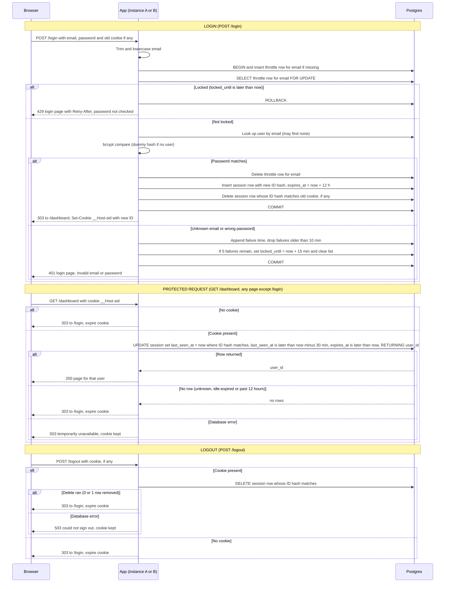

# Login with server-side sessions: design

## Decisions

1. **Storage: Postgres, not Redis.** Two new tables, `sessions` and `login_throttle`. Both app instances already share Postgres. Login must check the throttle, verify the password, create the session and clear the throttle as one unit, and a single database transaction does that. Redis could not, without a second system and a compensation path. Expected traffic is team-sized, so one primary-key lookup per request is cheap. Redis adds a service, a secret and a second failure domain for no gain at this scale. Revisit if request volume grows a lot.
2. **Session ID:** 256 bits from a cryptographic RNG, base64url encoded. The database stores only the SHA-256 hex of the ID, so a database read does not yield live cookie values.
3. **Cookie:** name `__Host-sid`. The value is the opaque ID only. Attributes: `HttpOnly; Secure; SameSite=Lax; Path=/`, no `Domain`, and no `Max-Age`. The `__Host-` prefix forces `Path=/` and no `Domain`. Without `Max-Age` the cookie is a browser-session cookie, and the server clock alone decides expiry.
4. **Expiry is checked on the database clock.** Each session row has `last_seen_at` (set to `now()` on every accepted request) and `expires_at` (login plus 12 hours, never extended). The protected-request query tests both, so the 30-minute idle clock restarts on every request. Using `now()` in Postgres avoids clock skew between the two instances.
5. **No write throttling on the touch.** Every accepted request updates `last_seen_at`. This costs one write per protected request, which is acceptable at this scale, and it keeps the idle rule exact.
6. **Abandoned sessions are swept, not trusted.** An expired row is never accepted, so the sweep only reclaims storage. A job runs every 10 minutes on either instance (the DELETE is idempotent). It removes sessions where `expires_at` is past or `last_seen_at` is more than 30 minutes old, and throttle rows that have no recent failures and no active lock.
7. **Failure counting is per normalized email, whether or not the account exists.** The key is the trimmed, lowercase email. The window is sliding: the row keeps the timestamps of recent failures. On each failure, timestamps older than 10 minutes are dropped. If 5 remain, `locked_until` is set to now plus 15 minutes and the list is cleared. A successful login deletes the row. The 5th wrong password returns 401, since it was a checked attempt. Attempts during the lock return 429 without any bcrypt call. The lock (15 minutes) is longer than the window (10 minutes), so the failures that caused it have aged out when it ends.
8. **Exact counting under concurrency.** Each login runs in one transaction that inserts the throttle row if missing and then `SELECT ... FOR UPDATE` on it, before the lock check. Concurrent guesses for the same email serialize, so the limit is exact, not approximate. The cost is that bcrypt runs while that row lock is held, which only delays other attempts on the same email.
9. **Unknown emails take the same path.** A dummy bcrypt hash, generated at startup, is compared when no user matches. Response timing and body are the same for both failure cases.
10. **Session rotation.** On success the app generates a new ID, inserts its row, deletes the row matching the incoming cookie hash (if any), clears the throttle row, and commits. Only after the commit does it send the new cookie.
11. **Redirects after POST use 303 See Other.**

## Storage failure policy

| Where | Failure | What the user sees | Reason |
|---|---|---|---|
| Login | Database unavailable | 503 page: sign-in is temporarily unavailable, try again shortly. No password check, no cookie change. | Fail closed, so the throttle cannot be bypassed while its state is unknown. |
| Protected page | Database unavailable | 503 page, same wording. Cookie kept. No page content. | Cannot confirm the session, so show nothing. The session may still be valid when storage returns. |
| Logout (cookie present) | Database error on delete | 503 page: could not sign out, try again. Cookie kept. | Not logged out until the server row is gone, so do not clear the cookie and claim success. |
| Logout (no cookie) | None possible | Redirect to `/login` with cookie expiry. | No database call is made, so this path cannot fail. |
| Sweep job | Fails | Nothing visible. Logged, retried on the next run. | Expired rows are never accepted, so correctness does not depend on the sweep. |

## Schema

```sql
CREATE TABLE sessions (
  id_hash      text PRIMARY KEY,           -- SHA-256 hex of the session ID
  user_id      bigint NOT NULL REFERENCES users(id) ON DELETE CASCADE,  -- match users.id type
  created_at   timestamptz NOT NULL DEFAULT now(),
  last_seen_at timestamptz NOT NULL,
  expires_at   timestamptz NOT NULL        -- login + 12 h, never extended
);
CREATE INDEX ON sessions (last_seen_at);
CREATE INDEX ON sessions (expires_at);

CREATE TABLE login_throttle (
  email        text PRIMARY KEY,           -- trimmed, lowercase
  failed_at    timestamptz[] NOT NULL DEFAULT '{}',  -- failures in the last 10 min
  locked_until timestamptz                 -- NULL when not locked
);
```

## Sequence diagram



## Notes on state and rules

**Session states.** A session is *live* when `last_seen_at` is later than now minus 30 minutes and `expires_at` is later than now. It becomes *dead* by the clock alone, with no write needed. A dead row is removed by logout, by login rotation (the old row) or by the sweep. A live row only moves forward by touching `last_seen_at`. `expires_at` is never extended, so a session always ends within 12 hours of login.

**Throttle states.** A row is *clear* (empty list, no lock), *counting* (1 to 4 recent failures), or *locked* (`locked_until` in the future). Counting moves to locked on the 5th failure within the window. Locked moves back to clear when `locked_until` passes, and the list is already empty by then. A successful login deletes the row, which returns it to clear.

**What each response reveals.** The 401 body and status are identical for unknown and wrong-password cases, and timing is matched by the dummy hash. A 429 shows only that an email is locked. Anyone can lock any email, known or not, so a 429 does not reveal whether an account exists. The 429 path is faster because it skips bcrypt. That difference also tells nothing about existence.

**Cookie handling.** The app never reads user data from the cookie, never logs the raw session ID and never sets a cookie on a 503.

## Open items and flagged risks

- **Login CSRF.** `SameSite=Lax` does not stop a cross-site form from posting credentials and logging the victim into the attacker's account. The brief does not cover this. Recommend a per-form token on the login form. Needs a decision.
- **Lockout as denial of service.** Five bad guesses lock a real account for 15 minutes. This follows the brief. A per-IP limit could be added later, but it is not in scope.
- **Per-request write.** Every protected request updates a row. Acceptable for a team app. Revisit if load grows.
- **Local development over HTTP.** `Secure` cookies require HTTPS, or `localhost`, which current browsers accept. Set up local HTTPS or use `localhost` in development.
- **Out of scope.** Password change and sign out everywhere are not covered. Adding them would mean deleting all `sessions` rows for a user.