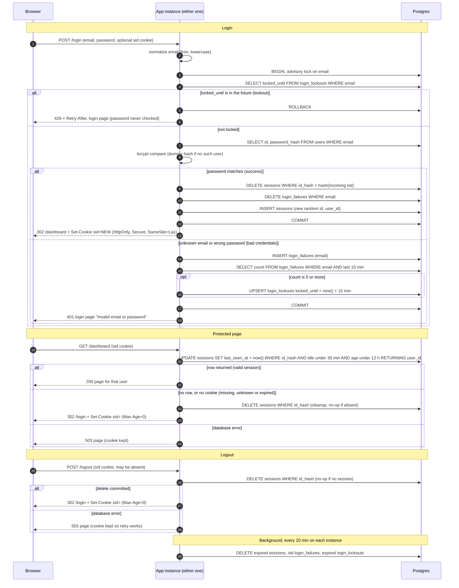

# Login with server-side sessions: design

## Decisions at a glance

| Choice | Decision |
|---|---|
| Where sessions live | Postgres, table `sessions`. No Redis. |
| Where failure counts live | Postgres, tables `login_failures` and `login_lockouts`. |
| Expiry check | One atomic `UPDATE ... RETURNING` on every protected request, using the database clock. |
| Expiry record | `created_at` and `last_seen_at` columns. No stored expiry timestamp. |
| Cleanup | Lazy delete on a failed lookup, plus a periodic sweep run by each instance. |
| Storage failure | Fail closed with an HTTP 503 page. Never fall through to "signed in". |

## Why Postgres and not Redis

- **Both instances already share Postgres.** That solves the two-instance problem with no new component to deploy, monitor, secure or back up.
- **The load is small.** This is a small team-scheduling app serving server-rendered pages. One indexed primary-key write per page view is negligible for Postgres.
- **One transaction covers login.** Deleting the old session, inserting the new one and clearing failures commit or roll back together. Across Redis and Postgres that would need compensation logic.
- **Expiry needs one clock.** Both instances use Postgres `now()`, so clock skew between app hosts cannot let a session live longer on one instance.
- **The cost is a write per protected request**, because requirement 6 says every request restarts the idle clock. I accept this. If load grows, Redis is the natural upgrade behind the same three operations: create, touch-and-get, destroy. I would revisit it only when the data shows a problem.

## Data model

```sql
CREATE TABLE sessions (
  id_hash      bytea       PRIMARY KEY,           -- sha256 of the cookie value
  user_id      bigint      NOT NULL REFERENCES users(id) ON DELETE CASCADE,
  created_at   timestamptz NOT NULL DEFAULT now(),
  last_seen_at timestamptz NOT NULL DEFAULT now()
);
CREATE INDEX sessions_last_seen_idx ON sessions (last_seen_at);
CREATE INDEX sessions_created_idx   ON sessions (created_at);

CREATE TABLE login_failures (          -- one row per failed attempt
  email        text        NOT NULL,   -- normalized lowercase, may not exist in users
  attempted_at timestamptz NOT NULL DEFAULT now()
);
CREATE INDEX login_failures_email_idx ON login_failures (email, attempted_at);

CREATE TABLE login_lockouts (
  email        text        PRIMARY KEY,
  locked_until timestamptz NOT NULL
);
```

- **Session ID.** It is 32 bytes from a CSPRNG, base64url-encoded. The cookie holds the raw value. The database stores only its SHA-256 hash, so a leaked database or backup cannot be replayed as live sessions.
- **Failure counts are keyed by the submitted email.** The email does not have to exist in `users`. Unknown emails therefore lock exactly like real ones, and the 429 response reveals nothing about accounts.

## Rules that don't fit on the arrows

**Cookie**
- Name `sid`, value is the opaque ID only.
- Flags: `HttpOnly; Secure; SameSite=Lax; Path=/`.
- It has no `Max-Age`, so it is a browser-session cookie. The server alone enforces expiry.
- Clearing sends the same name and attributes with `Max-Age=0`.

**Login (`POST /login`)**
1. Normalize the email by trimming it and lowercasing it.
2. Open a transaction and take `pg_advisory_xact_lock(hashtext(email))`. The lock stays held through the bcrypt check, so parallel guesses for one email run one at a time. Without it, a burst of concurrent requests could all pass the lockout check before any failure is recorded.
3. If `login_lockouts.locked_until > now()`, return 429 with `Retry-After`. The password is not checked, and the attempt is not recorded as a failure.
4. Look up the user. If none exists, run bcrypt against a fixed dummy hash, so unknown and wrong-password cases take about the same time.
5. A bad email and a bad password both get HTTP 401 and the same login page with "Invalid email or password".
6. On failure, insert a `login_failures` row and count the rows from the last 10 minutes. The failing attempt is the one that records the fifth failure. It still returns 401, and the next attempt gets 429. If the count is 5 or more, upsert `locked_until = now() + 15 minutes`.
7. The 15-minute lock is longer than the 10-minute window, so failures from before a lockout have aged out when it ends. The user starts fresh.
8. On success, in the same transaction:
   - delete the session the incoming cookie pointed to, if any;
   - delete this email's `login_failures` rows;
   - insert a new session with a new random ID;
   - commit, then redirect to `/dashboard` with the new cookie.
9. The old session is destroyed even when the credentials are valid but the browser sent a stale or someone else's cookie. A failed login leaves any existing session untouched.

**Protected requests (every route except `/login`)**

One statement checks the session and restarts the idle clock:

```sql
UPDATE sessions
   SET last_seen_at = now()
 WHERE id_hash = $1
   AND last_seen_at > now() - interval '30 minutes'   -- idle limit
   AND created_at   > now() - interval '12 hours'     -- absolute limit
RETURNING user_id;
```

- One row returned means the user is signed in and the request continues.
- No row means the cookie is missing, unknown or expired. The app clears the cookie and redirects to `/login`.
- Because the check and the touch are one atomic statement, an expired session can never be revived by a concurrent request.
- `created_at` is never updated, so the 12-hour cap is not extendable.
- On the no-row path, the app also runs `DELETE FROM sessions WHERE id_hash = $1`. That cleans up an expired row immediately. Nothing depends on this delete for correctness.

**Logout (`POST /logout`)**
- Run `DELETE FROM sessions WHERE id_hash = $1`. This is a no-op if the cookie is missing or unknown.
- Then clear the cookie and redirect to `/login`.
- The response is identical whether or not a session existed.
- The delete is committed before the reply is sent.

**Abandoned session cleanup**
- Each instance runs a sweep every 10 minutes. The sweep is idempotent, so two instances running it at once is harmless. No leader election is needed.
- It deletes `sessions` where `last_seen_at < now() - 30 min` or `created_at < now() - 12 h`.
- It deletes `login_failures` older than 10 minutes.
- It deletes `login_lockouts` where `locked_until < now()`.
- The sweep only keeps the tables small. Enforcement is the `WHERE` clause above, so a missed or failed sweep cannot make an expired session valid.

**When storage fails**

All of these fail closed.

| Situation | Response | Why |
|---|---|---|
| Protected request, database error | HTTP 503 page: "Something went wrong on our side. Please try again." Cookie not cleared, no redirect to `/login`. | The session may still be valid. Clearing it would sign out users during an outage. |
| `POST /login`, database error | HTTP 503 and a login page saying "Sign-in is temporarily unavailable. Please try again." No session issued. | If the lockout state can't be read, the attempt is refused rather than allowed unchecked. |
| `POST /logout`, delete fails | HTTP 503 page: "We couldn't sign you out. Please try again." Cookie kept so a retry works. | Requirement 8 says the session is destroyed before replying. The app must not claim a logout it can't confirm. |

- 503 responses carry no information about accounts.
- Database error details are logged server-side only.

**Out of scope or noted**
- CSRF protection beyond `SameSite=Lax` is not part of this change.
- Password hashing parameters are unchanged.
- An already-signed-in user opening `/login` just sees the login page. A successful login there replaces their session, as requirement 4 states.

## Sequence diagram


